# 01 — Classes et objets

> 🎯 **Objectifs**
> - Je sais expliquer ce qu'est un **type**, une **classe**, un **objet** (= instance), un **attribut**, une **méthode**.
> - Je sais écrire une classe Java complète : attributs `private`, constructeurs, méthodes `public`.
> - Je sais créer des objets avec `new` et expliquer la différence entre **référence** et objet.
> - Je sais ce qu'est un **envoi de message** et le rôle de **`this`** (le receveur).
> - Je sais faire l'**analyse objet** d'un énoncé simple (noms → classes, verbes → méthodes).
>
> ⏱️ Prérequis : aucun (premier chapitre).

---

## 🗺️ Vue d'ensemble

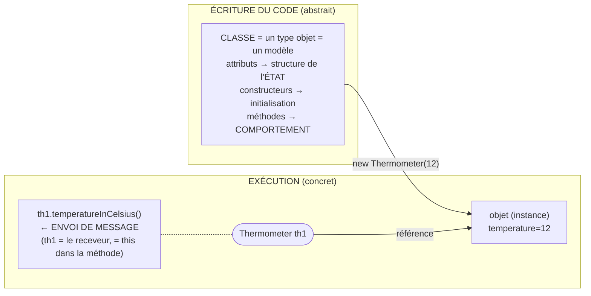

| Notion | En une phrase | Mot-clé Java |
|---|---|---|
| Classe | Définit un type : état (attributs) + comportement (méthodes) | `class` |
| Objet / instance | Une « chose » concrète créée à partir d'une classe | `new` |
| Référence | Ce qui permet d'accéder à un objet (pas l'objet lui-même) | `null` si rien |
| Envoi de message | Demander à un objet d'exécuter une de ses méthodes | `ref.methode()` |
| Auto-référence | L'objet qui reçoit le message, vu depuis la méthode | `this` |
| Encapsulation | Les données sont cachées, on passe par les méthodes | `private` / `public` |

---

## 1. Programmer… et programmer « objet »

💡 **L'idée :** programmer, ce n'est pas seulement coder ; en objet, un programme est **un ensemble d'objets qui interagissent**.

Les 3 étapes de la programmation :

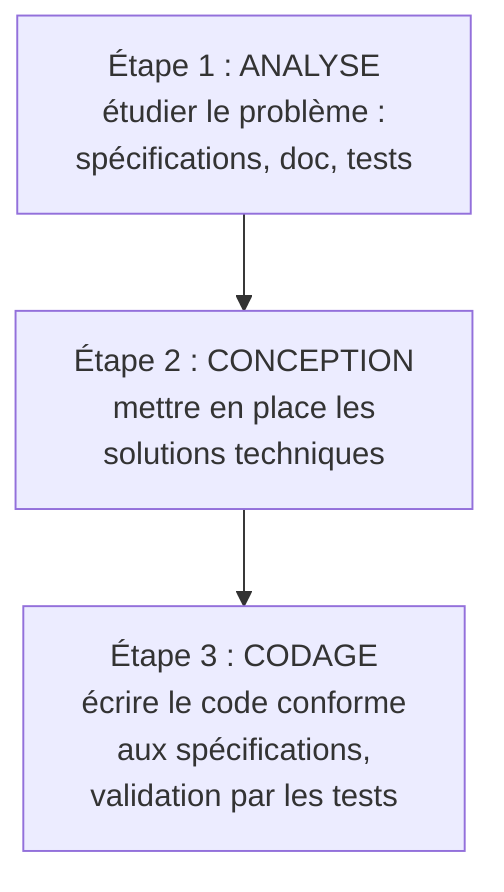

📌 À toujours garder en tête : **maintenance – évolutivité – réutilisabilité**.

Le **paradigme objet** :
- prolonge la démarche **modulaire** : on décompose un problème en parties simples ;
- en Java, le code *à l'intérieur* des méthodes reste **impératif** (if, boucles, affectations…) ;
- s'inspire du **monde réel** → modélisation « plus naturelle », plus proche du problème ;
- facilite la **réutilisation** et la conception de « grands » logiciels.

Langages objet : Java, C#, Smalltalk, Python, PHP…

---

## 2. Les types : dynamique vs statique

💡 **L'idée :** un type dit **quelles valeurs** sont possibles et **quelles opérations** sont permises. En Java, il est fixé une fois pour toutes.

Exemple : `42` et `"timoleon"` sont deux données de natures différentes. En Python, `is_even("timoleon")` n'est détecté qu'à l'exécution (plantage). 

> 📌 **Définition — type** : un type de données définit
> - l'ensemble des **valeurs possibles** pour les données du type,
> - les **opérations applicables** sur ces données.
>
> Toute donnée a un type, toute variable a un type.

| | Typage **dynamique** (Python, JavaScript) | Typage **statique** (Java, C) |
|---|---|---|
| Type de la variable | Déduit de la valeur affectée | **Déclaré** explicitement |
| Peut changer ? | Oui, en cours d'exécution | **Non**, jamais |
| Qui vérifie ? | Personne avant l'exécution | Le **compilateur** |

```java
int x = 42;
x = "timoleon";   // ❌ interdit : ne compile pas (x est un int)
```

---

## 3. Compilation et machine virtuelle

💡 **L'idée :** le compilateur Java traduit le code source en **bytecode**, exécuté par la **JVM** → le même programme tourne partout.

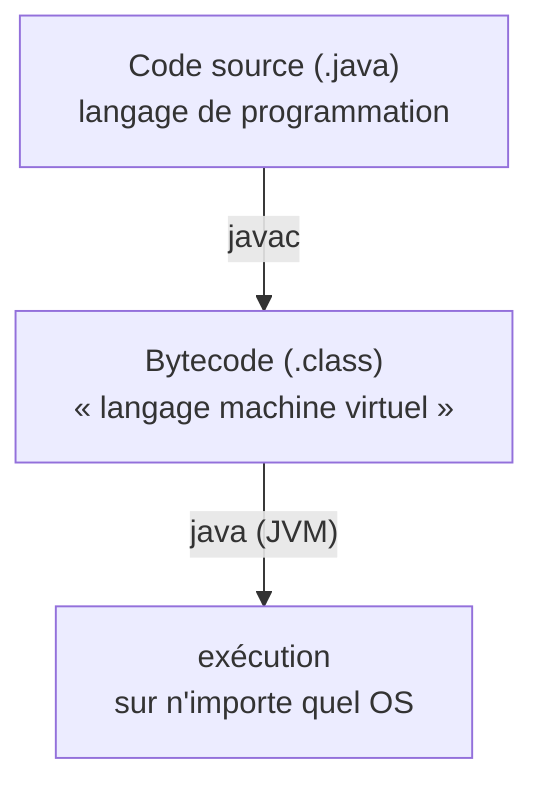

Phases de la compilation :
1. analyse **lexicale** (découpe en mots) ;
2. analyse **syntaxique** : vérifie la **syntaxe** ;
3. analyse **sémantique** : vérifie le **typage** ;
4. **optimisation** de code.

| C | Java |
|---|---|
| Code machine binaire, propre à une machine hôte | **Bytecode**, interprété par la **JVM** |
| Édition de liens : **early-binding** | Pas d'édition de liens : **late-binding** (vu plus tard) |
| Recompiler pour chaque machine | « **compile once, run everywhere** » |

---

## 4. Pourquoi définir ses propres types ?

💡 **L'idée :** les types de base (`int`, `float`…) ne suffisent pas : un âge et une température sont tous deux des `int`, mais on ne doit pas pouvoir les mélanger.

```java
int temperature = 42;   // température prévue à Oslo demain
int age = 42;           // âge du neveu de la voisine
int price = 42;         // prix d'une pizza margherita

public boolean ageSenior(int a) { return a >= 70; }

ageSenior(age);          // ✅ a du sens
ageSenior(temperature);  // 😱 compile... mais n'a aucun sens !
ageSenior(price);        // 😱 idem
```

Bilan :
- il faut **différencier** un « int âge » d'un « int température » ;
- l'application d'une opération doit être **contrôlée selon la nature** de la donnée ;
- ➡️ il faut pouvoir **définir ses propres types**.

| Type | Valeurs possibles | Opérations autorisées |
|---|---|---|
| `Thermometre` | une valeur en °C (`float`) | obtenir la valeur en °F, en °C |
| `Personne` | un âge (`int`), un nom (`String`) | savoir si majeure, obtenir l'âge |
| `Article` | un prix HT (`double`), une référence (`String`) | obtenir le prix TTC, calculer la TVA |

---

## 5. Objet, classe, attributs, méthodes

💡 **L'idée :** un **objet** regroupe des **données** (son état) et sait exécuter des **opérations** (son comportement). Sa **classe** est le modèle qui décrit les deux.

> 📌 En programmation objet, on **définit des types d'objets** (les classes), puis on **crée des objets** et on les **fait interagir**.

Un objet :
- est composé de données (qui sont elles-mêmes des objets ou des valeurs de base) → les **attributs** ;
- peut exécuter des opérations → les **méthodes** ;
- a un **type** = sa **classe**.

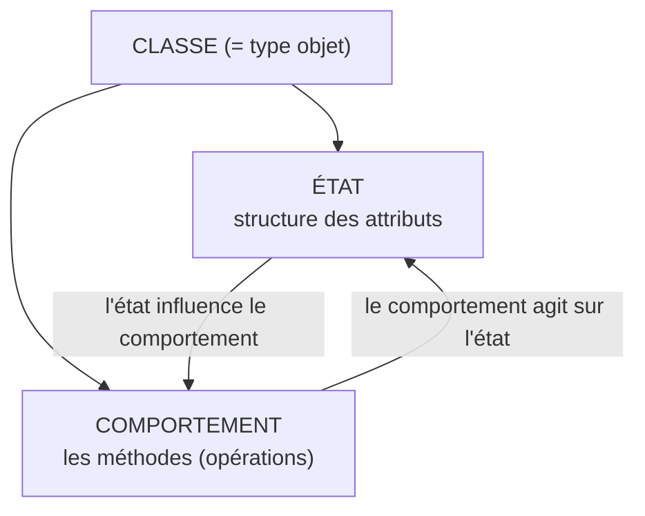

Définir une classe, c'est :
1. **définir les méthodes** que pourront exécuter ses objets.
   - Tous les objets de la classe peuvent les exécuter, et **seulement** eux.
   - Un objet ne peut exécuter **que** les méthodes de sa classe.
   - Tout traitement/calcul est défini **dans une méthode**.
2. **définir les attributs** de ses objets.
   - Tous les objets de la classe ont la **même structure** d'attributs…
   - … mais des **valeurs différentes** d'un objet à l'autre.

Exemples du cours (diagrammes de classe UML) :

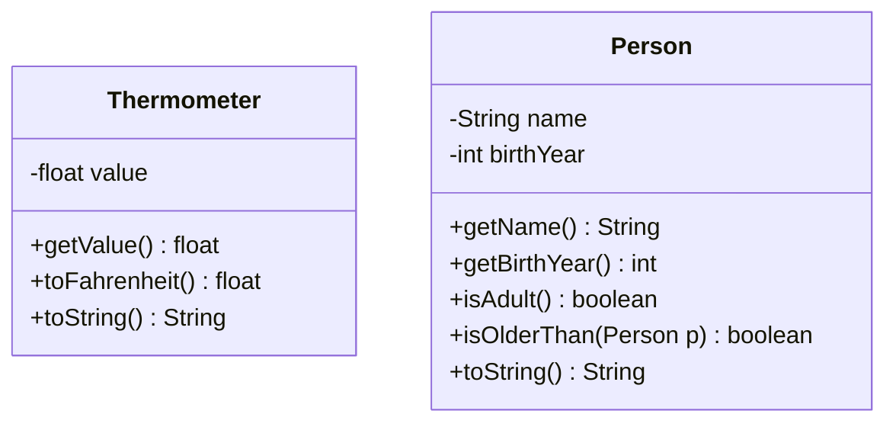

Deux objets `Thermometer` : même structure, valeurs différentes.

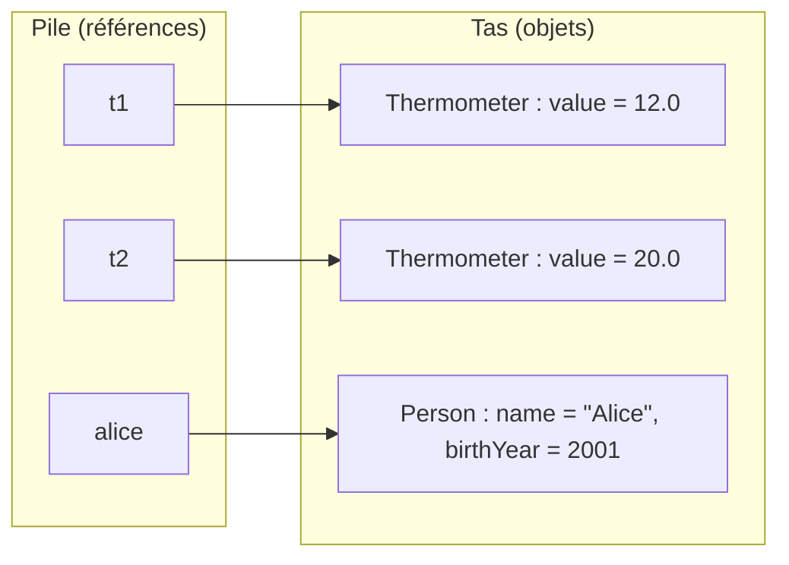

---

## 6. Classe vs instance

💡 **L'idée :** la classe est le **plan** (écrit pendant la programmation), l'instance est la **maison construite** (qui existe à l'exécution).

| | **Classe** | **Instance** (objet) |
|---|---|---|
| Nature | Définition d'un type / modèle | Objet conforme au modèle de sa classe |
| Contient | Structure de l'état (attributs + types) et méthodes | Des **valeurs** associées aux attributs |
| Messages | Définit les messages possibles = **interface publique** | N'accepte **que** les messages définis par sa classe |
| Quand ? | **Abstrait**, « pendant la programmation » | **Concret**, à l'exécution |
| Combien ? | Une seule par type | Autant qu'on veut (chaque `new` en crée une) |

---

## 7. L'envoi de message

💡 **L'idée :** on n'« appelle » pas une fonction toute seule : on **demande à un objet** d'exécuter une de ses méthodes. C'est l'**envoi de message**.

Notation pointée : `reference.message(arguments)`

```java
t1.toFahrenheit();     // ↦ 53.6
t2.toFahrenheit();     // ↦ 68.0
t1.toString();         // ↦ "temperature is 12°C"
alice.getBirthYear();  // ↦ 2001
alice.isAdult();       // ↦ true
alice.toString();      // ↦ "Alice, born in 2001"

t1.isAdult();          // ❌ impossible : pas une méthode de Thermometer
alice.toFahrenheit();  // ❌ impossible : pas une méthode de Person
```

- L'objet **contrôle** le message qu'on lui envoie : il n'accepte que ceux de **sa classe**.
- La légalité du message est vérifiée **à la compilation**, d'après le **type de la référence**.
- **Pas d'ambiguïté** entre deux méthodes de même nom dans des classes différentes : `t1.toString()` et `alice.toString()` exécutent chacune la méthode de **leur** classe.

> 📌 **Invocation de méthode** : une méthode ne peut être utilisée **qu'en étant invoquée sur un objet** de la classe qui la définit, via un envoi de message.
> L'objet invoquant s'appelle le **receveur** du message ; il fait partie du **contexte d'exécution** de la méthode.

> « `ref.method()` » se lit : « **l'objet référencé par `ref` exécute `method`** ».

---

## 8. Écrire une classe en Java

💡 **L'idée :** une classe Java = un fichier `NomDeLaClasse.java` qui contient les attributs (`private`), les constructeurs et les méthodes (`public`).

Squelette (exemple du cours, version « à compléter ») :

```java
public class Thermometer {                // fichier Thermometer.java
    private float temperature;            // ATTRIBUT (l'état)

    /** build a thermometer with given initial measured temperature
     * @param initialTemp initial measured temperature of thermometer
     */
    public Thermometer(float initialTemp) {   // CONSTRUCTEUR
        ???
    }

    /** @return the current temperature measured by this thermometer */
    public float temperatureInCelsius() {     // MÉTHODE
        ???
    }
}
```

Anatomie d'une méthode :

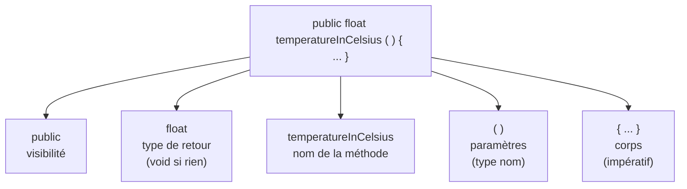

### 8.1 Encapsulation : `private` / `public`

| Mot-clé | Accessible depuis | Usage habituel |
|---|---|---|
| `private` | **uniquement** l'intérieur de la classe | les **attributs** (l'état est caché) |
| `public` | partout | les **méthodes** et **constructeurs** = l'interface publique |

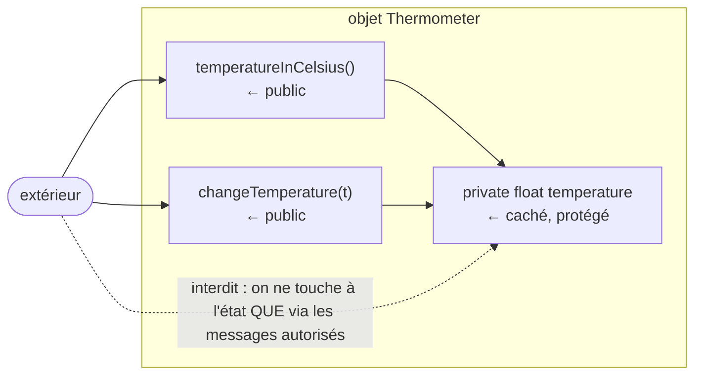

⚠️ Dans UML : `-` = `private`, `+` = `public`.

### 8.2 Commentaires de documentation (javadoc)

- `/** ... */` juste avant un constructeur ou une méthode = commentaire **javadoc**.
- `@param nom description` : décrit un paramètre ; `@return description` : décrit la valeur renvoyée.
- L'outil `javadoc` en génère une documentation HTML (cf. [§ 14](#14-compiler-exécuter-documenter-complément)).

---

## 9. Les constructeurs et `new`

💡 **L'idée :** pour créer un objet, on appelle un **constructeur** avec `new`. Chaque `new` crée un **nouvel** objet.

```java
new Thermometer()            // température initiale 0
new Thermometer(20)          // température initiale 20
new Person("Alice", 2001)
```

Un constructeur a **deux rôles** :
1. **créer les attributs** de l'objet (la structure de l'état) ⇒ **réserver l'espace mémoire** ;
2. **donner les valeurs initiales** des attributs (« initialiser l'objet »).

Règles Java :
- même **nom** que la classe, **pas de type de retour** (même pas `void`) ;
- une classe peut avoir **plusieurs constructeurs** (plusieurs façons d'initialiser), différenciés par leurs paramètres ;
- si la classe ne déclare **aucun** constructeur → il existe un **constructeur par défaut** (sans paramètre) ;
- ⚠️ ce constructeur par défaut **disparaît** dès qu'on déclare un autre constructeur.

```java
public class Thermometer {
    private float temperature;

    public Thermometer(float initialTemp) {
        this.temperature = initialTemp;
    }

    public Thermometer() {
        this.temperature = 0;
        // ou : this(0);  → appelle l'autre constructeur (doit être la 1re instruction)
    }
}
```

> 📌 Il est courant que les paramètres du constructeur aient **le même nom** que l'attribut qu'ils initialisent : `this.id = id;` (`this.id` = l'attribut, `id` = le paramètre).

---

## 10. Références et mémoire

💡 **L'idée :** une variable de type objet ne **contient pas** l'objet, elle contient une **référence** vers lui — comme une **télécommande** pour un téléviseur.

- L'appel à un constructeur a pour résultat une **référence** vers l'objet créé.
- Une référence = un pointeur vers l'**identité** de l'objet ; on la stocke dans une variable de type objet.
- ⚠️ La référence permet d'**accéder** à l'objet, mais **n'est pas l'objet lui-même**.

### 10.1 Déclaration et affectation

```java
Type variableId;              // déclaration : variableId peut référencer des objets de type Type
variableId = expression;      // affectation : la valeur de expression doit être du type de variableId
```

- Les variables sont **typées**, leur type est fixé **à la déclaration**.
- Une variable objet **non initialisée** vaut **`null`** (elle ne référence rien).
- On peut déclarer et initialiser en même temps.

### 10.2 Suivre les références pas à pas (exemple du cours)

```java
Thermometer th1;                        // (a) th1 vaut null
th1 = new Thermometer(20);              // (b) th1 référence l'objet créé
Thermometer th2 = new Thermometer(25);  // (c) déclaration + initialisation
th1 = new Thermometer(18);              // (d) th1 référence un autre objet
Thermometer th3 = th1;                  // (e) th3 référence LE MÊME objet que th1
th1 = new Thermometer();                // (f) th1 référence un nouvel objet
```

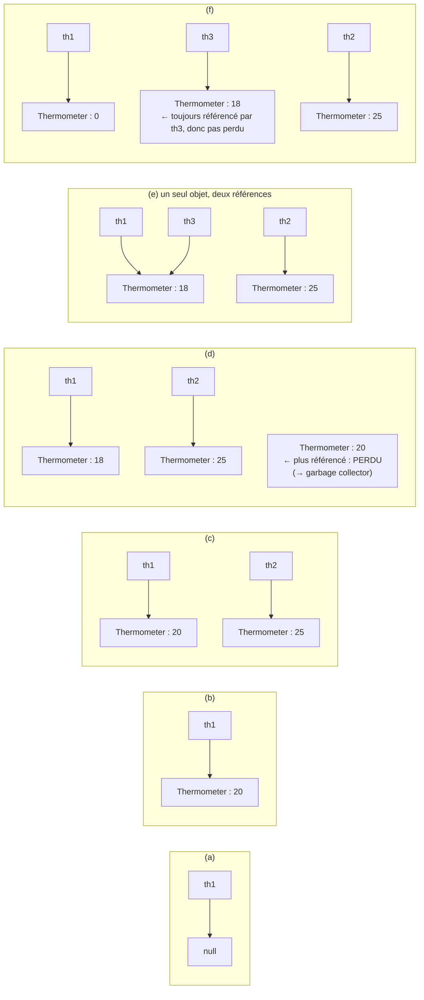

📌 À retenir :
- **chaque appel à `new` crée un nouvel objet** ;
- `th3 = th1` **copie la référence**, pas l'objet (pas de nouvel objet !) ;
- un objet qui n'est plus référencé est **perdu** : on ne peut plus lui parler ; le **garbage collector** libère sa mémoire.

⚠️ Conséquence (complément) : si `th3` et `th1` référencent le même objet, un message qui modifie l'objet via `th3` est « vu » via `th1`.

```java
Thermometer a = new Thermometer(10);
Thermometer b = a;
b.changeTemperature(30);
a.temperatureInCelsius();   // ↦ 30 : a et b désignent le même objet
```

---

## 11. `this` : l'auto-référence

💡 **L'idée :** dans le code d'une méthode, **`this`** désigne **l'objet qui a reçu le message** (le receveur).

Le problème posé dans le cours :

```java
Thermometer th1 = new Thermometer(12);
Thermometer th2 = new Thermometer(23);
th1.temperatureInCelsius();   // doit donner la température de th1 → 12
th2.temperatureInCelsius();   // doit donner la température de th2 → 23
```

Le code de `temperatureInCelsius()` est **écrit une seule fois** dans la classe.
Il doit renvoyer « la température du thermomètre… **lequel ?** » → **celui qui reçoit le message**.

> 📌 **`this`** = référence vers l'objet qui invoque la méthode = **l'objet receveur du message**.
> `this` est **toujours défini** dans le contexte d'exécution d'une méthode (et d'un constructeur).

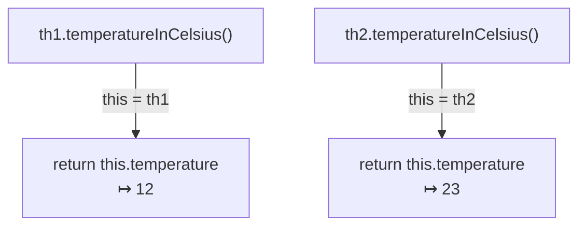

La classe `Thermometer` complète :

```java
public class Thermometer {
    private float temperature;

    /** build a thermometer with given initial measured temperature
     * @param initialTemp initial measured temperature of thermometer
     */
    public Thermometer(float initialTemp) {
        this.temperature = initialTemp;
    }

    /** build a thermometer with initial measured temperature of 0 */
    public Thermometer() {
        this.temperature = 0;
    }

    /** @return the current temperature measured by this thermometer */
    public float temperatureInCelsius() {
        return this.temperature;
    }

    /** change the measured temperature
     * @param t the new temperature (in celsius)
     */
    public void changeTemperature(float t) {
        this.temperature = t;
    }

    /** @return the measured temperature in fahrenheit */
    public float temperatureInFahrenheit() {
        return 9.0f / 5 * this.temperature + 32;   // ⚠️ pas 9/5 (voir pièges)
    }

    /** @return a textual description of this thermometer */
    public String toString() {
        return "temperature is " + this.temperature + "°C";
    }
}
```

Utilisation :

```java
Thermometer th1 = new Thermometer(25);
th1.temperatureInCelsius();     // 25
th1.changeTemperature(20);
th1.temperatureInCelsius();     // 20
th1.temperatureInFahrenheit();  // 68
```

📌 `toString()` renvoie une **description textuelle** de l'objet ; elle est utilisée automatiquement par `System.out.println(th1)`.

---

## 12. Des objets qui collaborent : le thermostat

💡 **L'idée :** un attribut peut être **un autre objet** ; on lui délègue le travail **par envoi de message**. Les messages s'enchaînent en **cascade** → c'est la dynamique du programme.

### 12.1 Les classes

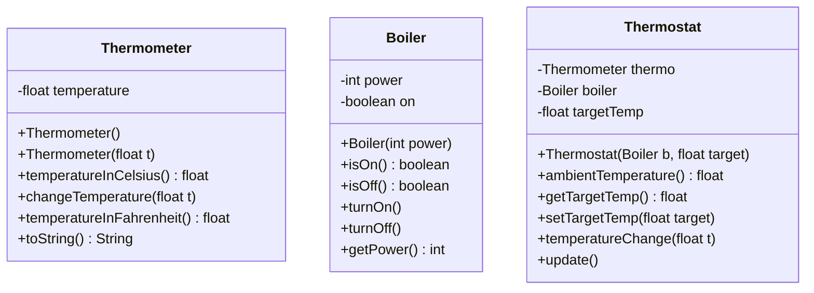

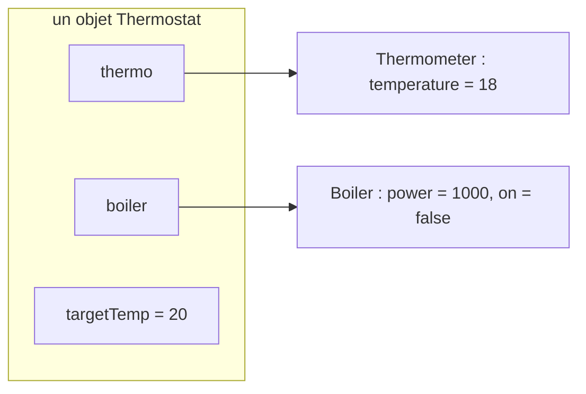

### 12.2 Le constructeur

```java
public class Thermostat {
    private Boiler boiler;        /* the boiler controlled by this thermostat */
    private Thermometer thermo;   /* the inner thermometer: measures ambient temperature */
    private float targetTemp;     /* the target temperature */

    /** build a thermostat that controls the given boiler, and is set to given target
     * @param boiler the controlled boiler
     * @param target the initial target temperature for boiler triggering
     */
    public Thermostat(Boiler boiler, float target) {
        this.boiler = boiler;              // initialiser les attributs
        this.targetTemp = target;
        this.thermo = new Thermometer();   // créer le thermomètre interne
        this.update();                     // mettre à jour l'état de la chaudière
    }
```

### 12.3 Déléguer par envoi de message

```java
    /** return the ambient temperature in °C (measured by the inner thermometer) */
    public float ambientTemperature() {
        return this.thermo.temperatureInCelsius();
    }
```

- On veut « la température mesurée par le thermomètre interne ».
- C'est l'objet référencé par l'attribut `thermo` qui a la **responsabilité** de mesurer.
- Sa classe fournit `temperatureInCelsius()` → on **lui envoie ce message**.

```java
    /** set the target (=triggering) temperature (in celsius) */
    public void setTargetTemp(float target) {
        this.targetTemp = target;   // mettre à jour la cible
        this.update();              // gérer les conséquences : responsabilité de update()
    }
```

### 12.4 `update()` : la cascade de messages

Algorithme :
- **si** la cible < température mesurée **et** la chaudière est allumée → **éteindre** la chaudière ;
- **sinon si** la cible ≥ température mesurée **et** la chaudière est éteinte → **allumer** la chaudière.

```java
    public void update() {
        if (this.targetTemp < this.ambientTemperature() && this.boiler.isOn()) {
            this.boiler.turnOff();
        } else if (this.targetTemp >= this.ambientTemperature() && this.boiler.isOff()) {
            this.boiler.turnOn();
        }
    }
}
```

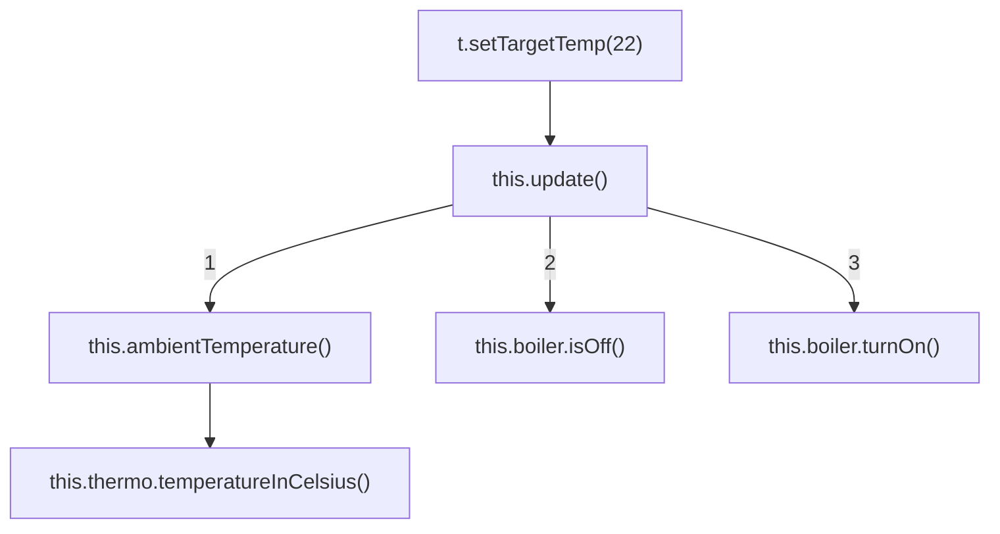

### 12.5 Utilisation

```java
Boiler b = new Boiler(1000);              // la chaudière pilotée par le thermostat
Thermostat t = new Thermostat(b, 20);     // il faut un Boiler et un float
// ou, en une ligne :
Thermostat t2 = new Thermostat(new Boiler(1000), 20);
```

---

## 13. Analyse objet d'un problème

💡 **L'idée :** dans un énoncé, les **noms communs** donnent les **classes**, les **verbes** donnent les **méthodes**.

Les questions à se poser :
1. Quels **objets** sont nécessaires ? ⇒ décomposition du problème en objets.
2. À quels **modèles** correspondent-ils ? ⇒ quelles **classes** ?
3. Quelles **fonctionnalités** veut-on ? ⇒ quel **comportement**, c.-à-d. quels **messages** envoyer ?
4. Quelle **structure de l'état** ? ⇒ les attributs **nécessaires** pour réaliser ces comportements.

📌 On commence par le **comportement** (méthodes), **puis** on en déduit l'**état** (attributs).

### 13.1 L'énoncé (exemple du cours)

> Un **catalogue** regroupe des **articles**, il permet de *trouver un article* à partir de son identifiant.
> Un article est caractérisé par un **prix** et un **identifiant** que l'on peut *obtenir*. On veut pouvoir *savoir si un article est plus cher* qu'un autre.
> Une **commande** est *créée* pour un **client** et un catalogue donnés. On peut *ajouter des articles* à une commande. On doit pouvoir *accéder à la liste des articles*, au *prix total* et au *coût des frais de port*.
> Un client peut *créer une commande* pour un catalogue. Il peut *commander* un article à partir de son identifiant.

| Noms communs → classes | Verbes → méthodes |
|---|---|
| Catalogue | trouver un article → `getItem(String)` |
| Article → `Item` | obtenir prix / id, plus cher que → `getPrice()`, `getId()`, `moreExpensiveThan(...)` |
| Commande → `Order` | créer, ajouter, liste, prix total, frais de port |
| Client | créer une commande, commander un article |

### 13.2 Le résultat (UML, méthodes seulement)

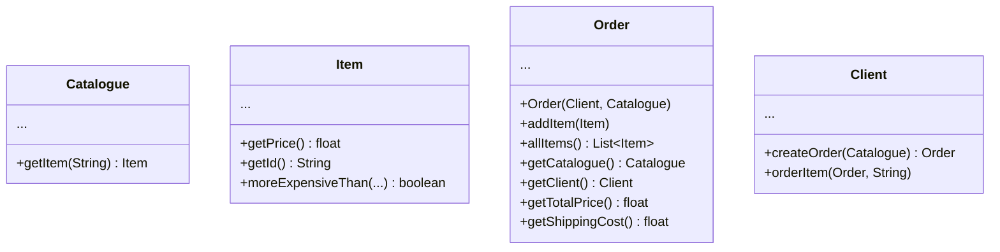

### 13.3 Un scénario d'utilisation

*Créer une commande pour un client, lui faire commander 2 articles, obtenir le prix total.*

```java
// on suppose client et cata déjà créés et initialisés
Order order = client.createOrder(cata);
client.orderItem(order, "A0527");
client.orderItem(order, "B3879");
float price = order.getTotalPrice();
```

### 13.4 Coder les méthodes (tout est envoi de messages)

```java
// dans la classe Client
public void orderItem(Order order, String id) {
    Catalogue cata = order.getCatalogue();   // récupérer le catalogue de la commande
    Item item = cata.getItem(id);            // trouver l'article dans le catalogue
    order.addItem(item);                     // l'ajouter à la commande
}

// dans la classe Client
public Order createOrder(Catalogue cata) {
    Order theOrder = new Order(this, cata);  // this = le client qui crée la commande
    return theOrder;
}
```

⚠️ `moreExpensiveThan` : **un seul** paramètre, car le **receveur** fait déjà partie du contexte (`this`).

```java
// dans la classe Item
public boolean moreExpensiveThan(Item otherItem) {
    return this.getPrice() > otherItem.getPrice();
}
// ou, puisqu'on est dans la classe Item (private = privé à la CLASSE) :
public boolean moreExpensiveThan(Item otherItem) {
    return this.price > otherItem.price;
}
```

### 13.5 La classe `Item` complète

On déduit l'**état** des comportements : un prix et un identifiant.

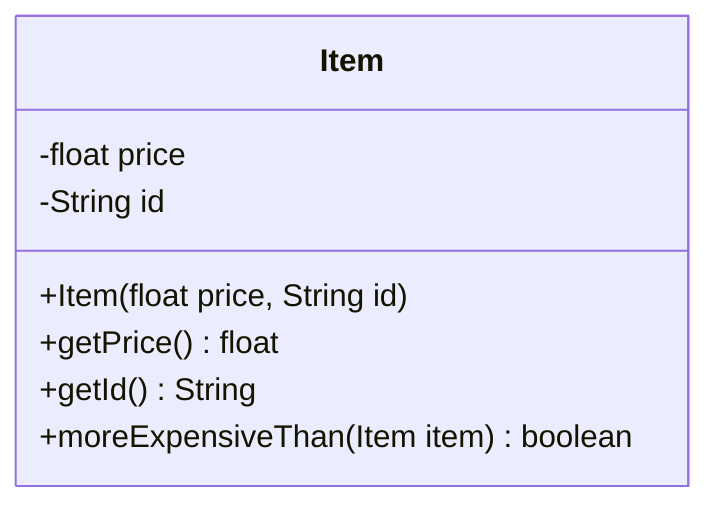

```java
public class Item {
    private float price;
    private String id;

    public Item(float p, String id) {
        this.price = p;
        this.id = id;
    }

    public float getPrice() {         // accesseur (« getter ») : lecture d'un attribut
        return this.price;
    }

    public String getId() {
        return this.id;
    }

    public boolean moreExpensiveThan(Item otherItem) {
        return this.price > otherItem.price;
    }
}
```

📌 Les méthodes `getXxx()` qui renvoient la valeur d'un attribut sont des **accesseurs** ; `setXxx(...)` (ex. `setTargetTemp`) qui le modifient sont des **modificateurs**. Ils permettent d'accéder à l'état **sans** rendre les attributs `public`.

---

## 14. Compiler, exécuter, documenter (complément)

💡 **L'idée :** `javac` compile, `java` exécute (à partir d'une méthode `main`), `javadoc` génère la documentation.

```java
public class ThermometerMain {
    public static void main(String[] args) {   // point d'entrée du programme
        Thermometer th = new Thermometer(12);
        System.out.println(th);                // utilise toString()
        System.out.println(th.temperatureInFahrenheit());
    }
}
```

| Commande | Rôle | Produit |
|---|---|---|
| `javac Thermometer.java ThermometerMain.java` | compile | `Thermometer.class`, `ThermometerMain.class` (bytecode) |
| `java ThermometerMain` | exécute `main` dans la JVM (⚠️ sans `.class`) | l'affichage |
| `javadoc -d docs Thermometer.java` | génère la doc à partir des `/** ... */` | pages HTML dans `docs/` |

📌 Le mot-clé `static` de `main` est expliqué au chapitre suivant. Les options (`-d`, classpath, `jar`…) sont détaillées dans le [mémento des commandes](../05-Fiches/memento-commandes.md).

---

## ⚠️ Pièges fréquents

| Erreur | Pourquoi c'est faux | Correction |
|---|---|---|
| `Thermometer t; t.temperatureInCelsius();` | `t` vaut `null` : aucun objet → `NullPointerException` | créer l'objet : `t = new Thermometer(20);` |
| Croire que `th3 = th1;` copie l'objet | On copie la **référence** : un seul objet, deux accès | `new` pour avoir un 2ᵉ objet |
| `return temperature;` vs `this.temperature` | Ça marche, mais le cours impose `this.` pour bien voir **à qui** appartient l'attribut | toujours écrire `this.attribut` |
| `temperature = temperature;` dans le constructeur | Le paramètre **masque** l'attribut : on affecte le paramètre à lui-même | `this.temperature = temperature;` |
| `new Thermometer()` après avoir écrit `Thermometer(float)` seulement | Le constructeur par défaut **n'existe plus** | écrire explicitement `public Thermometer()` |
| `public void Thermometer(float t) {...}` | Avec un type de retour, ce n'est **plus un constructeur** mais une méthode | pas de type de retour, même pas `void` |
| Attributs `public` | Casse l'**encapsulation** : n'importe qui modifie l'état | attributs `private` + méthodes `public` |
| `9/5 * t + 32` | `9/5` est une division **entière** = `1` → résultat faux | `9.0f / 5 * t + 32` |
| `moreExpensiveThan(Item a, Item b)` | Le receveur (`this`) est déjà un des deux articles | `moreExpensiveThan(Item other)` |
| `t1.isAdult()` sur un `Thermometer` | Message non défini par la classe → **erreur de compilation** | n'envoyer que les messages de la classe |

---

## ✅ À retenir

- Un **type** = des valeurs possibles + des opérations autorisées. Java est à **typage statique**, vérifié par le **compilateur**.
- `javac` produit du **bytecode** exécuté par la **JVM** : « compile once, run everywhere ».
- Une **classe** définit un type objet : **état** (attributs, `private`) + **comportement** (méthodes, `public`).
- Un **objet** (instance) est créé par **`new` + constructeur** ; chaque `new` crée un **nouvel** objet.
- Un **constructeur** réserve la mémoire et **initialise** les attributs ; constructeur par défaut seulement si aucun autre.
- Une variable objet contient une **référence** (télécommande), pas l'objet ; non initialisée elle vaut **`null`**.
- Objet non référencé = **perdu** → garbage collector.
- On agit sur un objet par **envoi de message** : `ref.methode(...)` ; le message doit être permis par le **type de la référence**.
- **`this`** = le **receveur** du message, toujours défini dans une méthode.
- Analyse : **noms → classes**, **verbes → méthodes**, puis l'**état** nécessaire au comportement.

---

## 🧠 Auto-évaluation

**Q1.** Quelle est la différence entre une classe et une instance ?

<details><summary>Réponse</summary>

La **classe** est le modèle (abstrait, écrit pendant la programmation) : elle définit la structure de l'état (attributs) et les méthodes. L'**instance** est un objet concret, créé à l'exécution par `new`, qui associe des **valeurs** aux attributs et n'accepte que les messages de sa classe.

</details>

**Q2.** Combien d'objets `Thermometer` sont créés ? Combien sont perdus à la fin ?

```java
Thermometer a = new Thermometer(10);
Thermometer b = a;
a = new Thermometer(15);
b = new Thermometer(20);
Thermometer c = b;
```

<details><summary>Réponse</summary>

**3 objets** créés (3 `new`). L'objet `10` n'est plus référencé (ni `a` ni `b`) → **1 objet perdu**.

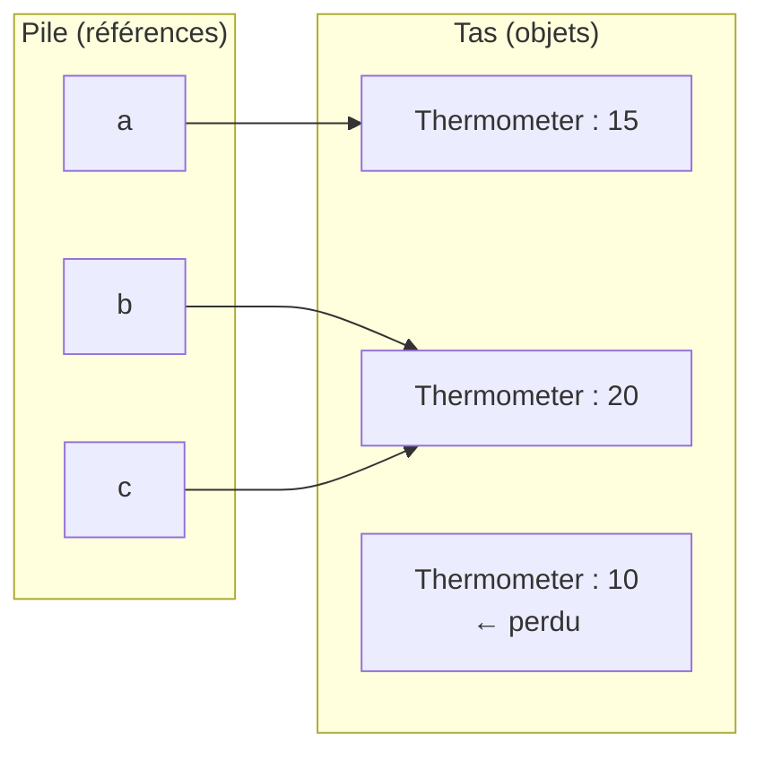

</details>

**Q3.** Que s'affiche-t-il ?

```java
Thermometer t1 = new Thermometer(12);
Thermometer t2 = t1;
t2.changeTemperature(30);
System.out.println(t1.temperatureInCelsius());
```

<details><summary>Réponse</summary>

`30.0` : `t1` et `t2` référencent **le même objet** ; le modifier via `t2` le modifie « pour » `t1`.

</details>

**Q4.** Trouve l'erreur :

```java
public class Item {
    private float price;
    private String id;
    public Item(float price, String id) {
        price = price;
        id = id;
    }
}
```

<details><summary>Réponse</summary>

Les paramètres portent le même nom que les attributs et les **masquent** : `price = price` affecte le paramètre à lui-même, l'attribut reste à `0`. Correction : `this.price = price; this.id = id;`.

</details>

**Q5.** Ce code compile-t-il ? Pourquoi ?

```java
public class Boiler {
    private int power;
    public Boiler(int power) { this.power = power; }
}
// ailleurs :
Boiler b = new Boiler();
```

<details><summary>Réponse</summary>

**Non.** La classe déclare un constructeur `Boiler(int)`, donc le **constructeur par défaut** (sans paramètre) **n'existe pas**.

</details>

**Q6.** Dans `th2.temperatureInCelsius()`, que vaut `this` pendant l'exécution de la méthode ? Et dans `createOrder`, pourquoi passe-t-on `this` à `new Order(this, cata)` ?

<details><summary>Réponse</summary>

- `this` vaut la référence de **`th2`**, le **receveur** du message.
- Dans `createOrder` (classe `Client`), `this` est **le client qui reçoit le message** ; une commande est créée *pour un client*, donc on lui passe ce client.

</details>

**Q7.** Analyse : « Une *lampe* a une *puissance* ; on peut l'*allumer*, l'*éteindre* et *savoir si elle est allumée*. » Propose la classe en UML.

<details><summary>Réponse</summary>

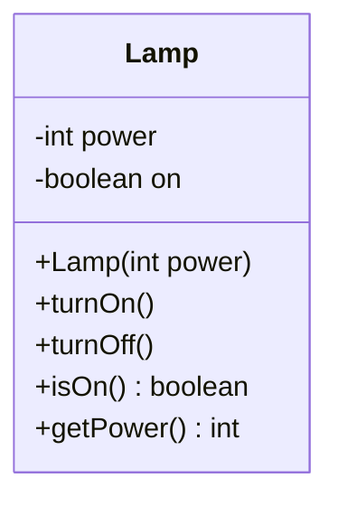

Nom → classe `Lamp` ; verbes → méthodes ; l'état (`on`) est déduit du comportement « savoir si elle est allumée ».

</details>

**Q8.** QCM — Quand la validité de `alice.toFahrenheit()` est-elle vérifiée ?
a) à l'exécution  b) à la compilation  c) jamais

<details><summary>Réponse</summary>

**b)** à la compilation : le compilateur vérifie que le message est défini par le **type de la référence** (`Person`). Ici il ne l'est pas → erreur de compilation.

</details>

---

## 🔗 Pour pratiquer

- 💻 [TP1 — TV library](../03-TP/TP1-tv-library/ENONCE.md) : utiliser des objets, références, envois de messages.
- 💻 [TP2 — Light](../03-TP/TP2-light/ENONCE.md) : écrire ses propres classes (attributs, constructeurs, méthodes).
- ✏️ [TD2 — Intervalles](../02-TD/TD2-intervalles/enonce.md) : analyse, `this`, méthodes prenant un objet en paramètre.
- 📌 [Mémento des commandes](../05-Fiches/memento-commandes.md) : `javac`, `java`, `javadoc`.

---

⬅️ Précédent | [🏠 Sommaire](./README.md) | [Suivant ➡️](./02-static-et-enum.md)
