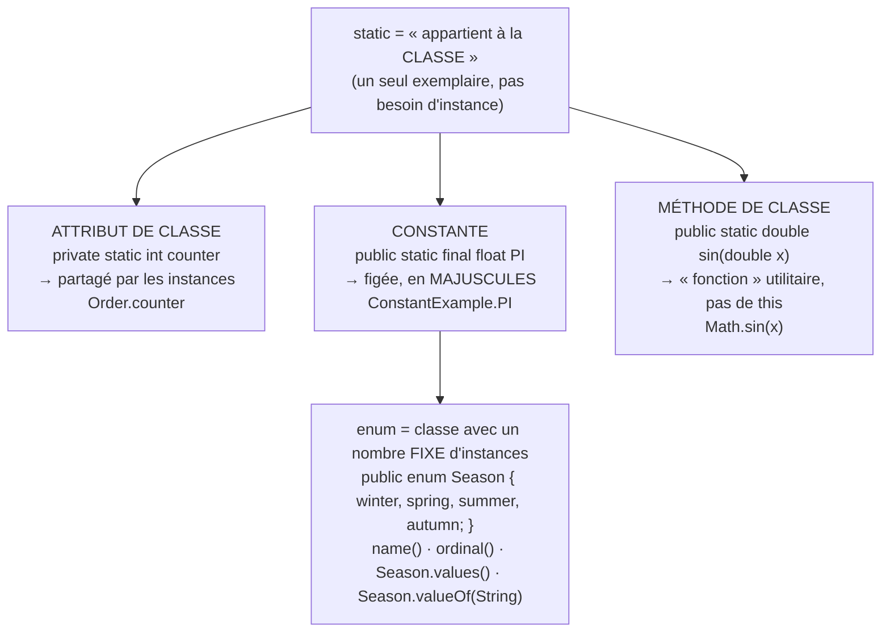
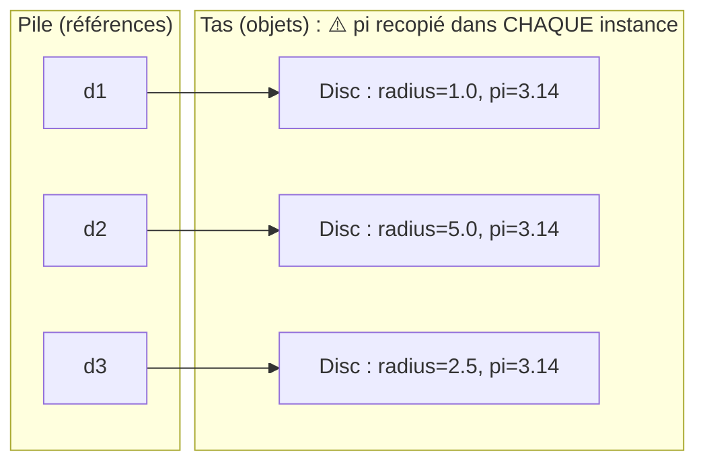
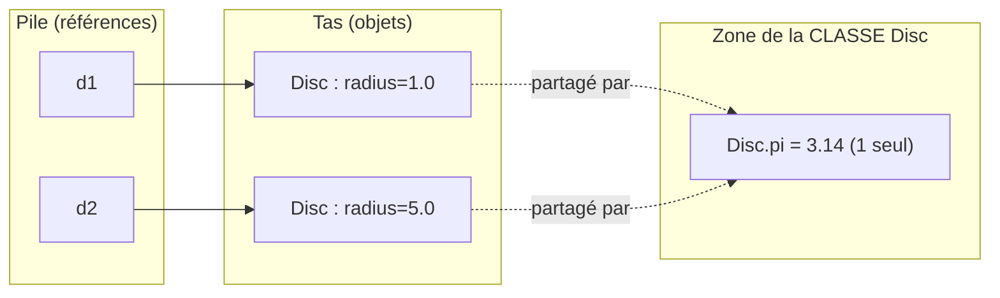
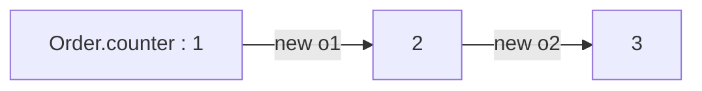
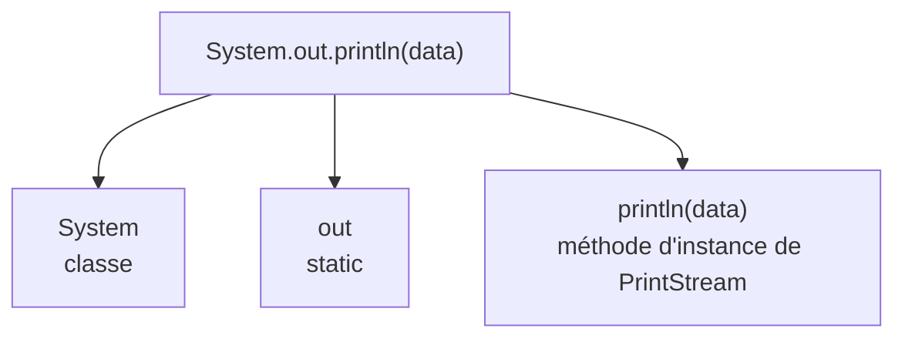
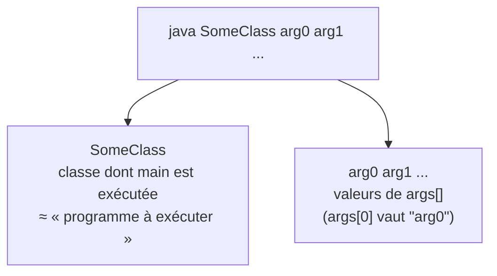
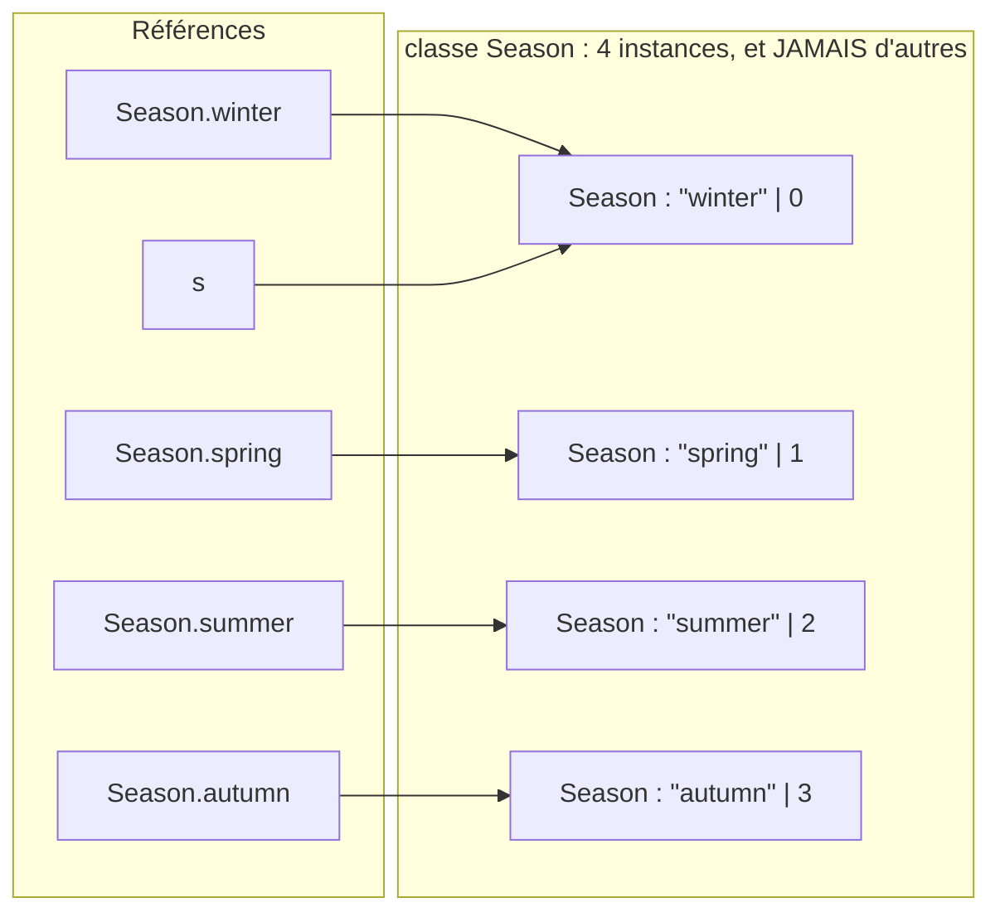
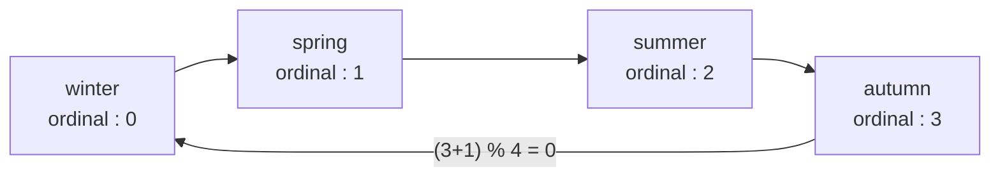

# 02 — static et types énumérés (enum)

> 🎯 **Objectifs**
> - Je sais distinguer une caractéristique **d'instance** d'une caractéristique **de classe** (`static`).
> - Je sais déclarer une **constante** (`static final`) et un **compteur partagé**.
> - Je sais quand une **méthode statique** est justifiée et pourquoi `this` y est interdit.
> - Je sais définir un **type énuméré** (`enum`) et utiliser `name()`, `ordinal()`, `values()`, `valueOf()`.
> - Je sais enrichir un `enum` avec attributs, constructeur privé et méthodes.
>
> ⏱️ Prérequis : [01 — Classes et objets](./01-classes-et-objets.md)

## 🗺️ Vue d'ensemble



## 1. Le problème : nommer les constantes

💡 **L'idée :** un nombre « magique » comme `3.14` doit porter un **nom** ; reste à savoir **où** le ranger.

```java
public class Disc {
    private double radius;
    public Disc(double radius) { this.radius = radius; }
    public double perimeter() { return 2 * 3.14 * this.radius; }             // 2πr
    public double area()      { return 3.14 * this.radius * this.radius; }   // πr²
}
```

📌 **Bonne pratique : il faut nommer les constantes !** `3.14 ↦ pi`. Mais quel **statut** pour `pi` ?

Première idée : un **attribut d'instance** `private double pi;` initialisé à `3.14` dans le constructeur.



⚠️ Un attribut `this.pi` pour chaque instance de `Disc`… pas raisonnable : π ne dépend pas du disque !

## 2. Attributs de classe (`static`)

💡 **L'idée :** un attribut `static` existe en **un seul exemplaire**, rattaché à la **classe** et non aux objets.

- La définition d'une classe est **unique** ⇒ ses attributs de classe aussi.
- Créés quand la classe est **chargée en mémoire par la JVM**, quel que soit le nombre d'instances (**y compris 0**).
- Pas besoin d'instance pour utiliser une caractéristique statique.
- Déclaration avec **`static`** ; accès via le **nom de la classe** (notation « . »).

```java
public class Disc {
    private double radius;
    private static double pi = 3.14;     // attribut de classe

    public Disc(double radius) { this.radius = radius; }
    public double perimeter() { return 2 * Disc.pi * this.radius; }   // Disc.pi, pas this.pi
    public double area()      { return Disc.pi * this.radius * this.radius; }
}
```



**Les modificateurs d'accès sont respectés :**

```java
public class StaticExample {
    private static int compteur;          // visible seulement dans StaticExample
    public static double pi = 3.14159;    // visible partout
}
```

- `StaticExample.compteur` : attribut de classe **privé, partagé par les instances**.
- `StaticExample.pi` : visible **partout**.

## 3. Constantes : `static final`

💡 **L'idée :** `static` (un seul exemplaire) + `final` (non modifiable) = **constante**.

```java
public class ConstantExample {
    public static final float PI = 3.141592f;
    public static final String BEST_BOOK = "Le Seigneur des...";
}
```

- `final` : une fois initialisée, la valeur **ne peut plus être modifiée**.
- Exemples de l'API : `Boolean.TRUE`, `Double.MAX_VALUE`.
- 📌 **Convention** : identifiants en **MAJUSCULES**, mots séparés par `_`.
- `final` sans `static` et `static` sans `final` sont possibles (indépendants).
- ⚠️ `static` est à utiliser **avec parcimonie et pertinence**.

| Déclaration | Un exemplaire… | Modifiable ? |
|---|---|---|
| `private int x;` | par instance | oui |
| `private final int x;` | par instance | non (fixé à la construction) |
| `private static int x;` | pour la classe | oui |
| `public static final int X = 1;` | pour la classe | non → **constante** |

## 4. Un compteur partagé : l'exemple `Order`

💡 **L'idée :** un attribut `private static` = valeur **partagée** par les instances, ici pour les numéroter.

```java
public class Order {
    // attributs de classes : static
    private static final String ORDER_ID_PREFIX = "order#";
    private static int counter = 1;      // pour compter les instances créées
    // attributs d'instance
    private Client client;
    private Catalogue catalogue;
    private String id;

    public Order(Client client, Catalogue cata) {
        this.client = client;
        this.catalogue = cata;
        this.id = Order.ORDER_ID_PREFIX + Order.counter++;   // utilise PUIS incrémente
    }
    public String getId() { return this.id; }
}
```

```java
Order o1 = new Order(c, k);   // c, k supposés définis et initialisés
Order o2 = new Order(c, k);
System.out.println("o1 -> " + o1.getId());   // o1 -> order#1
System.out.println("o2 -> " + o2.getId());   // o2 -> order#2
```



📌 **Exemple connu : `System.out`.** La doc de `java.lang.System` indique :
`public static final PrintStream out` → c'est une **constante de classe** ; `println` est une méthode **d'instance** de cet objet `PrintStream`.



## 5. Méthodes de classe (`static`)

💡 **L'idée :** une méthode dont le traitement **ne dépend pas de l'état d'un objet** n'a pas besoin d'objet.

**Le problème : calculer un sinus.** Signature : `public double sin(double x)`, définie dans une classe `Trigonometry`. Invocation ⇒ **il faut un objet**…

```java
Trigonometry trigo1 = new Trigonometry();
trigo1.sin(45);
Trigonometry trigo2 = new Trigonometry();
trigo2.sin(60);
new Trigonometry().sin(60);       // objet « jetable »
```

📌 Intérêt des objets `trigo1`, `trigo2` ? **Aucun** : ils n'ont pas d'état.

**La solution : `static`** — invocation sans instance, par le nom de la classe.

```java
public class StaticExample {
    public static void staticMethod() {
        System.out.println("ceci est une méthode statique");
    }
}
StaticExample.staticMethod();             // pas besoin d'instance

public class Math {                       // classe de l'API Java
    public static double sin(double x) { ... }
    public static double sqrt(double x) { ... }
    public static int max(int a, int b) { ... }
}
```

- Intérêt : **éviter la création d'objets « jetables »** ; on retrouve la notion de **fonction** de Python.
- Usage **limité et justifié** : a priori rare car « pas objet »… mais pratique.
- Réservé aux méthodes **« utilitaires »** = fonctions.
- ⚠️ **Pas d'instance ⇒ `this` n'a aucun sens** dans une méthode statique (donc pas d'accès aux attributs d'instance).

## 6. Cas particulier : la méthode `main`

💡 **L'idée :** `main` est **statique** car la JVM l'appelle au lancement, **avant** qu'aucun objet n'existe.

Sa signature doit être **rigoureusement** :

```java
public class SomeClass {
    public static void main(String[] args) { ... }
}
```

```bash
$ java SomeClass arg0 arg1 ...
```



## 7. Types énumérés : `enum`

💡 **L'idée :** quand un type n'a qu'un **ensemble fini de valeurs connues à l'avance**, on les **énumère**.

> **Type énuméré** : type qui comprend un ensemble fini de valeurs connues dès la création du type. On le construit par énumération de ces valeurs.

```java
// dans un fichier Season.java  (Java ≥ 1.5)
public enum Season { winter, spring, summer, autumn; }

Season s = Season.winter;     // référence vers une valeur du type
```

📌 Un type énuméré **est une classe** avec un nombre **prédéfini et fixé** d'instances, créées à la définition de la classe. Les valeurs sont des **objets**.



## 8. Méthodes fournies pour tout `enum`

💡 **L'idée :** tout type énuméré `E` reçoit automatiquement 2 méthodes d'instance et 2 méthodes de classe.

| Méthode | Type | Rôle | Exemple |
|---|---|---|---|
| `name() : String` | instance | nom de `this` (sans le nom du type) | `Season.summer.name()` → `"summer"` |
| `ordinal() : int` | instance | indice dans l'ordre de déclaration (dès **0**) | `Season.summer.ordinal()` → `2` |
| `static valueOf(String v) : E` | classe | l'instance dont le nom est `v` (si elle existe) | `Season.valueOf("spring")` → `Season.spring` |
| `static values() : E[]` | classe | tableau des valeurs dans l'ordre de déclaration | `Season.values()[3]` → `Season.autumn` |

📌 Pour toute valeur `e` d'un type énuméré `E`, on a **toujours** :

```java
E.valueOf(e.name()) == e
E.values()[e.ordinal()] == e
```

✅ **On peut comparer avec `==`** deux références d'un même type énuméré. Pourquoi ? Chaque valeur n'existe qu'en **un seul objet** : deux références « égales » désignent forcément **le même objet**.

**Exercice du cours — valeur qui suit `e`** (la première suit la dernière) :

```java
E.values()[(e.ordinal() + 1) % E.values().length]
```



## 9. Exploitation : `SeasonExample`

💡 **L'idée :** `valueOf` + `ordinal` + `values` suffisent pour naviguer dans un `enum`.

```java
public class SeasonExample {
    public void nextSeason(String seasonName) {
        Season s = Season.valueOf(seasonName);          // String → Season
        int index = s.ordinal();
        Season next = Season.values()[(index + 1) % (Season.values().length)];
        System.out.println("after " + seasonName + " comes " + next.name());
    }
    public static void main(String[] args) {
        SeasonExample t = new SeasonExample();
        if (args.length > 0) { t.nextSeason(args[0]); }
        else { t.nextSeason("winter"); }
    }
}
```

```bash
$ javac SeasonExample.java
$ java SeasonExample summer
after summer comes autumn
$ java SeasonExample
after winter comes spring
```

⚠️ `Season.valueOf("Summer")` ne correspond à **aucune** valeur : le nom doit être **exact**.

## 10. Sous le capot : ce que génère le compilateur

💡 **L'idée :** le désassembleur `javap -p` montre qu'un `enum` est compilé en **classe** à constantes `static final`.

Pour une classe ordinaire comme `Thermometer`, `javap -p` liste simplement attributs, constructeur et méthodes. Pour `Season` :

```text
$ javap -p Season
public class Season ... {
  public static final Season winter;
  public static final Season spring;
  public static final Season summer;
  public static final Season autumn;
  private Season();                          ← constructeur PRIVÉ
  public static Season[] values();
  public static Season valueOf(java.lang.String);
  public final int ordinal();
  public final java.lang.String name();
}
```

Le compilateur crée **à peu près** la classe :

```java
public class Season {
    private String name;
    private int index;
    private Season(String theName, int idx) { this.name = theName; this.index = idx; }

    public static final Season winter = new Season("winter", 0);
    public static final Season spring = new Season("spring", 1);
    public static final Season summer = new Season("summer", 2);
    public static final Season autumn = new Season("autumn", 3);

    public String name() { return this.name; }
    public int ordinal() { return this.index; }
    public static Season[] values() {
        return new Season[] { Season.winter, Season.spring, Season.summer, Season.autumn };
    }
    public static Season valueOf(String s) {   // à peu près
        if (s.equals("winter")) { return Season.winter; }
        else if (s.equals("spring")) { return Season.spring; }
        // idem pour summer et autumn...
    }
}
```

📌 **Pourquoi le constructeur est-il privé ?** Pour qu'aucune autre classe ne puisse faire `new Season(...)` : les 4 instances sont les **seules** possibles. En Java ≤ 1.4, cette logistique était à faire soi-même.

## 11. Enrichir un `enum` : attributs, constructeur, méthodes

💡 **L'idée :** ce sont des classes ⇒ on peut **ajouter** attributs, méthodes et constructeurs **privés**.

```java
public enum Day {
    monday(true), tuesday(true), wednesday(true),       // constantes du type énuméré
    thursday(true), friday(true), saturday(false), sunday(false);

    private final boolean working;        // attribut ajouté, privé et final

    private Day(boolean value) {          // constructeur ajouté, privé
        this.working = value;
    }
    public boolean isWorkingDay() {       // méthode ajoutée
        return this.working;
    }
}

// utilisation
for (Day d : Day.values()) {
    System.out.println(d.name() + " vaut " + d.isWorkingDay());   // monday vaut true ...
}
```

- `monday(true)` signifie : `public static final Day monday = new Day(true);`
- ⚠️ La liste des constantes vient **en premier** et se termine par `;`.

## ⚠️ Pièges fréquents

| Erreur | Pourquoi c'est faux | Correction |
|---|---|---|
| `this.pi` pour une constante | une copie par instance, inutile | `private static final double PI = 3.14;` |
| `this.radius` dans une méthode `static` | pas d'instance ⇒ pas de `this` | retirer `static` (la méthode dépend de l'état) |
| Tout mettre en `static` | ce n'est plus de l'objet | réserver aux constantes, compteurs, utilitaires |
| `o1.counter` pour un attribut statique | laisse croire qu'il est propre à l'objet | `Order.counter` (nom de la classe) |
| Constante nommée `maxSize` | convention non respectée | `MAX_SIZE` |
| `new Season(...)` | constructeur d'un `enum` privé | utiliser `Season.winter` |
| `ordinal()` supposé commencer à 1 | l'indice commence à **0** | `Season.winter.ordinal() == 0` |
| `main` sans `static` | la JVM ne la trouve pas | `public static void main(String[] args)` |

## ✅ À retenir

- `static` = caractéristique **de classe** : un seul exemplaire, créé au chargement, utilisable **sans instance**.
- Accès par le **nom de la classe** : `Disc.pi`, `Order.counter`, `Math.sqrt(x)`.
- `static final` = **constante**, nommée en `MAJUSCULES_AVEC_UNDERSCORE`.
- `private static` = valeur **partagée** par les instances (ex. compteur).
- Méthode `static` = **fonction utilitaire** ; **pas de `this`**.
- `main` : `public static void main(String[] args)`, lancée par `java SomeClass arg0 ...`.
- `enum` = **classe à nombre fixe d'instances** `public static final`, constructeur **privé**.
- Fournies : `name()`, `ordinal()` (dès 0), `E.values()`, `E.valueOf(String)` ; comparaison avec **`==`**.
- On peut ajouter **attributs, constructeur privé, méthodes** à un `enum` (ex. `Day`).

## 🧠 Auto-évaluation

**Q1.** Combien d'exemplaires de `Disc.pi` existe-t-il après la création de 1000 disques ? Et de 0 disque ?

<details><summary>Réponse</summary>

**Un seul** dans les deux cas : l'attribut de classe existe dès le chargement de la classe, indépendamment du nombre d'instances.

</details>

**Q2.** Que s'affiche-t-il ?

```java
Order a = new Order(c, k);
Order b = new Order(c, k);
Order d = new Order(c, k);
System.out.println(d.getId() + " " + a.getId());
```

<details><summary>Réponse</summary>

`order#3 order#1` — `counter` est partagé et vaut 1, 2, 3 lors des trois créations (post-incrémentation).

</details>

**Q3.** Trouve l'erreur :

```java
public class Counter {
    private int value;
    public static void increment() { this.value++; }
}
```

<details><summary>Réponse</summary>

Une méthode `static` n'a pas d'instance : `this` n'y a aucun sens → erreur de compilation. Il faut retirer `static`, car la méthode dépend de l'état de l'objet.

</details>

**Q4.** Lesquelles devraient être `static` ? a) `Disc.area()` b) `Math.max(int a, int b)` c) `Order.getId()`

<details><summary>Réponse</summary>

**b** seulement : son résultat ne dépend que des paramètres. `area()` et `getId()` dépendent de l'état de l'objet.

</details>

**Q5.** Que valent `Season.autumn.ordinal()`, `Season.values().length`, `Season.valueOf("spring").name()` ?

<details><summary>Réponse</summary>

`3`, `4` et `"spring"`.

</details>

**Q6.** Pourquoi le constructeur d'un `enum` est-il privé, et pourquoi peut-on comparer ses valeurs avec `==` ?

<details><summary>Réponse</summary>

Privé pour interdire la création d'autres instances. Il n'existe donc qu'**un seul objet** par valeur : `==` (égalité de références) suffit.

</details>

**Q7.** Complète l'`enum` pour que `Coin.euro.getValue()` renvoie `100`.

```java
public enum Coin { cent(1), euro(100); /* ... */ }
```

<details><summary>Réponse</summary>

```java
public enum Coin {
    cent(1), euro(100);
    private final int value;
    private Coin(int value) { this.value = value; }
    public int getValue() { return this.value; }
}
```

</details>

## 🔗 Pour pratiquer

- [TP3 — member](../03-TP/TP3-member/ENONCE.md)
- [TD3 — tournois](../02-TD/TD3-tournois/enonce.md)
- [DS1 2025-2026 — sujet](../04-Examens/DS1-2025-2026/sujet.md)

---

[⬅️ Précédent : 01 — Classes et objets](./01-classes-et-objets.md) | [🏠 Sommaire](./README.md) | [Suivant ➡️ : 03 — Tests unitaires](./03-tests.md)
