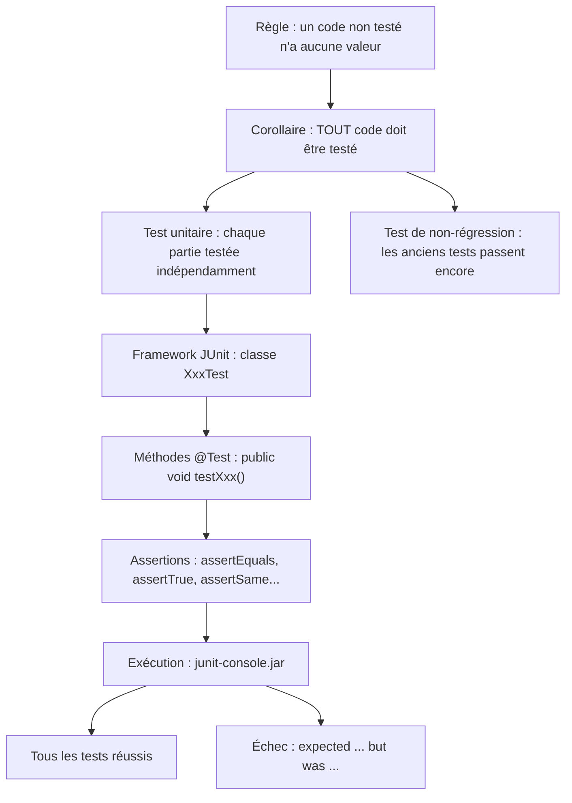
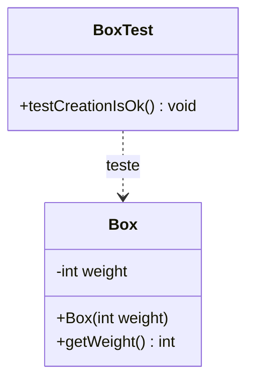
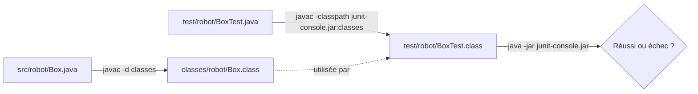
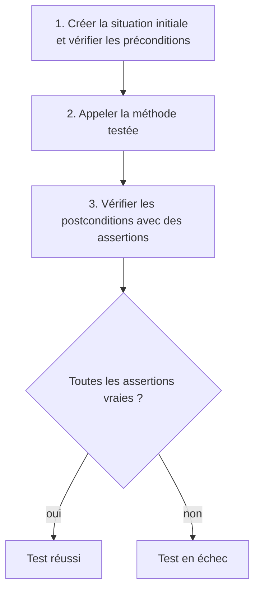
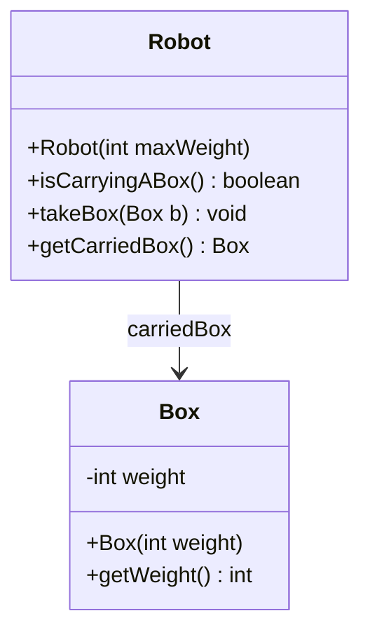
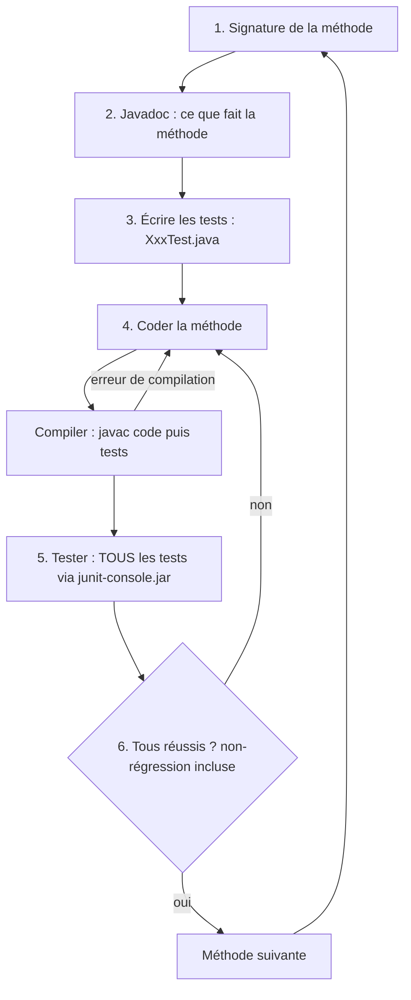

# 03 — Tests unitaires (JUnit)

> 🎯 **Objectifs**
> - Je sais expliquer ce qu'est un **test unitaire** et un **test de non-régression**.
> - Je sais écrire une classe de test **JUnit** (`@Test`, assertions).
> - Je sais structurer un test : **situation initiale / préconditions → appel → postconditions**.
> - Je sais compiler et exécuter des tests avec `junit-console.jar`, et lire un rapport d'échec.
> - Je sais appliquer la **méthodologie** « signature → javadoc → tests → code → tests ».
>
> ⏱️ Prérequis : [01 — Classes et objets](./01-classes-et-objets.md), [02 — static et enum](./02-static-et-enum.md)

## 🗺️ Vue d'ensemble



## 1. Pourquoi tester ?

💡 **L'idée :** un programme qui « a l'air de marcher » ne prouve rien ; seuls des tests **systématiques** donnent confiance.

> 📌 **Règle** : un code non testé n'a aucune valeur.
> 📌 **Corollaire** : **tout** code doit être testé.

Deux types de tests à connaître :

| Type | Définition (cours) | Question posée |
|---|---|---|
| **Test unitaire** | tester les différentes parties d'un programme **indépendamment** les unes des autres | « cette méthode fait-elle ce que dit sa javadoc ? » |
| **Test de non-régression** | vérifier que le nouveau code ajouté ne corrompt pas les codes précédents : les tests **précédemment réussis doivent encore l'être** | « ai-je cassé quelque chose en ajoutant du code ? » |

- Les tests sont **conservés** et relancés à chaque modification → c'est ce qui permet la non-régression. ⚠️ Tester « à la main » dans un `main` avec des `println` n'est **pas** un test : il faut relire l'affichage, et on ne le relance jamais.

## 2. Premier test JUnit : la classe `Box`

💡 **L'idée :** pour une classe `Box`, on écrit une classe `BoxTest` dont chaque méthode vérifie un comportement à l'aide d'**assertions**.

Mise en œuvre : **framework JUnit** (version 5, « Jupiter »), qui s'appuie sur des **assertions** (voir documents de TP + portail, onglet « Documents »).

**La classe à tester** (dans `src/robot/Box.java`) :

```java
package robot;

public class Box {
    /** weight of the box */
    private int weight;

    /** ... */
    public Box(int weight) {
        this.weight = weight;
    }

    /** @return this box's weight */
    public int getWeight() {
        return this.weight;
    }
}
```

**La classe de test** (dans `test/robot/BoxTest.java`) :

```java
package robot;                                          // même paquetage que Box

import org.junit.jupiter.api.Test;                      // l'annotation @Test
import static org.junit.jupiter.api.Assertions.*;       // assertEquals, assertTrue...

public class BoxTest {

    @Test
    public void testCreationIsOk() {
        Box someBox = new Box(10);
        assertEquals(10, someBox.getWeight());          // attendu : 10
    }
    // ... autres méthodes de test
}
```

| Élément | Rôle |
|---|---|
| `BoxTest` | convention : nom de la classe testée + `Test` |
| `package robot;` | même paquetage que `Box` (mais rangée dans `test/`) |
| `import org.junit.jupiter.api.Test;` | rend l'annotation `@Test` disponible |
| `import static ...Assertions.*;` | permet d'écrire `assertEquals(...)` sans préfixe (import **static**, cf. ch. 02) |
| `@Test` | indique à JUnit que la méthode est un test à exécuter |



## 3. Compiler et exécuter les tests

💡 **L'idée :** on compile la classe de test **avec** JUnit et les classes déjà compilées, puis c'est **JUnit** (et non `java MaClasse`) qui lance les tests.



**Compilation** (après avoir compilé `src/` dans `classes/`) :

```bash
javac -classpath junit-console.jar:classes test/robot/BoxTest.java
```

**Exécution** :

```bash
# une seule classe de test
java -jar junit-console.jar -classpath test:classes -select-class robot.BoxTest

# toutes les classes de test trouvées dans le classpath
java -jar junit-console.jar -classpath test:classes -scan-classpath
```

- 📌 `junit-console.jar` = le fichier `junit-platform-console-standalone-1.9.3.jar` **renommé**.
- Compiler : `-classpath junit-console.jar:classes` (JUnit **et** `Box.class`) ; exécuter : `-classpath test:classes` (tests **et** code).
- `-select-class robot.BoxTest` : nom **complet** (paquetage inclus) de la classe de test.
- ⚠️ Séparateur du classpath : `:` sous Linux/macOS, `;` sous Windows.
- ⚠️ Selon la version de JUnit, les options s'écrivent avec deux tirets : `--select-class`, `--scan-classpath`.

## 4. Lire le résultat d'une exécution

💡 **L'idée :** JUnit affiche un **bilan** ; en cas d'échec, il indique **quel test**, **quelle valeur attendue** et **quelle valeur obtenue**.

**Tests passés avec succès :**

```text
Test run finished after 132 ms
[         2 tests found           ]
(...)
[         2 tests successful      ]
[         0 tests failed          ]
```

**Test en échec :**

```text
Failures (1):
  JUnit Jupiter:BoxTest:testGetWeight()
    => org.opentest4j.AssertionFailedError: expected: <20> but was: <10>
       org.junit.jupiter.api.Assertions.assertEquals(Assertions.java:1142)
       robot.BoxTest.testGetWeight(BoxTest.java:20)
       (...)
[         1 tests successful      ]
[         1 tests failed          ]
```

| Ce qu'on lit | Signification |
|---|---|
| `BoxTest:testGetWeight()` | **le test** qui a échoué |
| `expected: <20>` | valeur **attendue** = 1er argument de `assertEquals` |
| `but was: <10>` | valeur **obtenue** = 2e argument |
| `BoxTest.java:20` | **ligne** de l'assertion qui a échoué |

⚠️ Un test qui échoue ne dit pas forcément que le **code** est faux : le **test** lui-même peut être erroné (mauvaise valeur attendue). Il faut relire la javadoc.

## 5. Anatomie d'une méthode de test

💡 **L'idée :** une méthode de test = mettre en place une situation, appeler la méthode testée, puis **vérifier** le résultat par des assertions.

**Règles de forme :**
- préfixée de l'annotation **`@Test`** ;
- signature de la forme **`public void testMethod()`** (pas de paramètre, pas de retour) ;
- le corps contient des **assertions** (`assertTrue`, `assertEquals`, etc.) ;
- le test est **réussi si toutes les assertions sont vérifiées** ;
- **plusieurs méthodes de test** peuvent être nécessaires pour tester une seule méthode.

**Principe en 3 étapes :**



| Étape | Contenu | Exemple |
|---|---|---|
| Situation initiale | créer les objets nécessaires | `Robot robbie = new Robot(15);` |
| Préconditions | vérifier que l'état de départ est celui supposé | `assertFalse(robbie.isCarryingABox());` |
| Appel | exécuter **la** méthode testée | `robbie.takeBox(b);` |
| Postconditions | vérifier la situation **attendue après** l'exécution | `assertSame(b, robbie.getCarriedBox());` |

## 6. Les assertions principales

💡 **L'idée :** une assertion compare ce qui **est** à ce qui **devrait être** ; la valeur **attendue** se met **en premier**.

| Assertion | Réussit si… |
|---|---|
| `assertTrue(cond)` | `cond` vaut `true` |
| `assertFalse(cond)` | `cond` vaut `false` |
| `assertEquals(attendu, obtenu)` | valeurs égales (`==` pour les primitifs, `equals` pour les objets) |
| `assertNotEquals(a, b)` | valeurs différentes |
| `assertSame(attendu, obtenu)` | **même référence** (le même objet) |
| `assertNotSame(a, b)` | références différentes |
| `assertNull(ref)` / `assertNotNull(ref)` | référence `null` / non `null` |
| `assertThrows(XxxException.class, () -> ...)` | l'expression déclenche l'exception (voir [ch. 04](./04-exceptions.md)) |

**`assertEquals` ou `assertSame` ?**

```java
Box b = new Box(10);
robbie.takeBox(b);
assertSame(b, robbie.getCarriedBox());              // c'est LA caisse b, le même objet
assertEquals(10, robbie.getCarriedBox().getWeight()); // même VALEUR (int)
```

- `assertSame` → identité des **références** (comme `==` sur des objets).
- `assertEquals` → égalité des **valeurs** (`equals` pour les objets).

## 7. Exemple complet : le `Robot` qui porte des caisses

💡 **L'idée :** on part d'un **cahier des charges** en français et on le traduit en **un test par comportement attendu**.

> **Cahier des charges** — Un robot peut porter une caisse d'un poids maximal défini à la construction du robot. Initialement un robot ne porte pas de caisse. S'il porte déjà une caisse il ne peut en prendre une autre.



On repère **4 comportements** dans le texte → **4 tests** :

| Phrase du cahier des charges | Test |
|---|---|
| « Initialement un robot ne porte pas de caisse » | `notCarryingABoxWhenCreated` |
| « peut porter une caisse… » (assez légère) | `robotCanTakeLightBox` |
| « …d'un poids maximal » (trop lourde → refus) | `robotCannotTakeTooHeavyBox` |
| « S'il porte déjà une caisse il ne peut en prendre une autre » | `robotCanTakeOnlyOneBox` |

**Test 1 — un robot neuf ne porte rien :**

```java
@Test
public void notCarryingABoxWhenCreated() {
    Robot robbie = new Robot(15);
    // aucune caisse portée ?
    assertFalse(robbie.isCarryingABox());
}
```

**Test 2 — il peut prendre une caisse assez légère :**

```java
@Test
public void robotCanTakeLightBox() {
    // situation initiale : un robot et une caisse
    Robot robbie = new Robot(15);
    Box b = new Box(10);
    // précondition : robot ne porte rien
    assertFalse(robbie.isCarryingABox());
    // exécution de la méthode testée
    robbie.takeBox(b);
    // postcondition : la caisse portée est bien b
    assertSame(b, robbie.getCarriedBox());
}
```

**Test 3 — il refuse une caisse trop lourde :**

```java
@Test
public void robotCannotTakeTooHeavyBox() {
    Robot robbie = new Robot(15);
    Box b = new Box(20);                    // 20 > 15
    assertFalse(robbie.isCarryingABox());
    // exécution de la méthode testée
    robbie.takeBox(b);
    // toujours aucune caisse portée
    assertFalse(robbie.isCarryingABox());
}
```

**Test 4 — il ne peut porter qu'une caisse à la fois :**

```java
@Test
public void robotCanTakeOnlyOneBox() {
    // situation initiale : robot portant une caisse
    Robot robbie = new Robot(15);
    Box b1 = new Box(10);
    robbie.takeBox(b1);
    // précondition : b1 est bien la caisse portée
    assertSame(b1, robbie.getCarriedBox());
    Box b2 = new Box(5);
    // exécution de la méthode testée
    robbie.takeBox(b2);
    // postcondition : la caisse portée est toujours b1
    assertSame(b1, robbie.getCarriedBox());
}
```

📌 Remarques :
- Chaque test crée **ses propres objets** : les tests sont **indépendants** ; `takeBox` est testée par **3 tests** (un par cas).
- Les noms de tests sont des **phrases** : en cas d'échec, on comprend tout de suite quel comportement est cassé.
- Les tests n'utilisent que les méthodes **publiques** : on teste le **comportement**, pas les attributs privés.

Une implémentation possible de `Robot` qui passe ces 4 tests (complément) :

```java
public class Robot {
    private int maxWeight;
    private Box carriedBox;                   // null si aucune caisse

    public Robot(int maxWeight) {
        this.maxWeight = maxWeight;
        this.carriedBox = null;
    }
    public boolean isCarryingABox() { return this.carriedBox != null; }
    public Box getCarriedBox() { return this.carriedBox; }
    public void takeBox(Box b) {
        if (!this.isCarryingABox() && b.getWeight() <= this.maxWeight) {
            this.carriedBox = b;
        }
    }
}
```

## 8. Méthodologie : les tests AVANT le code

💡 **L'idée :** on travaille **une méthode à la fois**, et on écrit ses tests **avant** son code.

**Les 6 étapes du cours :**
1. définir la **signature** de la méthode ;
2. écrire la **javadoc** de la méthode ;
3. écrire les **tests** qui permettront de contrôler que le code écrit pour la méthode est correct = répond au cahier des charges ;
4. **coder** la méthode ;
5. **exécuter** les tests définis à l'étape 3, en vérifiant la **non-régression** ;
6. si les tests sont réussis, passer à la méthode suivante (étape 1), **sinon recommencer à l'étape 4**.



> 📌 « Il ne s'agit pas de travailler plus, mais d'être plus efficace. »

Pourquoi cet ordre ?
- La **javadoc** fixe le contrat, les tests en découlent ; les écrire **avant** oblige à réfléchir aux **cas** (normal, limites, erreurs).
- Relancer **tous** les tests (étape 5) garantit qu'on n'a rien cassé : c'est la **non-régression**.
- ⚠️ Si un test échoue, on corrige le **code** (étape 4), pas le test… sauf si le test contredit la javadoc.

## ⚠️ Pièges fréquents

| Erreur | Pourquoi c'est faux | Correction |
|---|---|---|
| Oublier `@Test` | JUnit ignore la méthode : « 0 tests found » | ajouter `@Test` au-dessus |
| `public int testX()` ou `testX(int a)` | signature invalide pour un test | `public void testX()` sans paramètre |
| `assertEquals(obtenu, attendu)` | message d'échec inversé, trompeur | **attendu en premier** |
| `assertEquals(b, robbie.getCarriedBox())` pour vérifier l'identité | compare avec `equals`, pas les références | `assertSame(b, ...)` |
| Un seul test « fourre-tout » pour une méthode | on ne sait pas quel cas a échoué | **un test par comportement** |
| Ne pas vérifier les préconditions | le test peut réussir « par hasard » | `assertFalse(robbie.isCarryingABox())` avant l'appel |
| Lancer `java robot.BoxTest` | `BoxTest` n'a pas de `main` | `java -jar junit-console.jar ...` |
| Ne relancer que le nouveau test | la régression passe inaperçue | `-scan-classpath` : tout relancer |

## ✅ À retenir

- **Un code non testé n'a aucune valeur** ⇒ tout code doit être testé.
- **Test unitaire** = une partie testée indépendamment ; **non-régression** = les anciens tests passent toujours.
- Classe `XxxTest` dans `test/`, même paquetage que `Xxx`, imports `org.junit.jupiter.api.Test` et `static ...Assertions.*`.
- Méthode de test : **`@Test public void nomExplicite()`**, contenant des **assertions**.
- Structure : **situation initiale + préconditions → appel → postconditions**.
- `assertEquals(attendu, obtenu)` (valeurs) ≠ `assertSame(attendu, obtenu)` (références).
- Compiler : `javac -classpath junit-console.jar:classes test/...` ; exécuter : `java -jar junit-console.jar -classpath test:classes -select-class ...` ou `-scan-classpath`.
- Méthodologie : **signature → javadoc → tests → code → tests** ; recommencer au code tant que ça échoue.

## 🧠 Auto-évaluation

**Q1.** Quelle est la différence entre un test unitaire et un test de non-régression ?

<details><summary>Réponse</summary>

Le test **unitaire** vérifie une partie du programme (une méthode, une classe) **indépendamment** du reste. Le test de **non-régression** consiste à **relancer** les tests déjà réussis après un ajout de code, pour vérifier qu'on n'a rien cassé.

</details>

**Q2.** Trouve les erreurs :

```java
public class BoxTest {
    public int testWeight() {
        Box b = new Box(10);
        assertEquals(b.getWeight(), 10);
    }
}
```

<details><summary>Réponse</summary>

- `@Test` manquant → JUnit ne l'exécute pas.
- Signature : doit être `public void`, pas `public int` (et il n'y a pas de `return` → erreur de compilation).
- Arguments inversés : `assertEquals(10, b.getWeight())` (attendu en premier).

</details>

**Q3.** Un test affiche `expected: <20> but was: <10>` à la ligne `assertEquals(20, box.getWeight());`, avec `box = new Box(20)`. Où chercher l'erreur ?

<details><summary>Réponse</summary>

Dans le **code** de `Box` : le constructeur ou `getWeight()` ne conserve/renvoie pas le bon poids (la valeur obtenue est 10 alors que la caisse a été créée avec 20).

</details>

**Q4.** Pourquoi utilise-t-on `assertSame(b, robbie.getCarriedBox())` et pas `assertEquals(10, robbie.getCarriedBox().getWeight())` dans `robotCanTakeLightBox` ?

<details><summary>Réponse</summary>

On veut vérifier que le robot porte **la caisse `b` elle-même** (même référence), pas seulement une caisse de même poids. `assertSame` compare les **références**.

</details>

**Q5.** Écris le test « un robot ne peut pas prendre de caisse dont le poids est égal à son maximum + 1 ».

<details><summary>Réponse</summary>

```java
@Test
public void robotCannotTakeBoxJustTooHeavy() {
    Robot robbie = new Robot(15);
    Box b = new Box(16);
    assertFalse(robbie.isCarryingABox());   // précondition
    robbie.takeBox(b);                       // appel
    assertFalse(robbie.isCarryingABox());   // postcondition
}
```

</details>

**Q6.** Remets dans l'ordre : coder la méthode · écrire la javadoc · exécuter les tests · définir la signature · écrire les tests.

<details><summary>Réponse</summary>

Signature → javadoc → tests → code → exécution des tests (et retour au code en cas d'échec).

</details>

**Q7.** Quelle commande lance **tous** les tests compilés dans `test/` ?

<details><summary>Réponse</summary>

```bash
java -jar junit-console.jar -classpath test:classes -scan-classpath
```

</details>

## 🔗 Pour pratiquer

- [TP4 — hôtel](../03-TP/TP4-hotel/ENONCE.md)
- [TD3 — tournois](../02-TD/TD3-tournois/enonce.md)
- [Mémento des commandes (javac, JUnit, javadoc)](../05-Fiches/memento-commandes.md)

---

[⬅️ Précédent : 02 — static et enum](./02-static-et-enum.md) | [🏠 Sommaire](./README.md) | [Suivant ➡️ : 04 — Exceptions](./04-exceptions.md)
