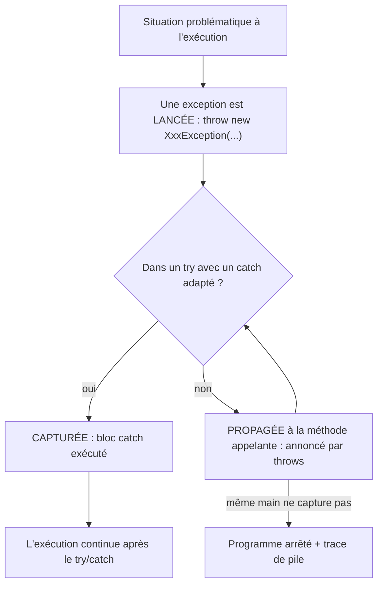
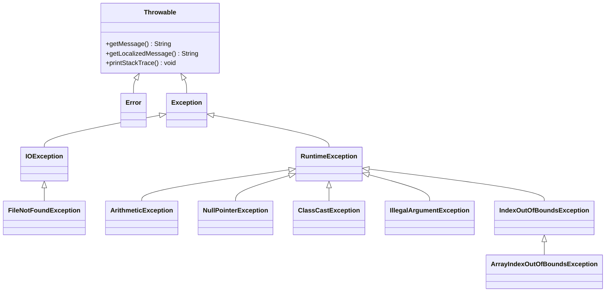
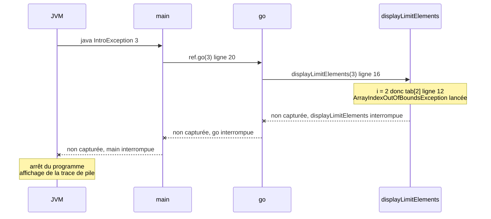

# 04 — Exceptions

> 🎯 **Objectifs**
> - Je sais ce qu'est une **exception** et lire une **trace de pile** (stack trace).
> - Je sais **capturer** une exception avec `try` / `catch` et prévoir le flux d'exécution.
> - Je sais **signaler** une exception (`throws`) et la **documenter** (`@exception` / `@throws`).
> - Je sais **déclencher** une exception avec `throw new ...`.
> - Je sais **tester** une levée d'exception avec `assertThrows`.
>
> ⏱️ Prérequis : [01 — Classes et objets](./01-classes-et-objets.md), [03 — Tests unitaires](./03-tests.md)

## 🗺️ Vue d'ensemble



## 1. Le problème : gérer les situations anormales

💡 **L'idée :** quand une méthode ne peut pas faire son travail, elle doit le **signaler** clairement, sans mélanger ce signal avec les résultats normaux.

| Par une **valeur de retour** spéciale (ex. `-1`) | Par une **exception** |
|---|---|
| ⚠️ difficile à traiter : l'appelant doit tester chaque retour, et `-1` peut être une valeur valide | signale le problème **là où il se pose** ; **sépare** cas normaux et cas exceptionnels ; transmet au **gestionnaire d'exceptions** (*exception handler*) |

## 2. Qu'est-ce qu'un cas exceptionnel ?

💡 **L'idée :** une situation qui ne correspond pas au **« fonctionnement normal »** d'une méthode.

| Situation | Exception Java |
|---|---|
| diviser un nombre (entier) par 0 | `ArithmeticException` |
| envoyer un message sur une référence `null` | `NullPointerException` |
| accéder à un élément de tableau en dehors des indices | `ArrayIndexOutOfBoundsException` |
| réaliser un transtypage (*cast*) impossible | `ClassCastException` |
| tenter d'accéder à un fichier qui n'existe pas | `FileNotFoundException` |

📌 La **javadoc** de l'API indique les exceptions possibles. Ex. `String.substring(int beginIndex)` (`"unhappy".substring(2)` → `"happy"`) : *Throws: IndexOutOfBoundsException - if beginIndex is negative or larger than the length of this String object.*

## 3. Les exceptions sont des objets

💡 **L'idée :** en Java, une exception est un **objet** ; sa classe indique la **nature** du problème.

- Du code peut **lancer** (déclencher) une exception, signe d'un « problème » ; on peut la **capturer** pour proposer une alternative / une solution.
- Toutes les exceptions sont **du type `Exception`** ; leur classe « exacte » est un **« sous-type »** de `Exception`.
- 📌 **Convention de nommage** : `NatureDuProblèmeException` (ex. `IllegalArgumentException`).

Quelques méthodes disponibles sur **toute** exception : `getMessage()` (le message), `getLocalizedMessage()` (message adapté à la langue), `printStackTrace()` (affiche la **trace de pile** : où l'exception est née et par où elle est passée).

**La hiérarchie des exceptions** (une flèche ◁ se lit « est une sorte de » ; complément, la notion de sous-type sera vue avec l'héritage) :



- `Error` : problèmes graves de la JVM (mémoire épuisée…), non traités ; `Exception` : problèmes que le programme peut traiter.
- `RuntimeException` et ses sous-types : erreurs « de programmation » (voir § 13).
- 📌 Un `catch (IndexOutOfBoundsException e)` capture aussi les `ArrayIndexOutOfBoundsException` (c'est une sorte d'`IndexOutOfBoundsException`).

## 4. Quand personne ne capture : la trace de pile

💡 **L'idée :** une exception non capturée **remonte** de méthode appelante en méthode appelante jusqu'à `main`, puis **arrête** le programme en affichant la pile d'appels.

```java
package cours4;
public class IntroException {
    private int[] tab;
    public IntroException() {
        this.tab = new int[2];
        for (int i = 0; i < this.tab.length; i++) { this.tab[i] = i; }   // tab = {0, 1}
    }
    public void displayLimitElements(int limit) {
        for (int i = 0; i < limit; i++) { System.out.println(this.tab[i]); }   // ligne 12
    }
    public void go(int limit) { this.displayLimitElements(limit); }   // ligne 16
    public static void main(String[] args) {
        IntroException ref = new IntroException();
        ref.go(Integer.parseInt(args[0]));                 // ligne 20
        System.out.println("execution reaches this point ?");
    }
}
```

```bash
$ java -classpath classes cours4.IntroException 3
0
1
Exception in thread "main" java.lang.ArrayIndexOutOfBoundsException: Index 2 out of bounds for length 2
    at IntroException.displayLimitElements(IntroException.java:12)
    at IntroException.go(IntroException.java:16)
    at IntroException.main(IntroException.java:20)
```

**Lecture de la trace** : de **haut en bas** = du lieu de l'erreur vers `main`.
- 1re ligne : **classe** de l'exception + **message** ; 1er `at` (ligne 12) : là où elle est **née** ;
- `at` suivants : les méthodes **appelantes**, avec la ligne de l'appel.
- ⚠️ `"execution reaches this point ?"` n'est **jamais** affiché : le programme s'est arrêté.

**La propagation le long de la pile d'appels :**



## 5. Documenter les exceptions

💡 **L'idée :** une exception fait partie du **contrat** de la méthode : elle se documente avec **`@exception`** (ou son synonyme **`@throws`**).

```java
/** sum the 'limit' first elements of tab
 * @exception ArrayIndexOutOfBoundsException if limit is greater than the number of elements (here 2)
 */
public int sumOfLimitElements(int limit) {
    int sum = 0;
    for (int i = 0; i < limit; i++) { sum = sum + this.tab[i]; }   // exception si i >= 2
    return sum;
}
```

- On indique **quelle** exception et **dans quel cas** ; ces cas serviront à écrire les **tests** (§ 11).

## 6. Capturer une exception : `try` / `catch`

💡 **L'idée :** on **essaie** d'exécuter un code « normalement », et **si** une exception survient, on la **capture** pour indiquer le traitement à faire.

```java
try {
    ... code susceptible de lancer une exception
} catch (ClasseDException e) {
    ... traitement à exécuter si exception
}
```

- `e` = **référence** vers l'objet exception capturé → `e.getMessage()`, `e.printStackTrace()`.
- ⚠️ Un **affichage** dans un `catch` n'est **pas une bonne pratique**, sauf en phase de développement : un `catch` doit **corriger** (« code correctif »).

**Exemple 1 — `endOfTimo`** : renvoyer la fin de `"timoleon"` à partir d'un indice.

```java
/** returns end of "timoleon" string from given index
 * @return substring of "timoleon" from index, "timoleon" if index<0 or "" if index>8 */
public String endOfTimo(int index) {
    String result;
    try {
        result = "timoleon".substring(index);   // peut lever IndexOutOfBoundsException
    } catch (IndexOutOfBoundsException e) {
        if (index < 0) { result = "timoleon"; }
        else { result = ""; }                    // index > "timoleon".length()
    }
    return result;
}
```

Utilisation : `endOfTimo(2)` → `"moleon"` ; `endOfTimo(-1)` → `"timoleon"` ; `endOfTimo(12)` → `""`.

⚠️ Avec deux `if` séparés (`if (index < 0) ...` puis `if (index > 8) ...`) comme sur la diapo, le compilateur refuse `return result;` : *variable result might not have been initialized*. D'où le `else`.

**Exemple 2 — `equals()` autrement**, en capturant un *cast* impossible :

```java
public boolean equals(Object o) {      // dans la classe Item
    try {
        Item other = (Item) o;          // exception si o n'est pas un Item (cast illégal)
        return (this.price == other.price) && this.id.equals(other.id);
    } catch (ClassCastException e) {
        return false;                   // pas un Item => pas égal
    }
}
```

## 7. Le flux d'exécution avec `try` / `catch`

💡 **L'idée :** capturer une exception **n'arrête pas** le programme ; on saute directement au `catch`, puis on continue **après**.

- on **quitte** le bloc `try` **dès** qu'une exception y est levée (la suite du `try` est sautée) ;
- si elle est capturée, le `catch` est exécuté, puis le flux se poursuit **après** le bloc `catch` ;
- sans exception, le `catch` est **ignoré**.

**Exemple `IntroException2`** (capture dans `go`, `main` inchangé) :

```java
public int go(int limit) {
    int result = 0;
    try {
        result = this.sumOfLimitElements(limit);
        System.out.println("go(): OK, result obtained");
    } catch (ArrayIndexOutOfBoundsException e) {
        System.out.println("go(): GOT IT");
        result = Integer.MIN_VALUE;                // code correctif
    }
    System.out.println("go(): AFTER");
    return result;
}
// main : result = ref.go(...) ; affiche "result = " + result puis "execution reaches this point ?"
```

| `java cours4.IntroException2 2` (pas d'exception) | `java cours4.IntroException2 3` (exception) |
|---|---|
| `go(): OK, result obtained` | `go(): GOT IT` |
| `go(): AFTER` | `go(): AFTER` |
| `result = 1` | `result = -2147483648` |
| `execution reaches this point ?` | `execution reaches this point ?` |

📌 Avec `3`, `"go(): OK, result obtained"` n'est **pas** affiché (on a quitté le `try`), mais le programme **continue** jusqu'au bout.

## 8. Plusieurs exceptions possibles

💡 **L'idée :** un même bloc peut lever **plusieurs** exceptions ; on peut les traiter **séparément** ou **globalement**.

```java
// 1) captures SÉPARÉES : un traitement par type
try { x = 1 / obj.getValue(); }
catch (NullPointerException e) { System.out.println(e.getMessage()); }   // obj == null
catch (ArithmeticException e)  { x = Double.MAX_VALUE; }                 // getValue() == 0

// 2) captures SIMULTANÉES : même traitement pour plusieurs types
try { x = 1 / obj.getValue(); }
catch (NullPointerException | ArithmeticException e) { e.printStackTrace(); }

// 3) capture GLOBALE : toute exception (toutes sont du type Exception)
try { x = 1 / obj.getValue(); }
catch (Exception e) { e.printStackTrace(); }
```

- Forme 1 : traitements **différents** ; forme 2 : **même** traitement ; forme 3 : ⚠️ à éviter, elle masque aussi les erreurs **imprévues**.
- ⚠️ Le **premier** `catch` qui correspond est choisi : du **plus précis au plus général** (un `catch (Exception e)` en premier rend les suivants inaccessibles → erreur de compilation).

## 9. Ne pas capturer : signaler avec `throws`

💡 **L'idée :** si une méthode **ne veut pas (ou ne peut pas)** traiter l'exception, elle doit **prévenir** son utilisateur qu'elle peut la générer.

⇒ ajouter **`throws ClasseDException`** à la **signature** + documentation **`@exception`**.

```java
// dans SomeClass, qui a un attribut private String name
public int endOfName(int endLength) throws IndexOutOfBoundsException {
    return this.name.substring(this.name.length() - endLength);
}
public FileReader openFile() throws FileNotFoundException {
    return new FileReader(this.name);
}
```

Plusieurs exceptions possibles : `public void someMethod(args) throws Exception1, ..., ExceptionN { ... }`

**Exemple `IntroException3`** : `go` laisse passer, `main` capture.

```java
/** @exception ArrayIndexOutOfBoundsException if limit is greater than size of tab */
public int go(int limit) throws ArrayIndexOutOfBoundsException {
    return this.sumOfLimitElements(limit);
}
public static void main(String[] args) {
    IntroException3 ref = new IntroException3();
    int result;
    try { result = ref.go(Integer.parseInt(args[0])); }
    catch (ArrayIndexOutOfBoundsException e) { System.out.println("main(): GOT IT"); result = -1000; }
    System.out.println("result = " + result);
    System.out.println("execution reaches this point ?");
}
// $ java cours4.IntroException3 3  ->  main(): GOT IT / result = -1000 / execution reaches this point ?
```

📌 Même propagation qu'au § 4, mais elle s'arrête dans `main` : `sumOfLimitElements` et `go` sont interrompues, le `catch` de `main` s'exécute, puis la suite de `main` continue normalement.

## 10. Déclencher une exception : `throw`

💡 **L'idée :** c'est **ma** méthode qui détecte un cas anormal (ex. paramètre invalide) et qui **lance** l'exception.

① **créer** un objet exception (de la classe voulue) ; ② le **« lancer »** avec **`throw`** ; ③ la signature doit **annoncer** l'exception (**`throws`**). 📌 Bien **choisir la classe** : son nom doit aider à identifier le problème.

```java
/** returns end of "timoleon" string from given index
 * @exception IllegalArgumentException if index is not valid (< 0 or > 8) */
public String endOfTimo(int index) throws IllegalArgumentException {
    if (index < 0 || index > "timoleon".length())
        throw new IllegalArgumentException("index " + index + " is not valid");
    return "timoleon".substring(index);        // pas exécuté si throw
}
// endOfTimo(2) -> "moleon"    endOfTimo(-1), endOfTimo(12) -> IllegalArgumentException déclenchée
```

**Exemple `IntroException4`** : `go` vérifie son paramètre **avant** de calculer.

```java
public int go(int limit) throws IllegalArgumentException {
    if (limit > this.tab.length)
        throw new IllegalArgumentException("limit too high: " + limit);
    return this.sumOfLimitElements(limit);
}
public static void main(String[] args) {
    IntroException4 ref = new IntroException4();
    try { System.out.println("result = " + ref.go(Integer.parseInt(args[0]))); }
    catch (IllegalArgumentException e) { System.out.println("main(): GOT IllegalArgumentException");
                                         System.out.println("result cannot be computed"); }   // correctif
    System.out.println("execution reaches this point ?");
}   // java cours4.IntroException4 3 : affiche les 3 messages ci-dessus, dans l'ordre
```

| `throw` | `throws` |
|---|---|
| **instruction**, dans le corps | **déclaration**, dans la signature |
| suivi d'un **objet** : `throw new XxxException(...)` | suivi d'un ou plusieurs **noms de classes** |
| **lance** l'exception maintenant | **prévient** que la méthode peut la lancer |

## 11. Tester les exceptions : `assertThrows`

💡 **L'idée :** la levée d'exception fait partie de la **spécification** ⇒ elle se **teste** comme le reste (cf. [ch. 03](./03-tests.md)).

- Construire la logique du test pour aboutir à une situation où l'exception **devrait** être déclenchée.
- Utiliser **`assertThrows(ExpectedException.class, () -> tested_expression)`** : réussie **si et seulement si** l'expression déclenche l'exception mentionnée (et les autres assertions éventuelles sont valides) ; `() -> ...` est une **lambda** : le code « emballé » pour que JUnit le lance lui-même.

> `endOfTimo(int index)` doit déclencher une `IllegalArgumentException` si son paramètre est négatif ou supérieur à 8.

```java
@Test
public void endOfTimoThrowsExceptionWhenIndexNegative() {
    SomeClass some = new SomeClass();
    // plus rigoureux : ne doit PAS lancer d'exception si le paramètre est valide
    some.endOfTimo(2);
    // doit lancer l'exception
    assertThrows(IllegalArgumentException.class, () -> some.endOfTimo(-1));
}
```

- Version minimale du cours : la seule ligne `assertThrows` ; l'appel valide `endOfTimo(2)` vérifie en plus l'absence d'exception « à tort ».
- ⚠️ Sans `() ->`, `some.endOfTimo(-1)` est évalué **avant** d'entrer dans `assertThrows` → l'exception part et le test **échoue**.

## 12. Réessayer après une erreur

💡 **L'idée :** placer le `try` dans une **boucle** pour recommencer tant que le traitement échoue.

```java
boolean done = false;
while (!done) {
    try { ... traitement avec levée d'exception possible
          done = true; }             // atteint seulement si aucune exception
    catch (ClasseDException e) { ... correction problème
          done = false; }            // ou done déjà à false
}
```

**Exemple : saisie d'un nombre**

```java
public class Input {   // attribut supposé : private static Scanner scanner = new Scanner(System.in);
    public static int readInt() throws java.io.IOException {
        try { return Input.scanner.nextInt(); }
        catch (Exception e) {
            Input.scanner.skip(".*");              // vider la saisie incorrecte
            throw new java.io.IOException();       // relancer une exception
        }
    }
}
// ==== UTILISATION ====
int value = -1;
while (value < 0) {
    try { System.out.print("Enter a positive integer : "); value = Input.readInt(); }
    catch (IOException e) { System.out.println("You must provide an integer."); }   // pas un nombre
}
```

📌 Un `catch` peut lui-même **lancer** une nouvelle exception : `readInt` **traduit** le problème pour son appelant.

## 13. À venir

- Pourquoi **toutes** les exceptions n'ont pas besoin d'être capturées ou signalées ? → ce sont les **`RuntimeException`** (`NullPointerException`, `IllegalArgumentException`…). Les autres (`IOException`, `FileNotFoundException`) **doivent** être capturées ou annoncées par `throws`, sinon le compilateur refuse.
- **Créer ses propres classes** d'exceptions, nommées `NatureDuProblèmeException`.

## ⚠️ Pièges fréquents

| Erreur | Pourquoi c'est faux | Correction |
|---|---|---|
| `throws new IllegalArgumentException()` | confusion des mots-clés | `throw new ...` dans le corps, `throws` dans la signature |
| `throw IllegalArgumentException;` | il faut lancer un **objet** | `throw new IllegalArgumentException("msg");` |
| Croire que le `try` continue après l'exception | on **quitte** le `try` immédiatement | mettre le code dépendant **dans** le `try` |
| `catch (Exception e)` avant `catch (ArithmeticException e)` | le 2e est inaccessible → erreur de compilation | du plus précis au plus général |
| `catch` vide ou avec juste un `println` | l'erreur est masquée, rien n'est corrigé | écrire un vrai code correctif ou laisser propager |
| Variable affectée dans le `try` mais pas dans tous les cas du `catch` | « might not have been initialized » | initialiser ou couvrir tous les cas (`else`) |
| `assertThrows(X.class, some.m(-1))` | l'exception part avant l'assertion | `() -> some.m(-1)` |

## ✅ À retenir

- Une exception = un **objet** signalant un cas qui sort du **fonctionnement normal** ; classes nommées `NatureDuProblèmeException`.
- Non capturée, elle **remonte la pile d'appels** jusqu'à `main` puis **arrête** le programme avec une **trace de pile** (lue de haut en bas).
- **`try { ... } catch (XxxException e) { ... }`** : on quitte le `try` dès l'exception, on exécute le `catch`, puis on continue **après** ; plusieurs `catch`, `catch (A | B e)` ou `catch (Exception e)`.
- **`throws`** dans la signature = « je ne traite pas, je **signale** » ; **`throw new ...`** dans le corps = « je **lance** ».
- Toujours **documenter** : `@exception` / `@throws` + le cas de déclenchement.
- Un `catch` doit **corriger**, pas seulement afficher (`e.getMessage()`, `e.printStackTrace()`).
- Tester : **`assertThrows(Xxx.class, () -> expr)`**, et vérifier aussi qu'un appel valide ne lève rien.
- Boucle `while (!done) { try {...; done = true;} catch {...} }` pour **réessayer**.

## 🧠 Auto-évaluation

**Q1.** Que s'affiche-t-il avec `java cours4.IntroException2 3` ? Et avec `2` ?

<details><summary>Réponse</summary>

Avec `3` : `go(): GOT IT`, `go(): AFTER`, `result = -2147483648`, `execution reaches this point ?`.
Avec `2` : `go(): OK, result obtained`, `go(): AFTER`, `result = 1`, `execution reaches this point ?`.

</details>

**Q2.** Trouve les erreurs :

```java
public int divide(int a, int b) throw ArithmeticException {
    if (b == 0) throws ArithmeticException("b is zero");
    return a / b;
}
```

<details><summary>Réponse</summary>

Mots-clés inversés et `new` manquant : `... int b) throws ArithmeticException {` dans la signature, et `throw new ArithmeticException("b is zero");` dans le corps.

</details>

**Q3.** Que vaut `x` si `obj` vaut `null` ? Et si `obj.getValue()` (un `int`) vaut `0` ?

```java
double x = 5;
try { x = 1 / obj.getValue(); }
catch (NullPointerException e) { x = -1; }
catch (ArithmeticException e) { x = Double.MAX_VALUE; }
```

<details><summary>Réponse</summary>

`obj == null` → `NullPointerException` → `x = -1`. `getValue() == 0` → division entière par 0 → `ArithmeticException` → `x = Double.MAX_VALUE`.

</details>

**Q4.** Écris un test vérifiant que `endOfTimo(12)` lève une `IllegalArgumentException`, mais pas `endOfTimo(8)`.

<details><summary>Réponse</summary>

```java
@Test
public void endOfTimoThrowsExceptionWhenIndexTooHigh() {
    SomeClass some = new SomeClass();
    some.endOfTimo(8);    // valide : renvoie "", ne doit rien lever
    assertThrows(IllegalArgumentException.class, () -> some.endOfTimo(12));
}
```

</details>

**Q5.** Vrai ou faux : « quand une exception est capturée, le programme s'arrête après le `catch` ».

<details><summary>Réponse</summary>

**Faux** : on quitte le `try`, on exécute le `catch`, puis l'exécution **continue** après le bloc `catch`. Seule une exception **non capturée** (jusqu'à `main`) arrête le programme.

</details>

## 🔗 Pour pratiquer

- [TP4 — hôtel](../03-TP/TP4-hotel/ENONCE.md)
- [TD3 — tournois](../02-TD/TD3-tournois/enonce.md)
- [TD — Othello](../02-TD/TD-othello/enonce.md)

---

[⬅️ Précédent : 03 — Tests unitaires](./03-tests.md) | [🏠 Sommaire](./README.md) | [Suivant ➡️ : 05 — Polymorphisme et interfaces](./05-polymorphisme-et-interfaces.md)
