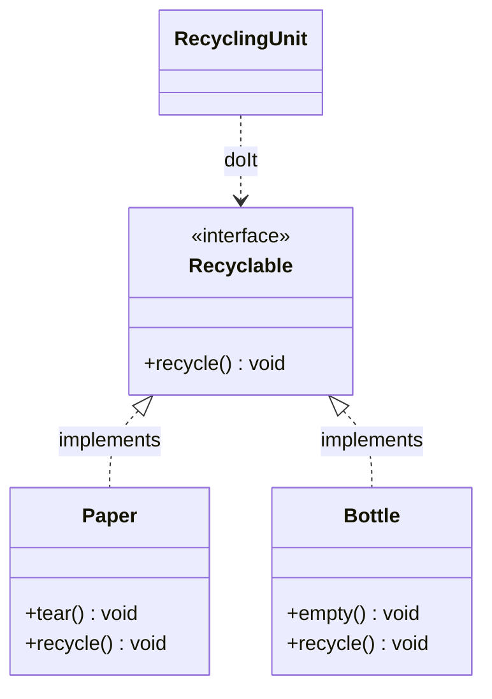
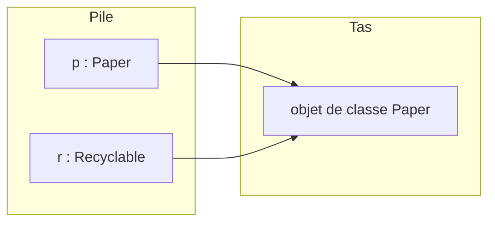
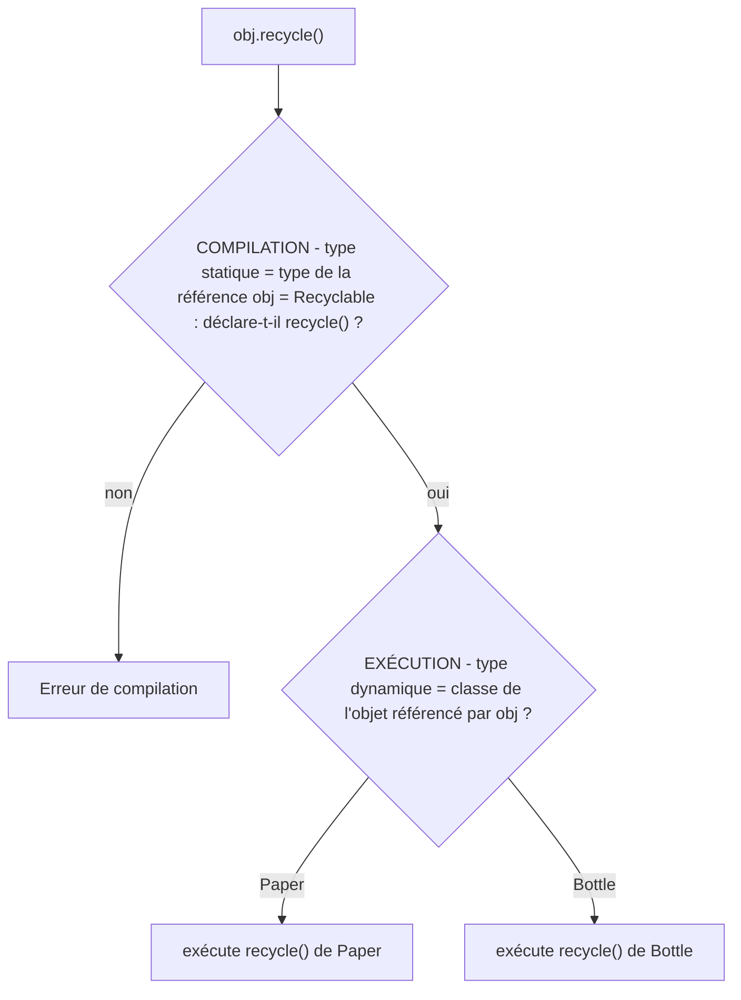
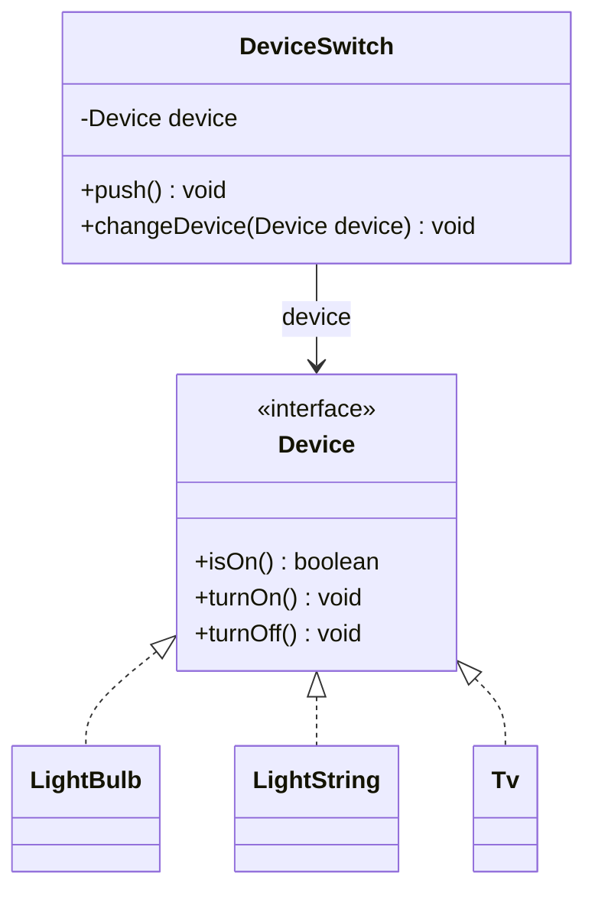

# 05 — Polymorphisme et interfaces

> 🎯 **Objectifs**
> - Je sais définir une **interface** Java et la faire **implémenter** (`implements`) par plusieurs classes.
> - Je sais expliquer le **polymorphisme** : un objet a plusieurs types (sa classe + ses interfaces).
> - Je sais distinguer **type de la référence** (ce qui est autorisé) et **classe de l'objet** (ce qui est exécuté).
> - Je sais expliquer le **late binding** et la différence **upcast** / **downcast**.
> - Je sais écrire et utiliser une **default method** (Java 8+) et résoudre un conflit avec `X.super.m()`.
>
> ⏱️ Prérequis : [01 — Classes et objets](./01-classes-et-objets.md) · [02 — static et enum](./02-static-et-enum.md) · [03 — Tests](./03-tests.md) · [04 — Exceptions](./04-exceptions.md)

## 🗺️ Vue d'ensemble

| Notion | En une phrase | Exemple du cours |
|---|---|---|
| **Interface** | un **type** qui liste les messages acceptés, sans le code | `Recyclable`, `Device` |
| **implements** | la classe s'engage à fournir le code de chaque méthode | `Paper implements Recyclable` |
| **Polymorphisme** | un objet est du type de sa classe **et** de ses interfaces | un `Paper` est aussi un `Recyclable` |
| **Late binding** | la méthode exécutée est choisie **à l'exécution**, selon la classe de l'objet | `obj.recycle()` dans `RecyclingUnit` |
| **Cast** | changer le type de la **référence**, jamais l'objet | upcast implicite / downcast explicite |
| **default method** | code par défaut écrit dans l'interface (Java 8+) | `Device.onOffString()` |

## 1. Le problème : « recycler tous les objets d'une poubelle »

💡 **L'idée :** des objets **différents** (papier, bouteille) partagent **un même comportement** (être recyclés), chacun à sa manière.

- Vie quotidienne : on déchire du papier, on vide une bouteille… mais **tous** sont recyclables.
- En Java : `Paper` et `Bottle` ont des méthodes propres (`tear()`, `empty()`)…
- … et **toutes deux** une méthode `recycle()`, avec un traitement **différent**.

```java
public class Paper {
    public void tear() { ... }
    public void recycle() { System.out.println("recycling paper"); }
}
public class Bottle {
    private int volume;
    public Bottle(int v) { this.volume = v; }  public int getVolume() { return this.volume; }
    public void empty() { ... }
    public void recycle() { System.out.println("recycling bottle"); }
}
```

On voudrait écrire, avec la poubelle représentée par un tableau `trashcan` :

```java
T[] trashcan = new T[2];
trashcan[0] = new Paper();  trashcan[1] = new Bottle();
for (int i = 0; i < trashcan.length; i++) { trashcan[i].recycle(); }   // trashcan[i] de type T
```

**❓ Quel est le type `T` ?** Pour compiler, il faut que :
1. une référence de type `T` **accepte** un objet `Paper` **et** un objet `Bottle` ;
2. le type `T` **autorise** le message `recycle()`.

## 2. Les fausses pistes

💡 **L'idée :** ni une classe fourre-tout, ni `Object` ne conviennent.

| Piste | Pourquoi ça ne marche pas |
|---|---|
| **Une seule classe `Unique`** | comment distinguer `new Unique(???)` papier / bouteille ? que faire de `paper.empty()`, `bottle.tear()` ? deux codes pour `recycle()`… |
| **`T = Object`** | `Object r1 = new Paper();` compile, mais **`Object` n'accepte pas le message `recycle()`** |

✅ **Il faut donc :**
1. un **type commun** qui accepte le message `recycle()` ;
2. **conserver deux classes distinctes** `Paper` et `Bottle`, « **sous-types** » de ce type commun.

## 3. La solution Java : l'interface

💡 **L'idée :** une **interface** est un **type objet** qui définit les **envois de messages autorisés**, sans dire comment y répondre.

```java
public interface Recyclable {
    /** recycling process for this Recyclable object */
    public void recycle();          // signature seule : PAS de corps
}
```

- On énumère les **signatures de méthodes publiques** acceptées par le type.
- `Recyclable` = le type des « **objets qui acceptent l'envoi de message `recycle()`** ».

## 4. Implémenter une interface

💡 **L'idée :** avec `implements`, une classe **promet** de fournir le code de **chaque** méthode de l'interface.

```java
public class Paper implements Recyclable { public void tear() { ... }  public void recycle() { ... } }
public class Bottle implements Recyclable { public void empty() { ... } public void recycle() { ... } }
```

- Une **même interface** peut être implémentée par **plusieurs classes**.
- ⚠️ Une méthode de l'interface oubliée → **erreur de compilation**.
- ⚠️ La méthode implémentée doit rester **`public`**.

**Notation UML** : stéréotype `<<interface>>` et **flèche pointillée** à triangle creux de la classe vers l'interface (la flèche **pleine** est réservée à l'héritage `extends`, voir [08](./08-heritage.md)).



## 5. Polymorphisme : un objet, plusieurs types

💡 **L'idée :** les instances d'une classe qui implémente une interface sont **aussi** du type de l'interface → c'est le **polymorphisme**.

- La classe est un « **sous-type** » de l'interface : `Paper ⊂ Recyclable` et `Bottle ⊂ Recyclable`.

```java
Paper p = new Paper();
Recyclable r1 = p;                           // les objets Paper sont aussi de type Recyclable
Recyclable r2 = new Bottle();                // idem pour Bottle
Recyclable[] trashcan = new Recyclable[2];   // T = Recyclable !
trashcan[0] = r1;  trashcan[1] = new Bottle();
for (int i = 0; i < trashcan.length; i++) {
    trashcan[i].recycle();                   // traitement indifférencié
}                                            // recycling paper / recycling bottle
```

## 6. La référence n'est pas l'objet !

💡 **L'idée :** le **type de la référence** décide de ce qu'on a le **droit d'envoyer** ; la **classe de l'objet** décide du **code exécuté**.

```java
Paper p = new Paper();
p.tear();  p.recycle();   // ok, ok
Recyclable r = p;         // ok : p ∈ Recyclable, r et p référencent le MÊME objet
r.recycle();              // ok : c'est le code de recycle() de Paper qui s'exécute
r.tear();                 // ❌ ne compile pas : tear() n'est pas dans le type Recyclable
```



| Question | Décidé par | Moment |
|---|---|---|
| Le message est-il **autorisé** ? | le **type de la référence** (`Recyclable`) | **compilation** |
| **Quel code** s'exécute ? | la **classe de l'objet** (`Paper`) | **exécution** |

## 7. Une interface est un type… abstrait

💡 **L'idée :** on utilise une interface **partout où on utilise une classe** comme type, mais on ne peut **pas** l'instancier.

```java
public void aMethod(Recyclable r) { ... }  // sur r : QUE des méthodes du type Recyclable
Recyclable aRecyclableObject = new Paper();
someObject.aMethod(aRecyclableObject);
someObject.aMethod(new Bottle());
```

| Une interface… | La classe qui l'implémente… |
|---|---|
| n'a **pas de constructeur** (`new Recyclable()` ❌) | construit les objets du type |
| n'a **pas d'attribut**, sauf définitions `static` | définit la **structure** des objets (attributs) |
| n'a **pas de corps de méthode**, sauf *default method* | définit les **comportements concrets** |
| définit les **messages acceptés** | définit les **réponses** |

📌 Une interface est **concrétisée** par les classes qui l'implémentent.

## 8. Multi-implémentation

💡 **L'idée :** une classe peut implémenter **plusieurs** interfaces ; elle fournit alors le code de **toutes** leurs méthodes.

```java
public interface Flammable { public void burn();  public float ignitionTemperature(); }
public class Paper implements Recyclable, Flammable {
    public void tear() { ... }
    public void recycle() { ... }                       // pour Recyclable
    public void burn() { ... }                          // pour Flammable
    public float ignitionTemperature() { return 451; }  // pour Flammable
}
```

**❓ Quels types possibles pour une instance de `Paper` ?** → `Paper`, `Recyclable`, `Flammable` (et `Object`, comme tout objet).

## 9. Le late binding

💡 **L'idée :** en POO, **on ne sait qu'à l'exécution** quelle méthode va répondre à un message.

| | **Early binding** (ex. C) | **Late binding** (POO) |
|---|---|---|
| Choix du code appelé | à la **compilation** (édition de liens) | à l'**exécution** (*run time*) |
| Vérifié par le compilateur | tout | « seulement » que le message est **accepté** et que les types (arguments, retour) sont valides |

```java
public class RecyclingUnit {
    /** applies the recycling process to obj */
    public void doIt(Recyclable obj) { obj.recycle(); }   // ❓ quelle méthode est invoquée ?
}
public class RecyclingUnitMain {
    public static void main(String[] args) {
        RecyclingUnit unit = new RecyclingUnit();
        Recyclable ref;
        if (args[0].equals("paper")) { ref = new Paper(); }
        else { ref = new Bottle(); }
        unit.doIt(ref);
    }
}
// $> java RecyclingUnitMain paper   →  recycling paper
// $> java RecyclingUnitMain other   →  recycling bottle
```

- Ce code **compile**, et son résultat **dépend de `args[0]`**.
- Dans `doIt`, la méthode `recycle()` invoquée **n'est pas connue a priori** : **on ne sait pas, et on ne peut pas savoir** à la compilation.



📌 **Définition (à savoir par cœur) :**
- La méthode exécutée lors d'un envoi de message est **déterminée dynamiquement à l'exécution** : elle dépend de la **classe de l'objet receveur**.
- Le compilateur vérifie seulement si l'envoi de message est **autorisé** : cela dépend **uniquement du type de la référence** → **vérification statique**.
- Le compilateur **garantit l'existence** de la méthode.

## 10. Cast (transtypage) : upcast et downcast

💡 **L'idée :** une **référence n'a qu'un seul type**, un **objet peut en avoir plusieurs**. « Caster » = créer une **autre référence**, d'un autre type, **vers le même objet**.

| | **UpCast** (généralisation) | **DownCast** (spécialisation) |
|---|---|---|
| Sens | vers un type **moins spécifique** (toujours possible vers `Object`) | vers un type **plus spécifique** |
| Écriture | **implicite**, naturel | **explicite** : `(Paper) ref` |
| Vérifié | à la **compilation** | à l'**exécution** |
| Risque | **sûr** (*safe*) | **à risque** |

```java
Recyclable[] trashcan = new Recyclable[2];
trashcan[0] = new Paper();          // upcast implicite (Paper → Recyclable)
trashcan[1] = new Bottle();         // upcast implicite (Bottle → Recyclable)
for (int i = 0; i < trashcan.length; i++) {
    ((Paper) trashcan[i]).burn();   // downcast explicite (Recyclable → Paper)
}                                   // ❌ erreur à l'exécution quand i = 1
```

- ⚠️ Le downcast **compile**, mais lève une **`ClassCastException`** si l'objet n'est pas de la bonne classe (ici un `Bottle`).
- 📌 Un downcast est souvent le signe de **types mal choisis** (voir [06](./06-interfaces-suite.md)).

**❓ Et les piles ?** Pour recycler une `Battery`, il suffit d'écrire `class Battery implements Recyclable` avec sa méthode `recycle()` : `trashcan` et `RecyclingUnit` fonctionnent **sans aucune modification**.

## 11. Exemple : interrupteurs et appareils

💡 **L'idée :** deux classes d'interrupteurs **quasi identiques** → on extrait ce dont l'interrupteur a **besoin** dans une interface.

- `LightBulb` (ampoule) : méthodes exclusives `getPower()`, `getColor()`, constructeur `LightBulb(int, String)`.
- `LightString` (guirlande) : méthodes exclusives `size()`, `getNthBulb()`, constructeur `LightString(int)`.
- Des méthodes **similaires** (`isOn()`, `turnOn()`, `turnOff()`) mais des **codes différents** :

```java
public class LightBulb {
    private boolean on;
    public void turnOn() { this.on = true; }     // bulb becomes on
}
public class LightString {
    private LightBulb[] theBulbs;
    public void turnOn() { for (LightBulb light : this.theBulbs) { light.turnOn(); } }
}
public class Switch {                            // un interrupteur pour LightBulb… 😕
    private LightBulb light;
    public Switch(LightBulb light) { this.light = light; }
    public LightBulb getLightBulb() { return this.light; }
    public void push() {
        if (this.light.isOn()) { this.light.turnOff(); } else { this.light.turnOn(); }
    }
}
// SwitchForLightString : EXACTEMENT le même code, avec LightString à la place de LightBulb
```

➡️ Seul le **type** change ! Pour l'interrupteur, il faut et il **suffit** qu'existent `isOn()`, `turnOff()`, `turnOn()`.

### 11.1 L'abstraction `Device`

```java
public interface Device {
    public boolean isOn();
    public void turnOn();
    public void turnOff();
}
public class DeviceSwitch {
    private Device device;
    public DeviceSwitch(Device device) { this.device = device; }
    public Device getDevice() { return this.device; }
    public void push() {
        if (this.device.isOn()) { this.device.turnOff(); } else { this.device.turnOn(); }
    }
    public void changeDevice(Device device) { this.device = device; }
}
public class LightBulb implements Device { ... isOn(), turnOn(), turnOff(), getPower() ... }
public class LightString implements Device { ... isOn(), turnOn(), turnOff(), size() ... }
public class Tv implements Device { ... isOn(), turnOn(), turnOff(), changeChannel(int) ... }
```



### 11.2 Utilisation

```java
LightString ls = new LightString(5);
DeviceSwitch devSwitch = new DeviceSwitch(ls);   // contrôle une guirlande
devSwitch.push();  System.out.println(ls.isOn()); // true
LightBulb lb = new LightBulb(1, "blanc");
devSwitch.changeDevice(lb);                      // le MÊME interrupteur contrôle une ampoule
devSwitch.push();  System.out.println(lb.isOn()); // true

public class DeviceUser { public void plugIt(Device d) { d.turnOn(); } }
DeviceUser user = new DeviceUser();
user.plugIt(lb);  user.plugIt(ls);               // n'importe quel Device
user.plugIt(new Tv());                           // et plus encore !
```

✅ **Abstraction :** on passe de **plusieurs classes interrupteur spécifiques** à **une seule classe interrupteur commune** (« générique »), grâce à l'abstraction `Device` implémentée par les différentes classes.

## 12. Les default methods (depuis Java 8)

💡 **L'idée :** quand un code ne dépend **que de l'interface**, on l'écrit **une fois** dans l'interface au lieu de le recopier dans chaque classe.

### 12.1 Le constat et la solution `default`

`LightBulb` **et** `LightString` recopient le **même** code (constantes `ON`/`OFF` + méthode `onOffString()`), qui ne dépend **que** de `isOn()`, une méthode de l'interface. → On le place **dans l'interface**.

Possible si le code ne dépend **que** de définitions **statiques** et d'**appels de méthodes définies par l'interface**.

```java
public interface Device {
    public boolean isOn();
    public void turnOn();
    public void turnOff();
    public static final String ON = "on";
    public static final String OFF = "off";
    public default String onOffString() {
        if (this.isOn()) { return Device.ON; } else { return Device.OFF; }
    }
}
LightBulb lb = new LightBulb(1, "blanc");
System.out.println(lb.onOffString());   // disponible SANS redéfinition dans LightBulb
```

📌 Une classe qui implémente `Device` **peut aussi redéfinir** `onOffString()`.

### 12.2 Default method et méthode statique

```java
public interface FirstInterface {
    public double f();
    public double g();
    public default double m() { return 2 * this.f() + this.g(); }    // default method
    public static double foo(double value) { return value + 1; }   // méthode statique
}
public class FirstClass implements FirstInterface {
    private double x, y;
    public FirstClass(double x, double y) { this.x = x; this.y = y; }
    public double f() { return this.x; }      // obligatoire
    public double g() { return this.y; }      // obligatoire
    // pas d'implémentation pour m() : on utilise la version par défaut
}
public class SecondClass implements FirstInterface {
    public double f() { return 10; }
    public double g() { return 3.14; }
    public double m() { return new java.util.Random().nextDouble(); }  // m() redéfinie
}

new FirstClass(1, 2).m();   // 2*1 + 2 = 4.0 (méthode par défaut)
new SecondClass().m();      // un nombre aléatoire (version redéfinie)
```

### 12.3 Conflit entre deux default methods

💡 **L'idée :** si deux interfaces fournissent une default method de **même signature**, la classe doit **choisir explicitement** (ou redéfinir) avec `InterfaceName.super.methodName()`.

```java
public interface OtherInterface {
    public double h();
    public default double m() { return FirstInterface.foo(this.h()); }  // même signature !
}
public class OtherClass implements FirstInterface, OtherInterface {
    public double h() { return 1.1234; }       // dû à OtherInterface
    public double f() { return 0; }            // dû à FirstInterface
    public double g() { return 0; }
    public double m() {                        // conflit à résoudre OBLIGATOIREMENT
        return OtherInterface.super.m();       // on choisit la version de OtherInterface
    }
}
```

⚠️ Sans cette redéfinition de `m()`, `OtherClass` **ne compile pas**.

### 12.4 Illustration : `Element` et `ElementAggregate`

```java
public interface Element { public int getValue(); }
public interface ElementAggregate {
    public void add(Element e);
    public Collection<Element> allElements();
    /** the sum of all the values of the elements in this aggregate */
    public default int globalValue() {
        int total = 0;
        for (Element e : this.allElements()) { total = total + e.getValue(); }
        return total;
    }
}
public class Potato implements Element {
    private int weight;                                    // en grammes
    public Potato(int weight) { this.weight = weight; }
    public int getValue() { return this.getWeight(); }
    public int getWeight() { return this.weight; }
}
public class PotatoesBag implements ElementAggregate {
    private List<Element> potatoes;
    public PotatoesBag() { this.potatoes = new ArrayList<>(); }  public void add(Element potato) { this.potatoes.add(potato); }
    public Collection<Element> allElements() { return this.potatoes; }
    public int globalWeight() { return this.globalValue(); }   // utilise la default method
}

PotatoesBag bag = new PotatoesBag();
bag.add(new Potato(100)); bag.add(new Potato(120)); bag.add(new Potato(140));
System.out.println("total weight of bag is " + bag.globalValue());   // 360
```

📌 On peut recommencer avec **une autre** classe d'`Element` regroupée dans **une autre** classe `ElementAggregate` : `globalValue()` est **gratuite**.

## ⚠️ Pièges fréquents

| Erreur | Pourquoi c'est faux | Correction |
|---|---|---|
| `new Recyclable()` | une interface n'a **pas de constructeur** | `Recyclable r = new Paper();` |
| `Recyclable r = new Paper(); r.tear();` | `tear()` n'est pas dans le **type de la référence** | référence `Paper`, ou méthode ajoutée à l'interface si commune |
| Oublier une méthode de l'interface | promesse non tenue → ne compile pas | implémenter **toutes** les méthodes (sauf `default`) |
| `void recycle()` sans `public` dans la classe | visibilité réduite → erreur | `public void recycle()` |
| `((Paper) trashcan[i]).burn()` sur un `Bottle` | `ClassCastException` **à l'exécution** | éviter le downcast, revoir les types |
| Croire que le compilateur choisit le code exécuté | il vérifie seulement l'**autorisation** | **late binding** : choix à l'exécution |
| Deux default `m()` en conflit non résolu | ambiguïté → ne compile pas | redéfinir `m()` avec `X.super.m()` |

## ✅ À retenir

- Une **interface** = un **type** qui liste des **signatures publiques** (messages acceptés), sans code.
- `class C implements I1, I2` : C fournit le code de **toutes** les méthodes de I1 et I2.
- **Polymorphisme** : un objet est du type de **sa classe** et de **toutes ses interfaces**.
- **La référence n'est pas l'objet** : type de la référence → messages **autorisés** ; classe de l'objet → code **exécuté**.
- **Late binding** : méthode choisie **à l'exécution** ; le compilateur ne fait qu'une **vérification statique**.
- Interface : pas de constructeur, pas d'attribut (sauf `static`), pas de corps (sauf `default`).
- **Upcast** implicite et sûr ; **downcast** explicite, vérifié à l'exécution, risqué.
- **Abstraction** : une seule classe `DeviceSwitch` au lieu d'une par appareil, grâce à `Device`.
- **default method** : code commun ne dépendant que de l'interface ; redéfinissable ; conflit → `I.super.m()`.

## 🧠 Auto-évaluation

**Q1.** Lesquelles compilent ? (`Paper implements Recyclable, Flammable`)
`a) Recyclable r = new Paper();` `b) Flammable f = new Paper();` `c) Paper p = r;` `d) r.burn();` `e) new Recyclable();`

<details><summary>Réponse</summary>

**a** et **b** seulement (upcasts implicites). c : downcast à écrire `(Paper) r`. d : `burn()` n'est pas dans `Recyclable`. e : une interface ne s'instancie pas.

</details>

**Q2.** Que s'affiche-t-il ? `Recyclable[] t = { new Bottle(2), new Paper(), new Bottle(1) }; for (Recyclable r : t) { r.recycle(); }`

<details><summary>Réponse</summary>

`recycling bottle`, `recycling paper`, `recycling bottle` : late binding, c'est le `recycle()` de la **classe de chaque objet** qui s'exécute.

</details>

**Q3.** Dans `doIt(Recyclable obj) { obj.recycle(); }`, qui décide **si** l'appel est valide, et **quel** code s'exécute ?

<details><summary>Réponse</summary>

Validité : le **compilateur**, d'après le **type de la référence** (`Recyclable`). Code exécuté : la **classe de l'objet**, connue **à l'exécution** (late binding).

</details>

**Q4.** Trouve l'erreur : `Recyclable[] tc = { new Paper(), new Bottle(1) };` puis `for (...) ((Paper) tc[i]).burn();`

<details><summary>Réponse</summary>

Pour `i = 1`, l'objet est un `Bottle` : le downcast échoue → **`ClassCastException`**, détectée **à l'exécution** seulement.

</details>

**Q5.** On ajoute `Battery`. Que faut-il modifier dans `RecyclingUnit` ? Quels types a une `Tv` ?

<details><summary>Réponse</summary>

**Rien** dans `RecyclingUnit` : il suffit `Battery implements Recyclable`. Une `Tv` est de type `Tv`, `Device` (et `Object`).

</details>

**Q6.** Que vaut `new FirstClass(3, 1).m()` ? Et comment `OtherClass` choisirait-elle la version de `FirstInterface` ?

<details><summary>Réponse</summary>

`2*3 + 1 = 7.0` (default method). Pour le conflit : `public double m() { return FirstInterface.super.m(); }`.

</details>

## 🔗 Pour pratiquer

- [TD Othello](../02-TD/TD-othello/enonce.md)
- [TP Othello](../03-TP/TP-othello/ENONCE.md)

---

[⬅️ Précédent : 04 — Exceptions](./04-exceptions.md) | [🏠 Sommaire](./README.md) | [Suivant ➡️ : 06 — Interfaces (suite)](./06-interfaces-suite.md)
