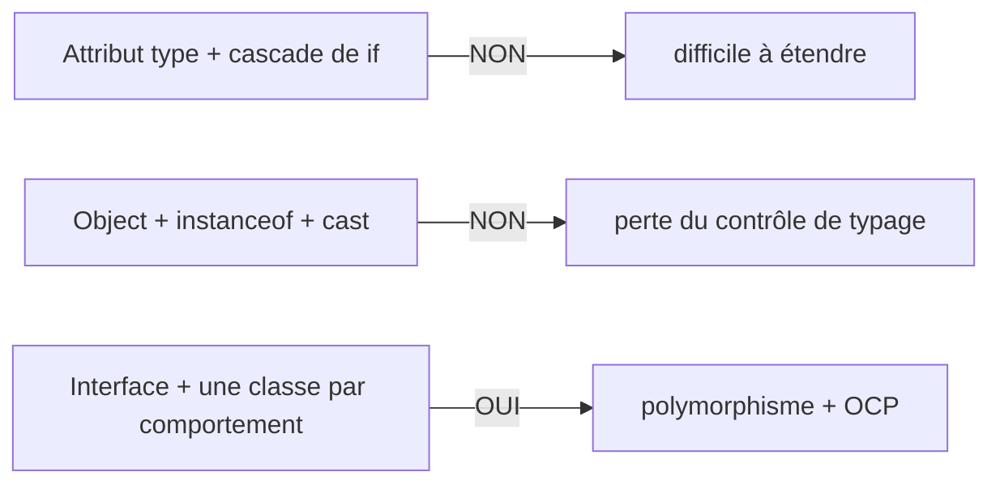
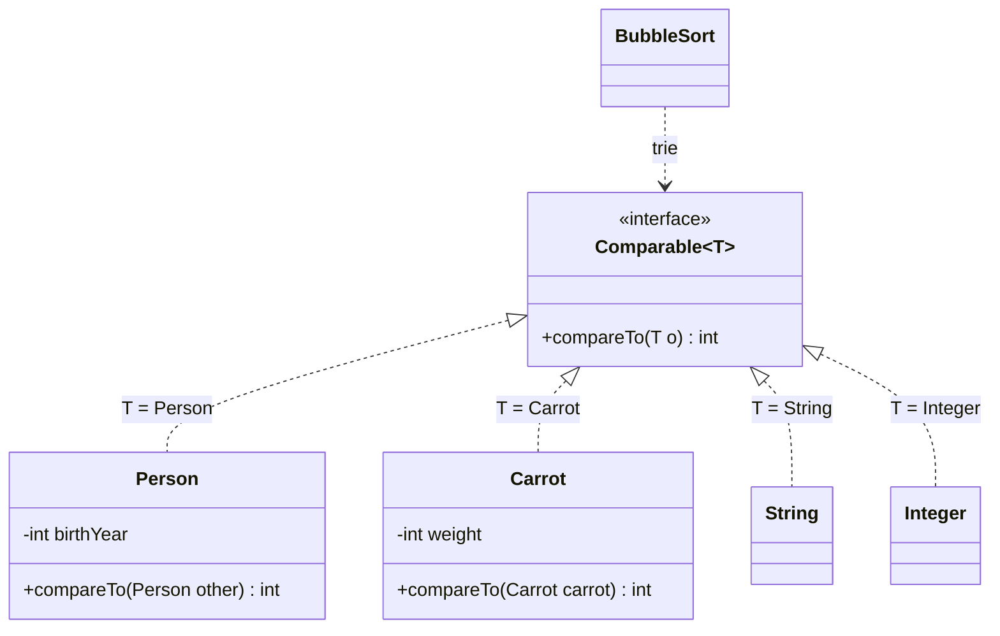
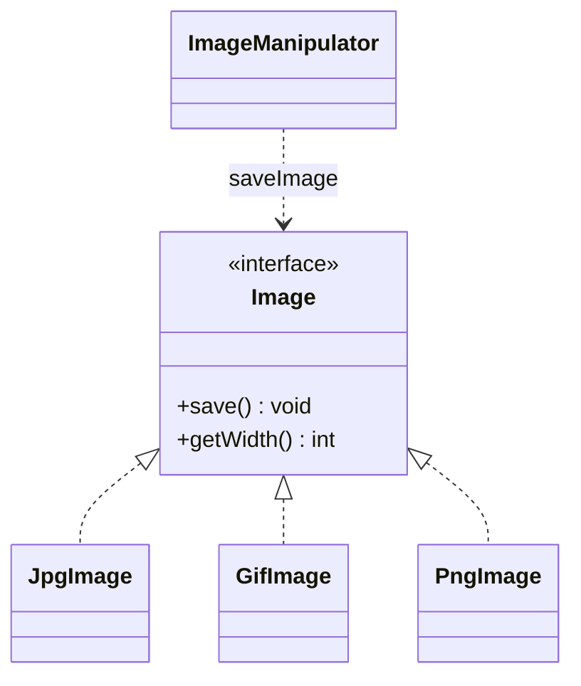
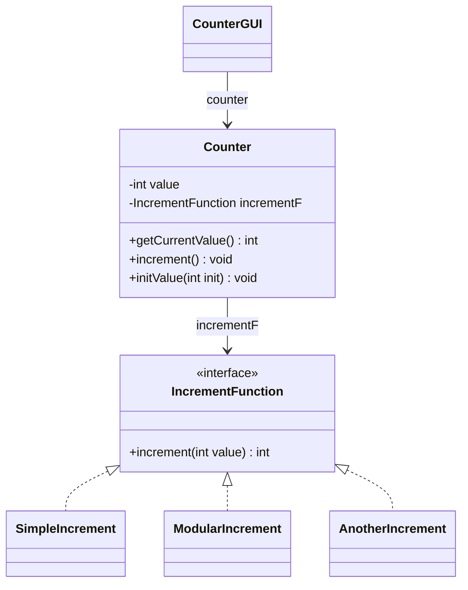
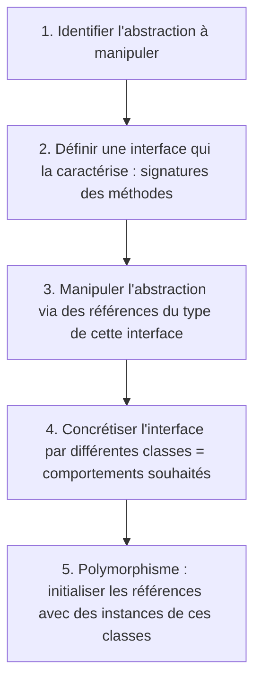

# 06 — Interfaces (suite) : mise en œuvre du polymorphisme

> 🎯 **Objectifs**
> - Je sais écrire un **algorithme générique** (tri) grâce à l'interface **`Comparable<T>`**.
> - Je sais reconnaître les **mauvaises conceptions** (attribut « type » + cascade de `if`, `Object` + `instanceof`).
> - Je sais remplacer une cascade de `if` sur le type par **une interface + des classes**.
> - Je sais énoncer et appliquer l'**Open Closed Principle (OCP)**.
> - Je sais **faire varier un comportement** en identifiant la bonne **abstraction** (exemple du compteur).
>
> ⏱️ Prérequis : [05 — Polymorphisme et interfaces](./05-polymorphisme-et-interfaces.md)

## 🗺️ Vue d'ensemble

💡 **Le fil rouge :** on veut qu'**une même action** (= **le même envoi de message**) produise des **comportements différents** (= des traitements différents).

| Exemple | Abstraction identifiée | Interface | Classes concrètes |
|---|---|---|---|
| Tri d'un tableau | « être comparables 2 à 2 » | `Comparable<T>` | `String`, `Integer`, `Person`, `Carrot` |
| Manipulation d'images | « être une image » | `Image` | `JpgImage`, `GifImage`, `PngImage` |
| Compteur (v1) | « être un compteur » | `Counter` | `SimpleCounter`, `ModularCounter`… |
| Compteur (v2) | « une façon d'incrémenter » | `IncrementFunction` | `SimpleIncrement`, `ModularIncrement`… |



## 1. Trier : le même algorithme, des types différents

💡 **L'idée :** le tri à bulles est **identique** pour des entiers, des chaînes, des personnes… seule la **comparaison** change.

**Tri croissant d'un tableau d'entiers** (cf. correction TD 1) :

```java
public void ascendingSort(int[] elements) {
    int tmp;
    for (int i = elements.length - 1; i > 0; i--) {
        for (int j = 0; j < i; j++) {
            if (elements[j] > elements[j + 1]) {   // mal triés ? on échange
                tmp = elements[j];  elements[j] = elements[j + 1];  elements[j + 1] = tmp;
            }
        }
    }
}
```

Pour trier autre chose, on recopie… et seuls **le type** et **la condition** changent :

| Tableau | Condition « mal triés ? » | En Java |
|---|---|---|
| `int[]` | `elements[j] > elements[j+1]` | opérateur `>` |
| `String[]` | `elements[j]` *greater than* `elements[j+1]` | `elements[j].compareTo(elements[j+1]) > 0` |
| `Person[]` | `elements[j]` *older than* `elements[j+1]` | ❓ |
| `Carrot[]` | `elements[j]` *heavier than* `elements[j+1]` | ❓ |

📌 `String` possède déjà une méthode **`compareTo`** : on s'en inspire.

## 2. Une méthode `compareTo` dans chaque classe

💡 **L'idée :** on donne à `Person` et `Carrot` leur propre `compareTo` ; le tri n'utilise plus que `compareTo`.

📌 **Convention de `a.compareTo(b)`** : **< 0** si `a` avant `b`, **0** si égaux, **> 0** si `a` après `b`.

```java
public class Person {
    private int birthYear;
    public int compareTo(Person other) { return -(this.birthYear - other.birthYear); }  // plus vieux = « plus grand »
}
public class Carrot {
    private int weight;
    public int compareTo(Carrot other) { return this.weight - other.weight; }          // plus lourde = « plus grande »
}
```

Dans `ascendingSort(Person[] elements)` (idem `Carrot[]`, `String[]`), la condition devient `if (elements[j].compareTo(elements[j + 1]) > 0)`.

➡️ Le code est **le même** à un type près : `********`. **Quel type mettre à la place de `********` ?**

## 3. L'interface `Comparable<T>`

💡 **L'idée :** la **seule** condition pour trier, c'est que les objets soient **comparables 2 à 2**, c.-à-d. disposent de `public int compareTo(...)` → c'est une **interface**.

```java
public interface Comparable<T> {      // existe déjà en Java, paquetage java.lang
    public int compareTo(T o);        // T représente le type des objets comparés
}

public class Person implements Comparable<Person> { ... même compareTo(Person other) ... }
public class Carrot implements Comparable<Carrot> { ... même compareTo(Carrot carrot) ... }
```



## 4. Le tri générique `BubbleSort`

💡 **L'idée :** **un seul** algorithme de tri, qui s'applique à **toute** classe implémentant `Comparable`.

```java
public class BubbleSort {
    public static void sort(Comparable<?>[] elements) {   // « ? » : n'importe quel type accepté
        Comparable<?> tmp;
        for (int i = elements.length - 1; i > 0; i--) {
            for (int j = 0; j < i; j++) {
                if (elements[j].compareTo(elements[j + 1]) > 0) {
                    tmp = elements[j];  elements[j] = elements[j + 1];  elements[j + 1] = tmp;
                }
            }
        }
    }
    public static void display(Object[] array) { for (Object o : array) { System.out.println(o.toString()); } }
}
```

- ⚠️ Sur la diapo, le test est écrit `< 0` : cela trierait en ordre **décroissant**. Pour la trace **croissante** ci-dessous, il faut `> 0`.
- 📌 En pratique, le compilateur refuse `compareTo` sur un `Comparable<?>`. Version qui compile, même idée avec un type `T` : `public static <T extends Comparable<T>> void sort(T[] elements) { T tmp; ... }`.

```java
String[] elts = new String[]{"bacd", "abcd", "aabc", "abda"};
BubbleSort.display(elts);    // (1) bacd abcd aabc abda
BubbleSort.sort(elts);
BubbleSort.display(elts);    // (2) aabc abcd abda bacd
Person[] persons = new Person[]{ ... };  BubbleSort.sort(persons);   // même méthode !
Carrot[] karrots = new Carrot[]{ ... };  BubbleSort.sort(karrots);   // même méthode !
```

- 📌 Tableau d'entiers ? Possible avec **`Integer[]`** (pas `int[]` : `int` n'est pas un objet).
- 📌 Pour trier selon **un autre critère** sans toucher à la classe : `java.util.Comparator<T>` → voir [07 — Collections](./07-collections.md).

✅ **Bilan :** l'interface permet **un algorithme** applicable à des objets de **classes différentes**. On identifie l'**abstraction pertinente** (être comparables 2 à 2 ⇒ `Comparable<T>`), on l'exprime par une interface qu'il « **suffit** » d'implémenter : c'est la **seule contrainte** imposée aux classes.

## 5. Manipulation d'images : le besoin

💡 **L'idée :** un outil unique `ImageManipulator` pour des images de **formats différents** (jpg, gif, bmp…).

- Pour une image : **dimension** (largeur × hauteur), **valeur d'un pixel**, **sauvegarder/charger** depuis un fichier…
- Traitements **différents** selon le format (codages), mais on veut **manipuler les images de manière identique** et **ajouter d'autres formats**.
- Objectif : `manipulator.saveImage(img1);` (GIF) et `manipulator.saveImage(img2);` (JPG) → **même envoi de message**, traitements différents.

## 6. Proposition 1 : une seule classe ❌ NON

💡 **L'idée (mauvaise) :** une classe `Image` avec un attribut « type » et des `if` partout.

```java
public class Image {
    private String type;                 // ou avec un enum ImageType
    public Image(String type) { this.type = type; ... }
    public void save() {
        if (this.type.equals("jpg")) { ...CODE A }        // sauvegarde jpg
        else if (this.type.equals("gif")) { ...CODE B }   // sauvegarde gif
        else if (this.type.equals("png")) { ...CODE C }   // sauvegarde png
    }
}
public class ImageManipulator { public void saveImage(Image img) { img.save(); } }
manipulator.saveImage(new Image("gif"));  manipulator.saveImage(new Image("jpg"));   // "ça marche"...
```

**Conséquences :**
- **Code** : une cascade de `if...else` sur le type **dans chaque méthode** liée au format (`getWidth()`, `getHeight()`, `load()`, `save()`…).
- **Conception** : ajouter un format ⇒ **modifier chaque méthode** (un `if` de plus) ⇒ **difficile à étendre**.

## 7. Proposition 2 : plusieurs classes + `Object` ❌ NON PLUS

💡 **L'idée :** pour des **comportements différents**, il faut des **classes différentes** (`JpgImage`, `GifImage`, `PngImage`), chacune avec **sa** version de `save()`… mais que devient `saveImage()` ?

```java
public class JpgImage { public void save() { ...CODE A } }   // identique proposition 1
public class GifImage { public void save() { ...CODE B } }

public class ImageManipulator {                              // ❌ mauvaise réponse
    public void saveImage(Object img) throws NotAnImageException {
        if (img instanceof JpgImage) { ((JpgImage) img).save(); }
        else if (img instanceof GifImage) { ((GifImage) img).save(); }
        else if (img instanceof PngImage) { ((PngImage) img).save(); }
        else throw new NotAnImageException();
    }
}
```

**Conséquences :**
- Ajouter une classe d'images ⇒ **modifier chaque méthode** de `ImageManipulator` : toujours la **cascade de `if`**.
- Paramètre de type `Object` ⇒ **plus de contrôle à la compilation** : `manipulator.saveImage(new String("timoleon"));` est **accepté** ! ⚠️ On **perd le contrôle de typage**.

## 8. La bonne solution : interface ✅ OUI

💡 **L'idée :** **mixer** les deux approches : un **type `Image` commun** (prop. 1) **et** des **classes différentes** par format (prop. 2).

Pour obtenir des traitements différents avec **une même invocation**, il faut des objets **de même type** (une **interface** fixe les messages acceptés) mais **de classes différentes** (chacune implémente **son** comportement) → le **polymorphisme**.

```java
public interface Image {
    public void save();
    // ... et d'autres comme public int getWidth();
}
public class JpgImage implements Image { public void save() { ...CODE A } }   // identique prop. 2
public class GifImage implements Image { public void save() { ...CODE B } }

public class ImageManipulator {                                             // identique prop. 1
    public void saveImage(Image img) { img.save(); }                        // late binding
}
Image img1 = new JpgImage();  Image img2 = new GifImage();
manipulator.saveImage(img1);  manipulator.saveImage(img2);   // "ça marche aussi", ET le typage est contrôlé

// Ajouter un format ? Il SUFFIT de définir une nouvelle classe :
public class PngImage implements Image { public void save() { ...CODE C } }
manipulator.saveImage(new PngImage());   // même message, SANS AUCUN autre changement
```



| | Prop. 1 (attribut type) | Prop. 2 (`Object` + `instanceof`) | ✅ Interface |
|---|---|---|---|
| Cascade de `if` | oui, dans `Image` | oui, dans `ImageManipulator` | **non** |
| Ajouter un format | modifier **chaque** méthode | modifier **chaque** méthode | **ajouter une classe** |
| Typage contrôlé | oui | **non** (`Object`) | **oui** (`Image`) |

## 9. Polymorphisme et Open Closed Principle

💡 **L'idée :** un objet est **toujours instance d'une seule classe**, mais peut être **vu** sous plusieurs types.

**Polymorphisme** — un objet est du type :
- de **sa classe** ;
- des **interfaces implémentées** par sa classe (une `JpgImage` peut être manipulée comme une `Image`).

**Open Closed Principle (OCP)** — **un module doit être ouvert aux extensions mais fermé aux modifications.**
- **Ouvert** : on peut **ajouter** des comportements (nouvelle classe `PngImage`).
- **Fermé** : **sans modifier** l'existant (`ImageManipulator` inchangée).
- À l'extrême : **toujours commencer par définir des interfaces**, et seulement ensuite les classes qui les implémentent.
- 📌 Devise : « **manipuler des abstractions et concrétiser le plus tard possible** ».

## 10. Remarque méthodologique : chasser les cascades de `if`

💡 **L'idée :** une cascade de « si … alors … sinon » dont la condition porte sur un **type** est un **signal d'alarme**.

**Recette :**
1. identifier le(s) **point(s) commun(s)** entre les objets (a priori toutes les méthodes concernées) ;
2. créer une **interface** regroupant ces méthodes ;
3. créer **une classe par « type d'objet »**, qui implémente l'interface et fixe le code des méthodes.

### 10.1 Situation 1 : `instanceof` sur des classes différentes

`ClasseUn` (`fooUn()`, `barUn()`, `f()`), `ClasseDeux` (`fooDeux()`, `barDeux()`, `g()`), `ClasseTrois` (`fooTrois()`, `barTrois()`, `h()`) :

```java
public class Utilisatrice {                                  // AVANT ❌
    public void appelFoo(Object o) {
        if (o instanceof ClasseUn) { ((ClasseUn) o).fooUn(); }
        else if (o instanceof ClasseDeux) { ((ClasseDeux) o).fooDeux(); }
        else if (o instanceof ClasseTrois) { ((ClasseTrois) o).fooTrois(); }
    }
    public void appelBar(Object o) { /* même cascade avec barUn, barDeux, barTrois */ }
    public void appelF(ClasseUn c1) { c1.f(); }  public void appelG(ClasseDeux c2) { c2.g(); }
}
```

**Factoriser les types : créer une interface**

```java
public interface MonInterface {
    public void foo();       // remplace fooUn(), fooDeux(), fooTrois()
    public void bar();       // remplace barUn(), barDeux(), barTrois()
}
public class ClasseUn implements MonInterface {
    public void foo() { /* le code de fooUn */ }  public void bar() { /* le code de barUn */ }
    public void f() { ... }                                  // inchangée
}
// ClasseDeux, ClasseTrois implements MonInterface : similaires
public class Utilisatrice {                                  // APRÈS ✅
    public void appelFoo(MonInterface ref) { ref.foo(); }
    public void appelBar(MonInterface ref) { ref.bar(); }
    public void appelF(ClasseUn c1) { c1.f(); }  public void appelG(ClasseDeux c2) { c2.g(); }  // inchangées
}
```

### 10.2 Situation 2 : un attribut qui code le « type »

```java
public class Timoleon {                                      // AVANT ❌
    private int bidule;       // ou un String, un char, un type énuméré...
    public Timoleon(int b) { this.bidule = b; }
    public int getBidule() { return this.bidule; }
}
public class Utilisatrice {
    public void appelFoo(Timoleon t) {
        int bid = t.getBidule();
        if (bid == 1) { /* bloc 1 pour foo */ } else if (bid == 2) { /* bloc 2 */ } else if (bid == 3) { /* bloc 3 */ }
    }
    public void appelBar(Timoleon t) {
        switch (t.getBidule()) { case 1: /* bloc 1 pour bar */ break;  case 2: ... break;  case 3: ... break; }
    }
}
```

**3 types et 3 comportements ? Alors 3 classes + une interface pour factoriser le type :**

```java
public interface TimoleonInterface { public void foo();  public void bar(); }
public class TimoleonUn implements TimoleonInterface {
    public void foo() { /* bloc 1 pour foo */ }  public void bar() { /* bloc 1 pour bar */ }
}
// TimoleonDeux (blocs 2), TimoleonTrois (blocs 3) : idem
public class Utilisatrice {                                  // APRÈS ✅
    public void appelFoo(TimoleonInterface tim) { tim.foo(); }
    public void appelBar(TimoleonInterface tim) { tim.bar(); }
}
```

## 11. Le compteur (version 1) : interface `Counter`

💡 **L'idée :** un compteur a **une valeur** et peut **passer à la valeur suivante** (« incrémenter ») ; il en existe **plusieurs sortes** (cyclique, borné, pas différents…), que l'interface graphique manipule **de la même façon**.

```java
public class CounterGUI {                 // très approximatif !
    private Counter counter;              // le compteur concerné par l'affichage
    public CounterGUI(Counter counter) { ... this.counter = counter; }
    private void initButtonAction() {
        counter.initValue(Integer.parseInt(initTextField.getText()));  displayCounter();
    }
    private void incrementButtonAction() { counter.increment(); displayCounter(); }
    private void displayCounter() { displayTextField.setText("" + counter.getCurrentValue()); }
}
```

On identifie les fonctionnalités nécessaires → **l'abstraction `Counter`** :

```java
public interface Counter {
    public int getCurrentValue();
    public void increment();
    public void initValue(int init);
}
public class SimpleCounter implements Counter {
    private int value;
    public SimpleCounter(int value) { this.value = value; }
    public int getCurrentValue() { return this.value; }
    public void increment() { this.value++; }
    public void initValue(int init) { this.value = init; }
}
public class ModularCounter implements Counter {
    private int value, modulo;
    public ModularCounter(int value, int modulo) { this.value = value; this.modulo = modulo; }
    ...                                                       // getCurrentValue, initValue : idem
    public void increment() { this.value = (this.value + 1) % this.modulo; }
}

Counter simpleCounter = new SimpleCounter(0);  Counter modularCounter = new ModularCounter(0, 7);   // upcasts vers Counter
new CounterGUI(simpleCounter);  new CounterGUI(modularCounter);
```

**Nouvelle sorte de compteur ?** Ajout **immédiat et naturel** → respect de l'**OCP** :

```java
public class AnotherCounter implements Counter {
    ...                                                       // value, constructeur, getCurrentValue, initValue
    public void increment() { this.value = 2 * this.value + 1; }
}
new CounterGUI(new AnotherCounter(0));                        // CounterGUI inchangée
```

## 12. Le compteur (version 2) : abstraction de l'incrément

💡 **L'idée :** en v1, `getCurrentValue()` et `initValue()` sont **recopiées** partout : la vraie abstraction est **la manière d'incrémenter**.

```java
public interface IncrementFunction { public int increment(int value); }
public class SimpleIncrement implements IncrementFunction { public int increment(int value) { return value + 1; } }
public class ModularIncrement implements IncrementFunction {
    private int modulo;
    public ModularIncrement(int modulo) { this.modulo = modulo; }
    public int increment(int value) { return (value + 1) % this.modulo; }
}
public class AnotherIncrement implements IncrementFunction { public int increment(int value) { return 2 * value + 1; } }
```

⚠️ La diapo écrit `return value++;` : la **post-incrémentation** renvoie l'**ancienne** valeur → le compteur ne bougerait jamais ! Écrire `value + 1`.

`Counter` devient **une seule classe**, qui **délègue** l'incrément :

```java
public class Counter {
    private int value;
    private IncrementFunction incrementF;
    public Counter(int value, IncrementFunction incrementF) { this.value = value; this.incrementF = incrementF; }
    public int getCurrentValue() { return this.value; }
    public void increment() { this.value = this.incrementF.increment(this.value); }  // late binding
    public void initValue(int init) { this.value = init; }
}

Counter simpleCounter  = new Counter(0, new SimpleIncrement());     // upcast
Counter modularCounter = new Counter(0, new ModularIncrement(7));   // vers
Counter anotherCounter = new Counter(0, new AnotherIncrement());    // IncrementFunction
new CounterGUI(simpleCounter);  new CounterGUI(modularCounter);  new CounterGUI(anotherCounter);
```



| | Version 1 | Version 2 |
|---|---|---|
| Ce qui est abstrait | **tout le compteur** (`interface Counter`) | **seulement l'incrément** (`interface IncrementFunction`) |
| `Counter` est… | une interface | une **classe** unique |
| Code répété | `getCurrentValue()`, `initValue()` dans chaque classe | **aucun** |
| Nouveau compteur | nouvelle classe `XxxCounter` | nouvelle classe `XxxIncrement` |

## 13. Interface = Abstraction

💡 **L'idée :** les interfaces sont des **types** qui fixent des **signatures sans imposer le comportement** associé.

Elles :
- permettent une **vision polymorphe** des objets et facilitent la **généricité** (notion de « template ») ;
- permettent d'**offrir aux autres un cadre de programmation** → **concepteur** de framework ;
- permettent de **réutiliser des classes** et de les **adapter à un contexte** → **utilisateur** de framework ;
- facilitent l'**extension** d'un programme (ajout de comportements) **sans modification de l'existant**.

## 14. Méthode : faire varier le comportement

💡 **L'idée :** 5 étapes à appliquer systématiquement.



## ⚠️ Pièges fréquents

| Erreur | Pourquoi c'est faux | Correction |
|---|---|---|
| Attribut `type` + cascade de `if` | ajouter un cas = modifier partout (viole l'OCP) | une interface + une classe par cas |
| Paramètre `Object` + `instanceof` + cast | cascade de `if` **et** perte du contrôle de typage | paramètre du type de l'**interface** |
| Copier-coller le tri pour chaque classe | duplication de code | `Comparable<T>` + un seul `BubbleSort` |
| `compareTo(...) < 0` pour un tri croissant | trie en ordre **décroissant** | échanger si `compareTo(...) > 0` |
| `return value++;` | renvoie l'**ancienne** valeur | `return value + 1;` |
| `implements Comparable` sans `<Person>` | type du paramètre de `compareTo` non fixé | `implements Comparable<Person>` |

## ✅ À retenir

- Polymorphisme : **même envoi de message ⇒ comportements différents**.
- Un **algorithme générique** s'écrit sur une **interface** (ex. tri sur `Comparable<T>`, `java.lang`).
- `a.compareTo(b)` : **< 0** (a avant b), **0** (égaux), **> 0** (a après b).
- ❌ Attribut « type » + `if` en cascade ; ❌ `Object` + `instanceof` + cast.
- ✅ **Un type commun (interface) + des classes différentes** (une par comportement).
- Un objet est du type de **sa classe** et des **interfaces** qu'elle implémente.
- **OCP** : ouvert aux extensions, fermé aux modifications ; « manipuler des abstractions, concrétiser le plus tard possible ».
- Bien choisir l'**abstraction** : parfois seulement **une partie du comportement** (`IncrementFunction`).
- Méthode en **5 étapes** : abstraction → interface → références typées par l'interface → classes → polymorphisme.

## 🧠 Auto-évaluation

**Q1.** Complète pour que `Carrot` soit triable par `BubbleSort` (poids croissant) : `public class Carrot ____ { private int weight; public int compareTo(____ other) { return ____; } }`

<details><summary>Réponse</summary>

`public class Carrot implements Comparable<Carrot> { ... public int compareTo(Carrot other) { return this.weight - other.weight; } }`

</details>

**Q2.** Avec `Person.compareTo` = `-(this.birthYear - other.birthYear)`, qui sort en premier après un tri croissant : la personne née en 1990 ou celle née en 2000 ?

<details><summary>Réponse</summary>

`-(1990 - 2000) = 10 > 0` → la personne de 1990 est « plus grande » (plus âgée). Tri croissant selon l'âge : celle née en **2000** (la plus jeune) sort en premier.

</details>

**Q3.** Trouve les deux défauts : `public void saveImage(Object img) { if (img instanceof JpgImage) { ((JpgImage) img).save(); } else if (img instanceof GifImage) { ((GifImage) img).save(); } }`

<details><summary>Réponse</summary>

1. Cascade de `if` sur le type : ajouter `PngImage` oblige à **modifier** la méthode (viole l'**OCP**).
2. Paramètre `Object` : `saveImage("timoleon")` **compile** → perte du contrôle de typage.

Correction : `public void saveImage(Image img) { img.save(); }` avec `interface Image`.

</details>

**Q4.** Que s'affiche-t-il ? `Counter c = new Counter(5, new ModularIncrement(7)); c.increment(); c.increment(); c.increment(); System.out.println(c.getCurrentValue());`

<details><summary>Réponse</summary>

`5 → 6 → 0 → 1` : affiche **`1`**.

</details>

**Q5.** Pourquoi passer de la version 1 à la version 2 du compteur ?

<details><summary>Réponse</summary>

En v1, `getCurrentValue()` et `initValue()` sont **répétées** dans chaque classe : seule **la manière d'incrémenter** varie. On abstrait donc **uniquement** ce qui varie (`IncrementFunction`) et on garde **une seule** classe `Counter`.

</details>

## 🔗 Pour pratiquer

- [TD Othello](../02-TD/TD-othello/enonce.md)
- [TP Othello](../03-TP/TP-othello/ENONCE.md)

---

[⬅️ Précédent : 05 — Polymorphisme et interfaces](./05-polymorphisme-et-interfaces.md) | [🏠 Sommaire](./README.md) | [Suivant ➡️ : 07 — Collections](./07-collections.md)
