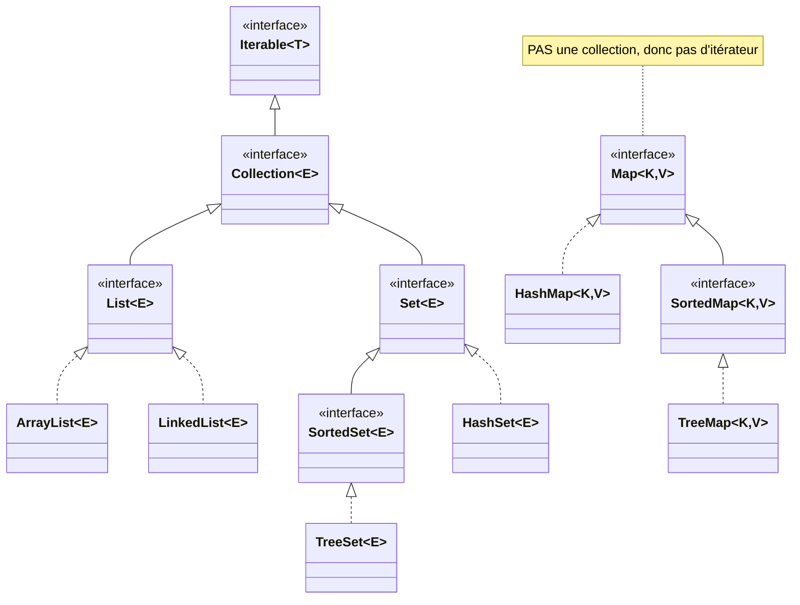
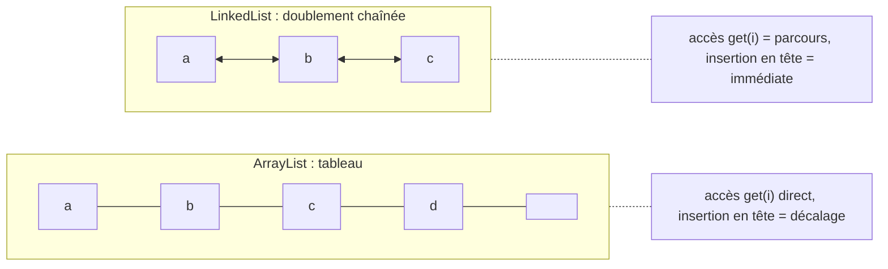
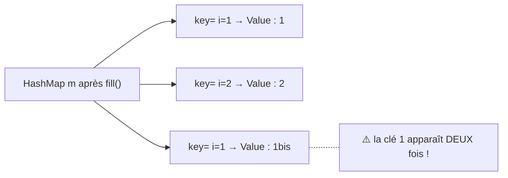
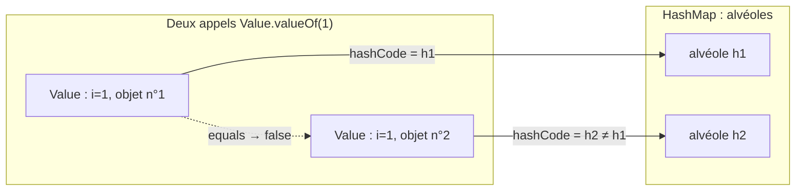
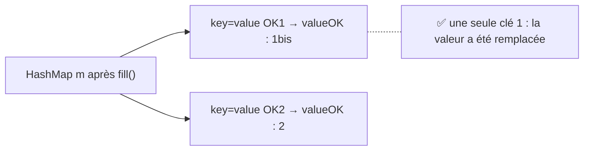
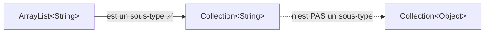

# 07 — Collections et tables de hachage

> 🎯 **Objectifs** :
> - Je sais choisir entre `List`, `Set` et `Map`, et entre leurs implémentations (`ArrayList`, `LinkedList`, `HashSet`, `TreeSet`, `HashMap`, `TreeMap`).
> - Je sais parcourir une collection avec un **itérateur** ou une boucle **for-each**, et rendre une classe `Iterable`.
> - Je sais parcourir une `Map` (par `keySet()` ou `entrySet()`).
> - Je sais pourquoi il faut redéfinir `equals` **et** `hashCode` pour les clés d'une `HashMap` / les éléments d'un `HashSet`.
> - Je comprends les difficultés du typage générique (`Collection<?>`, `Collection<? extends T>`).
>
> ⏱️ Prérequis : [05 — Polymorphisme et interfaces](./05-polymorphisme-et-interfaces.md), [06 — Interfaces (suite)](./06-interfaces-suite.md)

## 🗺️ Vue d'ensemble

Tout se trouve dans le paquetage **`java.util`** (à compléter par le cours d'ASD du S4).



## 1. Qu'est-ce qu'une collection ?

💡 **L'idée :** une collection est un **regroupement d'objets** (ses éléments), dont le comportement dépend de son type.

- **listes** : collections **ordonnées** ; **ensembles** : **sans répétition** de valeurs ;
- et d'autres : pile (`Stack`), file (`Queue`), `Vector`…

📌 Depuis Java 1.5, les collections sont **typées** : le contrat est défini par l'interface `java.util.Collection<E>`, où `E` est le **type des éléments**.

### Méthodes principales de `Collection<E>`

| Méthode | Rôle |
|---|---|
| `boolean add(E e)` | ajoute `e` (opération optionnelle) |
| `boolean contains(Object o)` | `true` s'il existe `e` tel que `o==null ? e==null : o.equals(e)` |
| `boolean isEmpty()` | `true` si aucun élément |
| `Iterator<E> iterator()` | fournit un itérateur sur les éléments |
| `boolean remove(Object o)` | retire **une** occurrence de `o` si présente (optionnelle) |
| `int size()` | nombre d'éléments |
| `addAll()`, `removeAll()`, `toArray()`… | opérations groupées |

⚠️ `contains` et `remove` utilisent **`equals`** : c'est ce qui explique la signature `equals(Object o)` (paramètre de type `Object`, pas du type de la classe).

## 2. Les listes : `List<E>`

💡 **L'idée :** une liste est une collection **ordonnée** : chaque élément a une **position** (index).

```java
List<String> noms = new ArrayList<String>();
noms.add("Frodo"); noms.add("Sam");   // positions 0 et 1
noms.add(0, "Bilbo");       // insertion en tête : Bilbo, Frodo, Sam
String s = noms.get(1);     // "Frodo"
int pos = noms.indexOf("Sam");   // 2 (-1 si absent)
noms.remove(0);             // supprime "Bilbo"
```

📌 En plus des méthodes de `Collection<E>`, `List<E>` exploite la **position** : `add(int index, E element)`, `E get(int index)`, `E remove(int index)`, `int indexOf(Object element)` (première occurrence, `-1` si absent).

⚠️ `get` et `remove(int)` lèvent `IndexOutOfBoundsException` si `index < 0 || index >= size()`.

### Deux implémentations



- **`ArrayList<E>`** : `size`, `isEmpty`, `get`, `set`, `iterator` en **temps constant** ; `add` en temps constant **amorti** ; le reste en temps linéaire.
- **`LinkedList<E>`** : liste doublement chaînée (détails en ASD au S4).

📌 **Quoi utiliser ?**
- `ArrayList` si **ajouts** et **accès direct (indicé)** ;
- `LinkedList` si **nombreuses insertions et suppressions**.

Mesures du cours (40 000 opérations) : `get(k)` → LinkedList 606 ms / ArrayList **3 ms** ; ajout en tête → LinkedList **3 ms** / ArrayList 213 ms ; suppression en tête → **3 ms** / 414 ms.

## 3. Les ensembles : `Set<E>`

💡 **L'idée :** un ensemble est une collection **sans répétition de valeurs** : ajouter deux fois « la même » valeur ne la stocke qu'une fois.

```java
Set<String> s = new HashSet<String>();
s.add("Gandalf"); s.add("Aragorn");
s.add("Gandalf");                  // déjà présent : add renvoie false
System.out.println(s.size() + " " + s.contains("Aragorn"));   // 2 true
```

| Classe | Principe | Coût des opérations de base |
|---|---|---|
| `HashSet<E>` | table de hachage → **test d'appartenance rapide** | temps **constant** (`add`, `remove`, `contains`, `size`) si la fonction de hachage disperse bien |
| `TreeSet<E>` | arbre → éléments **triés** | **log n** garanti |

- `TreeSet` implémente `SortedSet` ⇒ méthodes `first()`, `last()`.
- ⚠️ Les éléments d'un `TreeSet` doivent implémenter l'interface **`Comparable`**.
- 📌 Dans ce cours, on utilise essentiellement **`HashSet`**.

## 4. Collections d'objets, autoboxing, méthodologie

### 4.1 Uniquement des objets

💡 **L'idée :** une collection ne contient **que des objets**, jamais des valeurs primitives.

- `List<int>` / `Set<int>` ⇒ ❌ **impossible** : il faut la **classe associée** (`List<Integer>`, `Set<Integer>`).

Grâce à l'**autoboxing** (Java 1.5), le compilateur gère les conversions *type primitif ↔ classe associée* :

```java
List<Integer> l = new ArrayList<Integer>();
l.add(12);           // correspond à l.add(Integer.valueOf(12));
int i = l.get(0);    // correspond à int i = l.get(0).intValue();
```

### 4.2 Programmer avec l'interface

💡 **L'idée :** déclarer les références avec le type de l'**interface** (`List`, `Set`) et ne choisir la classe qu'au `new`.

```java
List<Item> aList = new ArrayList<Item>();   // traitements : uniquement méthodes de List
// si besoin, plus tard, on change UNE seule ligne, mêmes traitements :
List<Item> aList = new LinkedList<Item>();
```

✅ C'est le polymorphisme vu aux chapitres 05-06 : le code client ne dépend que du **contrat** (l'interface).

## 5. Les itérateurs

💡 **L'idée :** pour parcourir les éléments d'une collection, on demande à la collection un **itérateur**, un objet qui « avance » d'élément en élément.

### 5.1 L'interface `java.util.Iterator<E>`

| Méthode | Rôle |
|---|---|
| `boolean hasNext()` | reste-t-il des éléments ? |
| `E next()` | renvoie l'élément suivant (et avance) |
| `void remove()` | retire de la collection le dernier élément renvoyé par `next()` (optionnelle) |

Pour les listes, **`ListIterator<E>`** permet en plus le parcours avant/arrière (`previous()`, `hasPrevious()`) et `add(E e)`, `set(E e)`.

### 5.2 Utilisation : `iterator()`

Les itérateurs sont **construits par les collections**, via la méthode `iterator()` :

```java
Collection<Recyclable> trashcan = new ArrayList<Recyclable>();
trashcan.add(new Paper());     // upcast implicite vers Recyclable
trashcan.add(new Battery());
Iterator<Recyclable> it = trashcan.iterator();   // itérateur sur la collection
while (it.hasNext()) {
    Recyclable ref = it.next();   // it.next() est du type Recyclable
    ref.recycle();                // late binding : recycle() de Paper, puis de Battery
}
```

### 5.3 La boucle for-each

Même parcours, syntaxe plus légère :

```java
for (Recyclable r : trashcan) { r.recycle(); }
```

📌 Possible sur les **tableaux** et sur **toute classe qui implémente `Iterable<T>`**.

### 5.4 Rendre sa classe `Iterable`

```java
public interface Iterable<T> {        // java.lang.Iterable
    public Iterator<T> iterator();
}

public class Agency implements Iterable<Car> {
    private Collection<Car> theCars;
    // ...
    public Iterator<Car> iterator() {
        return this.theCars.iterator();   // on délègue à la collection interne
    }
}

Agency agency = ... ;
for (Car c : agency) { ... }   // itération sur les voitures de agency
```

### 5.5 ⚠️ Attention, danger : ne pas parcourir une liste avec `get(i)`

```java
for (int i = 0; i < l.size(); i++) { ... l.get(i) ... }   // ❌ À NE JAMAIS FAIRE
```

- Sur une `LinkedList`, chaque `get(i)` reparcourt la liste ⇒ coût énorme.
- Mesure du cours (80 000 éléments) : itérateur **34 ms** vs `get` **2315 ms**.
- ✅ Utiliser un **itérateur** (ou for-each).

### 5.6 Un itérateur est « fail-fast »

💡 **L'idée :** si la collection est modifiée **après** la création de l'itérateur (autrement que par le `remove`/`add` de l'itérateur lui-même), l'itérateur lance une **`ConcurrentModificationException`**.

```java
List<Item> l = ...;
for (int i = 0; i < 5; i++) { l.add(new Item(...)); }
Iterator<Item> it_l = l.iterator();
Item some = it_l.next();   // ok
l.add(new Item(...));      // modification de la liste ⇒ corruption de l'itérateur
some = it_l.next();        // ConcurrentModificationException levée
```

✅ Mise en échec **rapide et propre** plutôt que de risquer l'incohérence.

## 6. Les tables : `Map<K,V>`

💡 **L'idée :** une `Map` associe des **clés** (uniques) à des **valeurs**, comme un dictionnaire : auteur ⟶ livre.

- Aussi appelées « listes associatives », dictionnaires, index… : couples **(clé, valeur)**, **clés uniques**.
- ⚠️ Les `Map` **ne sont pas des collections** ⇒ **pas d'itérateur** direct.

| Classe | Principe | Coût |
|---|---|---|
| `HashMap<K,V>` | table de hachage | `get`/`put` en temps **constant** (si bon hachage) |
| `TreeMap<K,V>` | en plus : **clés triées** | **log n** garanti (`containsKey`, `get`, `put`, `remove`) |

### 6.1 Méthodes de `Map<K,V>`

| Méthode | Rôle |
|---|---|
| `V get(K key)` | valeur associée à `key` |
| `put(K key, V value)` | ajoute le couple (remplace l'ancienne valeur si la clé existe) |
| `V remove(Object key)` | supprime le couple de clé `key` |
| `boolean containsKey(Object key)` | la clé existe ? (`equals` **et** `hashCode()`) |
| `boolean containsValue(Object value)` | la valeur existe ? (`equals`) |
| `Collection<V> values()` | collection des valeurs |
| `Set<K> keySet()` | **ensemble** des clés |
| `Set<Map.Entry<K,V>> entrySet()` | ensemble des couples (objets `Map.Entry<K,V>`) |

### 6.2 Exemple du cours : auteur ⟶ `Book`

```java
// associe un auteur (String) à un Book
Map<String,Book> table = new HashMap<String,Book>();
String author = "Tolkien";
Book book1 = new Book("Le Seigneur des Anneaux");
table.containsKey(author);                      // false
table.put(author, book1);
System.out.println(table.get(author).getTitle()); // Le Seigneur des Anneaux
table.containsKey(author);  table.containsValue(book1);   // true, true
Book book2 = new Book("Le Silmarillion");
table.put(author, book2);                       // même clé ⇒ REMPLACE book1
System.out.println(table.get(author).getTitle()); // Le Silmarillion
table.containsValue(book1);                     // false
```

### 6.3 Parcourir une `Map`

Pas d'itérateur ⇒ on itère sur l'**ensemble des clés** ou sur l'**ensemble des couples**.

**(1) Par les clés : `keySet()`**

```java
public void displayMap() {     // table : Map<String,Book>
    for (String author : this.table.keySet()) {
        System.out.println(author + " a ecrit " + this.table.get(author));
    }
}
```

**(2) Par les couples : `entrySet()`** (évite un `get` par clé)

```java
public void displayMap() {
    for (Map.Entry<String,Book> entry : this.table.entrySet()) {
        System.out.println(entry.getKey() + " a ecrit " + entry.getValue());
    }
}
```

## 7. Attention !!! `equals` et `hashCode`

💡 **L'idée :** une `HashMap` (ou un `HashSet`) reconnaît deux clés comme « identiques » seulement si elles ont le **même `hashCode()`** **ET** sont **égales selon `equals`**.

### 7.1 Ça marche avec `Integer`…

Dans `TestMapSimple`, `put(1, "Integer : 1")`, `put(2, "Integer : 2")` puis `put(1, "Integer : 1bis")` donnent 2 couples : `1 -> Integer : 1bis` et `2 -> Integer : 2` (même clé ⇒ remplacement ✅).

### 7.2 … « damned ! » avec notre classe `Value`

```java
class Value {
    private int i = 1;
    public Value(int i) { this.i = i; }
    public String toString() { return " i=" + this.i; }
    public static Value valueOf(int i) { return new Value(i); }
}
// dans TestMapPb :
this.m.put(Value.valueOf(1), "Value : 1");
this.m.put(Value.valueOf(2), "Value : 2");
this.m.put(Value.valueOf(1), "Value : 1bis");
```


Pourquoi ? `Value` n'a redéfini ni `equals` ni `hashCode` : ce sont ceux d'`Object`, qui comparent les **références**. Deux `new Value(1)` sont deux objets distincts ⇒ deux clés différentes.



### 7.3 La correction : `ValueOK`

```java
class ValueOK {
    private int i = 1;
    public ValueOK(int i) { this.i = i; }
    public String toString() { return "value OK" + this.i; }
    public static ValueOK valueOf(int i) { return new ValueOK(i); }

    public boolean equals(Object o) {           // paramètre Object !
        return (o instanceof ValueOK) && (this.i == ((ValueOK) o).i);
    }
    public int hashCode() { return this.i; }     // égaux ⇒ même hashCode
}
```


📌 **Règle** : pour toute classe dont les objets sont **clés d'une `HashMap`** ou **éléments d'un `HashSet`**, définir `hashCode()` **et** `equals(Object o)` de façon cohérente.

- Un `HashSet` est en fait l'ensemble des clés d'une `HashMap` ⇒ **même problème**.
- Le fonctionnement interne des tables de hachage : cours d'ASD au S4.

## 8. Difficultés liées au typage générique

💡 **L'idée :** `ArrayList<String>` est un sous-type de `Collection<String>`, mais **`Collection<String>` n'est PAS un sous-type de `Collection<Object>`**.



### 8.1 Conséquence

```java
Collection<Hobbit> colHob = new ArrayList<>();   // ok
Collection<Object> c = new ArrayList<>();        // ok
Collection<Object> c2 = colHob;                  // ❌ incompatible types

public void dump(Collection<Object> c) {
    for (Object o : c) { System.out.println(o); }
}
xxx.dump(new ArrayList<Hobbit>());   // ❌ ne compile pas !
```

`Collection<Object>` signifie « collection d'éléments **de type `Object`** », pas « n'importe quelle collection ».

### 8.2 Le joker `?` : `Collection<?>`

Pour dire « **n'importe quelle collection** » : `Collection<?>` (collection d'inconnus).

```java
public void dump(Collection<?> c) {
    for (Object o : c) { System.out.println(o); }   // seule garantie : ce sont des Object
}
xxx.dump(new ArrayList<Hobbit>());   // ✅ légal
```

⚠️ Mais on ne peut **rien ajouter** (type exact inconnu) : avec `Collection<?> c = new ArrayList<Hobbit>();`, l'instruction `c.add(new Hobbit(...));` ❌ ne compile pas.

### 8.3 Joker borné : `Collection<? extends Recyclable>`

Avec `recycleAll(Collection<Recyclable> c)`, l'appel `recycleAll(trashcan)` (une `List<Recyclable>`) est ✅ mais `recycleAll(paperBasket)` (une `List<Paper>`) est ❌, pour la même raison qu'au 8.1.

Pour exprimer « une collection de n'importe quoi **du moment que c'est un sous-type de `Recyclable`** » :

```java
public void recycleAll(Collection<? extends Recyclable> c) {
    for (Recyclable o : c) { o.recycle(); }
}
xxx.recycleAll(new ArrayList<Paper>());   // ✅ légal
```

📌 Il existe aussi `? super T` pour réclamer un type **plus général** que `T`.

| Écriture | Accepte | Lire un élément donne |
|---|---|---|
| `Collection<Object>` | seulement `Collection<Object>` | `Object` |
| `Collection<?>` | toute collection | `Object` |
| `Collection<? extends Recyclable>` | collections de `Recyclable` ou sous-types | `Recyclable` |

## 9. Trier une liste : `Collections.sort`

💡 **L'idée :** la classe utilitaire **`Collections`** (avec un « s ») fournit la méthode statique `sort` (tri par fusion modifié, ∼ n log n).

| Appel | Ordre utilisé |
|---|---|
| `Collections.sort(List<T> list)` | `compareTo` : les objets doivent être mutuellement **`Comparable`** |
| `Collections.sort(List<T> list, Comparator<? super T> comp)` | un **`Comparator<T>`** : `int compare(T o1, T o2)` (relation d'ordre totale) |

## 📌 Tableau comparatif des implémentations

| | `ArrayList<E>` | `LinkedList<E>` | `HashSet<E>` | `TreeSet<E>` | `HashMap<K,V>` |
|---|---|---|---|---|---|
| Interface | `List` | `List` | `Set` | `SortedSet` / `Set` | `Map` |
| Structure | tableau | liste doublement chaînée | table de hachage | arbre | table de hachage |
| Ordre | ordre d'insertion / positions | ordre d'insertion / positions | **aucun** garanti | **trié** | aucun garanti |
| Doublons | oui | oui | **non** | **non** | clés uniques |
| Accès par indice `get(i)` | **constant** | linéaire | — | — | `get(clé)` constant |
| Insertion/suppr. en tête | linéaire | **constant** | — | — | — |
| `contains` / `add` | linéaire / constant amorti | linéaire / constant | **constant** | log n | `containsKey` constant |
| Exigence sur les éléments | `equals` | `equals` | `equals` + `hashCode` | `Comparable` | clés : `equals` + `hashCode` |
| Quand l'utiliser | ajouts + accès indicé | nombreuses insertions/suppressions | test d'appartenance rapide | ensemble trié (`first()`, `last()`) | dictionnaire clé → valeur |

## ⚠️ Pièges fréquents

| Erreur | Pourquoi c'est faux | Correction |
|---|---|---|
| `List<int> l = ...` | une collection ne contient que des objets | `List<Integer>` (autoboxing) |
| `for (int i…) l.get(i)` | très lent sur `LinkedList` | itérateur ou for-each |
| Modifier la liste pendant un parcours par itérateur | `ConcurrentModificationException` (fail-fast) | utiliser `it.remove()` |
| Clé de `HashMap` sans `equals`/`hashCode` | comparaison par références ⇒ « doublons » | redéfinir `equals(Object)` **et** `hashCode()` |
| `public boolean equals(ValueOK o)` | surcharge, pas redéfinition : `contains`/`get` appellent `equals(Object)` | paramètre de type `Object` |
| `TreeSet` d'objets non `Comparable` | le tri est impossible | implémenter `Comparable` |
| `dump(Collection<Object>)` appelé avec `ArrayList<Hobbit>` | `Collection<Hobbit>` n'est pas sous-type de `Collection<Object>` | `Collection<?>` ou `Collection<? extends …>` |

## ✅ À retenir

- `java.util` : `Collection<E>` ⟶ `List<E>` (ordonnée) et `Set<E>` (sans répétition) ; `Map<K,V>` à part.
- `ArrayList` : accès indicé rapide ; `LinkedList` : insertions/suppressions rapides.
- `HashSet` : appartenance en temps constant ; `TreeSet` : trié, éléments `Comparable`.
- Déclarer avec l'**interface** (`List<Item> l = new ArrayList<Item>()`).
- Parcours : **itérateur** (`hasNext`/`next`) ou **for-each** (tableaux + `Iterable<T>`) ; jamais `get(i)` en boucle.
- Itérateur **fail-fast** ⇒ `ConcurrentModificationException`.
- `Map` : `put`, `get`, `containsKey`, `keySet()`, `entrySet()` ; `put` sur une clé existante **remplace**.
- `HashMap`/`HashSet` : redéfinir **`equals(Object)` ET `hashCode()`**.
- `Collection<String>` n'est pas un `Collection<Object>` ⇒ `Collection<?>`, `Collection<? extends T>`.
- `Collections.sort(list)` (avec `Comparable`) ou `Collections.sort(list, comparator)`.

## 🧠 Auto-évaluation

**Q1.** Quelle structure choisir pour stocker des mots en **éliminant les doublons**, avec un test d'appartenance rapide ?

<details><summary>Réponse</summary>

Un `Set<String>` implémenté par `HashSet<String>` : pas de répétition, `contains` en temps constant.

</details>

**Q2.** Trouve l'erreur : `List<double> notes = new ArrayList<double>();`

<details><summary>Réponse</summary>

Une collection ne contient que des objets. Il faut `List<Double> notes = new ArrayList<Double>();` ; l'autoboxing permet ensuite `notes.add(12.5);`.

</details>

**Q3.** Que s'affiche-t-il ?
```java
Map<String,Integer> m = new HashMap<String,Integer>();
m.put("a", 1); m.put("b", 2); m.put("a", 3);
System.out.println(m.size() + " " + m.get("a"));
```

<details><summary>Réponse</summary>

`2 3` : les clés sont uniques, le second `put("a", …)` **remplace** la valeur.

</details>

**Q4.** Que se passe-t-il ?
```java
List<String> l = new ArrayList<String>();
l.add("x"); l.add("y");
Iterator<String> it = l.iterator();
it.next(); l.add("z"); it.next();
```

<details><summary>Réponse</summary>

`ConcurrentModificationException` au second `it.next()` : la liste a été modifiée autrement que par l'itérateur après sa création (itérateur **fail-fast**).

</details>

**Q5.** Avec la classe `Value` du cours (sans `equals` ni `hashCode`), combien d'éléments contient `s` ?
```java
Set<Value> s = new HashSet<Value>();
s.add(new Value(1)); s.add(new Value(1));
```

<details><summary>Réponse</summary>

**2** : `equals` et `hashCode` sont ceux d'`Object` (comparaison des références). Avec `ValueOK`, on obtiendrait **1**.

</details>

**Q6.** Ce code compile-t-il ? Sinon, corrige la signature.
```java
public void recycleAll(Collection<Recyclable> c) { ... }
xxx.recycleAll(new ArrayList<Paper>());   // Paper implements Recyclable
```

<details><summary>Réponse</summary>

Non : `Collection<Paper>` n'est pas un sous-type de `Collection<Recyclable>`. Correction :
```java
public void recycleAll(Collection<? extends Recyclable> c) { ... }
```

</details>

**Q7.** Écris le parcours d'une `Map<String,Book> table` qui affiche « auteur a ecrit livre » **sans** appeler `get`.

<details><summary>Réponse</summary>

```java
for (Map.Entry<String,Book> entry : table.entrySet()) {
    System.out.println(entry.getKey() + " a ecrit " + entry.getValue());
}
```

</details>

## 🔗 Pour pratiquer

- [TP Othello](../03-TP/TP-othello/ENONCE.md)

---

⬅️ [Précédent](./06-interfaces-suite.md) | 🏠 [Sommaire](./README.md) | [Suivant ➡️](./08-heritage.md)
