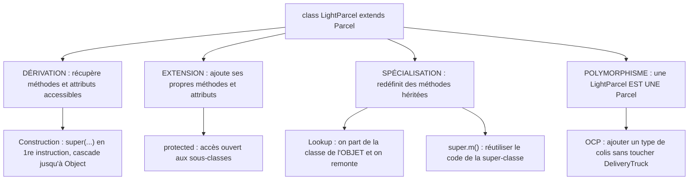
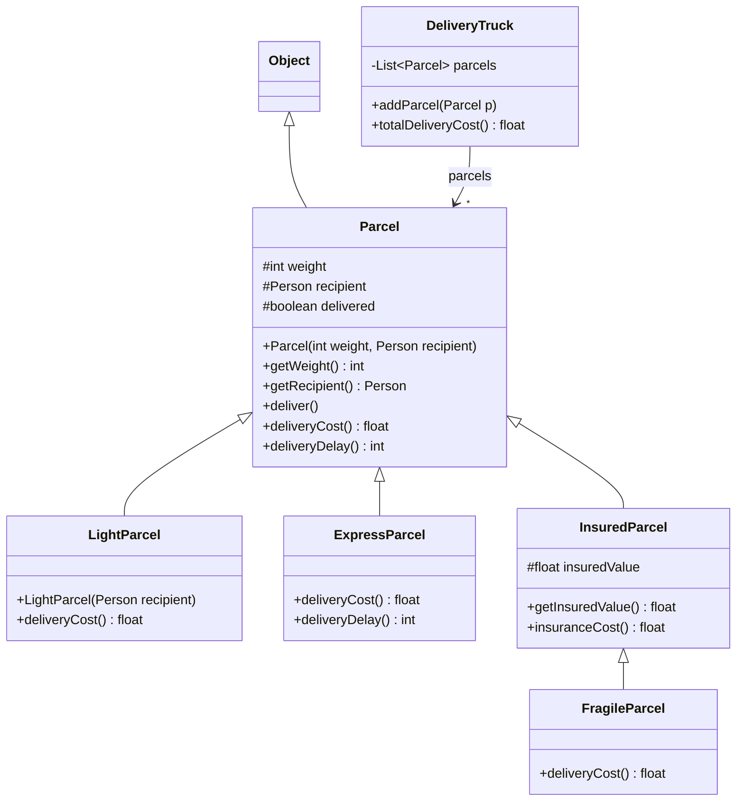
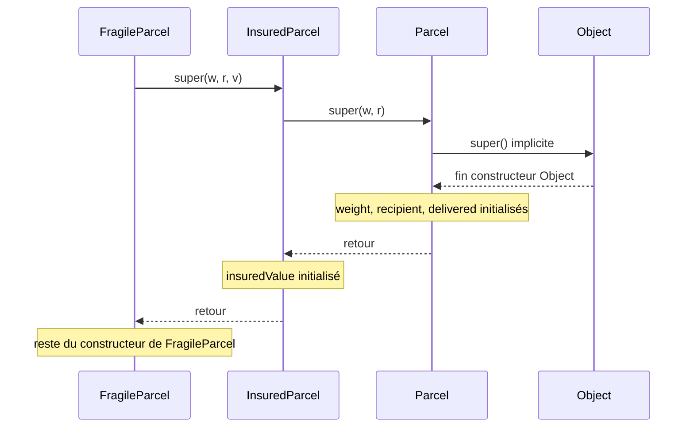
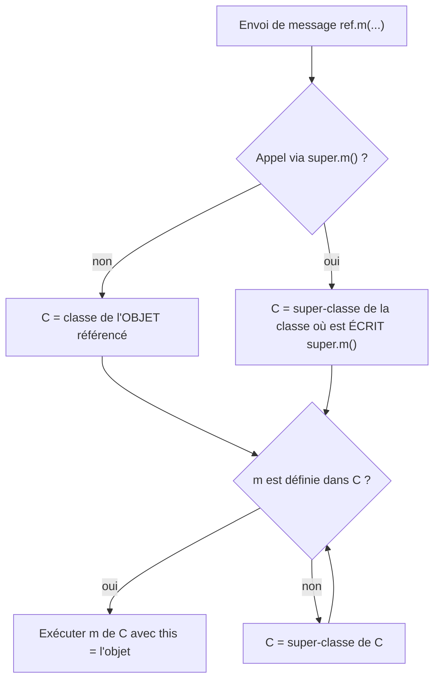

# 08 — Héritage

> 🎯 **Objectifs**
> - Je sais déclarer une sous-classe avec **`extends`** et expliquer **dérivation / extension / spécialisation**.
> - Je sais écrire un constructeur de sous-classe qui appelle le **super-constructeur** `super(...)`.
> - Je sais **redéfinir** une méthode (overriding) et réutiliser la version de la super-classe avec **`super.m()`**.
> - Je sais dérouler l'algorithme de **recherche de méthode (lookup)** et le **late binding**.
> - Je sais utiliser **`protected`** et pourquoi on évite les `instanceof` en cascade.
>
> ⏱️ Prérequis : [05 — Polymorphisme et interfaces](./05-polymorphisme-et-interfaces.md) · [06 — Interfaces (suite)](./06-interfaces-suite.md)

## 🗺️ Vue d'ensemble



## 1. Le problème : des colis à livrer

💡 **L'idée :** plusieurs sortes de colis partagent l'essentiel de leur code mais diffèrent sur quelques points — l'héritage évite le copier-coller.

**Colis « de base »** (`Parcel`) : un poids, un destinataire (`Person`) et son adresse, livré ou non, destinataire notifié à la livraison, frais de livraison selon le poids, délai de 48h par défaut.

| Autre catégorie | Spécificité |
|---|---|
| colis léger | poids fixé à 1 kg, frais fixés à 2 € |
| colis express | délai 24h, frais = **double** de ceux d'un colis de base de même poids |
| colis avec assurance | a une **valeur assurée** + frais d'assurance (1 % de la valeur) |
| colis fragile | colis **avec assurance** dont les frais sont augmentés de 5 € |

**Le camion** (`DeliveryTruck`) transporte **tous les types de colis ensemble** (charge max), calcule le total des frais et livre les colis.

📌 **Conséquences tirées de l'étude** :
- « un colis léger **est un** colis » ⇒ il accepte **les mêmes messages** que `Parcel` et possède **les mêmes attributs**.
- Certaines méthodes gardent le **même code** (`getWeight()`, `deliver()`…), d'autres changent (`deliveryCost()` du colis léger).
- Certains colis ont des méthodes/attributs **en plus** (`getInsuredValue()`).
- Les frais express/fragile **dépendent** du calcul « au-dessus » : s'il change, ils doivent suivre.
- Le camion range tout dans une `List<Parcel>` ⇒ il faut un **type commun**.

## 2. Héritage de classe : `extends`

💡 **L'idée :** une classe peut **hériter** d'une autre ; `extends` = « **est un cas particulier de** ».

```java
public class Parcel { ... }
public class LightParcel   extends Parcel { ... }
public class ExpressParcel extends Parcel { ... }
public class InsuredParcel extends Parcel { ... }
public class FragileParcel extends InsuredParcel { ... }
```

| Mécanisme | La sous-classe… | Exemple colis |
|---|---|---|
| **dérivation** | récupère les comportements (accessibles) de la super-classe | `LightParcel` a `deliver()` |
| **extension** | ajoute de nouveaux comportements/attributs | `InsuredParcel.getInsuredValue()` |
| **spécialisation** | modifie (redéfinit) des comportements hérités | `LightParcel.deliveryCost()` |
| **polymorphisme** | ses instances sont aussi du type de la super-classe | une `LightParcel` est une `Parcel` |



📌 En UML : triangle vide vers la super-classe = **généralisation** ; `#` = `protected`. Une sous-classe ne liste que ce qu'elle **ajoute** ou **redéfinit**.

⚠️ En Java, on n'hérite que d'**une seule classe** (certains langages permettent l'héritage multiple).

## 3. Polymorphisme et upcast

💡 **L'idée :** une sous-classe est un **sous-type** : là où on attend une `Parcel`, on peut mettre n'importe quel colis.

📌 **C'est le type de la référence qui détermine les appels valides** (comme avec les interfaces) :

```java
Parcel p = new LightParcel(timoleon);        // upcast légal
p = new ExpressParcel(8, timoleon);          // upcast légal
FragileParcel fragileP = new FragileParcel(3, timoleon, 100);
p = fragileP;                   // upcast : deux références vers le même objet
p.deliver();                    // légal
fragileP.getInsuredValue();     // légal
p.getInsuredValue();            // ⚠️ ILLÉGAL : Parcel ne connaît pas getInsuredValue()
```

C'est ce qui permet à `addParcel(Parcel parcel)` d'accepter **n'importe quel type de colis**.

## 4. Dérivation : ce qu'on hérite « gratuitement »

💡 **L'idée :** sans rien écrire, la sous-classe dispose des méthodes **et** des attributs de la super-classe.

```java
public class LightParcel extends Parcel {
    public LightParcel(Person recipient) { ... }
    public float deliveryCost() { ... }
}   // et rien de plus

LightParcel lightP = new LightParcel(timoleon);
lightP.getRecipient();       // → timoleon   (code défini dans Parcel)
lightP.deliver();            // → timoleon est notifié
lightP.hasBeenDelivered();   // → true
```

- Héritage des méthodes ⇒ **héritage des attributs** : `getRecipient()` lit `this.recipient`, donc `recipient` **existe** dans `lightP`.
- ⇒ impact sur la **construction** des objets de la sous-classe (§8).

⚠️ **Ce qui est privé reste privé** : les attributs `private` hérités **existent** mais ne sont **pas accessibles** directement.

```java
public class SpecialPerson extends Person {
    public void something() {
        System.out.println(this.name);        // ⚠️ interdit : name est private dans Person
        this.setName("my new name");          // légal : méthode publique héritée
        System.out.println(this.getName());   // légal → name existe bien
    }
}
```

## 5. Extension et transitivité

💡 **L'idée :** une sous-classe peut définir de **nouveaux** attributs et méthodes, en plus de ceux hérités.

```java
public class InsuredParcel extends Parcel {
    private static final float INSURANCE_RATE = 0.01f;
    private float insuredValue;                                   // nouvel attribut
    public InsuredParcel(int weight, Person recipient, float value) { ... }
    public float getInsuredValue() { return this.insuredValue; }  // nouvelle méthode
    public float insuranceCost() { return this.insuredValue * INSURANCE_RATE; }
}
```

📌 L'héritage est **transitif** : `FragileParcel ⊂ InsuredParcel ⊂ Parcel`.

```java
FragileParcel fragileP = new FragileParcel(3, timoleon, 100);
InsuredParcel insuredP = fragileP;   // légal
fragileP.getInsuredValue();          // hérité de InsuredParcel (méthode ajoutée)
fragileP.deliver();                  // hérité de InsuredParcel, qui l'hérite de Parcel
```

## 6. Spécialisation : la redéfinition (overriding)

💡 **L'idée :** une sous-classe peut **redéfinir** une méthode héritée ; ses instances utilisent alors **sa** version.

```java
public class Parcel {
    private static final int BASE_COST = 3;
    public float deliveryCost() {
        if (this.weight < 5) { return BASE_COST; }
        else { return 2 * BASE_COST + (this.weight / 10); }
    }
}
public class LightParcel extends Parcel {
    private static final int COST = 2;
    public float deliveryCost() { return COST; }      // redéfinition / overriding
}

new Parcel(4, timoleon).deliveryCost();             // comportement « de base »
new InsuredParcel(4, timoleon, 500).deliveryCost(); // comportement hérité de Parcel
new LightParcel(timoleon).deliveryCost();           // → 2 : comportement redéfini
```

📌 **Règles d'une redéfinition :**
- respecter **exactement la signature** ;
- on peut **accroître** la visibilité, jamais la **réduire** ;
- exceptions : les mêmes, ou des **sous-classes** de celles-ci (§9).

> Complément : `@Override` devant la méthode demande au compilateur de vérifier qu'il s'agit bien d'une redéfinition. Ne pas confondre avec la **surcharge** (même nom, paramètres **différents**).

## 7. `Object` : des mystères révélés

💡 **L'idée :** toute classe hérite, directement ou par transitivité, de **`Object`** (`extends Object` est implicite).

- **tout objet est de type `Object`** ;
- tout objet dispose des méthodes de `Object` : `equals(Object o)`, `toString()`, `hashCode()`… ;
- la définition de `Object` est utilisée **s'il n'y a pas de redéfinition**.

## 8. Construction : le super-constructeur `super(...)`

💡 **L'idée :** les attributs hérités sont créés et initialisés par **un constructeur de la super-classe**, appelé avec `super(...)`.

📌 **Règles :**
- `super(paramètres)` = appel d'un constructeur de la super-classe ;
- c'est **la première instruction** du constructeur de la sous-classe ; l'initialisation propre vient **après** ;
- appels **en cascade** jusqu'à `Object` ;
- appel **implicite** possible seulement pour `super()` **sans paramètre**.

```java
public class Parcel {                           // extends Object implicite
    private int weight; private Person recipient; private boolean delivered;
    public Parcel(int weight, Person recipient) {
        // super();  ← implicite : constructeur de Object
        this.weight = weight; this.recipient = recipient; this.delivered = false;
    }
}
public class InsuredParcel extends Parcel {
    private float insuredValue;
    public InsuredParcel(int weight, Person recipient, float value) {
        super(weight, recipient);       // ① super-constructeur
        this.insuredValue = value;      // ② initialisation de l'attribut ajouté
    }
}
public class FragileParcel extends InsuredParcel {
    public FragileParcel(int weight, Person recipient, float value) { super(weight, recipient, value); }
}
```

Déroulé de `new FragileParcel(w, r, v)` :



Le constructeur reprend **souvent** les paramètres du super-constructeur… **mais pas toujours** : `public LightParcel(Person recipient) { super(DEFAULT_WEIGHT, recipient); }` (poids imposé à 1).

⚠️ `Parcel` n'a **pas** de constructeur sans paramètre ⇒ dans ses sous-classes, `super(...)` explicite est **obligatoire**.

### Les étapes de la création d'un objet

1. **chargement de la classe** (si pas déjà fait), donc aussi de sa super-classe ;
2. attributs **`static`** — **une seule fois**, au chargement ;
3. appel du **constructeur de la super-classe** ;
4. initialisation des attributs ayant une **valeur par défaut** ;
5. exécution du **reste du code** du constructeur.

Exemple des diapos : `Initialisation extends C`, `C` a un `static Value v0`, `Initialisation` a un `static Value v1`, un attribut `v2 = new Value(2)` et crée `v3` dans son constructeur. Deux `new Initialisation()` affichent :
`Value 0` · `Value 1` · `C` · `Value 2` · `Initialisation` · `Value 3` · `****` · `C` · `Value 2` · `Initialisation` · `Value 3` → les `static` ne s'exécutent **qu'une fois**.

📌 **Mort d'un objet** : le **Garbage Collector** libère les objets **plus référencés**, sans garantie de moment. `finalize()` n'est pas fiable : pour une fin de vie particulière (fermer des flux…), écrire et **appeler explicitement** une méthode dédiée.

## 9. Exceptions et héritage

💡 **L'idée :** une classe d'exception est une classe qui **hérite** de `Exception` (ou d'une de ses sous-classes).

```java
public class CapacityExceededException extends Exception {
    public CapacityExceededException(String msg) { super(msg); }
}
// dans DeliveryTruck
public void addParcel(Parcel parcel) throws CapacityExceededException {
    if (this.currentWeight + parcel.getWeight() > this.maxWeight) {
        throw new CapacityExceededException("max weight exceeded");
    }
    this.parcels.add(parcel); this.currentWeight = this.currentWeight + parcel.getWeight();
}
```

- Nom explicite `QuelqueChoseException` ; celles qui héritent de `RuntimeException` n'ont pas à être obligatoirement capturées.

📌 **Redéfinition et exceptions** : signature identique **jusqu'aux exceptions**, mais on peut **affiner** avec des **sous-classes** des exceptions d'origine.

```java
public class FoodException extends Exception { ... }
public class MeatException extends FoodException { ... }
public class Animal    { public void eat(Food n) throws FoodException { ... } }
public class Herbivore extends Animal { public void eat(Food n) throws MeatException { ... } }  // affinage autorisé

try { animal.eat(food); }
catch (MeatException e) { ... }    // la plus spécifique d'abord
catch (FoodException e) { ... }
```

⚠️ **Ordre des `catch`** : du plus spécifique au plus général (sinon `FoodException` capturerait aussi les `MeatException`).

## 10. Recherche de méthode (lookup) et late binding

💡 **L'idée :** à l'exécution, la méthode est cherchée dans la classe de **l'objet**, puis en **remontant** la hiérarchie.

```java
// dans DeliveryTruck
public float totalDeliveryCost() {
    float cost = 0;
    for (Parcel parcel : this.parcels) {
        cost = cost + parcel.deliveryCost();   // quelle méthode ?
    }
    return cost;
}
truck.addParcel(new Parcel(4, timoleon));              // deliveryCost() → 5
truck.addParcel(new InsuredParcel(10, timoleon, 10));  // deliveryCost() → 7 (hérité de Parcel)
truck.addParcel(new LightParcel(timoleon));            // deliveryCost() → 2 (redéfini)
truck.totalDeliveryCost();                             // → 14
```

> Valeurs des diapos ; l'essentiel est le **mécanisme** : chaque colis exécute **sa** version.

📌 **Deux temps :**
- **Compilation** : l'appel doit être **légal pour le type de la référence** (`Parcel` a bien `deliveryCost()`).
- **Exécution** : `this` = l'objet qui reçoit le message ; le **lookup** choisit le code → **late binding**.



- La recherche est **dynamique** (dépend de l'objet, pas de la référence).
- Elle **termine toujours** : le compilateur a garanti que `m` existe quelque part au-dessus.
- Chaque `this.x()` **dans** une méthode relance un lookup **depuis la classe de l'objet**.

### Exemple à dérouler (chaque méthode affiche « NomClasse.NomMéthode »)

```java
public class A {
    public void f() { System.out.println("A.f"); this.p(); this.g(); }
    public void g() { System.out.println("A.g"); this.h(); this.p(); }
    public void h() { System.out.println("A.h"); }
    public void p() { System.out.println("A.p"); }
}
public class B extends A {
    public void f() { System.out.println("B.f"); this.p(); this.g(); }
    public void h() { System.out.println("B.h"); }
    public void p() { System.out.println("B.p"); }
}
public class D extends B {
    public void h() { System.out.println("D.h"); }
    public void p() { System.out.println("D.p"); }
}
```

| Code | Affichage |
|---|---|
| `A ref = new A(); ref.f();` | A.f · A.p · A.g · A.h · A.p |
| `ref = new B(); ref.f();` | B.f · B.p · **A.g** · B.h · B.p |
| `ref = new D(); ref.f();` | **B.f** · D.p · **A.g** · D.h · D.p |

→ Avec `new D()` : `f` absente de `D` → trouvée dans `B` ; mais `this.p()` repart de **`D`** → `D.p`.

### Mammifères et cétacés

```java
public class Mammal extends Animal  { public int getNbLegs() { return 4; } }
public class Cetacean extends Mammal { public int getNbLegs() { return 0; } }

Cetacean cet = new Cetacean();  System.out.println(cet.getNbLegs());   // 0
Mammal mam1 = new Mammal();     System.out.println(mam1.getNbLegs());  // 4
Mammal mam2 = cet;              System.out.println(mam2.getNbLegs());  // 0 ← late binding
```

### ⚠️ On ne redéfinit pas les attributs !

```java
public class Mammal extends Animal {
    private int nbLegs = 4;
    public int getNbLegs() { return this.nbLegs; }
}
public class Cetacean extends Mammal {
    private int nbLegs = 0;                    // « redéfinition » de nbLegs : MAUVAISE IDÉE
    public void confusing() {
        System.out.println(this.nbLegs);       // 0
        System.out.println(this.getNbLegs());  // 4 !  getNbLegs() héritée de Mammal
    }
}
```

- Le lookup ne concerne **que les méthodes** ; la référence `this` est du type de la classe **où elle apparaît** : dans `Mammal`, `this.nbLegs` = l'attribut de `Mammal`.
- 📌 **Moralité : il ne faut pas redéfinir les attributs.** On initialise l'attribut hérité dans le constructeur… mais il est `private` ⇒ `protected`.

## 11. `protected` : ouvrir l'accès aux sous-classes

💡 **L'idée :** `protected` se comporte **comme `public` pour les sous-classes** et **comme `private` pour les autres**.

```java
public class Mammal {
    protected int nbLegs;                       // private → protected
    public Mammal() { this.nbLegs = 4; }
}
public class Cetacean extends Mammal {
    public Cetacean() { super(); this.nbLegs = 0; }   // légal : protected (illégal si private)
}
// avec protected int weight; protected Person recipient; protected boolean delivered; dans Parcel :
public class NotAParcel {                  // n'hérite PAS de Parcel
    public void trouble(Parcel p) {
        p.delivered = true;                // ⚠️ illégal : protected
        System.out.println(p.recipient);   // ⚠️ illégal : protected
        p.deliver();                       // légal : méthode publique
    }
}
```

| Modificateur \ accès | classe | sous-classe | même paquetage | autre cas | En résumé |
|---|:-:|:-:|:-:|:-:|---|
| `private` | oui | – | – | – | « for my eyes only » |
| `protected` | oui | oui | oui | – | « pour mes descendants et mes amis (!) » |
| `public` | oui | oui | oui | oui | « pour tout le monde » |

⚠️ `protected` ouvre aussi l'accès au **même paquetage**. (La sémantique de `public` change avec les « modules ».)

📌 **Encapsulation (le retour)** : attributs d'état protégés + accesseurs ; les attributs « héritables » peuvent être `protected` (ce sont aussi les attributs des sous-classes), les autres classes passent par les accesseurs.

**Méthodes et constructeurs aussi** peuvent être `protected` :

```java
public class Mammal {
    public Mammal() { this(4); }
    protected Mammal(int nbLegs) { this.nbLegs = nbLegs; }
}
public class Cetacean extends Mammal { public Cetacean() { super(0); } }   // légal
// dans Main : new Mammal() → 4 pattes ✅ · new Cetacean() → 0 patte ✅ · new Mammal(5) ⚠️ illégal (protected)
```

## 12. `super.m()` : réutiliser le comportement de la super-classe

💡 **L'idée :** dans une redéfinition, `super.m()` exécute la version de `m` **définie pour la super-classe**, sans copier-coller son code.

Le problème : frais express = **double** des frais de base ; frais fragile = frais avec assurance **+ 5 €**. Si le calcul de `Parcel` change, ces colis doivent suivre **automatiquement**.

```java
public class ExpressParcel extends Parcel {
    public float deliveryCost() { return 2 * super.deliveryCost(); }   // version définie pour Parcel
}
public class FragileParcel extends InsuredParcel {
    public float deliveryCost() { return super.deliveryCost() + 5; }   // version disponible pour InsuredParcel
}
```

→ L'évolution des super-classes est **prise en compte sans modification** des sous-classes.

📌 « défini **pour** la super-classe » ≠ « défini **dans** la super-classe » : `InsuredParcel` ne définit pas `deliveryCost()`, mais en **dispose** (héritée de `Parcel`).

### Lookup avec `super`

- `super` désigne **l'objet qui appelle** la méthode : **`super == this`**.
- Mais `super` **modifie le lookup** : la recherche commence dans la **super-classe de la classe qui contient le code `super.m()`**, puis le chaînage est le même.
- ⚠️ Ce n'est **pas** la super-classe **de l'objet** ! Et `super` ne sert **qu'à** modifier le lookup.

```java
public class A {
    public void f() { System.out.println("A.f"); this.g(); }
    public void g() { System.out.println("A.g"); this.h(); }
    public void h() { System.out.println("A.h"); }
    public void k() { System.out.println("A.k"); }
}
public class B extends A {
    public void f() { System.out.println("B.f"); this.g(); }
    public void h() { System.out.println("B.h"); }
    public void k() { System.out.println("B.k"); super.k(); }
}
public class D extends B {
    public void f() { System.out.println("D.f"); super.f(); }
    public void g() { System.out.println("D.g"); super.g(); }
    public void h() { System.out.println("D.h"); }
}
```

| Code | Affichage | Explication clé |
|---|---|---|
| `A ref = new B(); ref.k();` | B.k · A.k | `super.k()` écrit dans `B` → recherche dans `A` |
| `ref = new D(); ref.f();` | D.f · B.f · D.g · A.g · D.h | `this.g()` dans `B.f` repart de **D** ; `super.g()` écrit dans `D` → `B` (absente) puis `A` |
| `ref.k();` (objet `D`) | B.k · A.k | `k` trouvée dans `B` ; `super.k()` écrit dans `B` → `A` |

## 13. Transtypage : upcast, downcast et `instanceof`

💡 **L'idée :** monter dans la hiérarchie (upcast) est toujours sûr ; descendre (downcast) est risqué et souvent signe d'une mauvaise conception.

| | Upcast | Downcast (complément) |
|---|---|---|
| Sens | sous-classe → super-classe | super-classe → sous-classe |
| Syntaxe | implicite : `Parcel p = lightP;` | explicite : `(InsuredParcel) p` |
| Sûreté | toujours légal | `ClassCastException` si l'objet n'est pas du bon type |
| Effet | on « perd » l'accès aux méthodes spécifiques | on « retrouve » cet accès |

```java
Parcel p = new InsuredParcel(3, timoleon, 100);   // upcast
if (p instanceof InsuredParcel) {                 // teste le type de l'OBJET
    float v = ((InsuredParcel) p).getInsuredValue();
}
```

- `ref instanceof T` vaut `true` si l'objet est de type `T` **ou d'une sous-classe** de `T` (une `FragileParcel` est `instanceof InsuredParcel`).
- ⚠️ Le cast ne **change pas** l'objet, seulement le type de la référence.

## 14. Évolution du code : laisser travailler le lookup (OCP)

💡 **L'idée :** grâce à l'héritage et au lookup, on ajoute un type de colis **sans modifier** le code qui les utilise.

### Ajouter des colis lourds

« Délai d'un jour de plus au-delà de 250 kg, de deux jours au-delà de 1000 kg. »

```java
public class HeavyParcel extends Parcel {
    private static final int WEIGHT_1 = 250, WEIGHT_2 = 1000, DELAY_1 = 24, DELAY_2 = 48;
    public HeavyParcel(int weight, Person recipient) { super(weight, recipient); }
    public int deliveryDelay() {                 // redéfinition
        int delay = super.deliveryDelay();
        if (this.weight > WEIGHT_2)      { delay = delay + DELAY_2; }
        else if (this.weight > WEIGHT_1) { delay = delay + DELAY_1; }
        return delay;
    }
}
```

✅ **Rien à modifier dans `DeliveryTruck`** (`addParcel()`, `totalDeliveryCost()`, `deliver()`) : principe **ouvert/fermé (OCP)**.

### Séparer ce qui change de ce qui ne change pas

Si chaque colis redéfinit tout `toString()`, remplacer « livraison » par « frais de livraison » = **4 méthodes** à modifier. On isole la partie variable dans `description()` :

```java
// dans Parcel : toString() n'est plus redéfinie dans les sous-classes
public String toString() {
    return this.description() + " pour " + this.recipient + " poids : " + this.getWeight()
         + " livraison : " + this.deliveryCost() + "€";
}
public String description() { return "colis"; }
public String description() { return "colis express"; }                                  // ExpressParcel
public String description() { return "colis (avec assurance " + this.insuredValue + "€)"; } // InsuredParcel
```

→ `this.description()` est résolue par **lookup** ; une modification du texte = **1 seule méthode**.

### Ce qu'il ne faut surtout pas faire : `instanceof` en cascade

Bordereau : orange pour express, rouge pour fragile, noir sinon.

```java
// ⚠️ MAUVAIS (dans DeliveryTruck)
public void badDeliveryForm() {
    for (Parcel p : this.parcels) {
        if (p instanceof ExpressParcel)      { PRINTER.orange(p.toString()); }
        else if (p instanceof FragileParcel) { PRINTER.red(p.toString()); }
        else                                 { PRINTER.black(p.toString()); }
    }
}
```

Bleu pour les colis assurés ⇒ il faut modifier `DeliveryTruck` (et gare à l'ordre : une `FragileParcel` est aussi une `InsuredParcel` !).

📌 **Déplacer la responsabilité** vers les colis : 1) créer une méthode dans les classes de colis, 2) l'invoquer, 3) **laisser le lookup agir**.

```java
// ✅ BON (dans DeliveryTruck)
public void goodDeliveryForm() {
    for (Parcel p : this.parcels) { p.print(); }   // responsabilité reportée vers les colis
}
// Parcel (héritée)          : public void print() { PRINTER.black(this.toString()); }
// ExpressParcel (redéfinie) : public void print() { PRINTER.orange(this.toString()); }
// FragileParcel (redéfinie) : public void print() { PRINTER.red(this.toString()); }
```

→ Bleu pour les assurés : redéfinir `print()` dans `InsuredParcel`, **rien** à changer dans le camion.

## ⚠️ Pièges fréquents

| Erreur | Pourquoi c'est faux | Correction |
|---|---|---|
| `this.weight = weight;` dans `LightParcel` (attribut `private`) | inaccessible dans la sous-classe | `super(DEFAULT_WEIGHT, recipient);` |
| `super(...)` après une autre instruction | doit être la **1re** instruction | le placer en premier |
| Pas de `super(...)` alors que la super-classe n'a pas de constructeur sans paramètre | le `super()` implicite n'existe pas | appeler `super(w, r)` explicitement |
| `p.getInsuredValue()` avec `Parcel p` | appels fixés par le **type de la référence** | référence `InsuredParcel` (ou downcast contrôlé) |
| Croire que `Parcel p = new LightParcel(..)` exécute `Parcel.deliveryCost()` | le lookup part de la classe de **l'objet** | → `LightParcel.deliveryCost()` |
| Croire que `super.m()` part de la super-classe **de l'objet** | elle part de la super-classe de la classe **où est écrit** l'appel | dérouler le lookup depuis cette classe |
| Redéclarer un attribut hérité | deux attributs distincts, pas de lookup sur les attributs | `protected` + initialisation dans le constructeur |
| Réduire la visibilité en redéfinissant | interdit | garder ou accroître la visibilité |
| `catch (FoodException)` avant `catch (MeatException)` | le plus général capture tout | du plus spécifique au plus général |
| Cascade de `instanceof` chez le client | à modifier pour chaque nouveau type (viole l'OCP) | méthode redéfinie + lookup |

## ✅ À retenir

- `extends` = « est un cas particulier de » ; **une seule** super-classe ; tout hérite de **`Object`**.
- Héritage = **dérivation** (on récupère) + **extension** (on ajoute) + **spécialisation** (on redéfinit).
- Sous-classe = **sous-type** : upcast implicite ; le **type de la référence** fixe les appels autorisés.
- Attributs `private` hérités : **présents** mais **inaccessibles** ; `protected` les ouvre aux sous-classes.
- Constructeur : **`super(...)` en premier**, cascade jusqu'à `Object` ; implicite seulement pour `super()`.
- **Redéfinition** : même signature, visibilité ≥, exceptions identiques ou sous-classes.
- **Lookup** : depuis la classe de **l'objet**, en remontant (late binding) ; `super.m()` part de la super-classe de la classe **où est écrit** l'appel.
- On ne redéfinit **jamais** les attributs.
- Remplacer les `instanceof` en cascade par une **méthode redéfinie** : laisser le lookup agir (OCP).

## 🧠 Auto-évaluation

**1.** Lesquelles compilent ? (a) `Parcel p = new FragileParcel(3, t, 100);` (b) `p.deliver();` (c) `p.getInsuredValue();` (d) `InsuredParcel ip = p;`

<details><summary>Réponse</summary>

(a) et (b). (c) non : `Parcel` n'a pas `getInsuredValue()`. (d) non : il faudrait un downcast explicite `(InsuredParcel) p`.

</details>

**2.** Trouve l'erreur : `public ExpressParcel(int w, Person r) { System.out.println("création"); super(w, r); }`

<details><summary>Réponse</summary>

`super(...)` doit être la **première instruction** du constructeur : inverser les deux lignes.

</details>

**3.** `Mammal m = new Cetacean(); System.out.println(m.getNbLegs());` — que s'affiche-t-il (`Mammal` → 4, `Cetacean` → 0) ?

<details><summary>Réponse</summary>

`0` : le lookup part de la classe de l'**objet** (`Cetacean`), pas du type de la référence (**late binding**).

</details>

**4.** Avec le premier exemple `A`/`B`/`D` du §10, qu'affiche `A ref = new D(); ref.f();` ? Pourquoi `A.g` ?

<details><summary>Réponse</summary>

`B.f D.p A.g D.h D.p`. `f` absente de `D` → trouvée dans `B` ; `g` absente de `D` et `B` → trouvée dans `A`. Chaque `this.p()` / `this.h()` repart de `D`.

</details>

**5.** Écris `deliveryCost()` de `FragileParcel` (« 5 € de plus qu'un colis avec assurance ») sans recopier le calcul de `Parcel`.

<details><summary>Réponse</summary>

`public float deliveryCost() { return super.deliveryCost() + 5; }` — la recherche part de `InsuredParcel`, qui hérite la version de `Parcel` : si le calcul de base change, les colis fragiles suivent.

</details>

**6.** QCM — `protected int weight;` dans `Parcel`. Qui y accède directement ? a) `Parcel` seule · b) `Parcel`, ses sous-classes et le même paquetage · c) tout le monde

<details><summary>Réponse</summary>

b) `protected` = comme `public` pour les sous-classes (et le paquetage), comme `private` pour les autres.

</details>

**7.** Pourquoi `badDeliveryForm()` (cascade de `instanceof`) est-elle une mauvaise idée ? Que faire ?

<details><summary>Réponse</summary>

Chaque nouveau type de colis oblige à modifier `DeliveryTruck` (viole l'OCP) et l'ordre des tests est fragile. Il faut une méthode `print()` dans `Parcel`, redéfinie dans les sous-classes, et appeler `p.print()` : le lookup choisit la bonne version.

</details>

## 🔗 Pour pratiquer

- [DS1 2025-2026 — sujet](../04-Examens/DS1-2025-2026/sujet.md)
- [Checklist de révision](../05-Fiches/checklist-revision.md)

---

[⬅️ Précédent : 07 — Collections](./07-collections.md) | [🏠 Sommaire](./README.md) | [Suivant ➡️ : 09 — Classes abstraites](./09-classes-abstraites.md)
