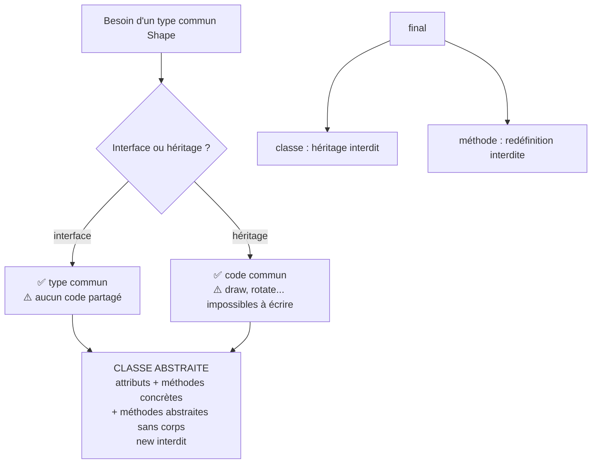
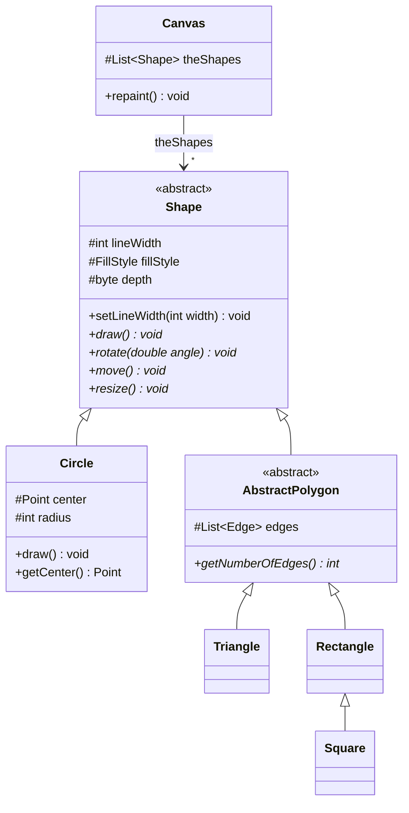
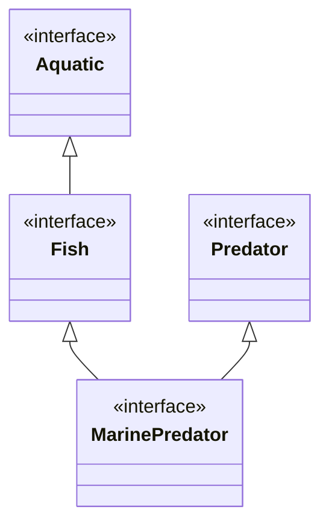
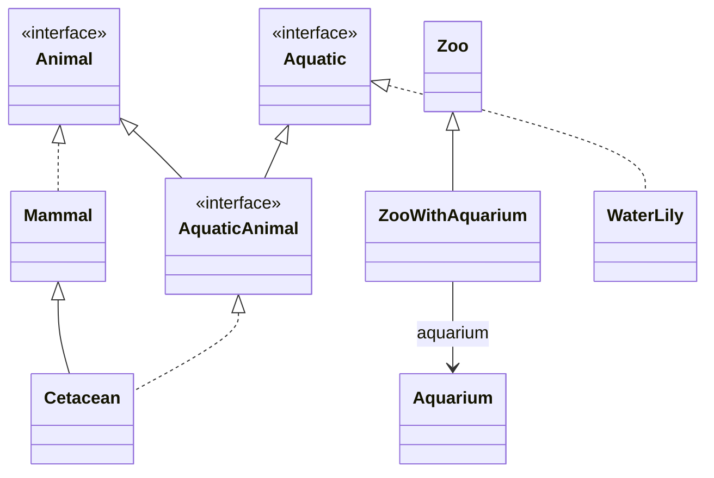
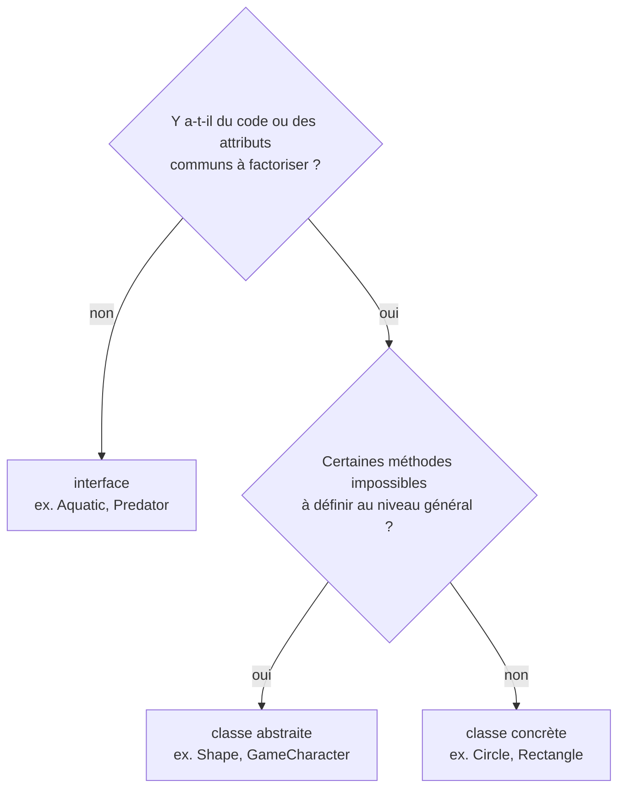

# 09 — Classes abstraites et final

> 🎯 **Objectifs**
> - Je sais expliquer **pourquoi** on a besoin d'une classe abstraite (exemple du dessin de formes).
> - Je sais déclarer une **classe abstraite** et une **méthode abstraite** avec `abstract`.
> - Je sais ce qu'une sous-classe doit faire face à des méthodes abstraites (les concrétiser… ou rester abstraite).
> - Je sais choisir entre **classe concrète**, **classe abstraite** et **interface**, et étendre une interface par héritage (multiple).
> - Je sais utiliser `final` pour interdire l'héritage d'une classe ou la redéfinition d'une méthode.
>
> ⏱️ Prérequis : [08 — Héritage](./08-heritage.md)

## 🗺️ Vue d'ensemble



## 1. Exemple : dessin de formes

💡 **L'idée :** une application de dessin manipule des formes **variées**, mais `Canvas` et les outils doivent fonctionner **sans connaître** les formes précises.

- Formes : cercles, triangles, rectangles, polygones, carrés, etc.
- Un objet `Canvas` gère l'état courant du dessin ; des **outils** déplacent, redimensionnent, font tourner la forme sélectionnée.
- 📌 Contrainte : on doit pouvoir **ajouter facilement des formes** sans toucher à `Canvas` ni aux outils → **Open Close Principle (OCP)**.

```java
public class Canvas {
    protected List<Shape> theShapes;
    public void repaint() {
        for (Shape s : this.theShapes) {
            s.draw();                     // late binding : le draw() de la vraie forme
        }
    }
}
public class MoveTool   { public void move(Shape selectedShape)   { selectedShape.move(...); } }
public class RotateTool { public void rotate(Shape selectedShape) { selectedShape.rotate(...); } }
public class ResizeTool { public void resize(Shape selectedShape) { selectedShape.resize(...); } }
```

➡️ Il est **nécessaire de disposer d'un type `Shape`**. Reste à choisir sa nature.

## 2. Interface ou héritage ?

💡 **L'idée :** aucune des deux solutions n'est satisfaisante seule.

| Solution | Avantage | Problème |
|---|---|---|
| `interface Shape` | type commun, OCP respecté | impossible de définir un **comportement** (et des attributs) communs |
| `class Shape` (héritage) | on factorise ce qui est commun : couleur du trait, motif de remplissage, épaisseur du trait, plan de profondeur… | que mettre dans `draw()`, `rotate()`, `resize()` d'une forme **quelconque** ? |

➡️ Autre possibilité : une **approche hybride** = **la classe abstraite**.

## 3. Classe abstraite : définition

💡 **L'idée :** une classe abstraite est une classe « à trous » : du code commun **et** des méthodes laissées vides, à compléter par les sous-classes.

1. **est une classe** → elle comporte des attributs et des méthodes ;
2. **déclare des méthodes sans comportement** attaché : les **méthodes abstraites** ;
3. **ne peut pas créer d'instance** (même si elle définit un constructeur) ;
4. impose à ses sous-classes de **concrétiser toutes** les méthodes abstraites → **sinon elles sont elles aussi abstraites**.

⚠️ Pas d'instance **directe**, mais on peut tout à fait déclarer une **référence** de ce type :

```java
Shape s = new Shape();     // ❌ erreur de compilation : Shape est abstraite
Shape s = new Circle();    // ✅ upcast : un Circle est une Shape
```

## 4. Le mot-clé `abstract`

💡 **L'idée :** `abstract` se place devant `class` pour la classe, et devant le **type de retour** pour la méthode, qui n'a **pas de corps**.

```java
public abstract class SomeAbstractClass {              // classe abstraite
    // ... attributs, constructeurs, méthodes concrètes ...
    public abstract Type exampleOfAbstractMethod(...); // ; à la place du corps { }
}
```

En UML, la classe porte le stéréotype `<<abstract>>` (ou son nom en *italique*), et les méthodes abstraites sont en *italique* (notées `*` en Mermaid, voir § 5).
📌 Une classe qui contient **au moins une** méthode abstraite **doit** être déclarée `abstract`.

## 5. Retour en forme : `Shape` abstraite

💡 **L'idée :** `Shape` factorise attributs et code communs, et **laisse abstraites** les méthodes qui dépendent de la forme précise.

```java
public abstract class Shape {
    protected int lineWidth;
    protected FillStyle fillStyle;
    protected byte depth;
    // méthodes CONCRÈTES : même code pour toutes les formes
    public void setLineWidth(int width) { this.lineWidth = width; }
    public void toFront() { this.depth = 0; }
    public FillStyle getFillStyle() { return this.fillStyle; }
    // méthodes ABSTRAITES : chaque forme aura son propre code
    public abstract void draw();
    public abstract void rotate(double angle);
    public abstract void move(...);
    public abstract void resize(...);
}

public class Circle extends Shape {          // classe concrète
    protected Point center;
    protected int radius;
    public void draw() { ... code ... }      // concrétisation obligatoire
    public void rotate(double angle) { ... code ... }
    public void move(...) { ... code ... }
    public void resize(...) { ... code ... }
    public Point getCenter() { ... code ... } // méthode propre à Circle
}
```

📌 **Hiérarchie à plusieurs niveaux :** une classe abstraite peut **hériter** d'une classe abstraite et **ajouter** ses propres méthodes abstraites.

```java
public abstract class AbstractPolygon extends Shape {   // toujours abstraite
    protected List<Edge> edges;
    public abstract int getNumberOfEdges();              // nouvelle méthode abstraite
    ...
}
// définissent getNumberOfEdges() ET les autres méthodes abstraites de Shape
public class Triangle extends AbstractPolygon { ... }
public class Rectangle extends AbstractPolygon { ... }
// réutilise le getNumberOfEdges() de Rectangle
public class Square extends Rectangle { ... }
```



➡️ `Canvas` et les outils ne dépendent **que** de `Shape` : ajouter un `Hexagon` ne demande **aucune** modification de leur code (**OCP**).

## 6. Constructeurs d'une classe abstraite : personnages de jeu

💡 **L'idée :** une classe abstraite peut avoir des **constructeurs** : ils ne servent pas à `new`, mais à **initialiser la partie commune** via `super(...)`.

```java
public abstract class GameCharacter {
    protected static final int DEFAULT_LIFEPOINTS = 12;
    protected static final int DEFAULT_STRENGTH = 8;
    protected int lifePoints;
    protected int strength;
    public GameCharacter() { this(GameCharacter.DEFAULT_LIFEPOINTS, GameCharacter.DEFAULT_STRENGTH); }
    public GameCharacter(int lifePoints, int strength) {
        this.lifePoints = lifePoints; this.strength = strength;
    }
    public abstract void interactWith(GameCharacter other);   // dépend du personnage
    public boolean isDead() { return this.lifePoints <= 0; }
    public int removeLifePoints(int lp) { return this.lifePoints -= lp; }
    public int strength() { return this.strength; }
    public int flee() { ... }
    public void attack(GameCharacter other) { other.removeLifePoints(this.strength); }
}
```

```java
// deux sous-classes concrètes, deux comportements pour interactWith
public class Orc extends GameCharacter {
    protected static final int ORC_LIFEPOINTS = 10;
    public Orc(int strength) { super(ORC_LIFEPOINTS, strength); }   // appel du constructeur abstrait
    public void interactWith(GameCharacter other) { this.attack(other); } // moi vois, moi tue
}
public class CarefulCharacter extends GameCharacter {
    protected int cautionThreshold;
    public CarefulCharacter(int strength, int limit) {
        super(GameCharacter.DEFAULT_LIFEPOINTS, strength);
        this.cautionThreshold = limit;
    }
    public void interactWith(GameCharacter other) {   // pas téméraire...
        if (other.strength() - this.strength > this.cautionThreshold) { this.flee(); }
        else { this.attack(other); }
    }
}
```

📌 Le code commun (`attack`, `isDead`…) est écrit **une seule fois** ; seul ce qui varie (`interactWith`) est abstrait.

## 7. Interfaces et héritage

💡 **L'idée :** une interface peut **étendre** une autre interface (`extends`), et même **plusieurs** : le multi-héritage est possible **entre interfaces**.

```java
public interface Aquatic { public boolean freshWaterOrNot(); }   // eau douce ou pas ?
public interface Fish extends Aquatic { public void swim(); }
// une classe implémentant Fish doit définir freshWaterOrNot() ET swim()
public interface Predator { public void hunt(); }
public interface MarinePredator extends Fish, Predator {   // multi-héritage d'interfaces
    public float kiloOfFishEatenADay();
}
// donc au minimum 4 méthodes à définir pour implémenter MarinePredator
```



### Exemple : zoo avec aquarium (héritage de classe + interfaces)

```java
public interface Animal { }
public interface Aquatic { }
public interface AquaticAnimal extends Animal, Aquatic { }
public class Zoo { public void addAnimal(Animal animal) { ... } }
public class Aquarium { public void add(Aquatic aquatic) { ... } }
public class ZooWithAquarium extends Zoo {
    protected Aquarium aquarium;
    public Aquarium getAquarium() { return this.aquarium; }
    public void addAquaticAnimal(AquaticAnimal aquAnimal) {
        this.addAnimal(aquAnimal);       // OK : un AquaticAnimal est un Animal
        this.aquarium.add(aquAnimal);    // OK : un AquaticAnimal est un Aquatic
    }
}
public class Mammal implements Animal { ... }
public class Cetacean extends Mammal implements AquaticAnimal { ... }
public class WaterLily implements Aquatic { ... }   // water lily = nénuphar
// ... utilisation ...
ZooWithAquarium zoo = new ZooWithAquarium();
zoo.addAquaticAnimal(new Cetacean());      // dans le zoo ET dans l'aquarium
zoo.getAquarium().add(new WaterLily());    // aquatique mais pas animal
```



⚠️ `zoo.addAquaticAnimal(new WaterLily())` ne compile pas : un nénuphar est `Aquatic`, **pas** `AquaticAnimal`.

## 8. Classe concrète, classe abstraite ou interface ?

💡 **L'idée :** l'interface donne un **type** (un contrat), la classe abstraite donne un **type + du code commun**, la classe concrète donne un type **complet et instanciable**.

| Critère | Classe concrète | Classe abstraite | Interface |
|---|---|---|---|
| Déclaration | `class C` | `abstract class C` | `interface I` |
| Création d'instance `new` | ✅ oui | ❌ non | ❌ non |
| Peut servir de **type** de référence | ✅ | ✅ | ✅ |
| Attributs | ✅ | ✅ | ❌ (seulement des constantes) |
| Constructeurs | ✅ | ✅ (appelés via `super(...)`) | ❌ |
| Méthodes avec corps | ✅ toutes | ✅ certaines | ❌ (dans le cadre du cours) |
| Méthodes abstraites | ❌ aucune | ✅ zéro ou plus | ✅ toutes |
| Ce dont on hérite | `extends` | `extends` | `implements` (classe) / `extends` (interface) |
| Combien à la fois | **une seule** classe mère | **une seule** classe mère | **plusieurs** |
| UML | `C` | `<<abstract>>` | `<<interface>>` |
| Exemple du cours | `Circle`, `Orc` | `Shape`, `GameCharacter` | `Fish`, `AquaticAnimal` |



## 9. `final` : interdire l'héritage ou la redéfinition

💡 **L'idée :** `final` ≈ « **constant** » : ce qui est `final` ne peut plus être modifié — ni étendu (classe), ni redéfini (méthode).

### Classe `final` : pas de sous-classe

```java
public final class ExtendsNotPossibleClass { ... }
public class Attempt extends ExtendsNotPossibleClass { }   // ❌ erreur de compilation
// dans l'API : java.lang.String, java.lang.Boolean, java.net.InetAddress, etc.
```

### Méthode `final` : pas de redéfinition

```java
public class SomeClass { public final void someMethod() { ... } }
public class SomeSubClasse extends SomeClass {
    // ne peut pas redéfinir public void someMethod()
}
```

| `final` sur… | Effet |
|---|---|
| une classe | **interdit l'héritage** (pas de sous-classe) |
| une méthode | **interdit la redéfinition** dans les sous-classes (elle reste héritée) |
| un attribut / une variable | valeur **non modifiable** après initialisation (cf. `static final`, [02](./02-static-et-enum.md)) |

⚠️ `abstract` et `final` sont **contradictoires** : une classe abstraite **doit** être étendue, une classe `final` **ne peut pas** l'être.

## 10. Application : intérêt d'une méthode `final`

💡 **L'idée :** une méthode `final` **ferme le code à l'extension** : on **garantit le code exécuté**, quel que soit l'héritage.

Exemple : dans une classe `Poll` (scrutin), garantir l'**anonymat du votant** quel que soit le (sous-)type de scrutin.

```java
public final void vote(Person person) throws ImpossibleVoteException {
    // vote and voter (person) are never memorized together
    if (this.canVote(person)) {
        Vote vote = person.vote(this.possibleVotes); // gets the vote from person
        this.storeVote(vote);                        // stores vote but not the voter
        this.voteDone(person);                       // person has voted
    } else {
        throw new ImpossibleVoteException();
    }
}
private final void storeVote(Vote vote) {
    // no information about voter while storing vote
    this.allVotes.add(vote);
}
```

➡️ Une sous-classe de `Poll` (scrutin à deux tours, référendum…) **ne peut pas** redéfinir `vote` pour mémoriser qui a voté quoi.

## ⚠️ Pièges fréquents

| Erreur | Pourquoi c'est faux | Correction |
|---|---|---|
| `new Shape()` | une classe abstraite n'a pas d'instance directe | `Shape s = new Circle();` |
| `public abstract void draw() { }` | une méthode abstraite n'a **pas de corps** | `public abstract void draw();` |
| méthode abstraite dans une classe non `abstract` | toute classe ayant une méthode abstraite est abstraite | `public abstract class …` |
| sous-classe qui oublie une méthode abstraite | elle hérite d'une méthode sans corps | la définir **ou** déclarer la sous-classe `abstract` |
| « une classe abstraite n'a pas de constructeur » | elle peut en avoir, appelés par `super(...)` | définir le constructeur pour la partie commune |

## ✅ À retenir

- Une **classe abstraite** = attributs + méthodes concrètes + **méthodes abstraites** (sans corps).
- `abstract` avant `class` ; `abstract` avant le type de retour, signature terminée par `;`.
- **Pas d'instance** d'une classe abstraite, mais elle sert de **type** (`Shape s = new Circle();`) et peut avoir des **constructeurs** (via `super`).
- Une sous-classe doit concrétiser **toutes** les méthodes abstraites, **sinon elle est abstraite**.
- Classe abstraite = **approche hybride** entre interface (type commun) et héritage (code commun) → respect de l'**OCP**.
- Une interface peut **étendre plusieurs** interfaces (`extends I1, I2`) ; une classe n'étend qu'**une** classe.
- `final class` → pas de sous-classe (`String`) ; `final` méthode → pas de redéfinition = **garantir le code exécuté** quel que soit l'héritage (ex. anonymat du vote).

## 🧠 Auto-évaluation

**Q1.** Ce code compile-t-il ? `Shape s = new Shape();` et `Shape s = new Circle();`

<details><summary>Réponse</summary>

Le premier **non** : `Shape` est abstraite, on ne peut pas l'instancier. Le second **oui** : `Circle` est une sous-classe concrète de `Shape` (upcast).

</details>

**Q2.** Trouve l'erreur :

```java
public class Shape {
    public abstract void draw();
}
```

<details><summary>Réponse</summary>

La classe contient une méthode abstraite : elle **doit** être déclarée `public abstract class Shape`.

</details>

**Q3.** `public class Hexagon extends AbstractPolygon` ne définit que `draw()` et `getNumberOfEdges()`. Que se passe-t-il ?

<details><summary>Réponse</summary>

Erreur de compilation : `rotate`, `move` et `resize` (abstraites dans `Shape`) ne sont pas concrétisées. Il faut les définir, ou déclarer `Hexagon` abstraite (mais alors plus de `new Hexagon()`).

</details>

**Q4.** Combien de méthodes, au minimum, une classe qui `implements MarinePredator` doit-elle définir ? Lesquelles ?

<details><summary>Réponse</summary>

**4** : `freshWaterOrNot()` (de `Aquatic`, via `Fish`), `swim()` (de `Fish`), `hunt()` (de `Predator`) et `kiloOfFishEatenADay()`.

</details>

**Q5.** Pour `Shape`, pourquoi une classe abstraite plutôt qu'une interface ?

<details><summary>Réponse</summary>

Parce que des attributs et comportements sont **communs** à toutes les formes (épaisseur du trait, remplissage, profondeur, `toFront()`…) : une interface ne permet pas de les factoriser. Mais `draw`, `rotate`… ne peuvent pas être écrites pour une forme quelconque → méthodes abstraites.

</details>

**Q6.** Quel intérêt à déclarer `vote` en `final` dans `Poll` ?

<details><summary>Réponse</summary>

Fermer le code à l'extension : aucune sous-classe ne peut redéfinir `vote`, donc on **garantit** que le vote et le votant ne sont jamais mémorisés ensemble (anonymat), quel que soit le type de scrutin.

</details>

## 🔗 Pour pratiquer

- [DS1 2025-2026 — sujet](../04-Examens/DS1-2025-2026/sujet.md)
- [Checklist de révision](../05-Fiches/checklist-revision.md)

---

[⬅️ Précédent : 08 — Héritage](./08-heritage.md) | [🏠 Sommaire](./README.md)
