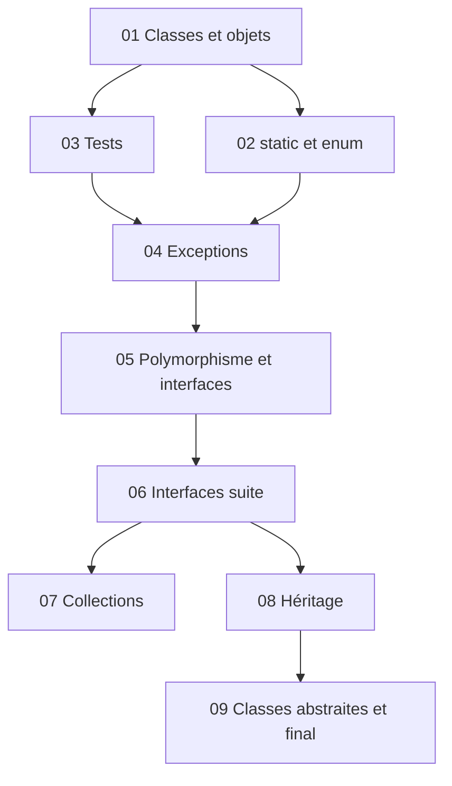

# 📖 Cours — Sommaire

> Lis les chapitres **dans l'ordre** : chacun s'appuie sur les précédents.
> Chaque chapitre : 🎯 objectifs → 🗺️ vue d'ensemble → notions → ⚠️ pièges → ✅ à retenir → 🧠 quiz.

| # | Chapitre | En une phrase |
|---|---|---|
| 01 | [Classes et objets](./01-classes-et-objets.md) | Définir ses propres types : attributs, méthodes, constructeurs, références, `this`. |
| 02 | [static et enum](./02-static-et-enum.md) | Ce qui appartient à la **classe** (et non aux objets) ; les types à valeurs finies. |
| 03 | [Tests unitaires](./03-tests.md) | « Un code non testé n'a aucune valeur » : JUnit 5 et les assertions. |
| 04 | [Exceptions](./04-exceptions.md) | Signaler et traiter les situations anormales : `throw`, `throws`, `try/catch`. |
| 05 | [Polymorphisme et interfaces](./05-polymorphisme-et-interfaces.md) | Un même message, des comportements différents selon l'objet (*late binding*). |
| 06 | [Interfaces (suite)](./06-interfaces-suite.md) | Mettre en œuvre le polymorphisme : tris, `Comparable`, principe ouvert/fermé (OCP). |
| 07 | [Collections](./07-collections.md) | `List`, `Set`, `Map`, itérateurs, `equals`/`hashCode`. |
| 08 | [Héritage](./08-heritage.md) | `extends`, `super`, redéfinition, recherche de méthode, `protected`. |
| 09 | [Classes abstraites et final](./09-classes-abstraites.md) | Factoriser du code tout en laissant des méthodes à définir. |

---
🏠 [Retour à l'accueil](../README.md) · 🛠️ [Memento des commandes](../05-Fiches/memento-commandes.md) · ✅ [Checklist de révision](../05-Fiches/checklist-revision.md)
