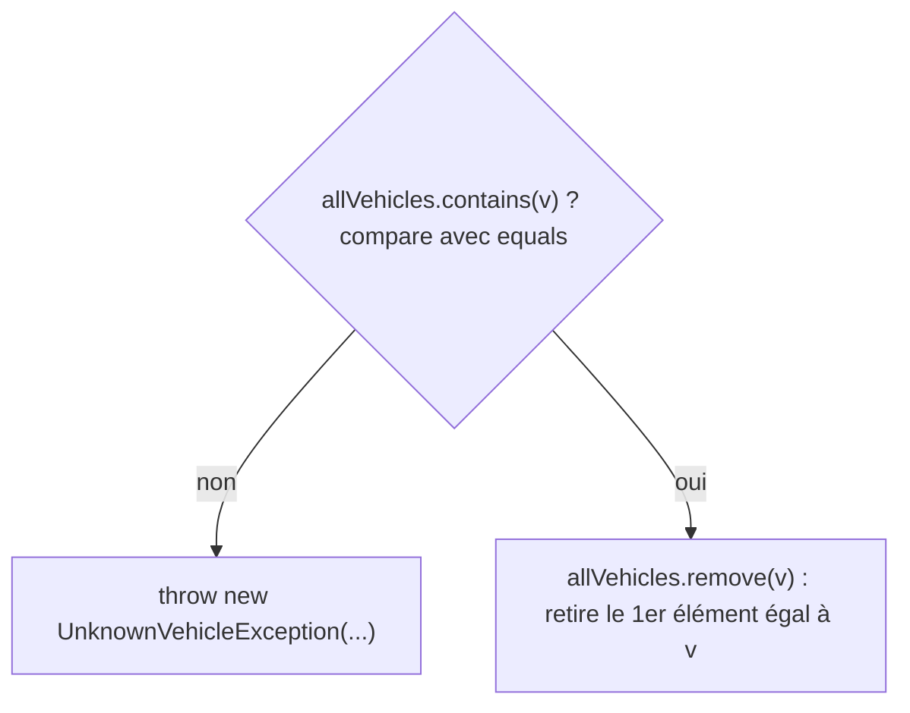
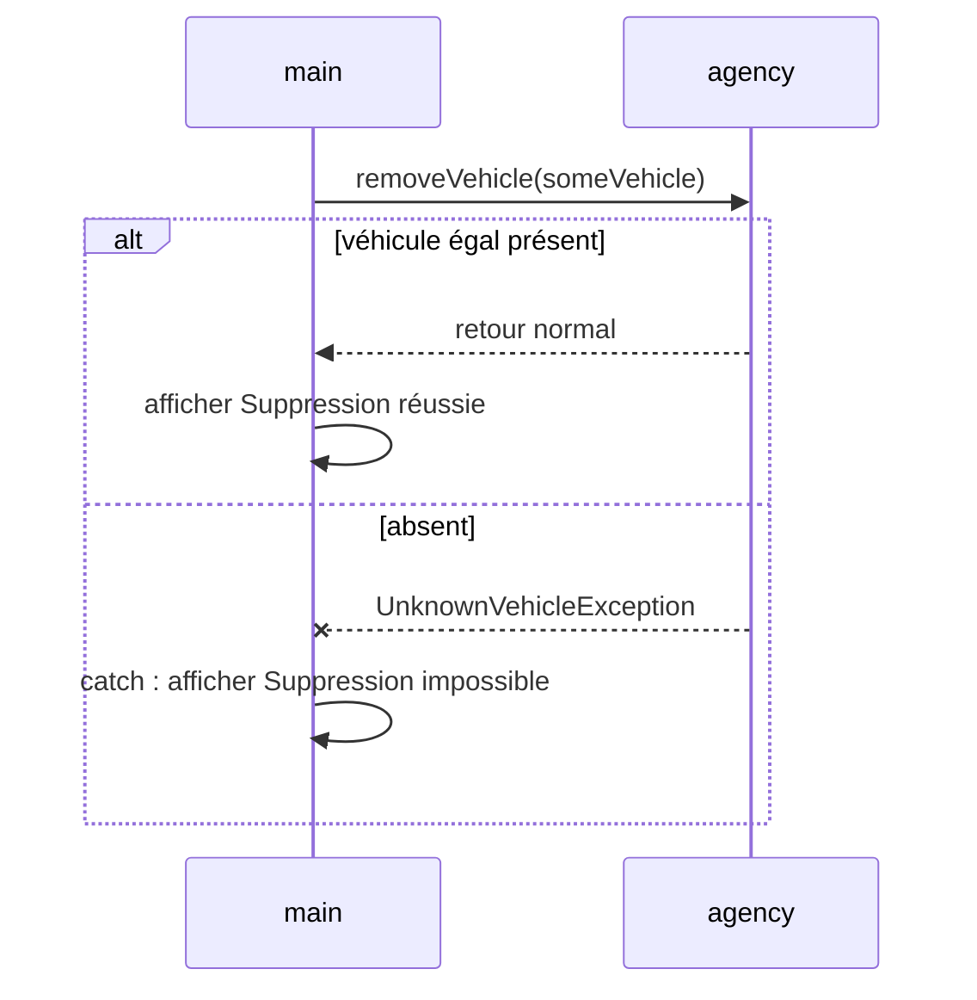
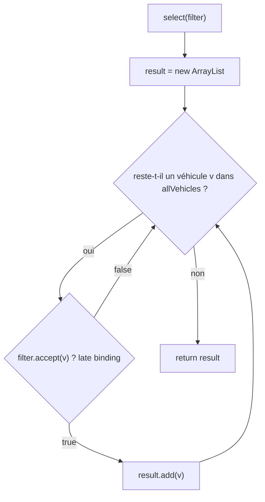
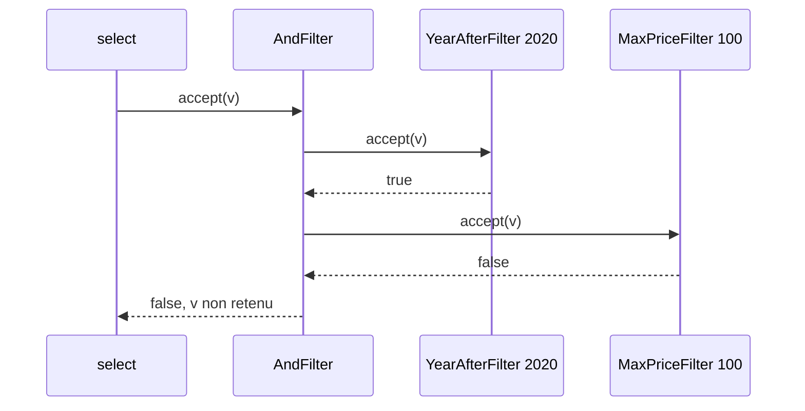
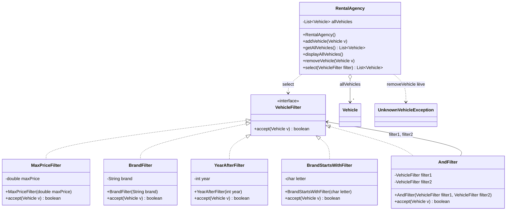

# TD Location de véhicules — Listes et filtres — Corrigé

> 📄 [Énoncé](./enonce.md) · 📚 Cours : [07 — Collections](../../01-Cours/07-collections.md) · [06 — Interfaces (suite) : OCP](../../01-Cours/06-interfaces-suite.md) · [04 — Exceptions](../../01-Cours/04-exceptions.md)
> ✅ Code **compilé** (Java 21) et **testé** : les 17 tests JUnit 5 de ce corrigé ont été exécutés avec succès ; les affichages du `main` sont les sorties **réelles**.
> 💡 D'autres réponses justes sont possibles.

## 📌 Hypothèses (non fixées par l'énoncé)

| Élément | Hypothèse retenue |
|---|---|
| `UnknownVehicleException` | `public class UnknownVehicleException extends Exception` avec un constructeur `(String message)` : exception **contrôlée** ⇒ `throws` obligatoire |
| « inférieur à 100 € » (Q6, Q14) | **strictement** : `< 100` |
| « après 2018 » (Q8) | **strictement** : `> 2018` |
| paramètre de `addVehicle` / `removeVehicle` | nommé `v` (le sujet écrit `c`) |
| `toString()` de `Vehicle` | `"Timoleon Alpha, 2019, 79.0 €/jour"` |

<details><summary>La classe <code>Vehicle</code> complète (compilée avec le reste)</summary>

```java
package rental;

/** A vehicle of a rental agency. */
public class Vehicle {
    private String brand;
    private String model;
    private int productionYear;
    private double dailyRentalPrice;

    /**
     * Builds a vehicle.
     * @param brand the brand of this vehicle
     * @param model the model name of this vehicle
     * @param productionYear the production year of this vehicle
     * @param dailyRentalPrice the daily rental price of this vehicle
     */
    public Vehicle(String brand, String model, int productionYear, double dailyRentalPrice) {
        this.brand = brand;
        this.model = model;
        this.productionYear = productionYear;
        this.dailyRentalPrice = dailyRentalPrice;
    }

    /** @return the brand of this vehicle */
    public String getBrand() {
        return this.brand;
    }

    /** @return the model name of this vehicle */
    public String getModel() {
        return this.model;
    }

    /** @return the production year of this vehicle */
    public int getProductionYear() {
        return this.productionYear;
    }

    /** @return the daily rental price of this vehicle */
    public double getDailyRentalPrice() {
        return this.dailyRentalPrice;
    }

    /**
     * @param o the compared object
     * @return true if o is a Vehicle whose attributes are all equal to those of this vehicle
     */
    public boolean equals(Object o) {
        if (!(o instanceof Vehicle)) {
            return false;
        }
        Vehicle other = (Vehicle) o;
        return this.brand.equals(other.brand)
                && this.model.equals(other.model)
                && this.productionYear == other.productionYear
                && this.dailyRentalPrice == other.dailyRentalPrice;
    }

    /** @return a description such as "Timoleon Alpha, 2019, 79.0 €/jour" */
    public String toString() {
        return this.brand + " " + this.model + ", " + this.productionYear
                + ", " + this.dailyRentalPrice + " €/jour";
    }
}
```

</details>

---

## Q1 — Attribut `allVehicles` et constructeur

💡 **L'idée :** on **déclare** avec l'interface `List<Vehicle>` et on ne choisit la classe concrète `ArrayList` qu'au `new` (« programmer avec l'interface », ch. 07 § 4.2).

```java
package rental;

import java.util.ArrayList;
import java.util.List;

/** A rental agency: the vehicles it manages (version 1, questions 1 to 8). */
public class RentalAgency {
    private List<Vehicle> allVehicles;

    /** Builds an agency with no vehicle. */
    public RentalAgency() {
        this.allVehicles = new ArrayList<Vehicle>();
    }
```

- ✅ **Conséquence sur l'entête** : `List` et `ArrayList` sont dans **`java.util`** ⇒ il faut les **importer** (`import java.util.List;` et `import java.util.ArrayList;`) entre `package rental;` et `public class RentalAgency`.
- 📌 Changer d'avis plus tard (`LinkedList`) ⇒ **une seule** ligne à modifier : celle du `new`.
- ⚠️ Sans le `new ArrayList<Vehicle>()`, l'attribut vaut `null` ⇒ `NullPointerException` au premier `add`.

---

## Q2 — `addVehicle()`

💡 **L'idée :** l'agence **délègue** l'ajout à sa liste.

```java
    /** @param v the vehicle added to this agency */
    public void addVehicle(Vehicle v) {
        this.allVehicles.add(v);
    }
```

📌 La liste stocke une **référence** vers le véhicule (pas une copie).

---

## Q3 — `displayAllVehicles()`

💡 **L'idée :** un parcours **for-each** de la liste, un `println` par véhicule.

```java
    /** Displays the vehicles of this agency, one per line. */
    public void displayAllVehicles() {
        for (Vehicle v : this.allVehicles) {
            System.out.println(v);
        }
    }
```

- 📌 `println(v)` appelle **`v.toString()`** (late binding).
- ⚠️ Pas de `for (int i…) get(i)` : à proscrire pour parcourir une liste (ch. 07 § 5.5).

---

## Q4 — `removeVehicle()` avec `UnknownVehicleException`

💡 **L'idée :** on vérifie d'abord que le véhicule est dans la liste (`contains`) ; sinon on **lance** l'exception ; sinon on le **retire** (`remove`).

```java
    /**
     * Removes a vehicle from this agency.
     * @param v the vehicle to remove
     * @throws UnknownVehicleException if v is not managed by this agency
     */
    public void removeVehicle(Vehicle v) throws UnknownVehicleException {
        if (!this.allVehicles.contains(v)) {
            throw new UnknownVehicleException("unknown vehicle: " + v);
        }
        this.allVehicles.remove(v);
    }
```

```java
package rental;

/** Thrown when a vehicle is not managed by the agency. */
public class UnknownVehicleException extends Exception {
    public UnknownVehicleException(String message) {
        super(message);
    }
}
```

📌 **Rappel : `contains` et `remove` utilisent `equals`.** C'est le `equals(Object o)` de `Vehicle` qui décide si « le » véhicule est dans la liste :

```java
    public boolean equals(Object o) {
        if (!(o instanceof Vehicle)) {
            return false;
        }
        Vehicle other = (Vehicle) o;
        return this.brand.equals(other.brand)
                && this.model.equals(other.model)
                && this.productionYear == other.productionYear
                && this.dailyRentalPrice == other.dailyRentalPrice;
    }
```



- ✅ Grâce à `equals`, on peut supprimer avec un **autre objet** de mêmes attributs (c'est le cas du `main` de Q5).
- ⚠️ Sans `equals` redéfini (ou avec `equals(Vehicle o)`, qui est une **surcharge**), `contains`/`remove` compareraient les **références** : `someVehicle` serait toujours « inconnu ».
- ⚠️ `this.brand.equals(other.brand)` et pas `==` (références de `String`) ; `==` est correct pour `int` et `double`.
- 💡 Variante : `remove(Object)` renvoie `false` si rien n'a été retiré ⇒ `if (!this.allVehicles.remove(v)) { throw ... }` (un seul parcours).
- 📌 `javac -Xlint` signale que `Vehicle` redéfinit `equals` sans `hashCode` : sans conséquence pour une `List`, **indispensable** si on met des `Vehicle` dans un `HashSet` ou comme clés d'une `HashMap` (ch. 07 § 7).

---

## Q5 — Compléter le `main` (`try` / `catch`)

💡 **L'idée :** `removeVehicle` peut lever une exception **contrôlée** ⇒ le `main` la **capture** : message de succès dans le `try`, message d'échec dans le `catch`.

À l'endroit « A COMPLETER ICI » :

```java
        try {
            agency.removeVehicle(someVehicle);
            System.out.println("Suppression réussie : " + someVehicle);
        } catch (UnknownVehicleException e) {
            System.out.println("Suppression impossible, véhicule inconnu : " + someVehicle);
        }
```



- ⚠️ Le message de succès est **dans** le `try`, **après** l'appel : si l'exception part, il n'est pas affiché.
- ⚠️ `main(String[] args)` : le `main(String args)` du sujet ne serait pas un point d'entrée. Le `main` complet et ses affichages réels sont [plus bas](#le-main-complet-et-son-exécution).

---

## Q6 — `selectByMaxPrice100()`

💡 **L'idée :** une **nouvelle** liste résultat, on parcourt l'agence, on y ajoute chaque véhicule qui **vérifie la condition**.

```java
    /** @return the vehicles of this agency whose daily rental price is lower than 100 */
    public List<Vehicle> selectByMaxPrice100() {
        List<Vehicle> result = new ArrayList<Vehicle>();
        for (Vehicle v : this.allVehicles) {
            if (v.getDailyRentalPrice() < 100) {
                result.add(v);
            }
        }
        return result;
    }
```

⚠️ On **ne retire rien** de `allVehicles` : sélectionner ne doit pas vider l'agence.

## Q7 — `selectByBrandTimoleon()`

```java
    /** @return the vehicles of this agency whose brand is "Timoleon" */
    public List<Vehicle> selectByBrandTimoleon() {
        List<Vehicle> result = new ArrayList<Vehicle>();
        for (Vehicle v : this.allVehicles) {
            if (v.getBrand().equals("Timoleon")) {
                result.add(v);
            }
        }
        return result;
    }
```

⚠️ `equals` et pas `==` pour comparer des `String`.

---

## Q8 — Que constate-t-on ?

💡 **L'idée :** les deux méthodes sont **identiques à une ligne près** : seule la **condition** change.

```java
    /** @return the vehicles of this agency produced after 2018 */
    public List<Vehicle> selectByYearAfter2018() {
        List<Vehicle> result = new ArrayList<Vehicle>();
        for (Vehicle v : this.allVehicles) {
            if (v.getProductionYear() > 2018) {
                result.add(v);
            }
        }
        return result;
    }
```

| Méthode | Seule ligne différente : la condition |
|---|---|
| `selectByMaxPrice100()` | `v.getDailyRentalPrice() < 100` |
| `selectByBrandTimoleon()` | `v.getBrand().equals("Timoleon")` |
| `selectByYearAfter2018()` | `v.getProductionYear() > 2018` |
| tout autre filtre | encore une copie… |

- ✅ **Constat** : du **code dupliqué** ; chaque nouveau critère = une nouvelle méthode dans `RentalAgency` ⇒ la classe doit être **modifiée** à chaque fois (contraire à l'**OCP**).
- 💡 Même situation que le tri à bulles du ch. 06 : l'algorithme est le même, seule la **condition** change.

---

## Q9 — Éviter la répétition : une interface de filtre

💡 **L'idée :** l'**abstraction** qui varie, c'est « **ce véhicule est-il accepté ?** » ⇒ une **interface** avec une seule méthode qui répond par un booléen.

```java
package rental;

/** A selection criterion for vehicles. */
public interface VehicleFilter {
    /**
     * @param v the tested vehicle
     * @return true if v satisfies this filter
     */
    public boolean accept(Vehicle v);
}
```

- On applique la méthode du ch. 06 § 14 : abstraction → **interface** → références du type de l'interface → **une classe par comportement** → polymorphisme.
- `RentalAgency` n'aura plus qu'**une** méthode de sélection, qui reçoit le filtre en **paramètre**.

---

## Q10 — Les trois filtres et la méthode `select`

💡 **L'idée :** chaque condition devient **une classe** qui implémente `VehicleFilter` ; la boucle est écrite **une seule fois**, dans `select(VehicleFilter filter)`.

```java
package rental;

/** Accepts vehicles whose daily rental price is lower than 100. */
public class MaxPrice100Filter implements VehicleFilter {
    public boolean accept(Vehicle v) {
        return v.getDailyRentalPrice() < 100;
    }
}
```

```java
package rental;

/** Accepts vehicles whose brand is "Timoleon". */
public class BrandTimoleonFilter implements VehicleFilter {
    public boolean accept(Vehicle v) {
        return v.getBrand().equals("Timoleon");
    }
}
```

```java
package rental;

/** Accepts vehicles produced after 2018. */
public class YearAfter2018Filter implements VehicleFilter {
    public boolean accept(Vehicle v) {
        return v.getProductionYear() > 2018;
    }
}
```

La méthode **générique** de `RentalAgency` :

```java
    /**
     * Selects the vehicles of this agency that satisfy a filter.
     * @param filter the selection criterion
     * @return the list of the vehicles of this agency accepted by filter
     */
    public List<Vehicle> select(VehicleFilter filter) {
        List<Vehicle> result = new ArrayList<Vehicle>();
        for (Vehicle v : this.allVehicles) {
            if (filter.accept(v)) {
                result.add(v);
            }
        }
        return result;
    }
```



**Que deviennent `selectByMaxPrice100()` et `selectByBrandTimoleon()` ?** Elles sont **inutiles** : on peut les **supprimer** (le client écrit `agency.select(new MaxPrice100Filter())`), ou les garder en **une ligne** qui délègue à `select` :

```java
    /** @return the vehicles of this agency whose daily rental price is lower than 100 */
    public List<Vehicle> selectByMaxPrice100() {
        return this.select(new MaxPrice100Filter());
    }

    /** @return the vehicles of this agency whose brand is "Timoleon" */
    public List<Vehicle> selectByBrandTimoleon() {
        return this.select(new BrandTimoleonFilter());
    }
```

- 📌 `filter.accept(v)` : **même envoi de message**, code exécuté différent selon la **classe de l'objet** filtre (late binding).
- ✅ Que faut-il faire ? **Une** interface, **une** classe par filtre, **une** méthode `select`.

---

## Q11 — Généraliser : filtres paramétrés

💡 **L'idée :** la valeur « en dur » (100, `"Timoleon"`, 2018) devient un **attribut** du filtre, fixé par le **constructeur** (comme `ModularIncrement(int modulo)` au ch. 06).

```java
package rental;

/** Accepts vehicles whose daily rental price is lower than a given maximum. */
public class MaxPriceFilter implements VehicleFilter {
    private double maxPrice;

    /** @param maxPrice the (excluded) maximum daily rental price */
    public MaxPriceFilter(double maxPrice) {
        this.maxPrice = maxPrice;
    }

    public boolean accept(Vehicle v) {
        return v.getDailyRentalPrice() < this.maxPrice;
    }
}
```

```java
package rental;

/** Accepts vehicles of a given brand. */
public class BrandFilter implements VehicleFilter {
    private String brand;

    /** @param brand the accepted brand */
    public BrandFilter(String brand) {
        this.brand = brand;
    }

    public boolean accept(Vehicle v) {
        return v.getBrand().equals(this.brand);
    }
}
```

```java
package rental;

/** Accepts vehicles produced after a given year. */
public class YearAfterFilter implements VehicleFilter {
    private int year;

    /** @param year the accepted vehicles are produced strictly after this year */
    public YearAfterFilter(int year) {
        this.year = year;
    }

    public boolean accept(Vehicle v) {
        return v.getProductionYear() > this.year;
    }
}
```

| Avant (Q10) | Après (Q11) |
|---|---|
| `new MaxPrice100Filter()` | `new MaxPriceFilter(100)`, `new MaxPriceFilter(85)`… |
| `new BrandTimoleonFilter()` | `new BrandFilter("Timoleon")`, `new BrandFilter("Renault")`… |
| `new YearAfter2018Filter()` | `new YearAfterFilter(2018)`, `new YearAfterFilter(2020)`… |

📌 Les classes de Q10 deviennent inutiles : **une** classe par **sorte** de critère, et non plus une par **valeur**. `select` ne change pas.

---

## Q12 — Marque commençant par une lettre donnée

💡 **L'idée :** **rien à modifier**, seulement **une classe à ajouter**.

```java
package rental;

/** Accepts vehicles whose brand starts with a given letter. */
public class BrandStartsWithFilter implements VehicleFilter {
    private char letter;

    /** @param letter the first letter of the accepted brands */
    public BrandStartsWithFilter(char letter) {
        this.letter = letter;
    }

    public boolean accept(Vehicle v) {
        String brand = v.getBrand();
        return brand.length() > 0 && brand.charAt(0) == this.letter;
    }
}
```

- ✅ `RentalAgency`, `VehicleFilter` et les autres filtres sont **inchangés** : ouvert aux extensions, fermé aux modifications ⇒ **OCP**.
- Utilisation : `agency.select(new BrandStartsWithFilter('T'))`.
- ⚠️ `'T'` (un `char`, apostrophes) ≠ `"T"` (une `String`, guillemets) ; le test `brand.length() > 0` évite une `StringIndexOutOfBoundsException` sur une marque vide.

---

## Q13 — Avantages de la solution

💡 **L'idée :** on **manipule une abstraction** (`VehicleFilter`) et on **concrétise le plus tard possible**.

| Avantage | Pourquoi |
|---|---|
| plus de **code dupliqué** | la boucle de sélection est écrite **une seule fois** (`select`) |
| **OCP** | nouveau critère = **nouvelle classe**, `RentalAgency` n'est plus modifiée |
| **réutilisable** | un même filtre sert pour plusieurs agences, plusieurs appels |
| **paramétrable** | `new MaxPriceFilter(85)` : une classe pour toutes les valeurs |
| **testable** | chaque filtre se teste seul (`accept`), indépendamment de l'agence |
| **combinable** | les filtres sont des objets : on peut les **composer** (Q15) |
| **typage contrôlé** | `select` n'accepte que des `VehicleFilter` (pas d'`Object` + `instanceof`) |

---

## Q14 — Afficher les véhicules à moins de 85 €

💡 **L'idée :** **un** filtre paramétré + **un** `select` + un parcours d'affichage.

```java
        for (Vehicle v : agency.select(new MaxPriceFilter(85))) {
            System.out.println(v);
        }
```

📌 Plus court mais moins lisible : `System.out.println(agency.select(new MaxPriceFilter(85)));` affiche toute la liste **sur une seule ligne**, entre crochets.

📌 **Complément (hors attendu du cours)** : `VehicleFilter` n'a **qu'une seule** méthode abstraite ⇒ Java permet aussi de créer le filtre avec une **lambda** (la même notation `() -> …` que dans `assertThrows`). Ligne testée (même résultat que `new MaxPriceFilter(85)`) :

```java
        VehicleFilter cheap = v -> v.getDailyRentalPrice() < 85;
```

La solution attendue reste **les classes** de filtres.

---

## Q15 — Intersection de filtres : `AndFilter`

💡 **L'idée :** **oui** ! Un « ET » de deux filtres est **lui-même un filtre** : une classe qui implémente `VehicleFilter`, **contient** deux filtres, et n'accepte un véhicule que si **les deux** l'acceptent (**composition**).

```java
package rental;

/** Accepts vehicles accepted by BOTH given filters (logical and). */
public class AndFilter implements VehicleFilter {
    private VehicleFilter filter1;
    private VehicleFilter filter2;

    /**
     * @param filter1 the first filter
     * @param filter2 the second filter
     */
    public AndFilter(VehicleFilter filter1, VehicleFilter filter2) {
        this.filter1 = filter1;
        this.filter2 = filter2;
    }

    public boolean accept(Vehicle v) {
        return this.filter1.accept(v) && this.filter2.accept(v);
    }
}
```

**Appliqué à l'exemple** (produits après 2020 **et** prix max 100 €) :

```java
        VehicleFilter recentAndCheap = new AndFilter(new YearAfterFilter(2020), new MaxPriceFilter(100));
        for (Vehicle v : agency.select(recentAndCheap)) {
            System.out.println(v);
        }
```



- ✅ **Pourquoi ça marche** : `select` attend un `VehicleFilter`, et un `AndFilter` **est** un `VehicleFilter` (polymorphisme) ⇒ ni `select`, ni `RentalAgency`, ni les autres filtres ne changent (**OCP**).
- 📌 Les attributs sont de type **interface** : on peut combiner **n'importe quels** filtres, y compris des `AndFilter` (imbrication) : `new AndFilter(new BrandFilter("Timoleon"), new AndFilter(new YearAfterFilter(2018), new MaxPriceFilter(100)))`.
- 📌 `&&` est paresseux : si le 1er filtre refuse, le 2nd n'est même pas interrogé.
- ⚠️ « au maximum 100 € » signifie `≤ 100`, alors que notre `MaxPriceFilter` est **strict** (« inférieur à », Q6 et Q14) : un véhicule à 100 € pile est exclu. Pour l'inclure, il suffit d'**ajouter** une classe de filtre avec `<=` (OCP), sans rien modifier.
- 💡 Sur le même modèle, un `OrFilter` (`||`) ou un `NotFilter` (`!`) s'ajoutent en une classe chacun.

<details><summary>Bonus : un « ET » d'un nombre quelconque de filtres (<code>List&lt;VehicleFilter&gt;</code>)</summary>

```java
package rental;

import java.util.ArrayList;
import java.util.List;

/** Accepts vehicles accepted by ALL its filters (any number of filters). */
public class AllFiltersFilter implements VehicleFilter {
    private List<VehicleFilter> filters;

    public AllFiltersFilter() {
        this.filters = new ArrayList<VehicleFilter>();
    }

    /** @param filter a filter to add to the conjunction */
    public void addFilter(VehicleFilter filter) {
        this.filters.add(filter);
    }

    public boolean accept(Vehicle v) {
        for (VehicleFilter filter : this.filters) {
            if (!filter.accept(v)) {
                return false;
            }
        }
        return true;
    }
}
```

- Dès qu'**un** filtre refuse ⇒ `false` ; si **aucun** ne refuse ⇒ `true`.
- 📌 Sans aucun filtre, tout véhicule est accepté (comme un site de réservation sans case cochée).

</details>

---

## 🗺️ La solution complète



<details><summary>La classe <code>RentalAgency</code> complète (version finale)</summary>

```java
package rental;

import java.util.ArrayList;
import java.util.List;

/** A rental agency: the vehicles it manages (final version, with filters). */
public class RentalAgency {
    private List<Vehicle> allVehicles;

    /** Builds an agency with no vehicle. */
    public RentalAgency() {
        this.allVehicles = new ArrayList<Vehicle>();
    }

    /** @param v the vehicle added to this agency */
    public void addVehicle(Vehicle v) {
        this.allVehicles.add(v);
    }

    /** @return the list of the vehicles managed by this agency */
    public List<Vehicle> getAllVehicles() {
        return this.allVehicles;
    }

    /** Displays the vehicles of this agency, one per line. */
    public void displayAllVehicles() {
        for (Vehicle v : this.allVehicles) {
            System.out.println(v);
        }
    }

    /**
     * Removes a vehicle from this agency.
     * @param v the vehicle to remove
     * @throws UnknownVehicleException if v is not managed by this agency
     */
    public void removeVehicle(Vehicle v) throws UnknownVehicleException {
        if (!this.allVehicles.contains(v)) {
            throw new UnknownVehicleException("unknown vehicle: " + v);
        }
        this.allVehicles.remove(v);
    }

    /**
     * Selects the vehicles of this agency that satisfy a filter.
     * @param filter the selection criterion
     * @return the list of the vehicles of this agency accepted by filter
     */
    public List<Vehicle> select(VehicleFilter filter) {
        List<Vehicle> result = new ArrayList<Vehicle>();
        for (Vehicle v : this.allVehicles) {
            if (filter.accept(v)) {
                result.add(v);
            }
        }
        return result;
    }

    /** @return the vehicles of this agency whose daily rental price is lower than 100 */
    public List<Vehicle> selectByMaxPrice100() {
        return this.select(new MaxPrice100Filter());
    }

    /** @return the vehicles of this agency whose brand is "Timoleon" */
    public List<Vehicle> selectByBrandTimoleon() {
        return this.select(new BrandTimoleonFilter());
    }
}
```

</details>

---

## Le `main` complet et son exécution

```java
package rental.main;

import rental.*;

public class AgencyMain {
    public static void main(String[] args) {
        RentalAgency agency = new RentalAgency();
        agency.addVehicle(new Vehicle("Timoleon", "Alpha", 2019, 79));
        agency.addVehicle(new Vehicle("Timoleon", "Beta", 2022, 120));
        agency.addVehicle(new Vehicle("Renault", "Clio", 2021, 59.5));
        agency.addVehicle(new Vehicle("Peugeot", "208", 2017, 85));
        agency.addVehicle(new Vehicle("Tesla", "Model 3", 2023, 95));
        agency.addVehicle(new Vehicle("Timo", "Leon", 1920, 100));
        Vehicle someVehicle = new Vehicle("Timo", "Leon", 1920, 100);

        // Q5
        try {
            agency.removeVehicle(someVehicle);
            System.out.println("Suppression réussie : " + someVehicle);
        } catch (UnknownVehicleException e) {
            System.out.println("Suppression impossible, véhicule inconnu : " + someVehicle);
        }

        System.out.println("--- Tous les véhicules de l'agence :");
        agency.displayAllVehicles();

        // Q14
        System.out.println("--- Prix inférieur à 85 € :");
        for (Vehicle v : agency.select(new MaxPriceFilter(85))) {
            System.out.println(v);
        }

        // Q15
        System.out.println("--- Produits après 2020 ET prix inférieur à 100 € :");
        VehicleFilter recentAndCheap = new AndFilter(new YearAfterFilter(2020), new MaxPriceFilter(100));
        for (Vehicle v : agency.select(recentAndCheap)) {
            System.out.println(v);
        }
    }
}
```

Affichage obtenu :

```text
Suppression réussie : Timo Leon, 1920, 100.0 €/jour
--- Tous les véhicules de l'agence :
Timoleon Alpha, 2019, 79.0 €/jour
Timoleon Beta, 2022, 120.0 €/jour
Renault Clio, 2021, 59.5 €/jour
Peugeot 208, 2017, 85.0 €/jour
Tesla Model 3, 2023, 95.0 €/jour
--- Prix inférieur à 85 € :
Timoleon Alpha, 2019, 79.0 €/jour
Renault Clio, 2021, 59.5 €/jour
--- Produits après 2020 ET prix inférieur à 100 € :
Renault Clio, 2021, 59.5 €/jour
Tesla Model 3, 2023, 95.0 €/jour
```

Même `main` **sans** la ligne `agency.addVehicle(new Vehicle("Timo", "Leon", 1920, 100));` (première ligne affichée) :

```text
Suppression impossible, véhicule inconnu : Timo Leon, 1920, 100.0 €/jour
```

- 📌 La suppression réussit alors que `someVehicle` n'est **pas le même objet** que celui ajouté : `remove` compare avec **`equals`** (Q4).
- 📌 La Peugeot à 85 € pile n'est **pas** retenue en Q14 : « inférieur à » est strict.

---

## ✅ Les tests JUnit 5

💡 **L'idée :** tester `removeVehicle` (cas normal, cas `equals`, cas **exceptionnel** avec `assertThrows`), **chaque filtre** seul (`accept`), puis `select` et `AndFilter`.

```bash
javac -d classes $(find src -name '*.java')
javac -d test -cp classes:junit-console.jar RentalAgencyTest.java VehicleFilterTest.java
java -jar junit-console.jar -classpath test:classes -scan-classpath
# [ 17 tests successful ]   [ 0 tests failed ]
```

```java
package rental;

import org.junit.jupiter.api.BeforeEach;
import org.junit.jupiter.api.Test;
import static org.junit.jupiter.api.Assertions.*;

import java.util.List;

public class RentalAgencyTest {
    private RentalAgency agency;
    private Vehicle alpha;
    private Vehicle clio;

    @BeforeEach
    public void before() {
        this.agency = new RentalAgency();
        this.alpha = new Vehicle("Timoleon", "Alpha", 2019, 79);
        this.clio = new Vehicle("Renault", "Clio", 2021, 59.5);
        this.agency.addVehicle(this.alpha);
        this.agency.addVehicle(this.clio);
    }

    @Test
    public void addVehicleAddsToTheList() {
        assertEquals(2, this.agency.getAllVehicles().size());
        assertTrue(this.agency.getAllVehicles().contains(this.alpha));
        assertTrue(this.agency.getAllVehicles().contains(this.clio));
    }

    @Test
    public void removeVehicleRemovesAKnownVehicle() throws UnknownVehicleException {
        this.agency.removeVehicle(this.alpha);
        assertEquals(1, this.agency.getAllVehicles().size());
        assertFalse(this.agency.getAllVehicles().contains(this.alpha));
        assertTrue(this.agency.getAllVehicles().contains(this.clio));
    }

    @Test
    public void removeVehicleUsesEquals() throws UnknownVehicleException {
        Vehicle sameAsAlpha = new Vehicle("Timoleon", "Alpha", 2019, 79);
        this.agency.removeVehicle(sameAsAlpha);
        assertFalse(this.agency.getAllVehicles().contains(this.alpha));
    }

    @Test
    public void removeVehicleThrowsExceptionWhenVehicleIsUnknown() throws UnknownVehicleException {
        Vehicle unknown = new Vehicle("Timo", "Leon", 1920, 100);
        assertThrows(UnknownVehicleException.class, () -> this.agency.removeVehicle(unknown));
        this.agency.removeVehicle(this.alpha);
        assertThrows(UnknownVehicleException.class, () -> this.agency.removeVehicle(this.alpha));
        assertEquals(1, this.agency.getAllVehicles().size());
    }

    @Test
    public void selectReturnsAcceptedVehiclesInOrder() {
        Vehicle beta = new Vehicle("Timoleon", "Beta", 2022, 120);
        this.agency.addVehicle(beta);
        List<Vehicle> result = this.agency.select(new BrandFilter("Timoleon"));
        assertEquals(2, result.size());
        assertSame(this.alpha, result.get(0));
        assertSame(beta, result.get(1));
    }

    @Test
    public void selectDoesNotModifyTheAgency() {
        List<Vehicle> result = this.agency.select(new BrandFilter("Tesla"));
        assertTrue(result.isEmpty());
        assertEquals(2, this.agency.getAllVehicles().size());
    }

    @Test
    public void oldSelectMethodsStillWork() {
        this.agency.addVehicle(new Vehicle("Timoleon", "Beta", 2022, 120));
        assertEquals(2, this.agency.selectByMaxPrice100().size());
        assertEquals(2, this.agency.selectByBrandTimoleon().size());
    }
}
```

```java
package rental;

import org.junit.jupiter.api.Test;
import static org.junit.jupiter.api.Assertions.*;

public class VehicleFilterTest {
    private Vehicle alpha = new Vehicle("Timoleon", "Alpha", 2019, 79);
    private Vehicle beta = new Vehicle("Timoleon", "Beta", 2022, 120);
    private Vehicle clio = new Vehicle("Renault", "Clio", 2021, 59.5);
    private Vehicle old = new Vehicle("Timo", "Leon", 1920, 100);

    @Test
    public void fixedFiltersOfQuestion10() {
        assertTrue(new MaxPrice100Filter().accept(this.alpha));
        assertFalse(new MaxPrice100Filter().accept(this.old));
        assertTrue(new BrandTimoleonFilter().accept(this.beta));
        assertFalse(new BrandTimoleonFilter().accept(this.old));
        assertTrue(new YearAfter2018Filter().accept(this.alpha));
        assertFalse(new YearAfter2018Filter().accept(this.old));
    }

    @Test
    public void maxPriceFilterAcceptsOnlyLowerPrices() {
        VehicleFilter filter = new MaxPriceFilter(100);
        assertTrue(filter.accept(this.alpha));
        assertFalse(filter.accept(this.beta));
        assertFalse(filter.accept(this.old));
    }

    @Test
    public void brandFilterComparesBrandsWithEquals() {
        VehicleFilter filter = new BrandFilter(new String("Timoleon"));
        assertTrue(filter.accept(this.alpha));
        assertFalse(filter.accept(this.clio));
        assertFalse(filter.accept(this.old));
    }

    @Test
    public void yearAfterFilterAcceptsOnlyLaterYears() {
        VehicleFilter filter = new YearAfterFilter(2021);
        assertTrue(filter.accept(this.beta));
        assertFalse(filter.accept(this.clio));
        assertFalse(filter.accept(this.alpha));
    }

    @Test
    public void brandStartsWithFilterChecksFirstLetter() {
        VehicleFilter filter = new BrandStartsWithFilter('T');
        assertTrue(filter.accept(this.alpha));
        assertTrue(filter.accept(this.old));
        assertFalse(filter.accept(this.clio));
        assertFalse(new BrandStartsWithFilter('t').accept(this.alpha));
        assertFalse(filter.accept(new Vehicle("", "NoBrand", 2020, 10)));
    }

    @Test
    public void andFilterAcceptsOnlyWhenBothFiltersAccept() {
        VehicleFilter filter = new AndFilter(new YearAfterFilter(2020), new MaxPriceFilter(100));
        assertTrue(filter.accept(this.clio));
        assertFalse(filter.accept(this.beta));
        assertFalse(filter.accept(this.alpha));
        assertFalse(filter.accept(this.old));
    }

    @Test
    public void andFiltersCanBeNested() {
        VehicleFilter filter = new AndFilter(new BrandFilter("Timoleon"),
                new AndFilter(new YearAfterFilter(2018), new MaxPriceFilter(100)));
        assertTrue(filter.accept(this.alpha));
        assertFalse(filter.accept(this.beta));
        assertFalse(filter.accept(this.clio));
    }

    @Test
    public void allFiltersFilterAcceptsOnlyWhenAllFiltersAccept() {
        AllFiltersFilter filter = new AllFiltersFilter();
        assertTrue(filter.accept(this.old));
        filter.addFilter(new YearAfterFilter(2018));
        filter.addFilter(new MaxPriceFilter(100));
        filter.addFilter(new BrandStartsWithFilter('R'));
        assertTrue(filter.accept(this.clio));
        assertFalse(filter.accept(this.alpha));
        assertFalse(filter.accept(this.beta));
    }

    @Test
    public void lambdaGivesSameSelectionAsMaxPriceFilter() {
        RentalAgency agency = new RentalAgency();
        agency.addVehicle(this.alpha);
        agency.addVehicle(this.beta);
        agency.addVehicle(this.clio);
        VehicleFilter cheap = v -> v.getDailyRentalPrice() < 85;
        assertEquals(agency.select(new MaxPriceFilter(85)), agency.select(cheap));
    }

    @Test
    public void vehiclesAreEqualWhenAllAttributesAreEqual() {
        assertEquals(this.alpha, new Vehicle("Timoleon", "Alpha", 2019, 79));
        assertNotEquals(this.alpha, new Vehicle("Timoleon", "Alpha", 2019, 80));
        assertNotEquals(this.alpha, new Vehicle("Timoleon", "Alpha", 2020, 79));
        assertNotEquals(this.alpha, this.beta);
    }
}
```

- ⚠️ `throws UnknownVehicleException` sur les tests qui appellent `removeVehicle` normalement : exception **contrôlée**.
- ⚠️ `() -> this.agency.removeVehicle(unknown)` : sans la lambda, l'exception partirait **avant** `assertThrows`.
- 📌 `assertSame` vérifie qu'on récupère **les mêmes objets** (pas des copies) ; `new String("Timoleon")` vérifie que `BrandFilter` compare avec `equals` et pas `==`.
- 📌 Pour chaque filtre : au moins un cas **accepté** et un cas **refusé**, plus les cas limites (100 € pile, 2021 pour `YearAfterFilter(2021)`, minuscule `'t'`, marque vide).

---

## ⚠️ Erreurs fréquentes

| Erreur | Pourquoi c'est faux | Correction |
|---|---|---|
| oublier `import java.util.List;` / `ArrayList` | `List` est inconnue : refus de compilation | importer depuis `java.util` (Q1) |
| `new List<Vehicle>()` | `List` est une **interface** : on ne l'instancie pas | `new ArrayList<Vehicle>()` |
| attribut déclaré mais jamais initialisé | `NullPointerException` au premier `add` | `this.allVehicles = new ArrayList<Vehicle>();` dans le constructeur |
| `Vehicle` sans `equals`, ou `equals(Vehicle o)` | `contains`/`remove` comparent alors les **références** : `someVehicle` est « inconnu » | `public boolean equals(Object o)` + `instanceof` |
| `this.brand == other.brand`, `v.getBrand() == "Timoleon"` | compare les **références** des `String` | `.equals(...)` |
| `removeVehicle` qui fait juste `remove(v)` | aucune exception si le véhicule est absent | `contains` puis `throw`, ou tester le booléen renvoyé par `remove` |
| `throws new UnknownVehicleException()` | confusion des mots-clés | `throw new ...` dans le corps, `throws ...` dans la signature |
| `main` sans `try / catch` | exception **contrôlée** : refus de compilation | `try { ... } catch (UnknownVehicleException e) { ... }` |
| `allVehicles.remove(v)` **pendant** un for-each sur `allVehicles` | `ConcurrentModificationException` (itérateur fail-fast) | construire une **nouvelle** liste résultat, ou `it.remove()` |
| `select` qui retire les véhicules refusés de `allVehicles` | sélectionner **vide l'agence** | ajouter les acceptés dans une liste `result` |
| `for (int i…) allVehicles.get(i)` | à proscrire pour parcourir une liste (très lent sur `LinkedList`) | for-each ou itérateur |
| une méthode `selectByXxx` par critère | code dupliqué, `RentalAgency` modifiée à chaque fois (viole l'**OCP**) | `select(VehicleFilter filter)` + une classe par filtre |
| une classe par **valeur** (`MaxPrice100Filter`, `MaxPrice85Filter`…) | explosion du nombre de classes | valeur en **attribut**, fixée par le constructeur (Q11) |
| `select(Object filter)` + `instanceof` | cascade de `if`, perte du contrôle de typage | paramètre de type **interface** `VehicleFilter` |
| `AndFilter` avec `\|\|` | c'est le **OU** logique | `filter1.accept(v) && filter2.accept(v)` |
| `brand.charAt(0) == "T"` | `"T"` est une `String`, pas un `char` | `'T'` (apostrophes) |
| `charAt(0)` sur une marque vide | `StringIndexOutOfBoundsException` | tester `brand.length() > 0` d'abord |
| `main(String args)` (sujet) | pas le point d'entrée du programme | `main(String[] args)` |

---
🏠 [Sommaire](../../README.md)
