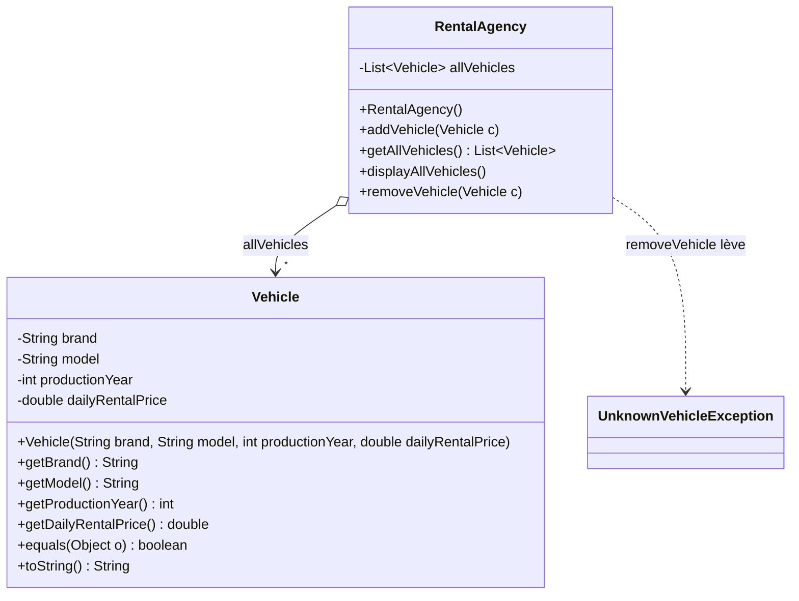

# TD Location de véhicules — Listes et filtres

> 🎯 **Objectifs** : gérer une **liste d'objets** (`List<Vehicle>`, `ArrayList`), **lever et capturer** une exception, repérer du **code dupliqué**, le **factoriser** avec une **interface de filtre**, puis **combiner** des filtres (« ET »).
> 📚 Cours : [07 — Collections](../../01-Cours/07-collections.md) · [06 — Interfaces (suite) : OCP](../../01-Cours/06-interfaces-suite.md) · [04 — Exceptions](../../01-Cours/04-exceptions.md)
> 📝 Préparation : faire les **questions 1 à 5**.

> ✅ [Corrigé](./corrige.md) — essaie d'abord seul·e !

> 🌍 **Dans la vraie vie :** une agence de location gère un parc de voitures : on en ajoute, on en retire (et on refuse de retirer une voiture qu'on ne possède pas !). Sur le site de réservation, le client coche des **filtres** : « prix max 85 €/jour », « marque Renault », « après 2020 »… et peut en cocher **plusieurs à la fois**.
> → en Java : le parc est une `List<Vehicle>`, chaque case à cocher est un **objet filtre**, et cocher deux cases revient à un « ET » de filtres.

## 🗺️ Les classes fournies

**Les véhicules** : une marque (`brand`), un nom de modèle (`model`), une année de production (`productionYear`, un `int`) et un prix de location à la journée (`dailyRentalPrice`, un `double`).
- **Deux véhicules sont égaux** si **tous** leurs attributs sont égaux.
- `toString()` renvoie un descriptif qui reprend les valeurs des attributs.

**L'agence** : l'attribut `allVehicles` est la liste des véhicules gérés par l'agence.



- 📌 Les deux classes sont dans le paquetage **`rental`** (`rental.Vehicle`, `rental.RentalAgency`) ; le diagramme du sujet se termine par « … » : d'autres méthodes viendront.
- ⚠️ Le sujet écrit `dailyrentalPrice` pour l'attribut : simple coquille, c'est `dailyRentalPrice` (comme dans le constructeur).

## ✍️ Questions

### Agence de location
- [ ] **Q1.** Déclaration de l'attribut `allVehicles` et code du constructeur de `RentalAgency`. Quelle **conséquence** sur l'**entête** de la classe ?
- [ ] **Q2.** `addVehicle()` : ajoute un véhicule à la liste des véhicules gérés par l'agence.
- [ ] **Q3.** `displayAllVehicles()` : affiche chacun des véhicules de l'agence, **un par ligne**.
- [ ] **Q4.** `removeVehicle()` : supprime un véhicule de l'agence ; déclenche une **`UnknownVehicleException`** si le véhicule n'est pas géré par l'agence (classe d'exception supposée définie dans le paquetage `rental`).
- [ ] **Q5.** Compléter le `main` ci-dessous à l'endroit indiqué : afficher un message **différent** selon que le véhicule a pu, ou non, être supprimé de l'agence.

```java
package rental.main;
import rental.*;
public class AgencyMain {
  public static void main(String args) {
    RentalAgency agency = new RentalAgency();
    ... // ajouts de véhicules à agency
    Vehicle someVehicle = new Vehicle("Timo", "Leon", 1920, 100);
    ___A COMPLETER ICI___
}
```

> ⚠️ Code recopié **tel quel** du sujet : `main(String args)` devrait être **`main(String[] args)`** (sinon ce n'est pas le point d'entrée du programme), et il manque l'accolade fermante de la classe.

### Sélection de véhicules
- [ ] **Q6.** `selectByMaxPrice100()` : renvoie la liste des véhicules de l'agence dont le prix de location à la journée est **inférieur à 100 €**.
- [ ] **Q7.** `selectByBrandTimoleon()` : renvoie la liste des véhicules de l'agence de marque **`"Timoleon"`**.
- [ ] **Q8.** Que constates-tu ? Et pour une méthode `selectByYearAfter2018()` (véhicules produits **après 2018**) ? Et pour d'autres filtres de sélection ?
- [ ] **Q9.** Que proposes-tu pour **éviter la répétition** de codes très similaires ?
- [ ] **Q10.** Applique ta solution aux **trois filtres** évoqués ci-dessus : que faut-il faire ? Que deviennent `selectByMaxPrice100()` et `selectByBrandTimoleon()` ?
- [ ] **Q11.** Comment **généraliser** pour un prix maximum, une marque ou une année **quelconques** ?
- [ ] **Q12.** Que faut-il **modifier et/ou ajouter** pour sélectionner les véhicules dont la marque **commence par une lettre donnée** ?
- [ ] **Q13.** Quels sont les **avantages** de la solution proposée ?
- [ ] **Q14.** `agency` est une référence de type `RentalAgency` déjà initialisée : la ou les lignes de code qui **affichent** tous les véhicules de cette agence dont le prix est **inférieur à 85 €**.
- [ ] **Q15.** « **Intersection de filtres** » = **et logique** entre des filtres. Exemple : véhicules produits **après 2020** **et** dont le prix de location est **au maximum 100 €**. La solution précédente le permet-elle ? Si oui, comment (applique-la à l'exemple) ? Si non, pourquoi ?

<details><summary>💡 Indice Q1 : quel type pour l'attribut ?</summary>

Déclarer avec l'**interface** (`List<Vehicle>`) et ne choisir la classe (`ArrayList`) qu'au `new`. `List` et `ArrayList` sont dans le paquetage `java.util`…

</details>

<details><summary>💡 Indice Q4 : comment savoir si le véhicule est géré ?</summary>

`contains(Object o)` et `remove(Object o)` de `List` comparent avec **`equals`** : c'est le `equals` de `Vehicle` qui sera utilisé. Penser à `throw` (dans le corps) **et** `throws` (dans la signature).

</details>

<details><summary>💡 Indice Q8-Q9 : qu'est-ce qui change d'une méthode à l'autre ?</summary>

Compare `selectByMaxPrice100()` et `selectByBrandTimoleon()` ligne à ligne : **une seule** ligne diffère. Cette ligne répond à la question « ce véhicule est-il accepté ? »… c'est l'**abstraction** à identifier (cf. `IncrementFunction` du compteur, ch. 06).

</details>

<details><summary>💡 Indice Q11 : « quelconque »</summary>

Une valeur qui change d'un filtre à l'autre = un **attribut** du filtre, fixé par son **constructeur** (comme `ModularIncrement(int modulo)` au ch. 06).

</details>

<details><summary>💡 Indice Q15 : un filtre fait de filtres</summary>

Un filtre « ET » est **lui-même** un filtre (il implémente la même interface) qui **contient deux** filtres et ne répond `true` que si **les deux** répondent `true`.

</details>

---

## 📝 Mes réponses

*(écris ici tes réponses, ou ajoute tes fichiers `.java` dans ce dossier)*

---
🏠 [Sommaire](../../README.md)
