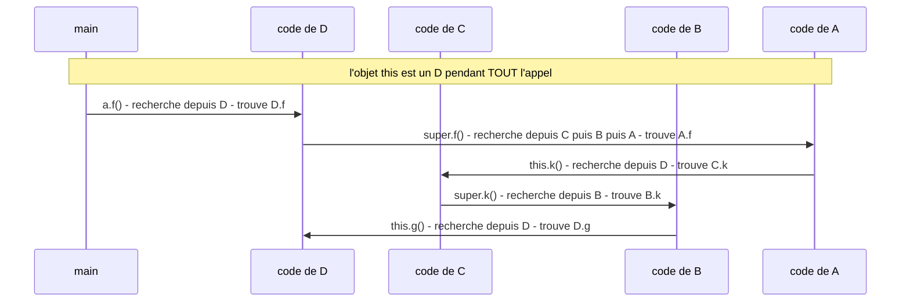
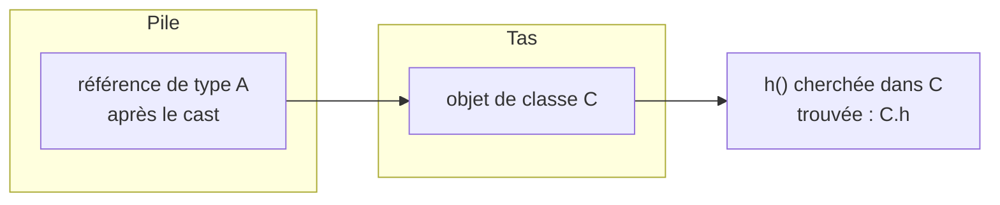
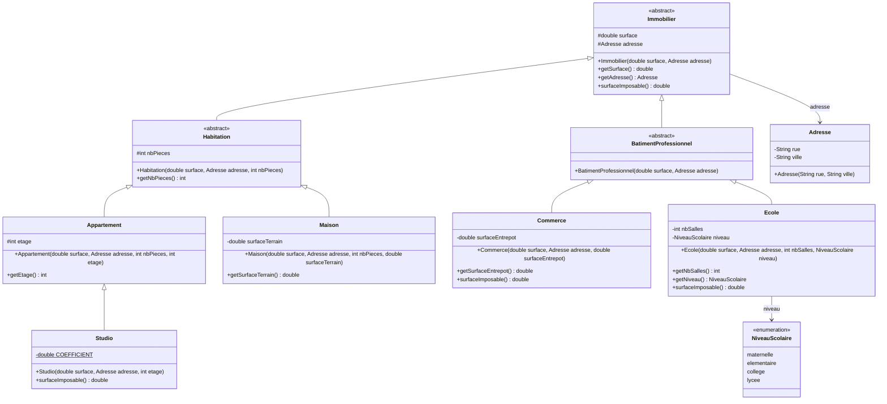
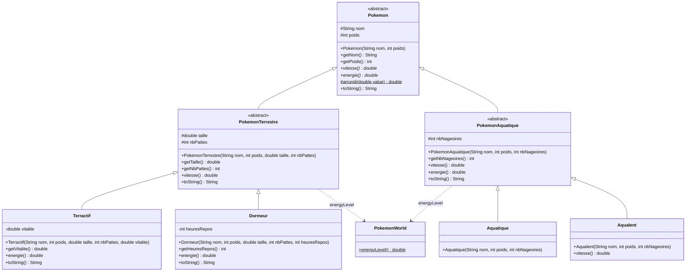
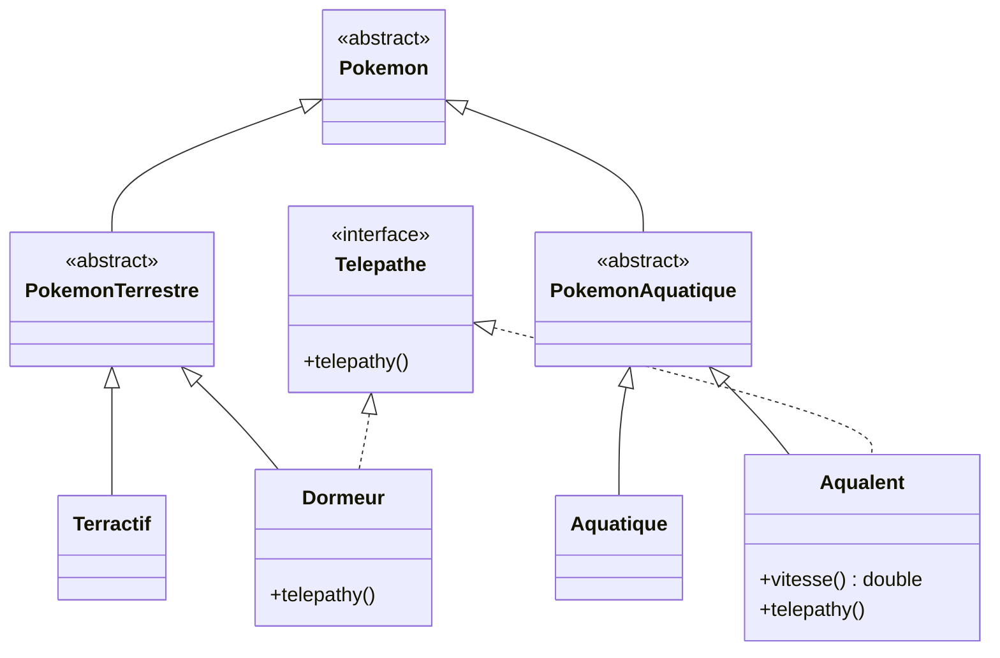

# TD Héritage — Lookup, biens immobiliers, Pokémons (annales DS2) — Corrigé

> 📄 [Énoncé](./enonce.md) · 📚 Cours : [08 — Héritage](../../01-Cours/08-heritage.md) · [09 — Classes abstraites et final](../../01-Cours/09-classes-abstraites.md) · [05 — Polymorphisme et interfaces](../../01-Cours/05-polymorphisme-et-interfaces.md)
> ✅ Code **compilé** (Java 21) et **exécuté** : les affichages sont les sorties **réelles** ; les 10 tests JUnit 5 du bonus passent.
> 💡 D'autres modélisations justes sont possibles (surtout aux Q1 des exercices 2 et 3) : l'important est de **justifier** ses choix.

---

## Exercice 1 — Lookup

### Q1 — Affichage obtenu

💡 **L'idée :** on déroule chaque appel en notant **l'objet** (`this`) et la classe où **démarre** la recherche.

Affichage **réel** (classes `A`, `B`, `C`, `D` codées puis exécutées) :

```text
-----
A.f
B.k
A.g
B.h
-----
D.f
A.f
C.k
B.k
D.g
-----
C.h
```

<details><summary>Le code des classes A, B, C, D (compilé et exécuté)</summary>

```java
package lookup;

public class A {
    public void f() {
        System.out.println("A.f");
        this.k();
    }
    public void g() {
        System.out.println("A.g");
        this.h();
    }
    public void h() {
        System.out.println("A.h");
    }
    public void k() {
        System.out.println("A.k");
    }
}
```

```java
package lookup;

public class B extends A {
    public void h() {
        System.out.println("B.h");
    }
    public void k() {
        System.out.println("B.k");
        this.g();
    }
}
```

```java
package lookup;

public class C extends B {
    public void h() {
        System.out.println("C.h");
    }
    public void k() {
        System.out.println("C.k");
        super.k();
    }
}
```

```java
package lookup;

public class D extends C {
    public void f() {
        System.out.println("D.f");
        super.f();
    }
    public void g() {
        System.out.println("D.g");
    }
    public void h() {
        System.out.println("D.h");
    }
}
```

</details>

### Les deux règles à appliquer

| Appel | La recherche commence dans… | Puis… |
|---|---|---|
| `ref.m()` ou `this.m()` | la classe de l'**objet** (pas le type de la référence) | on remonte les super-classes |
| `super.m()` | la **super-classe de la classe où est écrit** `super.m()` | on remonte les super-classes |

> ⚠️ `super` ne désigne **pas** la super-classe **de l'objet** : dans le code de `C`, `super.k()` cherche toujours dans `B`, même si l'objet est un `D`.

### Appel 1 : `a = new B(); a.f();` (l'objet est un `B`)

| Appel | Écrit dans | Recherche commence dans | Méthode trouvée | Affichage |
|---|---|:-:|:-:|:-:|
| `a.f()` | `main` | `B` | `A.f` (absente de `B`) | `A.f` |
| `this.k()` | `A.f` | `B` | `B.k` | `B.k` |
| `this.g()` | `B.k` | `B` | `A.g` (absente de `B`) | `A.g` |
| `this.h()` | `A.g` | `B` | `B.h` | `B.h` |

💡 Le code de `A.f` est **hérité**, mais `this` reste l'objet `B` : `this.k()` repart de `B`.

### Appel 2 : `a = new D(); a.f();` (l'objet est un `D`)

| Appel | Écrit dans | Recherche commence dans | Méthode trouvée | Affichage |
|---|---|:-:|:-:|:-:|
| `a.f()` | `main` | `D` | `D.f` | `D.f` |
| `super.f()` | `D.f` | `C` (super-classe de `D`) | `A.f` (ni `C` ni `B` n'ont `f`) | `A.f` |
| `this.k()` | `A.f` | `D` | `C.k` (absente de `D`) | `C.k` |
| `super.k()` | `C.k` | `B` (super-classe de `C`) | `B.k` | `B.k` |
| `this.g()` | `B.k` | `D` | `D.g` | `D.g` |

`D.g` n'appelle rien : l'appel est terminé.



📌 Les deux « pièges » de l'appel 2 :
- `super.f()` saute **plusieurs** niveaux : `C` puis `B` n'ont pas `f`, on arrive à `A`.
- Dans `B.k`, `this.g()` **redescend** jusqu'à `D` : c'est l'objet qui compte, pas l'endroit où le code est écrit (ce n'est **pas** `A.g` !).

### Appel 3 : `((A) new C()).h();` — le piège du cast

| Appel | Écrit dans | Recherche commence dans | Méthode trouvée | Affichage |
|---|---|:-:|:-:|:-:|
| `((A) new C()).h()` | `main` | `C` | `C.h` | `C.h` |



- Le cast `(A)` est un **upcast** : il change seulement le **type de la référence** (ce que le **compilateur** autorise : `A` a bien `h()`, donc ça compile).
- Il ne change **pas l'objet** : c'est toujours un `C`, et à l'exécution le lookup part de `C` → `C.h` (**late binding**).
- ⚠️ Réponse fausse classique : `A.h`.

---

## Exercice 2 — Biens immobiliers

### 📌 Choix de modélisation

| Question | Choix | Justification |
|---|---|---|
| `Immobilier` abstraite ? | **oui** | « on distingue parmi ces biens les habitations des bâtiments professionnels » : tout bien est l'un ou l'autre, un `new Immobilier(...)` n'a pas de sens |
| `Habitation` abstraite ? | **oui** | une habitation est un appartement **ou** une maison |
| `BatimentProfessionnel` abstraite ? | **oui** | « divisés entre » commerces **et** écoles |
| `Appartement` abstraite ? | **non** | il existe des appartements qui ne sont pas des studios |
| méthodes abstraites ? | **aucune** | `surfaceImposable()` a un comportement **par défaut** (surface totale) : une classe peut être abstraite **sans** méthode abstraite, c'est juste `new` qui est interdit |
| `Studio extends Appartement` | **oui** | « les studios sont des appartements particuliers » |
| attributs `protected` | `surface`, `adresse`, `nbPieces`, `etage` | utilisés par les sous-classes (ch. 08, § 11) ; les autres restent `private` |

> 💡 Garder `Immobilier`, `Habitation` ou `BatimentProfessionnel` **concrètes** est aussi accepté si on le justifie (« on pourra créer d'autres habitations plus tard ») ; mais une nouvelle sorte d'habitation se modélise mieux par une **nouvelle sous-classe**.

### Q1 — Diagramme UML



💡 **`surfaceImposable()` apparaît 4 fois** : dans `Immobilier` (comportement par défaut) et dans les 3 classes qui le **redéfinissent** (`Studio`, `Commerce`, `Ecole`). `Appartement`, `Maison`, `Habitation`… l'**héritent** sans changement : on ne la répète pas.

| Classe | `surfaceImposable()` | D'où vient le code ? |
|---|---|---|
| `Maison`, `Appartement` | surface totale | hérité de `Immobilier` |
| `Studio` | 0,9 × surface imposable d'un appartement | **redéfini**, avec `super.surfaceImposable()` |
| `Commerce` | surface − surface de l'entrepôt | **redéfini** |
| `Ecole` | 0 | **redéfini** |

### Q2 — La classe `Studio` (et ce qu'il faut pour la compiler)

💡 **L'idée :** un studio, c'est un appartement à **1 pièce** dont on reprend la surface imposable **× 0,9**, sans recopier le calcul de l'appartement.

```java
package immobilier;

/** A studio: a flat with a single room, taxed at 90% of a flat. */
public class Studio extends Appartement {
    private static final double COEFFICIENT = 0.9;

    /**
     * @param surface the total surface of this studio (in m2)
     * @param adresse the address of this studio
     * @param etage the floor of this studio
     */
    public Studio(double surface, Adresse adresse, int etage) {
        super(surface, adresse, 1, etage);
    }

    /** @return 0.9 times the taxable surface of a flat */
    public double surfaceImposable() {
        return COEFFICIENT * super.surfaceImposable();
    }
}
```

- 📌 Le constructeur ne demande **pas** le nombre de pièces : il vaut toujours **1**, on le passe directement à `super(...)`.
- 📌 `super.surfaceImposable()` = « la surface imposable retenue pour un **appartement** ». `Appartement` ne la définit pas, le lookup remonte à `Immobilier` → surface totale. Si un jour les appartements sont imposés autrement, les studios **suivront automatiquement**.
- ⚠️ `return 0.9 * this.surfaceImposable();` → **récursion infinie** (`StackOverflowError`) : `this.` relance le lookup depuis `Studio`.
- ⚠️ `return 0.9 * this.surface;` marche **aujourd'hui** mais court-circuite une éventuelle redéfinition dans `Appartement`.

Les super-classes nécessaires (et `Adresse`, « supposée définie », en version minimale) :

```java
package immobilier;

/** A minimal postal address (supposed to be defined by the subject). */
public class Adresse {
    private String rue;
    private String ville;

    public Adresse(String rue, String ville) {
        this.rue = rue;
        this.ville = ville;
    }

    public String getRue() {
        return this.rue;
    }

    public String getVille() {
        return this.ville;
    }

    public String toString() {
        return this.rue + ", " + this.ville;
    }
}
```

```java
package immobilier;

/** A real estate property: a total surface (in m2) and an address. */
public abstract class Immobilier {
    protected double surface;
    protected Adresse adresse;

    /**
     * @param surface the total surface of this property (in m2)
     * @param adresse the address of this property
     */
    public Immobilier(double surface, Adresse adresse) {
        this.surface = surface;
        this.adresse = adresse;
    }

    public double getSurface() {
        return this.surface;
    }

    public Adresse getAdresse() {
        return this.adresse;
    }

    /** @return the taxable surface: by default, the total surface */
    public double surfaceImposable() {
        return this.surface;
    }
}
```

```java
package immobilier;

/** A dwelling: a property with a number of rooms. */
public abstract class Habitation extends Immobilier {
    protected int nbPieces;

    public Habitation(double surface, Adresse adresse, int nbPieces) {
        super(surface, adresse);
        this.nbPieces = nbPieces;
    }

    public int getNbPieces() {
        return this.nbPieces;
    }
}
```

```java
package immobilier;

/** A flat: a dwelling located on a given floor. */
public class Appartement extends Habitation {
    protected int etage;

    public Appartement(double surface, Adresse adresse, int nbPieces, int etage) {
        super(surface, adresse, nbPieces);
        this.etage = etage;
    }

    public int getEtage() {
        return this.etage;
    }
}
```

📌 Chaîne des constructeurs pour `new Studio(30, lille, 4)` : `Studio` → `super(30, lille, 1, 4)` (`Appartement`) → `super(30, lille, 1)` (`Habitation`) → `super(30, lille)` (`Immobilier`) → `Object`.

<details><summary>Les autres classes de la hiérarchie (compilées avec le reste)</summary>

```java
package immobilier;

/** A house: a dwelling built on a piece of land. */
public class Maison extends Habitation {
    private double surfaceTerrain;

    public Maison(double surface, Adresse adresse, int nbPieces, double surfaceTerrain) {
        super(surface, adresse, nbPieces);
        this.surfaceTerrain = surfaceTerrain;
    }

    public double getSurfaceTerrain() {
        return this.surfaceTerrain;
    }
}
```

```java
package immobilier;

/** A building for professional use. */
public abstract class BatimentProfessionnel extends Immobilier {

    public BatimentProfessionnel(double surface, Adresse adresse) {
        super(surface, adresse);
    }
}
```

```java
package immobilier;

/** A shop: part of its surface is a warehouse, which is not taxed. */
public class Commerce extends BatimentProfessionnel {
    private double surfaceEntrepot;

    public Commerce(double surface, Adresse adresse, double surfaceEntrepot) {
        super(surface, adresse);
        this.surfaceEntrepot = surfaceEntrepot;
    }

    public double getSurfaceEntrepot() {
        return this.surfaceEntrepot;
    }

    /** @return the total surface minus the warehouse surface */
    public double surfaceImposable() {
        return this.surface - this.surfaceEntrepot;
    }
}
```

```java
package immobilier;

/** A school: never taxed. */
public class Ecole extends BatimentProfessionnel {
    private int nbSalles;
    private NiveauScolaire niveau;

    public Ecole(double surface, Adresse adresse, int nbSalles, NiveauScolaire niveau) {
        super(surface, adresse);
        this.nbSalles = nbSalles;
        this.niveau = niveau;
    }

    public int getNbSalles() {
        return this.nbSalles;
    }

    public NiveauScolaire getNiveau() {
        return this.niveau;
    }

    /** @return 0 : schools are not taxed */
    public double surfaceImposable() {
        return 0;
    }
}
```

</details>

### Démonstration : une liste de biens, chacun imposé « à sa façon »

```java
package immobilier;

import java.util.ArrayList;
import java.util.List;

public class ImmobilierMain {
    public static void main(String[] args) {
        Adresse lille = new Adresse("1 rue Nationale", "Lille");
        List<Immobilier> biens = new ArrayList<Immobilier>();
        biens.add(new Maison(120, lille, 5, 400));
        biens.add(new Appartement(70, lille, 3, 2));
        biens.add(new Studio(30, lille, 4));
        biens.add(new Commerce(200, lille, 80));
        biens.add(new Ecole(1500, lille, 12, NiveauScolaire.elementaire));
        double total = 0;
        for (Immobilier bien : biens) {
            System.out.println(bien.getSurface() + " m2 -> " + bien.surfaceImposable() + " m2 imposables");
            total = total + bien.surfaceImposable();
        }
        System.out.println("Total imposable : " + total + " m2");
    }
}
```

Sortie réelle :

```text
120.0 m2 -> 120.0 m2 imposables
70.0 m2 -> 70.0 m2 imposables
30.0 m2 -> 27.0 m2 imposables
200.0 m2 -> 120.0 m2 imposables
1500.0 m2 -> 0.0 m2 imposables
Total imposable : 337.0 m2
```

💡 La boucle ne contient **aucun** `instanceof` : `bien.surfaceImposable()` exécute la version de **l'objet** (late binding).

---

## Exercice 3 — Pokémons

### 📌 Hypothèses (non fixées par l'énoncé)

| Élément | Hypothèse retenue |
|---|---|
| noms des classes et méthodes | ceux du sujet : `Pokemon`, `vitesse()`, `energie()`, `Telepathe`, `telepathy()`… |
| type du poids | `int` (le sujet affiche « 18 kg », pas « 18.0 kg ») ⇒ ⚠️ divisions par `10.0`, `25.0`, `2.0` |
| taille, vitalité | `double` ; heures de repos, pattes, nageoires : `int` |
| `PokemonWorld` | « supposée définie » : version minimale avec un `setEnergyLevel(double)` pour simuler la variation dans le temps (démo et tests) |
| `toString` | même début pour **toutes** les familles (« Je suis … ») ; valeurs arrondies à 1 décimale pour afficher `11.4` et non `11.399999999999999` |
| texte du dormeur | « je me repose 8 h par jour » (non donné par le sujet) |

### Q1 — Diagramme UML

💡 **L'idée :** on monte chaque élément commun **le plus haut possible**, et on laisse **abstrait** ce qu'on ne sait pas calculer pour un Pokémon quelconque.

| Ce qui est commun… | … à qui ? | … va dans |
|---|---|---|
| `nom`, `poids`, `toString` (début), `vitesse()`/`energie()` **abstraites** | toutes les familles | `Pokemon` (abstraite) |
| `taille`, `nbPattes`, formule de vitesse « sur terre » | terractifs, dormeurs | `PokemonTerrestre` (abstraite) |
| `nbNageoires`, formules des aquatiques | aquatiques, aqualents | `PokemonAquatique` (abstraite) |
| `vitalite` + son énergie | terractifs seulement | `Terractif` |
| `heuresRepos` + son énergie | dormeurs seulement | `Dormeur` |
| vitesse divisée par 2 | aqualents seulement | `Aqualent` |



- 📌 `vitesse()*` et `energie()*` : méthodes **abstraites** dans `Pokemon` ⇒ on peut écrire `p.vitesse()` sur **n'importe quel** `Pokemon` d'une `List<Pokemon>`.
- 📌 `PokemonTerrestre` reste **abstraite** : elle concrétise `vitesse()` mais pas `energie()`.
- 📌 `PokemonAquatique` concrétise tout mais reste **abstraite** : un Pokémon « aquatique quelconque » n'est pas une famille. `Aquatique` n'ajoute rien… sauf d'être **la** famille des aquatiques, au même niveau que `Aqualent`.
- 💡 `Aqualent extends Aquatique` est aussi défendable (« deux fois plus lent qu'un aquatique »). Ici les deux familles sont « sœurs » et partagent leurs formules via `PokemonAquatique`.
- ✅ **OCP** : une nouvelle famille = une **nouvelle sous-classe** (de `Pokemon`, `PokemonTerrestre` ou `PokemonAquatique`) ; ni la collection ni les calculs de moyenne ne changent.

### Q2 — Le code des aqualents et de toutes leurs super-classes

💡 **L'idée :** `Aqualent` hérite de tout et ne redéfinit que `vitesse()`, en **réutilisant** celle des aquatiques via `super.vitesse()`.

```java
package pokemon;

/** A Pokemon of any family: a name and a weight (in kg). */
public abstract class Pokemon {
    protected String nom;
    protected int poids;

    /**
     * @param nom the name of this Pokemon
     * @param poids the weight of this Pokemon (in kg)
     */
    public Pokemon(String nom, int poids) {
        this.nom = nom;
        this.poids = poids;
    }

    public String getNom() {
        return this.nom;
    }

    public int getPoids() {
        return this.poids;
    }

    /** @return the speed of this Pokemon (in km/h) */
    public abstract double vitesse();

    /** @return the energy daily absorbed by this Pokemon */
    public abstract double energie();

    /** @return value rounded to one decimal (11.399999999999999 -> 11.4) */
    protected static double arrondi(double value) {
        return Math.round(value * 10) / 10.0;
    }

    /** @return the characteristics common to all Pokemons */
    public String toString() {
        return "Je suis " + this.nom + " mon poids est de " + this.poids + " kg, ma vitesse est de "
                + arrondi(this.vitesse()) + " km/h, j'absorbe quotidiennement une énergie de "
                + arrondi(this.energie());
    }
}
```

```java
package pokemon;

/** A Pokemon moving in water, with fins. */
public abstract class PokemonAquatique extends Pokemon {
    protected int nbNageoires;

    public PokemonAquatique(String nom, int poids, int nbNageoires) {
        super(nom, poids);
        this.nbNageoires = nbNageoires;
    }

    public int getNbNageoires() {
        return this.nbNageoires;
    }

    /** @return nbNageoires * (poids / 25) * energy level */
    public double vitesse() {
        return this.nbNageoires * (this.poids / 25.0) * PokemonWorld.energyLevel();
    }

    /** @return poids / 2 */
    public double energie() {
        return this.poids / 2.0;
    }

    public String toString() {
        return super.toString() + ", j'ai " + this.nbNageoires + " nageoires.";
    }
}
```

```java
package pokemon;

/** A slow aquatic Pokemon: twice slower than an aquatic one. */
public class Aqualent extends PokemonAquatique {

    public Aqualent(String nom, int poids, int nbNageoires) {
        super(nom, poids, nbNageoires);
    }

    /** @return half the speed of an aquatic Pokemon */
    public double vitesse() {
        return super.vitesse() / 2;
    }
}
```

- 📌 Dans `Pokemon.toString()`, `this.vitesse()` est un **envoi de message** : pour un `Aqualent`, le lookup trouve `Aqualent.vitesse()` → la vitesse **divisée par 2** s'affiche, sans redéfinir `toString`.
- 📌 `energie()` n'est **pas** redéfinie dans `Aqualent` : « autant d'énergie » qu'un aquatique = héritage pur.
- ⚠️ `this.poids / 25` avec un `int` = **division entière** : `15 / 25` vaut `0` ⇒ vitesse `0.0`. De même `(18 + 1) / 10` vaut `1` (Pikachu irait à 6.0 km/h au lieu de 11.4). D'où `25.0`, `10.0`, `2.0`.

<details><summary>La classe <code>PokemonWorld</code> minimale utilisée pour compiler</summary>

```java
package pokemon;

/** The worlds of the Pokemons: an energy field shared by all worlds. */
public class PokemonWorld {
    private static double energyLevel = 1.0;

    /** @return the current intensity of the energy field */
    public static double energyLevel() {
        return energyLevel;
    }

    /** Changes the intensity of the energy field (it varies in time). */
    public static void setEnergyLevel(double level) {
        energyLevel = level;
    }
}
```

</details>

<details><summary>Les autres familles : <code>PokemonTerrestre</code>, <code>Terractif</code>, <code>Aquatique</code> (et <code>Dormeur</code> en Q3)</summary>

```java
package pokemon;

/** A Pokemon moving on land, with legs and a size. */
public abstract class PokemonTerrestre extends Pokemon {
    protected double taille;
    protected int nbPattes;

    public PokemonTerrestre(String nom, int poids, double taille, int nbPattes) {
        super(nom, poids);
        this.taille = taille;
        this.nbPattes = nbPattes;
    }

    public double getTaille() {
        return this.taille;
    }

    public int getNbPattes() {
        return this.nbPattes;
    }

    /** @return nbPattes * ((poids + 1) / 10) * 2 * energy level */
    public double vitesse() {
        return this.nbPattes * ((this.poids + 1) / 10.0) * 2 * PokemonWorld.energyLevel();
    }

    public String toString() {
        return super.toString() + ", j'ai " + this.nbPattes + " pattes, ma taille est de " + this.taille + "m";
    }
}
```

```java
package pokemon;

/** A land Pokemon with a vitality coefficient. */
public class Terractif extends PokemonTerrestre {
    private double vitalite;

    public Terractif(String nom, int poids, double taille, int nbPattes, double vitalite) {
        super(nom, poids, taille, nbPattes);
        this.vitalite = vitalite;
    }

    public double getVitalite() {
        return this.vitalite;
    }

    /** @return vitalite * taille^2 * 100 */
    public double energie() {
        return this.vitalite * this.taille * this.taille * 100;
    }

    public String toString() {
        return super.toString() + ", ma vitalité est de " + this.vitalite + ".";
    }
}
```

```java
package pokemon;

/** An aquatic Pokemon: everything is inherited from PokemonAquatique. */
public class Aquatique extends PokemonAquatique {

    public Aquatique(String nom, int poids, int nbNageoires) {
        super(nom, poids, nbNageoires);
    }
}
```

</details>

### Q3.1 — Les Pokémons télépathes : une interface

💡 **L'idée :** dormeurs et aqualents sont dans **deux branches différentes** : pour les regrouper, il faut un **type commun hors de l'arbre d'héritage** → une **interface**.

> 🌍 **Dans la vraie vie :** dans un club, avoir le « badge secouriste » ne dépend pas de ta famille ou de ton métier : n'importe qui peut l'obtenir s'il sait faire les gestes. La liste des secouristes mélange donc des gens très différents.
> → en Java : `Telepathe` est un « badge » que `Dormeur` et `Aqualent` affichent avec `implements`, et une `List<Telepathe>` les accueille tous les deux.

Modifications à apporter :

1. **Créer** l'interface `Telepathe` :

```java
package pokemon;

/** A telepathic Pokemon. */
public interface Telepathe {
    public void telepathy();
}
```

2. **`Dormeur`** et **`Aqualent`** déclarent `implements Telepathe` et **définissent** `public void telepathy()`.
3. Les collections de télépathes ont pour type **`List<Telepathe>`** : on peut y ajouter un `Dormeur` **et** un `Aqualent`.
4. **Rien d'autre ne change** : ni `Pokemon`, ni `PokemonTerrestre`, ni `PokemonAquatique`, ni `Terractif`, ni `Aquatique`, ni le code qui manipule des `List<Pokemon>`.

| Autre idée | Pourquoi ça ne marche pas |
|---|---|
| une classe (abstraite) `PokemonTelepathe` | `Dormeur` hérite déjà de `PokemonTerrestre` et `Aqualent` de `PokemonAquatique` : **pas d'héritage multiple** de classes en Java |
| ajouter `telepathy()` dans `Pokemon` | **tous** les Pokémons deviendraient télépathes (faux pour terractifs et aquatiques) |
| une `List<Pokemon>` + `instanceof Dormeur \|\| instanceof Aqualent` | cascade de `instanceof` à modifier à chaque nouvelle famille télépathe (viole l'**OCP**) |



📌 Dans une `List<Telepathe>`, le compilateur ne connaît que `telepathy()` : pour appeler `vitesse()` sur un élément, il faudrait un **downcast** vers `Pokemon` (ch. 08, § 13).

### Q3.2 — Les changements dans la classe `Aqualent`

Exactement **deux** changements :
1. l'**entête** : `public class Aqualent extends PokemonAquatique implements Telepathe` ;
2. l'**ajout** de la méthode `public void telepathy()` (obligatoire, sinon `Aqualent` ne compile plus car elle n'est pas abstraite).

Le constructeur, `vitesse()`, et tout ce qui est hérité restent **inchangés**.

```java
package pokemon;

/** A slow aquatic Pokemon: twice slower than an aquatic one, telepathic. */
public class Aqualent extends PokemonAquatique implements Telepathe {

    public Aqualent(String nom, int poids, int nbNageoires) {
        super(nom, poids, nbNageoires);
    }

    /** @return half the speed of an aquatic Pokemon */
    public double vitesse() {
        return super.vitesse() / 2;
    }

    public void telepathy() {
        System.out.println(this.nom + " nage lentement... et lit dans les pensées.");
    }
}
```

<details><summary>La classe <code>Dormeur</code> (version télépathe)</summary>

```java
package pokemon;

/** A land Pokemon that rests a number of hours per day. */
public class Dormeur extends PokemonTerrestre implements Telepathe {
    private int heuresRepos;

    public Dormeur(String nom, int poids, double taille, int nbPattes, int heuresRepos) {
        super(nom, poids, taille, nbPattes);
        this.heuresRepos = heuresRepos;
    }

    public int getHeuresRepos() {
        return this.heuresRepos;
    }

    /** @return taille^2 - (heuresRepos * 2) */
    public double energie() {
        return this.taille * this.taille - (this.heuresRepos * 2);
    }

    public void telepathy() {
        System.out.println(this.nom + " dort... et lit dans les pensées.");
    }

    public String toString() {
        return super.toString() + ", je me repose " + this.heuresRepos + " h par jour.";
    }
}
```

</details>

### Vérification des exemples de `toString` du sujet

| Valeur du sujet | Calcul avec les formules | Bilan |
|---|---|---|
| Pikachu : **11.4 km/h** | 2 × ((18 + 1) / 10) × 2 × I = 7,6 × I | ✅ cohérent si l'intensité I vaut **1.5** |
| Pikachu : **79** d'énergie | 1,1 × 0,8² × 100 = **70.4** | ❌ **incohérent** : 79 demanderait une vitalité ≈ 1,234 ou une taille ≈ 0,847 m |
| Aquameche : **0.9 km/h** | aquatique : 3 × (15 / 25) × I = 1,8 × I, aqualent : 0,9 × I | ✅ cohérent si I vaut **1.0** |
| Aquameche : **7.5** d'énergie | 15 / 2 = 7,5 | ✅ |

- ⚠️ Les deux exemples supposent des intensités **différentes** (1.5 puis 1.0) : possible puisque le champ « varie dans le temps », mais ils n'ont pas été calculés au même instant.
- ⚠️ Le **79** est une erreur du sujet : notre code affiche **70.4** (vérifié à l'exécution ci-dessous). Ne pas « bricoler » la formule pour retrouver 79.
- ⚠️ Autres coquilles : « Pokémon actif » = terractif ; « ma actuelle » = « ma vitesse » ; « Je suis **le Pokémon** Aquameche » vs « Je suis Pikachu » : on garde **un seul** format, factorisé dans `Pokemon.toString()`.
- ⚠️ La formule des dormeurs donne souvent une énergie **négative** (taille 1 m, 8 h de repos : 1 − 16 = −15) : on applique la formule telle quelle.

### Démonstration : collection, vitesse moyenne, énergie totale

```java
package pokemon;

import java.util.ArrayList;
import java.util.List;

public class PokemonMain {
    public static void main(String[] args) {
        Terractif pikachu = new Terractif("Pikachu", 18, 0.8, 2, 1.1);
        Dormeur soporifik = new Dormeur("Soporifik", 32, 1.0, 2, 8);
        Aquatique magicarpe = new Aquatique("Magicarpe", 10, 2);
        Aqualent aquameche = new Aqualent("Aquameche", 15, 3);

        PokemonWorld.setEnergyLevel(1.5);
        System.out.println(pikachu);
        PokemonWorld.setEnergyLevel(1.0);
        System.out.println(aquameche);
        System.out.println("-----");

        List<Pokemon> pokemons = new ArrayList<Pokemon>();
        pokemons.add(pikachu);
        pokemons.add(soporifik);
        pokemons.add(magicarpe);
        pokemons.add(aquameche);
        double sommeVitesses = 0;
        double energieTotale = 0;
        for (Pokemon p : pokemons) {
            System.out.println(p);
            sommeVitesses = sommeVitesses + p.vitesse();
            energieTotale = energieTotale + p.energie();
        }
        double vitesseMoyenne = sommeVitesses / pokemons.size();
        System.out.println("Vitesse moyenne : " + Math.round(vitesseMoyenne * 10) / 10.0 + " km/h");
        System.out.println("Énergie totale : " + Math.round(energieTotale * 10) / 10.0);

        List<Telepathe> telepathes = new ArrayList<Telepathe>();
        telepathes.add(soporifik);
        telepathes.add(aquameche);
        for (Telepathe t : telepathes) {
            t.telepathy();
        }
    }
}
```

Sortie réelle :

```text
Je suis Pikachu mon poids est de 18 kg, ma vitesse est de 11.4 km/h, j'absorbe quotidiennement une énergie de 70.4, j'ai 2 pattes, ma taille est de 0.8m, ma vitalité est de 1.1.
Je suis Aquameche mon poids est de 15 kg, ma vitesse est de 0.9 km/h, j'absorbe quotidiennement une énergie de 7.5, j'ai 3 nageoires.
-----
Je suis Pikachu mon poids est de 18 kg, ma vitesse est de 7.6 km/h, j'absorbe quotidiennement une énergie de 70.4, j'ai 2 pattes, ma taille est de 0.8m, ma vitalité est de 1.1.
Je suis Soporifik mon poids est de 32 kg, ma vitesse est de 13.2 km/h, j'absorbe quotidiennement une énergie de -15.0, j'ai 2 pattes, ma taille est de 1.0m, je me repose 8 h par jour.
Je suis Magicarpe mon poids est de 10 kg, ma vitesse est de 0.8 km/h, j'absorbe quotidiennement une énergie de 5.0, j'ai 2 nageoires.
Je suis Aquameche mon poids est de 15 kg, ma vitesse est de 0.9 km/h, j'absorbe quotidiennement une énergie de 7.5, j'ai 3 nageoires.
Vitesse moyenne : 5.6 km/h
Énergie totale : 67.9
Soporifik dort... et lit dans les pensées.
Aquameche nage lentement... et lit dans les pensées.
```

- 📌 Après `setEnergyLevel(1.0)`, Pikachu ne va plus qu'à 7.6 km/h : la vitesse est **recalculée** à chaque appel, elle n'est **pas** stockée dans un attribut.
- 📌 Vitesse moyenne : (7,6 + 13,2 + 0,8 + 0,9) / 4 = 5,625 ≈ 5.6 ; énergie totale : 70,4 − 15 + 5 + 7,5 = 67,9.
- 📌 Sans l'arrondi, Java afficherait `11.399999999999999` : les `double` ne représentent pas exactement 0,1 (d'où le `delta` dans les tests).

---

## 🎁 Bonus : tests JUnit 5

Tests exécutés avec `java -jar junit-console.jar -classpath test:classes -scan-classpath` :

```text
[        10 tests successful      ]
[         0 tests failed          ]
```

```java
package immobilier;

import static org.junit.jupiter.api.Assertions.*;

import org.junit.jupiter.api.Test;

public class ImmobilierTest {
    private Adresse adresse = new Adresse("1 rue Nationale", "Lille");

    @Test
    public void maisonEtAppartementImposesSurLaSurfaceTotale() {
        assertEquals(120, new Maison(120, adresse, 5, 400).surfaceImposable(), 0.001);
        assertEquals(70, new Appartement(70, adresse, 3, 2).surfaceImposable(), 0.001);
    }

    @Test
    public void studioImposeA90PourCent() {
        Studio studio = new Studio(30, adresse, 4);
        assertEquals(27, studio.surfaceImposable(), 0.001);
        assertEquals(1, studio.getNbPieces());
        assertEquals(4, studio.getEtage());
    }

    @Test
    public void commerceSansEntrepot() {
        assertEquals(120, new Commerce(200, adresse, 80).surfaceImposable(), 0.001);
        assertEquals(200, new Commerce(200, adresse, 0).surfaceImposable(), 0.001);
    }

    @Test
    public void ecoleNonImposable() {
        Ecole ecole = new Ecole(1500, adresse, 12, NiveauScolaire.college);
        assertEquals(0, ecole.surfaceImposable(), 0.001);
        assertEquals(NiveauScolaire.college, ecole.getNiveau());
    }

    @Test
    public void lateBindingViaUneReferenceImmobilier() {
        Immobilier bien = new Studio(50, adresse, 0);
        assertEquals(45, bien.surfaceImposable(), 0.001);
    }
}
```

```java
package pokemon;

import static org.junit.jupiter.api.Assertions.*;

import org.junit.jupiter.api.AfterEach;
import org.junit.jupiter.api.Test;

public class PokemonTest {

    @AfterEach
    public void resetEnergyLevel() {
        PokemonWorld.setEnergyLevel(1.0);
    }

    @Test
    public void terractifVitesseEtEnergie() {
        PokemonWorld.setEnergyLevel(1.5);
        Terractif pikachu = new Terractif("Pikachu", 18, 0.8, 2, 1.1);
        assertEquals(11.4, pikachu.vitesse(), 0.001);
        assertEquals(70.4, pikachu.energie(), 0.001);
    }

    @Test
    public void dormeurVitesseEtEnergie() {
        Dormeur soporifik = new Dormeur("Soporifik", 32, 1.0, 2, 8);
        assertEquals(13.2, soporifik.vitesse(), 0.001);
        assertEquals(-15, soporifik.energie(), 0.001);
    }

    @Test
    public void aqualentDeuxFoisPlusLentQuUnAquatique() {
        Aquatique aquatique = new Aquatique("Magicarpe", 15, 3);
        Aqualent aqualent = new Aqualent("Aquameche", 15, 3);
        assertEquals(1.8, aquatique.vitesse(), 0.001);
        assertEquals(0.9, aqualent.vitesse(), 0.001);
        assertEquals(aquatique.energie(), aqualent.energie(), 0.001);
        assertEquals(7.5, aqualent.energie(), 0.001);
    }

    @Test
    public void vitesseSuitLIntensiteDuChamp() {
        Pokemon aqualent = new Aqualent("Aquameche", 15, 3);
        PokemonWorld.setEnergyLevel(2.0);
        assertEquals(1.8, aqualent.vitesse(), 0.001);
    }

    @Test
    public void toStringArrondiAUneDecimale() {
        PokemonWorld.setEnergyLevel(1.5);
        Terractif pikachu = new Terractif("Pikachu", 18, 0.8, 2, 1.1);
        assertEquals("Je suis Pikachu mon poids est de 18 kg, ma vitesse est de 11.4 km/h, "
                + "j'absorbe quotidiennement une énergie de 70.4, j'ai 2 pattes, ma taille est de 0.8m, "
                + "ma vitalité est de 1.1.", pikachu.toString());
    }
}
```

- 📌 `assertEquals(attendu, obtenu, delta)` pour les `double` : jamais d'égalité exacte sur des calculs flottants.
- 📌 `@AfterEach` remet l'intensité à 1.0 : l'attribut `static` de `PokemonWorld` est **partagé** par tous les tests.

---

## ⚠️ Erreurs fréquentes

| Erreur | Pourquoi c'est faux | Correction |
|---|---|---|
| Ex1 : `this.g()` dans `B.k` → `A.g` pour un objet `D` | `this` est l'objet `D` : la recherche repart de `D` | `D.g` |
| Ex1 : `super.k()` dans `C` → recherche dans la super-classe **de l'objet** | `super` dépend de la classe où il est **écrit** | depuis `B` (super-classe de `C`) |
| Ex1 : `((A) new C()).h()` → `A.h` | le cast change la **référence**, pas l'**objet** | `C.h` (late binding) |
| Ex1 : oublier les `println` des méthodes « de passage » | **chaque** méthode exécutée commence par son `println` | `D.f` **puis** `A.f`… |
| Ex2/Ex3 : répéter une méthode dans toutes les classes du diagramme | le sujet demande de ne l'écrire que là où elle **change** de comportement | 4 `surfaceImposable()`, pas 8 |
| Ex2 : `Studio(double surface, Adresse adresse, int nbPieces, int etage)` | un studio a **toujours** 1 pièce | `super(surface, adresse, 1, etage)` |
| Ex2 : `0.9 * this.surfaceImposable()` dans `Studio` | rappelle `Studio.surfaceImposable()` : récursion infinie | `0.9 * super.surfaceImposable()` |
| Ex2/Ex3 : oublier `super(...)` dans le constructeur | pas de constructeur sans paramètre dans la super-classe : refus de compilation | `super(...)` en **première** instruction |
| attributs `private` dans la super-classe mais utilisés par `this.surface` dans une sous-classe | inaccessible : refus de compilation | `protected` ou accesseur `getSurface()` |
| Ex2 : `instanceof Ecole` dans `Immobilier.surfaceImposable()` | casse l'OCP, à modifier à chaque nouveau bien | redéfinir dans `Ecole` |
| Ex3 : `(poids + 1) / 10` ou `poids / 25` avec `poids` entier | **division entière** : 19 / 10 = 1, 15 / 25 = 0 | `10.0`, `25.0`, `2.0` |
| Ex3 : recopier la formule des aquatiques dans `Aqualent` (avec `/ 2`) | code dupliqué : une évolution ne serait pas répercutée | `super.vitesse() / 2` |
| Ex3 : vitesse stockée dans un attribut calculé au constructeur | l'intensité **varie dans le temps** : valeur périmée | recalculer dans `vitesse()` |
| Ex3 : `Pokemon` concrète avec `vitesse()` qui renvoie 0 | on pourrait créer un Pokémon sans famille ; une nouvelle famille pourrait oublier de redéfinir | `abstract` : le compilateur **oblige** à définir |
| Ex3 Q3 : `class PokemonTelepathe` dont héritent `Dormeur` et `Aqualent` | pas d'héritage multiple de classes en Java | `interface Telepathe` + `implements` |
| Ex3 Q3 : `implements Telepathe` sans écrire `telepathy()` | la classe concrète ne respecte pas le contrat : refus de compilation | ajouter `public void telepathy()` |
| Ex3 : « corriger » la formule pour retrouver le 79 du sujet | l'exemple du sujet est incohérent (70.4 avec ses propres formules) | appliquer la formule et le signaler |

---
🏠 [Sommaire](../../README.md)
