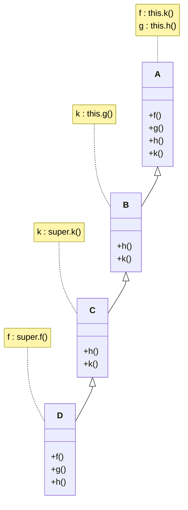

# TD Héritage — Lookup, biens immobiliers, Pokémons (annales DS2)

> 🎯 **Objectifs** : dérouler à la main la **recherche de méthode (lookup)** avec `this` et `super`, **modéliser** une hiérarchie de classes en **UML** (héritage, classes abstraites, redéfinition), **coder** une sous-classe qui réutilise le comportement de sa super-classe avec `super.m()`, et ajouter une **interface** à une hiérarchie existante.
> 📚 Cours : [08 — Héritage](../../01-Cours/08-heritage.md) · [09 — Classes abstraites et final](../../01-Cours/09-classes-abstraites.md) · [05 — Polymorphisme et interfaces](../../01-Cours/05-polymorphisme-et-interfaces.md)
> 📝 Trois exercices **d'anciens DS2** : à faire en conditions d'examen (sans ordinateur).

> ✅ [Corrigé](./corrige.md) — essaie d'abord seul·e !

| N° | Exercice | Niveau | Durée | Notions |
|:-:|---|:-:|:-:|---|
| 1 | Lookup (DS2 2018) | ⭐⭐ | 15 min | recherche de méthode, `this.m()`, `super.m()`, transtypage |
| 2 | Biens immobiliers (DS2 2015) | ⭐⭐ | 30 min | diagramme UML, `extends`, `super(...)`, redéfinition, `super.m()`, enum |
| 3 | Pokémons (DS2 2017) | ⭐⭐⭐ | 45 min | classes abstraites, méthodes abstraites, `toString`, OCP, interface |

---

## Exercice 1 : Lookup (DS2 2018)

💡 **L'idée :** chaque appel `this.m()` relance la recherche **depuis la classe de l'objet** ; chaque `super.m()` la lance **depuis la super-classe de la classe où il est écrit**.

> 🌍 **Dans la vraie vie :** au standard d'une entreprise, ta question est transmise d'abord à ton conseiller, puis à son chef, puis au directeur… jusqu'au premier qui sait répondre. Mais si le conseiller dit « je demande à **mon** chef » (`super`), on saute directement au-dessus de **lui**, pas au-dessus de toi.
> → en Java : `this.m()` part toujours de la classe de l'objet, `super.m()` part de la super-classe de la classe qui contient ce code.

On donne le diagramme de classes suivant :



Les notes du diagramme donnent les portions de code suivantes :

| Classe | Méthode | Corps (en plus du `println`) |
|:-:|:-:|---|
| `A` | `f()` | `this.k();` |
| `A` | `g()` | `this.h();` |
| `A` | `h()`, `k()` | *(rien)* |
| `B` | `h()` | *(rien)* |
| `B` | `k()` | `this.g();` |
| `C` | `h()` | *(rien)* |
| `C` | `k()` | `super.k();` |
| `D` | `f()` | `super.f();` |
| `D` | `g()`, `h()` | *(rien)* |

```java
public static void main(String[] args) {
    A a;
    System.out.println("-----");
    a = new B();
    a.f();
    System.out.println("-----");
    a = new D();
    a.f();
    System.out.println("-----");
    ((A) new C()).h();
}
```

En plus des portions de code indiquées sur le diagramme, chacune des méthodes **commence** par l'instruction :
`System.out.println("NomDeClasse.nomMéthode");` où `NomDeClasse` est évidemment remplacé par le nom de la classe dans laquelle le corps de la méthode est codé et `nomMéthode` par le nom de cette méthode.

> 📌 Par exemple, l'exécution de `new A().k()` produit l'affichage `A.k`.

- [ ] **Q1.** Indiquez précisément ce qu'affiche l'exécution de la méthode `main` ci-dessus.

<details><summary>💡 Indice : méthode de travail</summary>

Pour **chaque** appel, note sur ta copie : l'objet réellement créé (`new B()`, `new D()`…), la classe où **commence** la recherche, la classe où la méthode est **trouvée**, puis l'affichage. Les appels `this.x()` imbriqués repartent **toujours** de la classe de l'objet.

</details>

<details><summary>💡 Indice : le cast de la dernière ligne</summary>

`(A)` change le **type de la référence** (ce que le compilateur autorise), pas l'**objet** créé par `new C()`. Or le lookup dépend de quoi ?

</details>

---

## Exercice 2 : Biens immobiliers (DS2 2015)

💡 **L'idée :** chaque type de bien **hérite** de ce qui est commun (surface, adresse) et ne **redéfinit** `surfaceImposable()` que s'il est imposé **différemment**.

> 🌍 **Dans la vraie vie :** au centre des impôts, la règle par défaut est « on taxe toute la surface », puis viennent les exceptions : la réserve d'un magasin est déduite, une école est exonérée, un studio a une réduction de 10 %.
> → en Java : une méthode par défaut dans la super-classe, **redéfinie** seulement dans les classes concernées.

On s'intéresse ici à la modélisation de biens immobiliers (le sujet ne se veut absolument pas exhaustif sur ce thème, ni même réaliste : certains choix très arbitraires sont faits pour les besoins de l'exercice).

**Les biens immobiliers**
- Un bien **`Immobilier`** est caractérisé par une **surface totale** (en m²) et une **adresse** (de type `Adresse`, supposée définie). Ces données sont fournies à la création.
- Un bien immobilier dispose d'une méthode **`surfaceImposable`** qui fournit la surface du bien soumise à l'impôt : **par défaut**, c'est la **surface totale**.
- Parmi ces biens, on distingue les **`Habitation`**s et les bâtiments à usage professionnel (**`BatimentProfessionnel`**).

**Les habitations** sont caractérisées par un **nombre de pièces** (fourni à la création). Parmi elles :
- les **`Appartement`**s, caractérisés en plus par le **numéro de l'étage** où se trouve l'appartement ;
  - les **`Studio`**s sont des appartements particuliers n'ayant qu'**une seule pièce**. Un **coefficient de 0,9** est appliqué à la surface imposable retenue pour un appartement ;
- les **`Maison`**s, caractérisées en plus par la **surface du terrain** sur lequel est bâtie la maison.

**Les bâtiments à usage professionnel** sont divisés entre :
- les **`Commerce`**s : une partie de leur surface est occupée par un **entrepôt** (d'une certaine surface fournie à la construction). La surface de l'entrepôt est **déduite** de la surface totale pour obtenir la surface imposable d'un commerce ;
- les **`Ecole`**s, caractérisées par un **nombre de salles de classe** et un **`NiveauScolaire`**. Les écoles **ne sont pas imposables**.

Le type `NiveauScolaire` est défini par une énumération :

```java
package immobilier;

public enum NiveauScolaire {
    maternelle, elementaire, college, lycee;
}
```

Les différentes informations définissant les biens immobiliers (habitations ou commerces) sont fournies à la création des objets et des **accesseurs** sont disponibles.

- [ ] **Q1.** Faites une proposition de modélisation pour les données présentées ci-dessus, sous la forme d'un **diagramme UML** clair et détaillé dans lequel apparaissent :
  - les liens d'héritage/implémentation entre types ;
  - les noms et types de **tous** les attributs ;
  - les méthodes et constructeurs avec leurs paramètres et leurs types, ainsi que les types des valeurs de retour. Les méthodes doivent apparaître dans **chaque classe qui définit un nouveau comportement** pour cette méthode.

  Il faut faire apparaître au minimum tous les éléments **en gras** du texte (soulignés dans le sujet) : **`Immobilier`**, **`surfaceImposable`**, **`Habitation`**, **`BatimentProfessionnel`**, **`Appartement`**, **`Studio`**, **`Maison`**, **`Commerce`**, **`Ecole`**, **`NiveauScolaire`**.
- [ ] **Q2.** Donnez un code Java pour le type permettant de représenter les **studios**.

<details><summary>💡 Indice Q1 : où écrire surfaceImposable() ?</summary>

Une fois dans la classe la plus haute (comportement par défaut), puis **uniquement** dans les classes dont le calcul est **différent**. Combien de classes cela fait-il ? Se demander aussi : peut-on créer un bien qui n'est « ni habitation ni bâtiment professionnel » ?

</details>

<details><summary>💡 Indice Q2 : le studio et ses pièces</summary>

Un studio est un appartement : quels paramètres son constructeur doit-il **vraiment** demander, sachant qu'il a toujours 1 pièce ? Pour le coefficient, « la surface imposable retenue pour un appartement » se récupère **sans recopier** de calcul…

</details>

---

## Exercice 3 : Pokémons (DS2 2017)

💡 **L'idée :** regrouper dans des **classes abstraites** ce que des familles partagent (attributs, formules), et laisser **abstrait** ce qui ne peut pas être calculé pour un Pokémon « quelconque ».

> 🌍 **Dans la vraie vie :** dans un zoo, la fiche « animal » donne nom et poids ; la fiche « animal terrestre » ajoute pattes et taille ; chaque espèce précise son régime. Quand on découvre une nouvelle espèce, on **ajoute** une fiche sans réécrire les autres.
> → en Java : `Pokemon` → familles intermédiaires → familles concrètes, et une `List<Pokemon>` qui accepte toutes les familles, même celles découvertes plus tard (OCP).

Les Pokémons sont d'étranges animaux. Leur activité principale consiste à se **déplacer** et à **absorber de l'énergie**.

Les Pokémons habitent sur des mondes particuliers modélisés par des objets de la classe `PokemonWorld`. Ces mondes disposent d'un **champ d'énergie** qui influence l'activité des Pokémons, par exemple leur vitesse de déplacement. L'intensité de ce champ **varie dans le temps** mais elle est **la même pour tous** les mondes. La classe `PokemonWorld` dispose donc de la méthode :

```java
public static double energyLevel();
```

dont le résultat est la valeur de l'intensité de ce champ d'énergie (appelée **intensité d'énergie** dans la suite).

On distingue quatre grandes familles de Pokémons :

| Famille | Caractéristiques | Déplacement | Vitesse | Énergie absorbée quotidiennement |
|---|---|:-:|---|---|
| **terractifs** | nom, poids (kg), taille (m), nombre de pattes, coefficient de vitalité (flottant) | sur terre | nb pattes × ((poids + 1) / 10) × 2 × intensité d'énergie | coefficient de vitalité × taille² × 100 |
| **dormeurs** | nom, poids (kg), taille (m), nombre de pattes, nombre d'heures de repos quotidien | sur terre | nb pattes × ((poids + 1) / 10) × 2 × intensité d'énergie | taille² − (heures de repos × 2) |
| **aquatiques** | nom, poids (kg), nombre de nageoires | dans l'eau | nb nageoires × (poids / 25) × intensité d'énergie | poids / 2 |
| **aqualents** | nom, poids (kg), nombre de nageoires | dans l'eau | **deux fois plus lentement** qu'un aquatique de même poids et ayant autant de nageoires | **autant** qu'un aquatique |

Pour chacun des Pokémons, on doit disposer d'une méthode **`toString`** dont le résultat reprend les caractéristiques du Pokémon. Par exemple, appliquée sur un Pokémon actif (terractif), cette méthode a pour résultat :

```text
Je suis Pikachu mon poids est de 18 kg, ma vitesse est de 11.4 km/h, j'absorbe quotidiennement une énergie de 79, j'ai 2 pattes, ma taille est de 0.8m, ma vitalité est de 1.1.
```

et appliquée sur un Pokémon aqualent :

```text
Je suis le Pokémon Aquameche mon poids est de 15 kg, ma actuelle est de 0.9 km/h, j'absorbe quotidiennement une énergie de 7.5, j'ai 3 nageoires.
```

> 📌 Exemples recopiés **tels quels** du sujet (« ma actuelle » y est une coquille pour « ma vitesse »). Le corrigé vérifie ces valeurs avec les formules.

Dans la suite, on s'intéresse à une modélisation objet pour représenter tous ces différents Pokémons. À terme, on doit pouvoir créer une **collection** dans laquelle on ajoute des Pokémons de **toutes les familles** et faire des traitements sur cette collection, comme par exemple calculer la **vitesse moyenne** ou l'**énergie absorbée totale** des Pokémons qu'elle contient.

Il reste peut-être **d'autres familles** de Pokémons à découvrir : la conception doit permettre de **facilement** prendre en compte ces éventuelles nouvelles familles lorsqu'elles auront été découvertes.

- [ ] **Q1.** Donnez grâce à un **diagramme UML** clair et détaillé une proposition de modélisation pour représenter les Pokémons. Dans le diagramme doivent apparaître :
  - les liens d'héritage ou d'implémentation entre types ;
  - les noms et types de tous les attributs ;
  - les méthodes et constructeurs avec leurs paramètres et leurs types, ainsi que les types des valeurs de retour.

  Les méthodes doivent apparaître dans **chaque classe qui définit un nouveau comportement** pour cette méthode.
- [ ] **Q2.** Donnez le **code Java** de la classe **et de toutes les super-classes** (sauf `Object` évidemment) permettant de représenter les Pokémons de la famille des **aqualents**.
- [ ] **Q3.** Des découvertes récentes ont montré que les Pokémons **dormeurs** et **aqualents** sont **télépathes**. Cela se traduit par l'existence, pour ces Pokémons, d'une méthode `public void telepathy()` (peu importe ce que fait son code). On souhaite pouvoir créer des **collections de Pokémons télépathes**, dans lesquelles on pourrait donc trouver des Pokémons de ces deux familles.
  - [ ] **Q3.1.** Expliquez clairement et précisément les **modifications** qu'il faut apporter par rapport à la proposition de la question 2 pour prendre en compte cette découverte.
  - [ ] **Q3.2.** Quels sont **tous les changements** que ces modifications impliquent pour le code de la classe représentant les Pokémons aqualents ?

<details><summary>💡 Indice Q1 : repérer ce qui se répète</summary>

Compare les lignes du tableau deux à deux : quelles familles ont **exactement** la même formule de vitesse ? les mêmes attributs ? Ce qui est commun à **toutes** les familles monte tout en haut ; ce qui est commun à **deux** familles va dans une classe intermédiaire. Et que mettre dans `vitesse()` pour un Pokémon dont on ne connaît pas la famille ?

</details>

<details><summary>💡 Indice Q2 : « deux fois plus lentement »</summary>

Ne recopie pas la formule des aquatiques : si elle change un jour, les aqualents doivent suivre **automatiquement** (comme `ExpressParcel` au ch. 08, § 12).

</details>

<details><summary>💡 Indice Q3 : dormeurs et aqualents n'ont pas de super-classe commune utile</summary>

`Dormeur` et `Aqualent` sont dans deux branches différentes de la hiérarchie et Java n'a pas d'héritage multiple de classes… Quel type permet de regrouper des objets de classes **sans lien d'héritage** ?

</details>

<details><summary>💡 Indice : attention aux divisions</summary>

Si le poids est un `int`, que vaut `(poids + 1) / 10` en Java pour un poids de 18 ? et `poids / 25` pour 15 ?

</details>

---

## 📝 Mes réponses

*(écris ici tes réponses : affichage de l'exercice 1, diagrammes UML, code Java)*

---
🏠 [Sommaire](../../README.md)
