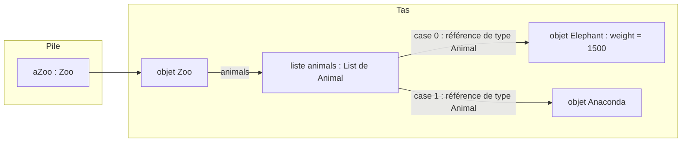
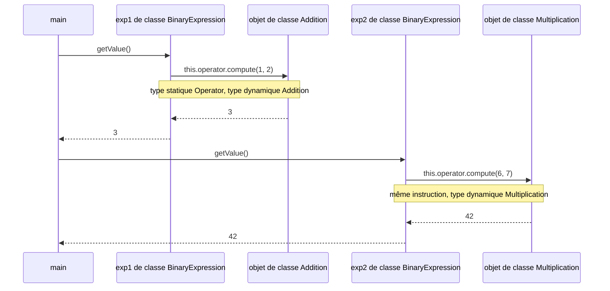
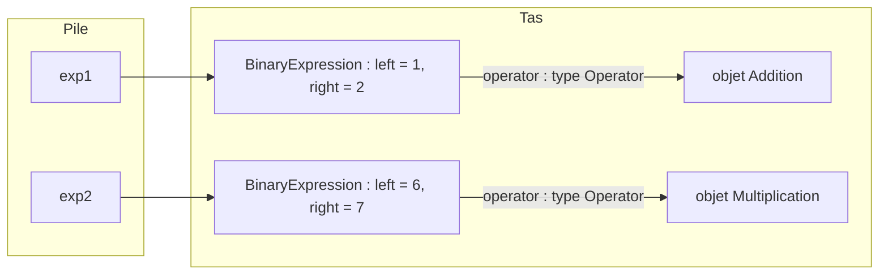

# TD Interfaces — Zoo, transformations de texte, expressions — Corrigé

> 📄 [Énoncé](./enonce.md) · 📚 Cours : [05 — Polymorphisme et interfaces](../../01-Cours/05-polymorphisme-et-interfaces.md) · [06 — Interfaces (suite)](../../01-Cours/06-interfaces-suite.md)
> ✅ Code **compilé** (Java 21) et **exécuté** : les affichages montrés sont les sorties réelles ; les tests du bonus ont été exécutés avec JUnit 5 (10 tests réussis).
> 💡 D'autres réponses justes sont possibles.

## 📌 Hypothèses (non fixées par l'énoncé)

| Élément | Hypothèse retenue |
|---|---|
| `Zoo` | une liste d'`Animal` (cours [07](../../01-Cours/07-collections.md)) + `addAnimal(Animal)` + `getNbAnimals()` pour vérifier |
| `Anaconda` | non demandée, écrite pour compiler les lignes de l'énoncé |
| `ToUpperCaseTransformation`, `Rot13Transformation` | non demandées, écrites pour exécuter Ex2 Q4 |
| `Multiplication` | caractère d'affichage `'x'` (l'énoncé écrit `"6x7"`) |
| constructeur de `BinaryExpression` | ordre `(left, operator, right)`, qui se lit comme l'expression : `new BinaryExpression(1, new Addition(), 2)` |

📌 Rappel du vocabulaire (cours 05) : le **type statique** = type de la **référence** (vérifié à la **compilation**) ; le **type dynamique** = **classe de l'objet** (utilisée à l'**exécution**, **late binding**).

---

## Exercice 1 — Le zoo

### Q1.1 — La classe `Elephant`

💡 **L'idée :** `implements Animal` = promesse de fournir le code de **chaque** méthode de `Animal` ; le poids est un **attribut** initialisé par le constructeur.

```java
package zoo;

/** An elephant: an animal with 4 legs, not carnivorous, with a weight. */
public class Elephant implements Animal {
    private int weight;

    /**
     * @param weight the weight of this elephant, in kilograms
     */
    public Elephant(int weight) {
        this.weight = weight;
    }

    public int getNbLegs() {
        return 4;
    }

    public boolean isCarnivorous() {
        return false;
    }
}
```

- 📌 « Minimal » : pas d'accesseur `getWeight()` (non demandé). On peut l'ajouter, ce n'est pas faux.
- ⚠️ Les deux méthodes restent **`public`** (comme dans l'interface).
- 💡 Pas d'attribut pour les pattes ni pour « carnivore » : c'est **pareil pour tous** les éléphants, la méthode renvoie directement la valeur.

<details><summary>Pour compiler : la classe Anaconda (non demandée)</summary>

```java
package zoo;

/** An anaconda: an animal without legs, carnivorous. */
public class Anaconda implements Animal {
    public int getNbLegs() {
        return 0;
    }

    public boolean isCarnivorous() {
        return true;
    }
}
```

📌 Aucun attribut, donc pas besoin d'écrire de constructeur : le constructeur par défaut `Anaconda()` suffit pour `new Anaconda()`.

</details>

### Q1.2 — Faut-il compléter `Zoo` ?

💡 **L'idée :** **NON**. `addAnimal(Animal animal)` accepte **tout objet de type `Animal`** ; or un `Elephant` et un `Anaconda` **sont** des `Animal` (polymorphisme).

- `Elephant implements Animal` ⇒ un objet `Elephant` est **aussi** de type `Animal`.
- À l'appel `aZoo.addAnimal(new Elephant(1500))`, la référence vers l'objet `Elephant` est convertie en référence de type `Animal` : **upcast implicite**, toujours sûr, vérifié à la compilation.
- ⚠️ Il **ne faut surtout pas** ajouter `addElephant(Elephant e)`, `addAnaconda(Anaconda a)`… : il faudrait modifier `Zoo` à chaque nouvel animal. Avec `Animal`, `Zoo` est **fermée aux modifications** et **ouverte aux extensions** (**OCP**, cours 06 § 9) : un `Tiger implements Animal` serait accepté **sans rien changer**.

| Argument fourni | Type du paramètre | Conversion | Compile ? |
|---|---|---|---|
| `new Elephant(1500)` | `Animal` | upcast `Elephant` → `Animal` | ✅ |
| `new Anaconda()` | `Animal` | upcast `Anaconda` → `Animal` | ✅ |



<details><summary>Code de Zoo utilisé pour vérifier (hypothèse)</summary>

```java
package zoo;

import java.util.ArrayList;
import java.util.List;

/** A zoo that hosts animals. */
public class Zoo {
    private List<Animal> animals;

    public Zoo() {
        this.animals = new ArrayList<>();
    }

    /** @param animal the animal to add to this zoo */
    public void addAnimal(Animal animal) {
        this.animals.add(animal);
    }

    /** @return the number of animals in this zoo */
    public int getNbAnimals() {
        return this.animals.size();
    }
}
```

</details>

Vérification (les 3 lignes de l'énoncé + Q2) :

```java
package zoo;

public class ZooMain {
    public static void main(String[] args) {
        Zoo aZoo = new Zoo();
        aZoo.addAnimal(new Elephant(1500));
        aZoo.addAnimal(new Anaconda());
        System.out.println(aZoo.getNbAnimals() + " animaux dans le zoo");

        Elephant ref1 = new Elephant(1000);   // T = Elephant (sa classe)
        Animal ref2 = new Elephant(1000);     // T = Animal (upcast)
        Object ref3 = new Elephant(1000);     // T = Object (upcast)
        System.out.println(ref1.getNbLegs() + " pattes, carnivore : " + ref2.isCarnivorous());
        System.out.println(ref3 instanceof Animal);
    }
}
```

```text
2 animaux dans le zoo
4 pattes, carnivore : false
true
```

### Q2 — Toutes les valeurs possibles de `T` dans `T ref = new Elephant(1000);`

💡 **L'idée :** un objet est du type de **sa classe**, de **toutes les interfaces** de sa classe, et de **`Object`** (comme tout objet). Ici : **3 valeurs**.

| `T` | Déclaration testée | Résultat de `javac` | Pourquoi |
|---|---|---|---|
| `Elephant` | `Elephant ref = new Elephant(1000);` | ✅ compile | sa classe |
| `Animal` | `Animal ref = new Elephant(1000);` | ✅ compile | interface implémentée (upcast) |
| `Object` | `Object ref = new Elephant(1000);` | ✅ compile | tout objet est un `Object` (upcast) |

**Contre-exemples** (testés, refusés par le compilateur) :

| Déclaration | Message de `javac` | Pourquoi |
|---|---|---|
| `Anaconda ref = new Elephant(1000);` | `incompatible types: Elephant cannot be converted to Anaconda` | même interface ≠ même type : un éléphant **n'est pas** un anaconda |
| `Zoo ref = new Elephant(1000);` | `incompatible types: Elephant cannot be converted to Zoo` | aucun lien entre les deux types |
| `Animal ref = new Animal();` | `Animal is abstract; cannot be instantiated` | une interface **ne s'instancie pas** |

⚠️ Le type `T` choisi change ce qu'on a le **droit d'envoyer** (type statique), pas l'objet :

| Avec… | `ref.getNbLegs()` |
|---|---|
| `Elephant ref` | ✅ |
| `Animal ref` | ✅ (méthode de l'interface) |
| `Object ref` | ❌ `cannot find symbol` : `Object` ne déclare pas `getNbLegs()` |

---

## Exercice 2 — Transformations de texte

### Q1 — `ToLowerCaseTransformation`

💡 **L'idée :** implémenter les **deux** méthodes de `Transformation` ; `transform` **délègue** à `toLowerCase()` de `String`.

```java
package text;

/** A transformation that puts every upper case letter in lower case. */
public class ToLowerCaseTransformation implements Transformation {

    public String transform(String input) {
        return input.toLowerCase();
    }

    public String getDescription() {
        return "converts all upper case letters to lower case";
    }
}
```

- 📌 `toLowerCase()` **ne modifie pas** `input` (une `String` est non modifiable) : elle renvoie une **nouvelle** chaîne, ce que demande l'interface.
- ⚠️ Ne pas oublier `getDescription()` : sinon `ToLowerCaseTransformation is not abstract and does not override abstract method getDescription()`.

### Q2 — Toutes les valeurs possibles de `T` dans `T ref = new ToLowerCaseTransformation();`

💡 **L'idée :** même raisonnement qu'à l'exercice 1 : **sa classe**, **son interface**, **`Object`**.

| `T` | Déclaration testée | Résultat de `javac` |
|---|---|---|
| `ToLowerCaseTransformation` | `ToLowerCaseTransformation ref = new ToLowerCaseTransformation();` | ✅ compile |
| `Transformation` | `Transformation ref = new ToLowerCaseTransformation();` | ✅ compile (upcast) |
| `Object` | `Object ref = new ToLowerCaseTransformation();` | ✅ compile (upcast) |
| ❌ `Rot13Transformation` | `Rot13Transformation ref = new ToLowerCaseTransformation();` | `incompatible types: ToLowerCaseTransformation cannot be converted to Rot13Transformation` |
| ❌ `String` | `String ref = new ToLowerCaseTransformation();` | `incompatible types: ToLowerCaseTransformation cannot be converted to String` |

- ⚠️ Avec `Object ref = new ToLowerCaseTransformation();`, l'appel `ref.transform("A");` ne compile **pas** (`cannot find symbol`) : `transform` n'est pas dans le type `Object`.
- 📌 Le **meilleur** choix en pratique : `Transformation ref` (« manipuler des abstractions », cours 06).

### Bonus — Les autres transformations (pour exécuter Q4)

💡 **L'idée :** même structure, seul le **code** de `transform` change. Rot-13 : chaque lettre est décalée de 13 places, en **revenant au début** après `z` (`% 26`).

```java
package text;

/** A transformation that puts every lower case letter in upper case. */
public class ToUpperCaseTransformation implements Transformation {

    public String transform(String input) {
        return input.toUpperCase();
    }

    public String getDescription() {
        return "converts all lower case letters to upper case";
    }
}
```

```java
package text;

/** A transformation that shifts each letter by 13 positions in the alphabet (Rot-13). */
public class Rot13Transformation implements Transformation {

    public String transform(String input) {
        String result = "";
        for (int i = 0; i < input.length(); i++) {
            result = result + this.rot13(input.charAt(i));
        }
        return result;
    }

    /**
     * @param c a character
     * @return c shifted by 13 letters if c is a letter, c unchanged otherwise
     */
    private char rot13(char c) {
        if (c >= 'a' && c <= 'z') {
            return (char) ('a' + (c - 'a' + 13) % 26);
        } else if (c >= 'A' && c <= 'Z') {
            return (char) ('A' + (c - 'A' + 13) % 26);
        } else {
            return c;
        }
    }

    public String getDescription() {
        return "applies Rot-13 encoding (each letter shifted by 13)";
    }
}
```

| Caractère | Calcul | Résultat |
|---|---|---|
| `'b'` | `'a' + (1 + 13) % 26` = `'a' + 14` | `'o'` |
| `'t'` | `'a' + (19 + 13) % 26` = `'a' + 6` | `'g'` |
| `'T'` | `'A' + (19 + 13) % 26` = `'A' + 6` | `'G'` |
| `' '` | ni minuscule ni majuscule | `' '` (inchangé) |

- 📌 `c - 'a'` = position de la lettre (0 pour `a`, 25 pour `z`) : un `char` est un **code numérique**.
- ⚠️ Le cast `(char)` est obligatoire : `'a' + ...` est un `int`.
- 💡 26 = 2 × 13 : appliquer Rot-13 **deux fois** redonne le texte initial (testé dans le bonus).
- 📌 `rot13(char)` est `private` : méthode **utilitaire**, pas dans l'interface.

### Q3 — `multiTransform`

💡 **L'idée :** un **nouveau** tableau de même taille ; chaque case reçoit `transformation.transform(texts[i])`. La méthode ne connaît **que** l'interface `Transformation`.

```java
package text;

/** Applies a transformation to several strings. */
public class MultiStringTransformer {

    /**
     * @param texts the strings to transform
     * @param transformation the transformation to apply
     * @return a new array: the i-th cell contains texts[i] transformed by transformation
     */
    public String[] multiTransform(String[] texts, Transformation transformation) {
        String[] result = new String[texts.length];
        for (int i = 0; i < texts.length; i++) {
            result[i] = transformation.transform(texts[i]);
        }
        return result;
    }
}
```

- 💡 **Late binding** : à la compilation, on vérifie seulement que `Transformation` déclare `transform(String)`. À l'exécution, c'est le `transform` de la **classe de l'objet** reçu (`ToLowerCaseTransformation`, `Rot13Transformation`…) qui s'exécute.
- 📌 **OCP** : une nouvelle transformation (`ReverseTransformation`…) fonctionne **sans modifier** `multiTransform`.
- ⚠️ On **ne modifie pas** `texts` : on renvoie un **nouveau** tableau (« le résultat est le tableau des chaînes transformées »).

### Q4 — Utilisation avec `data`

💡 **L'idée :** **un seul** objet `MultiStringTransformer`, **deux** objets transformation différents passés en argument.

```java
package text;

import java.util.Arrays;

public class TransformationMain {
    public static void main(String[] args) {
        String[] data = new String[] { "Timoleon", "jaVa", "JRR Tolkien" };

        MultiStringTransformer transformer = new MultiStringTransformer();
        String[] lowers = transformer.multiTransform(data, new ToLowerCaseTransformation());
        String[] rot13s = transformer.multiTransform(data, new Rot13Transformation());

        System.out.println("data   : " + Arrays.toString(data));
        System.out.println("lowers : " + Arrays.toString(lowers));
        System.out.println("rot13s : " + Arrays.toString(rot13s));
    }
}
```

Affichage obtenu :

```text
data   : [Timoleon, jaVa, JRR Tolkien]
lowers : [timoleon, java, jrr tolkien]
rot13s : [Gvzbyrba, wnIn, WEE Gbyxvra]
```

- 📌 Réponse attendue : les **3 lignes** `transformer = …`, `lowers = …`, `rot13s = …`. Les `println` servent à vérifier ; `Arrays.toString(tab)` (de `java.util.Arrays`) affiche le contenu d'un tableau.
- 💡 `new ToLowerCaseTransformation()` est passé là où on attend un `Transformation` : **upcast implicite**, comme pour `addAnimal` à l'exercice 1.

---

## Exercice 3 — Expressions arithmétiques binaires

### Q1 — `Addition` (et `Multiplication`)

💡 **L'idée :** implémenter `compute` (le calcul) et `getChar` (le symbole).

```java
package expression.operator;

/** The addition operator, displayed with '+'. */
public class Addition implements Operator {

    public int compute(int x, int y) {
        return x + y;
    }

    public char getChar() {
        return '+';
    }
}
```

```java
package expression.operator;

/** The multiplication operator, displayed with 'x'. */
public class Multiplication implements Operator {

    public int compute(int x, int y) {
        return x * y;
    }

    public char getChar() {
        return 'x';
    }
}
```

- ⚠️ `getChar()` renvoie un **`char`** : `'+'` avec des apostrophes, pas `"+"` (qui est une `String`).
- 📌 Les deux classes sont dans le paquetage `expression.operator`, comme l'interface.

### Q2 — `BinaryExpression`

💡 **L'idée :** **3 attributs** (deux opérandes `int` + un `Operator`). `getValue()` ne calcule rien elle-même : elle **délègue** à `operator.compute(...)`.

```java
package expression;

import expression.operator.Operator;

/** A binary arithmetic expression such as 1+2 or 6x7. */
public class BinaryExpression {
    private int left;
    private int right;
    private Operator operator;

    /**
     * @param left the left operand
     * @param operator the operator of this expression
     * @param right the right operand
     */
    public BinaryExpression(int left, Operator operator, int right) {
        this.left = left;
        this.operator = operator;
        this.right = right;
    }

    /** @return the result of the computation of this expression */
    public int getValue() {
        return this.operator.compute(this.left, this.right);
    }

    /** @return this expression as a String, for instance "1+2" */
    public String toString() {
        return "" + this.left + this.operator.getChar() + this.right;
    }
}
```

- 📌 L'attribut est de type **`Operator`** (l'interface) : une seule classe `BinaryExpression` pour **tous** les opérateurs, présents et futurs (OCP).
- 📌 `import expression.operator.Operator;` : `Operator` est dans **un autre paquetage**.
- ⚠️ `toString()` : sans le `"" +` au début, `this.left + this.operator.getChar() + this.right` est une **addition d'entiers** (`1 + '+' + 2` = `1 + 43 + 2` = `46`) → `incompatible types: int cannot be converted to String`.

#### Le late binding de `getValue()`

Dans `getValue()`, le **type statique** de `this.operator` est `Operator` ; son **type dynamique** dépend de l'objet donné au constructeur :



| Question | Décidé par | Moment |
|---|---|---|
| `this.operator.compute(...)` est-il **autorisé** ? | le type de la référence : `Operator` déclare `compute` | **compilation** |
| **Quel** `compute` s'exécute ? | la classe de l'objet : `Addition` ou `Multiplication` | **exécution** |



### Q3 — `ExpressionMain`

💡 **L'idée :** construire les deux expressions avec **des objets opérateurs différents**, puis afficher `toString()` et `getValue()`.

```java
package expression;

import expression.operator.Addition;
import expression.operator.Multiplication;

public class ExpressionMain {
    public static void main(String[] args) {
        BinaryExpression exp1 = new BinaryExpression(1, new Addition(), 2);
        BinaryExpression exp2 = new BinaryExpression(6, new Multiplication(), 7);

        System.out.println(exp1 + " = " + exp1.getValue());
        System.out.println(exp2.toString() + " = " + exp2.getValue());
    }
}
```

Affichage obtenu :

```text
1+2 = 3
6x7 = 42
```

- 📌 `exp1 + " = "` appelle **automatiquement** `exp1.toString()` (concaténation avec une `String`) ; écrire `exp2.toString()` explicitement est équivalent.
- ⚠️ Nom **exact** `toString()` : avec une faute (`tostring()`), la méthode n'est plus appelée automatiquement et on obtient (testé) `expression.BinaryExpression@7852e922 = 3`.

---

## ✅ Bonus — Tests JUnit 5

💡 **L'idée :** tester **à travers l'interface** (`Transformation t = new ...`) : on vérifie le **contrat**, quelle que soit la classe.

```java
package text;

import org.junit.jupiter.api.Test;
import static org.junit.jupiter.api.Assertions.*;

public class ToLowerCaseTransformationTest {

    @Test
    public void upperCaseLettersBecomeLowerCase() {
        Transformation t = new ToLowerCaseTransformation();
        assertEquals("java", t.transform("jaVa"));
        assertEquals("jrr tolkien", t.transform("JRR Tolkien"));
    }

    @Test
    public void otherCharactersAreUnchanged() {
        Transformation t = new ToLowerCaseTransformation();
        assertEquals("abc 123 !?", t.transform("abc 123 !?"));
        assertEquals("", t.transform(""));
    }
}
```

```java
package text;

import org.junit.jupiter.api.Test;
import static org.junit.jupiter.api.Assertions.*;

public class Rot13TransformationTest {

    @Test
    public void lettersAreShiftedBy13() {
        Transformation t = new Rot13Transformation();
        assertEquals("nop", t.transform("abc"));
        assertEquals("NOP", t.transform("ABC"));
        assertEquals("abc", t.transform("nop"));       // after 'z', back to 'a'
        assertEquals("Gvzbyrba", t.transform("Timoleon"));
    }

    @Test
    public void otherCharactersAreUnchanged() {
        Transformation t = new Rot13Transformation();
        assertEquals("123 !?", t.transform("123 !?"));
        assertEquals("WEE Gbyxvra", t.transform("JRR Tolkien"));
    }

    @Test
    public void rot13TwiceGivesBackTheInitialString() {
        Transformation t = new Rot13Transformation();
        String s = "JRR Tolkien, jaVa !";
        assertEquals(s, t.transform(t.transform(s)));
    }
}
```

```java
package text;

import org.junit.jupiter.api.Test;
import static org.junit.jupiter.api.Assertions.*;

public class MultiStringTransformerTest {

    @Test
    public void eachStringIsTransformed() {
        String[] data = new String[] { "Timoleon", "jaVa", "JRR Tolkien" };
        MultiStringTransformer transformer = new MultiStringTransformer();
        String[] lowers = transformer.multiTransform(data, new ToLowerCaseTransformation());
        assertArrayEquals(new String[] { "timoleon", "java", "jrr tolkien" }, lowers);
        String[] uppers = transformer.multiTransform(data, new ToUpperCaseTransformation());
        assertArrayEquals(new String[] { "TIMOLEON", "JAVA", "JRR TOLKIEN" }, uppers);
    }

    @Test
    public void initialArrayIsUnchanged() {
        String[] data = new String[] { "Timoleon", "jaVa" };
        MultiStringTransformer transformer = new MultiStringTransformer();
        String[] rot13s = transformer.multiTransform(data, new Rot13Transformation());
        assertNotSame(data, rot13s);
        assertArrayEquals(new String[] { "Timoleon", "jaVa" }, data);
    }

    @Test
    public void emptyArrayGivesEmptyArray() {
        MultiStringTransformer transformer = new MultiStringTransformer();
        assertEquals(0, transformer.multiTransform(new String[0], new Rot13Transformation()).length);
    }
}
```

```java
package expression;

import expression.operator.Addition;
import expression.operator.Multiplication;
import org.junit.jupiter.api.Test;
import static org.junit.jupiter.api.Assertions.*;

public class BinaryExpressionTest {

    @Test
    public void getValueUsesTheOperator() {
        assertEquals(3, new BinaryExpression(1, new Addition(), 2).getValue());
        assertEquals(42, new BinaryExpression(6, new Multiplication(), 7).getValue());
    }

    @Test
    public void toStringShowsOperandsAndOperatorChar() {
        assertEquals("1+2", new BinaryExpression(1, new Addition(), 2).toString());
        assertEquals("6x7", new BinaryExpression(6, new Multiplication(), 7).toString());
    }
}
```

- 📌 `assertArrayEquals(attendu, obtenu)` compare deux tableaux **case par case** (`assertEquals` sur deux tableaux comparerait les **références**).
- 📌 `assertNotSame(data, rot13s)` : `multiTransform` renvoie bien un **autre** tableau.

Commandes utilisées (sources dans `src/` et `test-src/`, compilés dans `classes/` et `test/`) :

```bash
javac -d classes $(find src -name "*.java")
javac -cp classes:junit-console.jar -d test $(find test-src -name "*.java")
java -jar junit-console.jar -classpath test:classes -scan-classpath --disable-banner
```

Résultat obtenu :

```text
╷
├─ JUnit Jupiter ✔
│  ├─ BinaryExpressionTest ✔
│  │  ├─ getValueUsesTheOperator() ✔
│  │  └─ toStringShowsOperandsAndOperatorChar() ✔
│  ├─ Rot13TransformationTest ✔
│  │  ├─ lettersAreShiftedBy13() ✔
│  │  ├─ rot13TwiceGivesBackTheInitialString() ✔
│  │  └─ otherCharactersAreUnchanged() ✔
│  ├─ ToLowerCaseTransformationTest ✔
│  │  ├─ otherCharactersAreUnchanged() ✔
│  │  └─ upperCaseLettersBecomeLowerCase() ✔
│  └─ MultiStringTransformerTest ✔
│     ├─ emptyArrayGivesEmptyArray() ✔
│     ├─ eachStringIsTransformed() ✔
│     └─ initialArrayIsUnchanged() ✔
├─ JUnit Vintage ✔
└─ JUnit Platform Suite ✔

Test run finished after 1180 ms
[         7 containers found      ]
[         0 containers skipped    ]
[         7 containers started    ]
[         0 containers aborted    ]
[         7 containers successful ]
[         0 containers failed     ]
[        10 tests found           ]
[         0 tests skipped         ]
[        10 tests started         ]
[         0 tests aborted         ]
[        10 tests successful      ]
[         0 tests failed          ]
```

---

## ⚠️ Erreurs fréquentes

| Erreur | Pourquoi c'est faux | Correction |
|---|---|---|
| `public class Elephant { ... }` sans `implements Animal` | même avec les bonnes méthodes, un `Elephant` n'est **pas** un `Animal` : `Elephant cannot be converted to Animal` | `public class Elephant implements Animal` |
| oublier une méthode de l'interface | `Elephant is not abstract and does not override abstract method isCarnivorous() in Animal` | implémenter **toutes** les méthodes |
| `int getNbLegs()` sans `public` dans la classe | visibilité réduite : `cannot implement ... attempting to assign weaker access privileges` | garder `public` |
| répondre « oui, ajouter `addElephant(Elephant e)` » en Q1.2 | `addAnimal(Animal)` accepte déjà tout `Animal` (upcast) ; et cela violerait l'**OCP** | « Non, car `Elephant` et `Anaconda` implémentent `Animal` » |
| oublier `Object` dans les valeurs de `T` | **tout** objet est de type `Object` | `Elephant`, `Animal`, `Object` |
| mettre `Anaconda` dans les valeurs de `T` | partager une interface ne rend pas les classes compatibles | seulement la classe, ses interfaces, `Object` |
| `new Transformation()` / `new Operator()` | une interface **ne s'instancie pas** | `new ToLowerCaseTransformation()`, `new Addition()` |
| `multiTransform(String[] texts, ToLowerCaseTransformation t)` | ne marche que pour **une** transformation | paramètre de type **`Transformation`** |
| `texts[i] = ...` dans `multiTransform` | modifie le tableau reçu au lieu d'en renvoyer un nouveau | `String[] result = new String[texts.length]` |
| `private Addition operator;` dans `BinaryExpression` | une classe par opérateur… plus de polymorphisme | `private Operator operator;` |
| calculer dans `getValue()` avec des `if` sur le caractère (`if (c == '+')`) | cascade de `if` sur un « type » (cours 06 § 10) | `return this.operator.compute(this.left, this.right);` |
| `return this.left + this.operator.getChar() + this.right;` | `int + char + int` = addition d'entiers → ne compile pas | `return "" + this.left + this.operator.getChar() + this.right;` |
| `return "+";` dans `getChar()` | `"+"` est une `String`, pas un `char` | `return '+';` |
| oublier `(char)` dans Rot-13 | `'a' + n` est un `int` | `(char) ('a' + (c - 'a' + 13) % 26)` |
| `Object ref = ...; ref.transform(s);` | le **type statique** `Object` n'autorise pas `transform` | référence de type `Transformation` |

---
🏠 [Sommaire](../../README.md)
