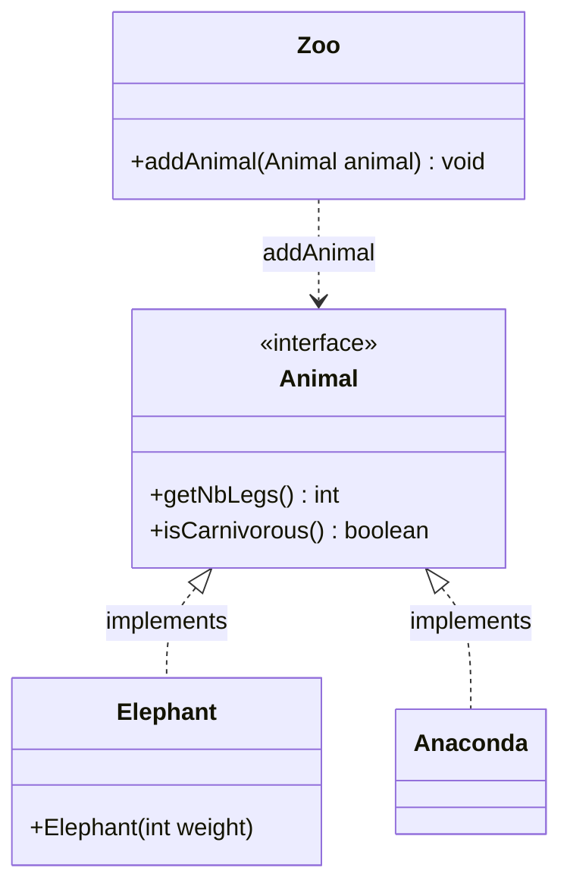
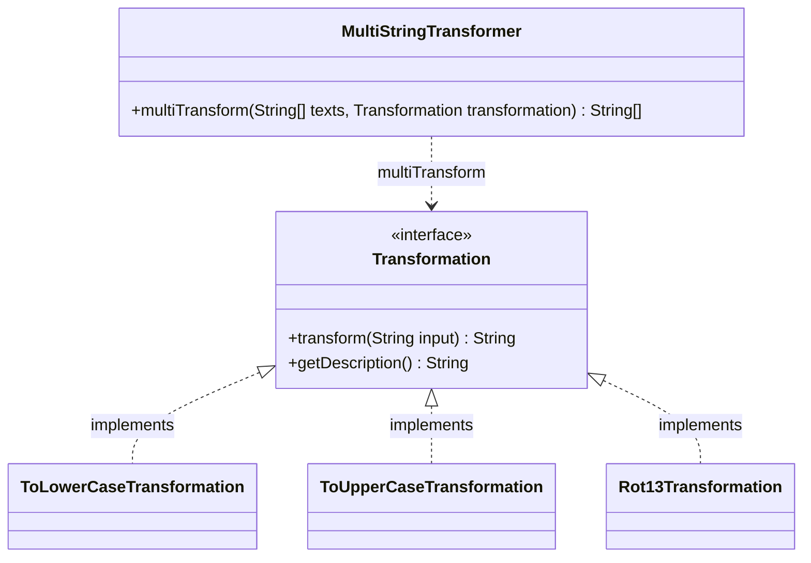
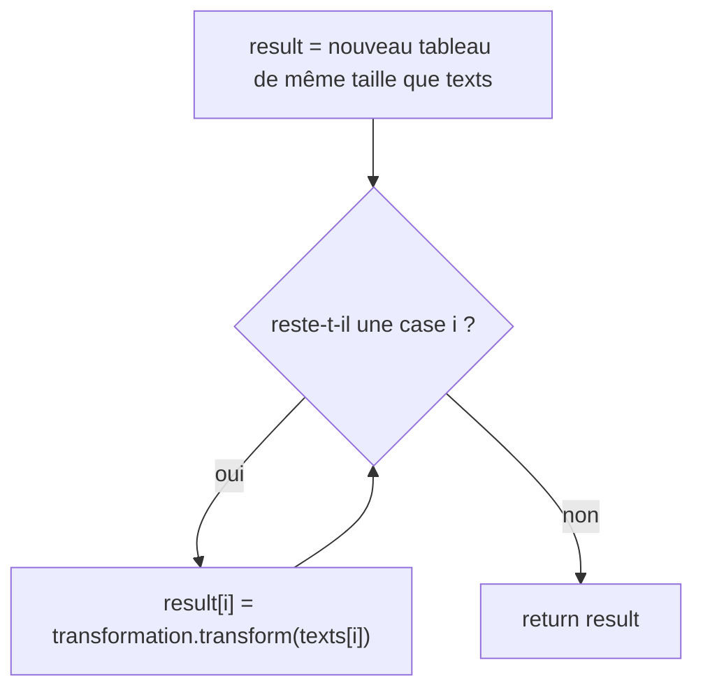
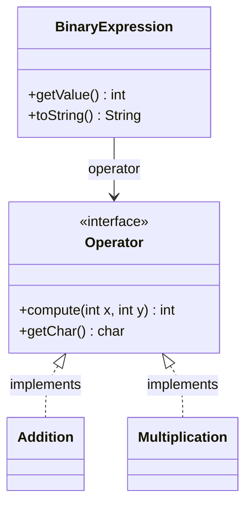

# TD Interfaces — Zoo, transformations de texte, expressions

> 🎯 **Objectifs** : **implémenter** une interface donnée (`implements`), utiliser le **polymorphisme** (une référence de type interface vers des objets de classes différentes), trouver **tous les types** possibles d'une référence (**upcast**), écrire du code qui ne connaît **que l'interface** (**late binding**).
> 📚 Cours : [05 — Polymorphisme et interfaces](../../01-Cours/05-polymorphisme-et-interfaces.md) · [06 — Interfaces (suite)](../../01-Cours/06-interfaces-suite.md)
> 📝 Préparation : faire l'**exercice 1**.

> ✅ [Corrigé](./corrige.md) — essaie d'abord seul·e !

## 🗺️ Les exercices

| N° | Titre | Niveau | Durée | Notions |
|---|---|---|---|---|
| 1 | Le zoo | ⭐ | 20 min | `implements`, upcast, types d'un objet |
| 2 | Transformations de texte | ⭐⭐ | 35 min | interface en paramètre, tableaux, late binding |
| 3 | Expressions arithmétiques binaires | ⭐⭐ | 35 min | interface en attribut, délégation, `toString` |

📌 Dans les 3 exercices, l'**interface est fournie** : on écrit les classes qui l'implémentent, puis du code qui les utilise **à travers l'interface**.

---

## Exercice 1 — Le zoo

> 🌍 **Dans la vraie vie :** à l'entrée d'un zoo, la fiche d'accueil demande seulement « nombre de pattes ? carnivore ? ». Éléphant ou anaconda, le soigneur remplit la même fiche.
> → en Java : l'interface `Animal` est la fiche ; le zoo accueille **tout** objet qui la respecte.

Un zoo accueille des animaux, **carnivores** (*carnivorous*) ou non. Le type des animaux est défini par l'interface :

```java
package zoo;
public interface Animal {
    /** @return the number of legs of this animal */
    public int getNbLegs();
    /** @return true if and only if this animal is carnivorous */
    public boolean isCarnivorous();
}
```

La classe `Zoo` dispose **déjà** de la méthode :

```java
public void addAnimal(Animal animal)
```

- Un **éléphant** : 4 pattes (*legs*), **non** carnivore, et un **poids** (entier, en kg) **fourni à la construction** → classe `Elephant`.
- Un **anaconda** : **0** patte, carnivore → classe `Anaconda`.



Ces lignes doivent **compiler et s'exécuter sans erreur** :

```java
Zoo aZoo = new Zoo();
aZoo.addAnimal(new Elephant(1500));
aZoo.addAnimal(new Anaconda());
```

- [ ] **Q1.1** Code **minimal** de la classe `Elephant` (paquetage `zoo`). *(Le code de `Anaconda` n'est pas demandé.)*
- [ ] **Q1.2** Faut-il **compléter la classe `Zoo`** pour que ces lignes compilent et s'exécutent ?
  - si **oui** : pourquoi, et **signature** (seulement) des méthodes à ajouter ;
  - si **non** : pourquoi ce n'est pas nécessaire.
- [ ] **Q2.** Dans la déclaration `T ref = new Elephant(1000);`, quelles sont **toutes** les valeurs possibles pour le type `T` ?

<details><summary>💡 Indice Q1.1</summary>

« Minimal » : `implements Animal`, l'attribut demandé, le constructeur, et le code de **chaque** méthode de l'interface. Rien de plus.

</details>

<details><summary>💡 Indice Q1.2</summary>

Le paramètre de `addAnimal` est de type `Animal`. Un objet `Elephant` est-il **aussi** de type `Animal` ? (cours 05 § 5, « Polymorphisme »)

</details>

<details><summary>💡 Indice Q2</summary>

Un objet est du type de **sa classe**, de **toutes les interfaces** qu'elle implémente… et d'un type que **tous** les objets ont.

</details>

---

## Exercice 2 — Transformations de texte

> 🌍 **Dans la vraie vie :** une photocopieuse a un bouton « copier » et un réglage (noir et blanc, agrandi, recto-verso…). On lui donne une pile de feuilles et un réglage, elle rend une pile de copies.
> → en Java : `MultiStringTransformer` est la photocopieuse, la `Transformation` est le réglage, les `String` sont les feuilles.

Une **transformation** produit, à partir d'une chaîne initiale, une **nouvelle** chaîne (le résultat). Interface fournie :

```java
package text;
/**
 * Define an opration to transform a string text into another string text.
 */
public interface Transformation {
    /** apply a transformation to the input String and return the resulting transformed String
     * @param input the String to transform
     * @return the transformed String
     */
    public String transform(String input);
    /** return a description of what the transformation does
     * @return a description of what the transformation does
     */
    public String getDescription();
}
```



- [ ] **Q1.** Code de la classe `ToLowerCaseTransformation` : remplace chaque **majuscule** par sa **minuscule**, laisse les autres caractères inchangés. *(NB : la classe `String` a une méthode `toLowerCase()`.)*
- [ ] **Q2.** Dans `T ref = new ToLowerCaseTransformation();`, quelles sont **toutes** les valeurs possibles de `T` pour que le code **compile** ?

📌 Pour la suite, d'autres transformations existent, définies de la même façon : `ToUpperCaseTransformation` (passage en majuscules), `Rot13Transformation` (codage **Rot-13** : chaque lettre est décalée de 13 dans l'alphabet, `a` ↔ `n`), etc.

- [ ] **Q3.** La classe `MultiStringTransformer` a une méthode `multiTransform` qui prend en paramètres :
  - un **tableau** de chaînes de caractères ;
  - une **transformation** ;

  et renvoie le **tableau des chaînes transformées**. Donner le code de `multiTransform`.
- [ ] **Q4.** Avec la variable :

  ```java
  String[] data = new String[] { "Timoleon", "jaVa", "JRR Tolkien" };
  ```

  écrire les lignes de code qui :
  1. créent un objet `MultiStringTransformer` ;
  2. définissent une variable `lowers` : le tableau des chaînes de `data` **en minuscules** ;
  3. définissent une variable `rot13s` : le tableau des chaînes de `data` **codées en Rot-13**.

<details><summary>💡 Indice Q2</summary>

Même raisonnement qu'à l'exercice 1 Q2 : sa classe, son interface, et…

</details>

<details><summary>💡 Indice Q3 : le schéma de la boucle</summary>



`multiTransform` ne sait **pas** quelle transformation elle reçoit : elle envoie juste le message `transform`.

</details>

<details><summary>💡 Indice Q4</summary>

On **ne change pas** de méthode pour changer de transformation : on change l'**objet** passé en 2ᵉ argument (`new ...Transformation()`).

</details>

---

## Exercice 3 — Expressions arithmétiques binaires

> 🌍 **Dans la vraie vie :** sur une calculatrice, on tape `6`, la touche `×`, puis `7`. La calculatrice garde les deux nombres et **la touche** ; au moment de « = », c'est la touche qui sait calculer.
> → en Java : `BinaryExpression` garde deux `int` et un `Operator` ; `getValue()` demande à l'opérateur de calculer.

Une expression binaire (`1 + 2`, `6 × 7`…) = **deux entiers** (les opérandes) + **un opérateur**. Interface fournie (paquetage `expression.operator`) :

```java
package expression.operator;
public interface Operator {
    /** performs the operation of this operator with given two operands
     * @param x the left operand
     * @param y the right operand
     * @return the result of the operation
     */
    public int compute(int x, int y);
    /** get the char used to display this operator
     * @return the char used to display this operator
     */
    public char getChar();
}
```



- [ ] **Q1.** Code de la classe `Addition` (paquetage `expression.operator`) : l'opérateur d'addition, affiché avec le caractère `'+'`.

📌 On suppose des classes similaires pour les autres opérateurs (`Multiplication`, etc.).

La classe `BinaryExpression` (paquetage `expression`) représente une expression binaire, construite à partir de ses **deux opérandes** et de son **opérateur**. Elle dispose :
- de `public int getValue()` : la **valeur** (résultat du calcul) de l'expression ;
- de `public String toString()` : le **texte** de l'expression, par exemple `"1+2"` ou `"6x7"`.

- [ ] **Q2.** Code de la classe `BinaryExpression`. *(Les accesseurs ne sont pas demandés.)*
- [ ] **Q3.** Code de la méthode `main` d'une classe `ExpressionMain` qui :
  - crée un objet `BinaryExpression` pour `1 + 2` ;
  - crée un objet `BinaryExpression` pour `6 × 7` ;
  - affiche le **texte** de chacune et son **résultat**.

<details><summary>💡 Indice Q2 : les attributs</summary>

- Deux `int` pour les opérandes, et un attribut de type… `Operator` (l'**interface**, pas `Addition` !).
- `getValue()` ne fait **aucun** calcul elle-même : elle **délègue** à l'opérateur.

</details>

<details><summary>💡 Indice Q2 : attention dans toString()</summary>

`int + char + int`, sans `String`, est une **addition de nombres** (un `char` est un code numérique). Il faut qu'une chaîne apparaisse en premier.

</details>

---

## 📝 Mes réponses

*(écris ici tes réponses, ou ajoute tes fichiers `.java` dans ce dossier)*

---
🏠 [Sommaire](../../README.md)
