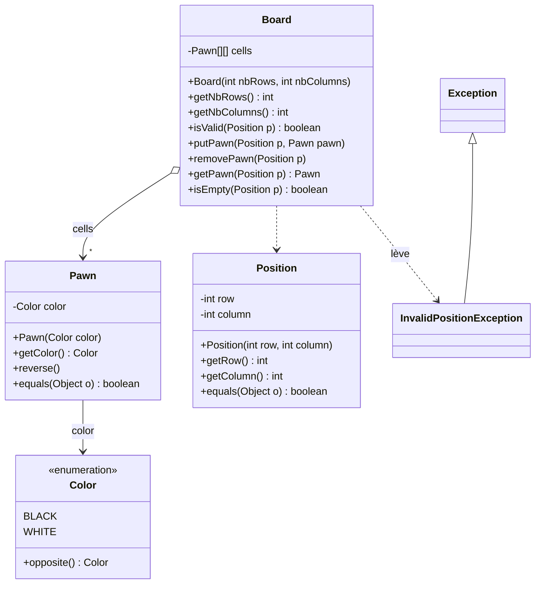
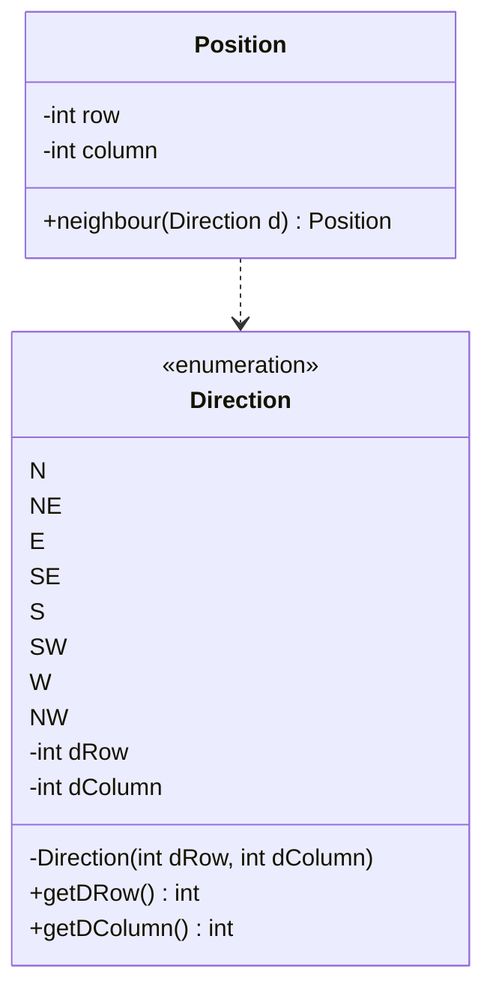
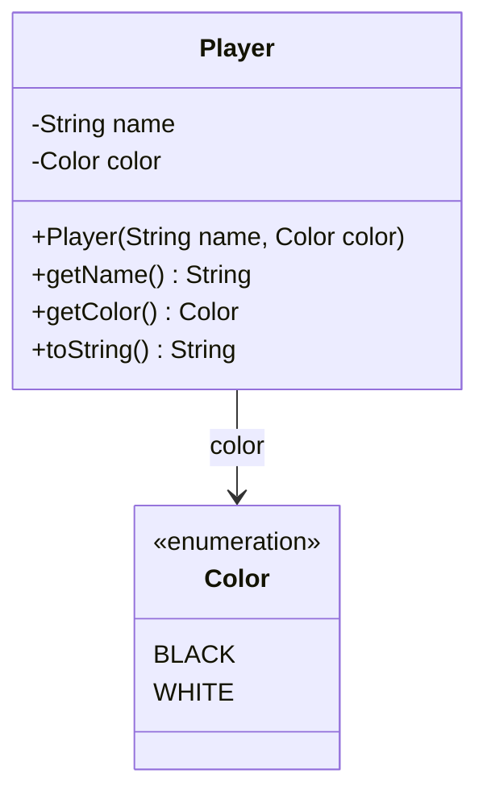
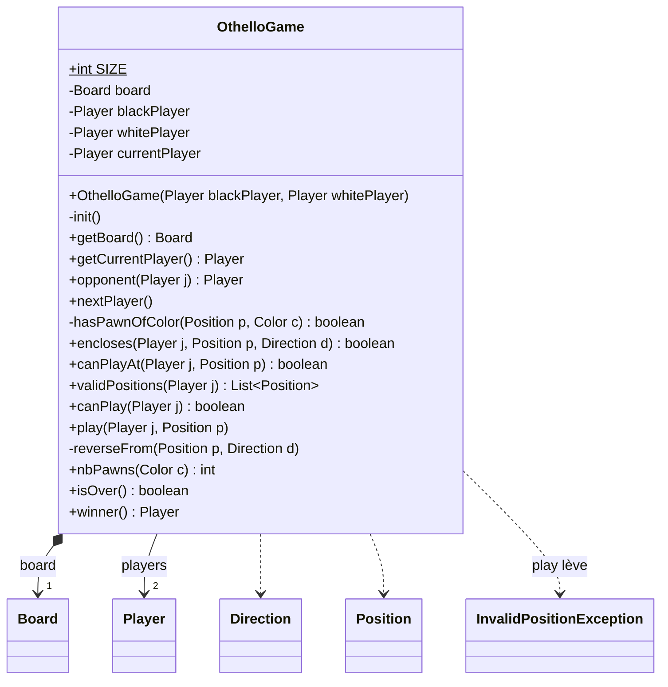
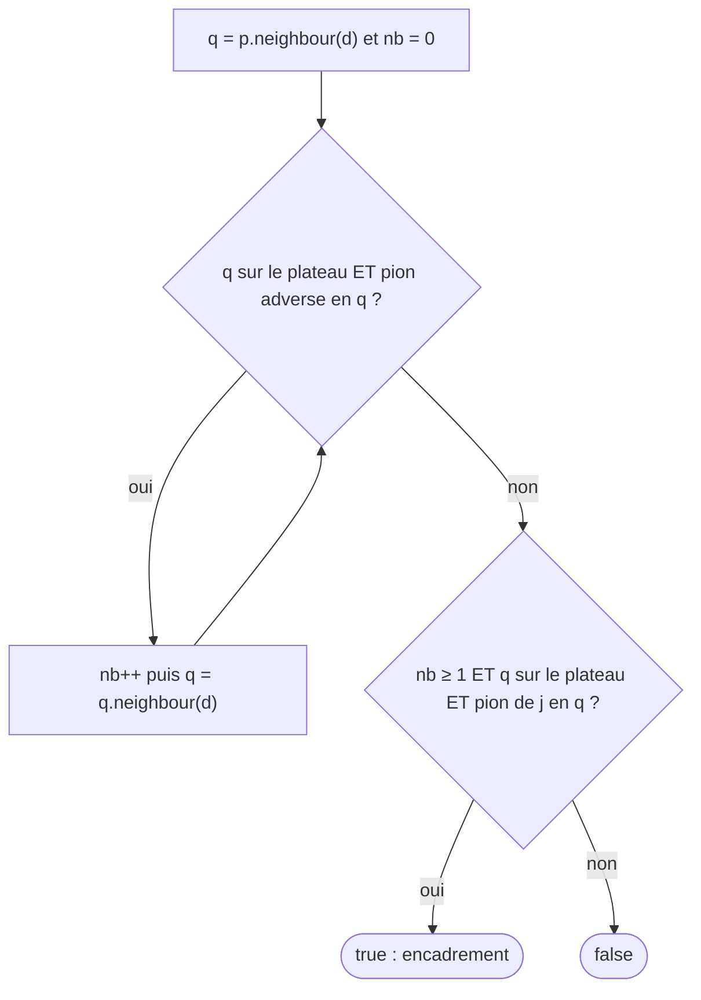
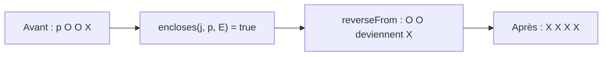

# TD Othello — Corrigé proposé

> ⚠️ **Corrigé non officiel**, rédigé pour réviser. Tout le code a été **compilé et testé** (JUnit 5 : 43 tests réussis, partie complète jouée jusqu'au bout).
> D'autres analyses justes sont possibles. 📄 [Retour à l'énoncé](./enonce.md) · 🛠️ Suite : [corrigé du TP Othello](../../03-TP/TP-othello/CORRIGE.md)

## 🗺️ Vue d'ensemble de la solution

| Question | Ce qu'on produit | Notion du cours |
|---|---|---|
| Q1 | UML : `Color`, `Pawn`, `Position`, `Board` | classes, `enum` |
| Q2 – Q3 | tests + `putPawn` qui lève `InvalidPositionException` | `assertThrows`, `try`/`catch`, `throw` |
| Q4 – Q5 | voisins, puis **un seul** `neighbour(Direction)` | `enum` avec attributs |
| Q6 – Q7 | UML : `Player`, `OthelloGame` | décomposition en méthodes |
| Q8 – Q10 | encadrement, `canPlayAt`, pose + retournement | algorithme, boucles, tests |

---

## Q1 — Diagramme UML des classes (partie 1)

💡 **L'idée :** chaque mot en gras devient une classe… sauf s'il n'a **ni état ni comportement propre**.

| Mot en gras | Choix | Pourquoi |
|---|---|---|
| **plateau** | classe `Board` | contient les emplacements, poser / retirer |
| **emplacement** | case du tableau `Pawn[][]` | une case = « vide (`null`) ou un pion » : pas besoin d'une classe |
| **pion** | classe `Pawn` | a une couleur, peut être **retourné** |
| blanc / noir | `enum Color` | nombre **fini et fixe** de valeurs |
| **position** | classe `Position` | (ligne, colonne), voisins, `equals` |



💡 On passe **toujours par une `Position`** (consigne) : `putPawn(Position p, Pawn pawn)` et non `putPawn(int row, int column, Pawn pawn)`.
💡 `reverse()` : un pion d'Othello **change de couleur** quand il est encadré → c'est son comportement.

---

## Q2 — Tests de la pose d'un pion

💡 **L'idée :** tester les **4 bords** (ligne/colonne trop petite/trop grande) + un cas **valide** (pas d'exception « à tort »).

```java
package othello;

import org.junit.jupiter.api.Test;
import static org.junit.jupiter.api.Assertions.*;

public class BoardTest {

    @Test
    public void putPawnThenGetPawn() throws InvalidPositionException {
        Board board = new Board(8, 8);
        Position p = new Position(2, 3);
        board.putPawn(p, new Pawn(Color.WHITE));
        assertFalse(board.isEmpty(p));
        assertEquals(Color.WHITE, board.getPawn(p).getColor());
        assertEquals(1, board.nbPawns(Color.WHITE));
    }

    @Test
    public void putPawnOnCornersIsOk() throws InvalidPositionException {
        Board board = new Board(4, 6);
        board.putPawn(new Position(0, 0), new Pawn(Color.BLACK));
        board.putPawn(new Position(3, 5), new Pawn(Color.BLACK));
        assertEquals(2, board.nbPawns(Color.BLACK));
    }

    @Test
    public void putPawnThrowsExceptionWhenRowTooSmall() {
        Board board = new Board(8, 8);
        assertThrows(InvalidPositionException.class,
                     () -> board.putPawn(new Position(-1, 3), new Pawn(Color.BLACK)));
    }

    @Test
    public void putPawnThrowsExceptionWhenRowTooBig() {
        Board board = new Board(8, 8);
        assertThrows(InvalidPositionException.class,
                     () -> board.putPawn(new Position(8, 3), new Pawn(Color.BLACK)));
    }

    @Test
    public void putPawnThrowsExceptionWhenColumnTooSmall() {
        Board board = new Board(8, 8);
        assertThrows(InvalidPositionException.class,
                     () -> board.putPawn(new Position(3, -1), new Pawn(Color.BLACK)));
    }

    @Test
    public void putPawnThrowsExceptionWhenColumnTooBig() {
        Board board = new Board(4, 6);
        assertThrows(InvalidPositionException.class,
                     () -> board.putPawn(new Position(3, 6), new Pawn(Color.BLACK)));
    }
}
```

| Cas testé | Attendu |
|---|---|
| `(2,3)` sur un 8×8 | pion posé, retrouvé par `getPawn` |
| coins `(0,0)` et `(3,5)` sur un 4×6 | OK (bornes **incluses**) |
| ligne `-1` ou `8` sur un 8×8 | `InvalidPositionException` |
| colonne `-1`, ou `6` sur un 4×6 | `InvalidPositionException` |

💡 Plateau 4×6 **non carré** : il détecte l'inversion ligne / colonne.
⚠️ `throws InvalidPositionException` sur les tests qui appellent `putPawn` « normalement » : l'exception est **vérifiée**.

---

## Q3 — Code de `putPawn`

💡 **L'idée :** on **essaie** d'écrire dans le tableau ; si l'indice est hors bornes, Java lève `ArrayIndexOutOfBoundsException` → on la **capture** et on lève **la nôtre**.

```java
package othello;

/**
 * Exception raised when a position can not be used : outside of the board,
 * or not a valid move for a player.
 */
public class InvalidPositionException extends Exception {

    /**
     * @param message the explanation of the problem
     */
    public InvalidPositionException(String message) {
        super(message);
    }
}
```

```java
    /**
     * Puts a pawn at a position (replacing the pawn already there, if any).
     * @param p the position where the pawn is put
     * @param pawn the pawn to put
     * @exception InvalidPositionException if p is not a position of this board
     */
    public void putPawn(Position p, Pawn pawn) throws InvalidPositionException {
        try {
            this.cells[p.getRow()][p.getColumn()] = pawn;
        } catch (ArrayIndexOutOfBoundsException e) {
            throw new InvalidPositionException("la position " + p + " est hors du plateau");
        }
    }

    /**
     * Removes the pawn at a position (the cell becomes empty).
     * @param p the position of the pawn to remove
     * @exception InvalidPositionException if p is not a position of this board
     */
    public void removePawn(Position p) throws InvalidPositionException {
        this.putPawn(p, null);
    }
```

**Variante sans `try`** (aussi juste), avec la méthode `isValid` utile pour la suite :

```java
    public boolean isValid(Position p) {
        return p.getRow() >= 0 && p.getRow() < this.getNbRows()
            && p.getColumn() >= 0 && p.getColumn() < this.getNbColumns();
    }
```
```java
if (!this.isValid(p)) {
    throw new InvalidPositionException("la position " + p + " est hors du plateau");
}
this.cells[p.getRow()][p.getColumn()] = pawn;
```

| Mot-clé | Où | Rôle |
|---|---|---|
| `throws` | signature | **annonce** l'exception (obligatoire : elle hérite d'`Exception`) |
| `throw new …` | corps | **lève** l'exception |
| `catch (ArrayIndexOutOfBoundsException e)` | corps | **traduit** l'erreur technique en erreur du domaine |

---

## Q4 — `neighbourSE()`, `neighbourNE()`, `neighbourN()`, `neighbourE()`

💡 **L'idée :** on lit le décalage dans le tableau de l'énoncé, et on crée une **nouvelle** position (`Position` reste inchangée).

```java
    public Position neighbourSE() {
        return new Position(this.row + 1, this.column + 1);
    }

    public Position neighbourNE() {
        return new Position(this.row - 1, this.column + 1);
    }

    public Position neighbourN() {
        return new Position(this.row - 1, this.column);
    }

    public Position neighbourE() {
        return new Position(this.row, this.column + 1);
    }
```

| Direction | (dLigne, dColonne) | Voisin de `(3,5)` |
|---|---|---|
| SE | (+1, +1) | `(4,6)` |
| NE | (−1, +1) | `(2,6)` |
| N | (−1, 0) | `(2,5)` |
| E | (0, +1) | `(3,6)` |

⚠️ Le voisin peut être **hors du plateau** (ex. N de `(0,0)`) : `Position` ne connaît pas le plateau, c'est `Board.isValid` qui tranche.

---

## Q5 — Une seule méthode `neighbour(Direction d)`

💡 **L'idée :** les 4 codes ne diffèrent que par **2 nombres** → on range ces nombres dans un **`enum` avec attributs** (comme `Coin(1)`, `Coin(100)` du cours).

```java
package othello;

/**
 * The 8 directions on a board. Each direction is defined by the shift
 * of the row and of the column (rows increase towards the south).
 */
public enum Direction {
    N(-1, 0), NE(-1, 1), E(0, 1), SE(1, 1),
    S(1, 0), SW(1, -1), W(0, -1), NW(-1, -1);

    private final int dRow;
    private final int dColumn;

    private Direction(int dRow, int dColumn) {
        this.dRow = dRow;
        this.dColumn = dColumn;
    }

    /** @return the shift of the row in this direction (-1, 0 or 1) */
    public int getDRow() {
        return this.dRow;
    }

    /** @return the shift of the column in this direction (-1, 0 or 1) */
    public int getDColumn() {
        return this.dColumn;
    }
}
```

```java
    /**
     * Gives the neighbour of this position in a direction.
     * The result may be outside of the board.
     * @param d the direction of the neighbour
     * @return the neighbour position of this position in direction d
     */
    public Position neighbour(Direction d) {
        return new Position(this.row + d.getDRow(), this.column + d.getDColumn());
    }
```



| Avant | Après |
|---|---|
| 8 méthodes presque identiques | **1** méthode + 1 `enum` |
| ajouter un cas = copier-coller | les 8 directions dans `Direction.values()` |
| `if (d == N) … else if …` | **aucun `if`** : la direction **porte** son décalage |

💡 Bonus : `for (Direction d : Direction.values())` parcourt les 8 directions (utile en Q9 et Q10).

---

## Q6 — Diagramme de la classe `Player`

💡 **L'idée :** un joueur = un **nom** + la **couleur** de ses pions. Les règles ne sont **pas** dans `Player` mais dans `OthelloGame`.



---

## Q7 — Diagramme de la classe `OthelloGame`

💡 **L'idée :** on suit le **déroulement** du jeu (organigramme de l'énoncé) : chaque case du dessin → une méthode.

| Étape du déroulement | Méthode |
|---|---|
| « Partie finie ? » | `isOver()` |
| « nb pions de chaque couleur » | `nbPawns(Color c)` |
| « position valide pour le joueur ? » | `canPlay(j)` ← `validPositions(j)` ← `canPlayAt(j, p)` ← `encloses(j, p, d)` |
| « appliquer la pose » | `play(j, p)` ← `reverseFrom(p, d)` |
| « joueur suivant » | `nextPlayer()`, `opponent(j)` |
| « annoncer le vainqueur » | `winner()` |



💡 `SIZE` souligné (`$`) = `public static final int SIZE = 8` : une constante **de classe**.
💡 Méthodes **privées** (`-`) = « briques » internes, pas utiles hors de la classe.

---

## Q8 — Encadrement dans **une** direction

### Q8.1 — Algorithme textuel

💡 **L'idée :** depuis p, on **avance** dans la direction d tant qu'on voit des pions **adverses**, puis on regarde **sur quoi on s'arrête**.

1. `q` ← voisin de `p` dans la direction `d` ; `nb` ← 0.
2. **Tant que** `q` est sur le plateau **et** contient un pion **adverse** : `nb` ← `nb + 1` ; `q` ← voisin de `q` dans la direction `d`.
3. On s'est arrêté : hors plateau, case vide, ou pion de `j`.
4. **Résultat** : vrai **si et seulement si** `nb ≥ 1` **et** `q` est sur le plateau **et** `q` contient un pion de `j`.



| Situation dans la direction d (j = Noir, X) | `nb` | Résultat |
|---|---|---|
| `p O X` | 1 | ✅ `true` |
| `p O O O X` | 3 | ✅ `true` |
| `p X` (pion de j tout de suite) | 0 | ❌ `false` |
| `p O O .` (case vide) | 2 | ❌ `false` |
| `p O O` puis **bord** du plateau | 2 | ❌ `false` |

### Q8.2 — Code

```java
    /**
     * @param p a position
     * @param c a color
     * @return true iff p is on the board and there is a pawn of color c at p
     */
    private boolean hasPawnOfColor(Position p, Color c) {
        return this.board.isValid(p) && !this.board.isEmpty(p)
            && this.board.getPawn(p).getColor() == c;
    }

    /**
     * Checks if player j, putting a pawn at p, encloses at least one pawn
     * of the opponent in direction d.
     * @param j the player
     * @param p the position where j puts a pawn
     * @param d the direction
     * @return true iff there are at least one opponent pawn, then a pawn of j,
     *         starting from the neighbour of p in direction d
     */
    public boolean encloses(Player j, Position p, Direction d) {
        Color opponentColor = j.getColor().opposite();
        Position q = p.neighbour(d);
        int nb = 0;
        while (this.hasPawnOfColor(q, opponentColor)) {
            nb++;
            q = q.neighbour(d);
        }
        return nb >= 1 && this.hasPawnOfColor(q, j.getColor());
    }
```

avec, dans `Color` :

```java
    /** @return the other color (BLACK for WHITE, WHITE for BLACK) */
    public Color opposite() {
        if (this == BLACK) {
            return WHITE;
        }
        return BLACK;
    }
```

💡 L'**ordre** dans `hasPawnOfColor` compte : `isValid(p)` **d'abord** (le `&&` s'arrête au premier `false`), sinon `getPawn` sort du tableau.
💡 `== c` suffit pour comparer deux valeurs d'`enum` (instances uniques).

---

## Q9 — `canPlayAt(j, p)`

### Q9.1 — Méthodes de test

💡 **L'idée :** au départ (`(3,3)` et `(4,4)` blancs, `(3,4)` et `(4,3)` noirs), Noir a **exactement 4** coups légaux : `(2,3)`, `(3,2)`, `(4,5)`, `(5,4)`.

```java
package othello;

import java.util.List;

import org.junit.jupiter.api.BeforeEach;
import org.junit.jupiter.api.Test;
import static org.junit.jupiter.api.Assertions.*;

public class OthelloGameTest {

    private Player black;
    private Player white;
    private OthelloGame game;

    @BeforeEach
    public void before() {
        this.black = new Player("Alice", Color.BLACK);
        this.white = new Player("Bob", Color.WHITE);
        this.game = new OthelloGame(this.black, this.white);
    }

    @Test
    public void blackCanPlayAtThe4InitialValidPositions() {
        assertTrue(this.game.canPlayAt(this.black, new Position(2, 3)));
        assertTrue(this.game.canPlayAt(this.black, new Position(3, 2)));
        assertTrue(this.game.canPlayAt(this.black, new Position(4, 5)));
        assertTrue(this.game.canPlayAt(this.black, new Position(5, 4)));
    }

    @Test
    public void blackHasExactly4ValidPositionsAtTheBeginning() {
        List<Position> valid = this.game.validPositions(this.black);
        assertEquals(4, valid.size());
        assertTrue(valid.contains(new Position(2, 3)));
        assertTrue(valid.contains(new Position(3, 2)));
        assertTrue(valid.contains(new Position(4, 5)));
        assertTrue(valid.contains(new Position(5, 4)));
    }

    @Test
    public void cannotPlayAtAnEmptyCellWithoutEnclosure() {
        assertFalse(this.game.canPlayAt(this.black, new Position(2, 4)));  // à côté de son propre pion
        assertFalse(this.game.canPlayAt(this.black, new Position(2, 2)));  // diagonale : (3,3) blanc, (4,4) blanc
        assertFalse(this.game.canPlayAt(this.black, new Position(0, 0)));  // loin de tout
    }

    @Test
    public void cannotPlayAtAnOccupiedCell() {
        assertFalse(this.game.canPlayAt(this.black, new Position(3, 3)));
        assertFalse(this.game.canPlayAt(this.white, new Position(3, 4)));
    }

    @Test
    public void cannotPlayOutsideOfTheBoard() {
        assertFalse(this.game.canPlayAt(this.black, new Position(-1, 3)));
        assertFalse(this.game.canPlayAt(this.black, new Position(3, 8)));
    }
}
```

| Cas testé | Attendu |
|---|---|
| les 4 coups légaux initiaux de Noir | `true` |
| case vide sans encadrement | `false` |
| case **occupée** (même si elle « encadrerait ») | `false` |
| hors plateau | `false` (pas d'exception) |

💡 `valid.contains(...)` utilise **`equals`** de `Position` → il **faut** l'avoir redéfini.

### Q9.2 — Code

```java
    /**
     * Checks if player j can put a pawn at position p.
     * @param j the player
     * @param p the position
     * @return true iff p is an empty cell of the board and j, putting a pawn
     *         at p, encloses opponent pawns in at least one direction
     */
    public boolean canPlayAt(Player j, Position p) {
        if (!this.board.isValid(p) || !this.board.isEmpty(p)) {
            return false;
        }
        for (Direction d : Direction.values()) {
            if (this.encloses(j, p, d)) {
                return true;
            }
        }
        return false;
    }
```

💡 Schéma « **il existe** » : on renvoie `true` **dès** qu'une direction convient, `false` seulement **après** la boucle.

---

## Q10 — La pose (avec retournement)

💡 **L'idée :** pour **chaque** direction qui encadre, on retourne les pions adverses **jusqu'au** pion de `j` ; puis on pose le pion de `j` en `p`.

```java
    /**
     * Player j puts a pawn at position p : all the opponent pawns enclosed
     * (in the 8 directions) are reversed.
     * @param j the player
     * @param p the position where j puts a pawn
     * @exception InvalidPositionException if j can not play at p
     */
    public void play(Player j, Position p) throws InvalidPositionException {
        if (!this.canPlayAt(j, p)) {
            throw new InvalidPositionException("la position " + p + " n'est pas jouable pour " + j);
        }
        for (Direction d : Direction.values()) {
            if (this.encloses(j, p, d)) {
                this.reverseFrom(p, d);
            }
        }
        this.board.putPawn(p, new Pawn(j.getColor()));
    }

    /**
     * Reverses the enclosed pawns from p in direction d.
     * Precondition : there is an enclosure from p in direction d.
     */
    private void reverseFrom(Position p, Direction d) {
        Color opponentColor = this.board.getPawn(p.neighbour(d)).getColor();
        Position q = p.neighbour(d);
        while (this.board.getPawn(q).getColor() == opponentColor) {
            this.board.getPawn(q).reverse();
            q = q.neighbour(d);
        }
    }
```

avec, dans `Pawn` :

```java
    /** Reverses this pawn : its color becomes the opposite color. */
    public void reverse() {
        this.color = this.color.opposite();
    }
```



💡 Dans `reverseFrom`, pas besoin de tester le bord : l'encadrement **garantit** qu'on rencontre un pion de `j` avant de sortir.
💡 Les 8 « rayons » partant de `p` ne se croisent pas → retourner dans une direction ne change pas le résultat de `encloses` dans une autre.
💡 Si `p` n'est pas valide, `play` lève `InvalidPositionException` : le programme principal pourra **redemander** une saisie.

---

## ⚠️ Erreurs fréquentes

| Erreur | Pourquoi c'est faux | Correction |
|---|---|---|
| `putPawn(int row, int column, …)` | la consigne impose de passer **par les positions** | `putPawn(Position p, Pawn pawn)` |
| `throws new InvalidPositionException()` | confusion des mots-clés | `throw new …` dans le corps, `throws …` dans la signature |
| tester seulement `row < 8` | oublie les indices **négatifs** et les colonnes | 4 tests : ligne/colonne trop petite/trop grande |
| `assertThrows(X.class, board.putPawn(...))` | l'exception part **avant** l'assertion | `() -> board.putPawn(...)` |
| 8 méthodes `neighbourXX` | code dupliqué | `enum Direction` + `neighbour(Direction d)` |
| `getPawn(q)` sans vérifier `isValid(q)` | `ArrayIndexOutOfBoundsException` au bord | `isValid(q) && …` **avant** |
| `getPawn(q).getColor()` sans tester la case vide | `NullPointerException` | `!isEmpty(q) && …` |
| encadrement vrai avec `p X` (0 pion adverse) | il faut **au moins un** pion adverse | compteur `nb ≥ 1` |
| `canPlayAt` qui renvoie `false` dans la boucle (`else return false`) | ne regarde que la **1re** direction | `return false` **après** la boucle |
| retourner en avançant **sans** avoir vérifié l'encadrement | retourne des pions **non encadrés** (`p O O .`) | `if (encloses(j, p, d)) reverseFrom(p, d)` |
| `position1 == position2` | compare les **références** | redéfinir `equals(Object o)` |
| oublier la case **occupée** dans `canPlayAt` | on pourrait « jouer » sur un pion | `isEmpty(p)` d'abord |

---
📄 [Énoncé](./enonce.md) · 🛠️ [Corrigé du TP Othello](../../03-TP/TP-othello/CORRIGE.md) · 🏠 [Sommaire](../../README.md)
