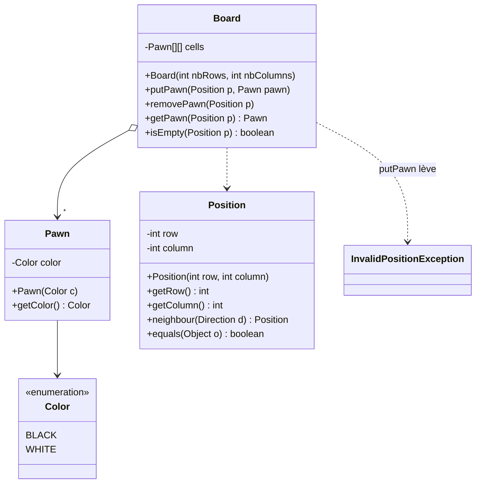
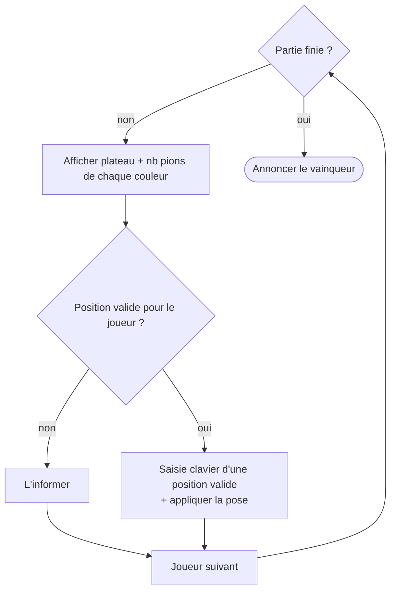
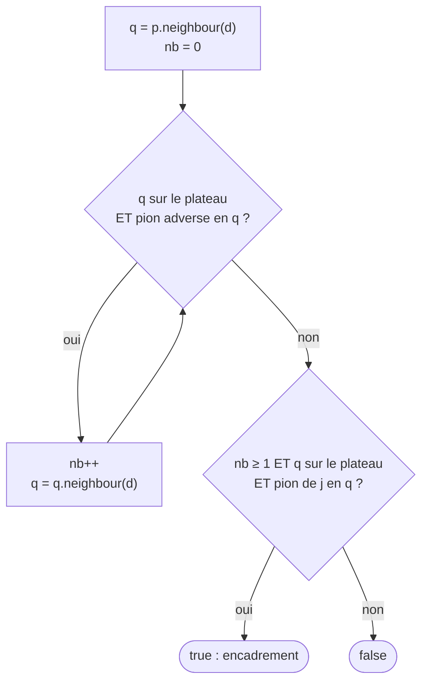

# TD Othello — Pions, plateau, positions et règles du jeu

> 🎯 **Objectifs** : **analyser** un problème en classes (UML), lever une exception, éliminer du code dupliqué avec un **`enum` de directions**, écrire un **algorithme** de jeu et ses **tests**.
> 📚 Cours : [01 — Classes et objets](../../01-Cours/01-classes-et-objets.md) · [02 — static et enum](../../01-Cours/02-static-et-enum.md) · [03 — Tests](../../01-Cours/03-tests.md) · [04 — Exceptions](../../01-Cours/04-exceptions.md)
> 📝 Préparation : lire l'énoncé et faire la **Q1**. → Ce TD prépare le [TP Othello](../../03-TP/TP-othello/ENONCE.md).

---

## Partie 1 — Pions et plateaux

Un **plateau** rectangulaire est constitué d'**emplacements** qui accueillent des **pions** (blancs ou noirs). Un emplacement est repéré par une **position** (ligne, colonne). On peut ajouter / retirer un pion à tout emplacement valide, toujours **via les positions**.

- [ ] **Q1.** Diagrammes UML des classes correspondant aux mots en gras (méthodes, attributs, constructeurs).
- [ ] **Q2.** Méthodes de test de la pose d'un pion : elle lève `othello.InvalidPositionException` si la position n'existe pas sur le plateau.
- [ ] **Q3.** Code de cette méthode.
  💡 Accéder à un indice invalide d'un tableau lève `ArrayIndexOutOfBoundsException` → on peut la capturer et lever la nôtre.

<details><summary>💡 Une proposition d'analyse (à comparer avec la tienne)</summary>



</details>

## Partie 2 — Positions voisines

| | colonne − 1 | colonne | colonne + 1 |
|---|:---:|:---:|:---:|
| **ligne − 1** | NO `(-1,-1)` | N `(-1,0)` | NE `(-1,+1)` |
| **ligne** | O `(0,-1)` | **P** | E `(0,+1)` |
| **ligne + 1** | SO `(+1,-1)` | S `(+1,0)` | SE `(+1,+1)` |

*(décalage (ligne, colonne) — la ligne augmente vers le sud)*

- [ ] **Q4.** Code de `neighbourSE()`, `neighbourNE()`, `neighbourN()`, `neighbourE()`.
- [ ] **Q5.** Ces 4 codes se ressemblent : propose **une seule** méthode `neighbour(direction)`. Comment identifier les 8 directions ?

<details><summary>💡 Indice Q5 : un enum avec des attributs</summary>

```java
public enum Direction {
    N(-1, 0), NE(-1, 1), E(0, 1), SE(1, 1),
    S(1, 0), SW(1, -1), W(0, -1), NW(-1, -1);

    private final int dRow, dColumn;
    private Direction(int dRow, int dColumn) { this.dRow = dRow; this.dColumn = dColumn; }
    public int getDRow() { return this.dRow; }
    public int getDColumn() { return this.dColumn; }
}
```
```java
public Position neighbour(Direction d) {
    return new Position(this.row + d.getDRow(), this.column + d.getDColumn());
}
```

</details>

## Partie 3 — Le jeu d'Othello

### 📋 Règles en bref

| Règle | Détail |
|---|---|
| Plateau | 8 × 8 ; 4 pions au centre au départ |
| Qui commence | **Noir** |
| Coup valide | case **vide**, qui **encadre** au moins un pion adverse (ligne, colonne ou diagonale) entre le pion posé et un pion de sa couleur |
| Effet | tous les pions adverses encadrés (dans les 8 directions) **changent de couleur** |
| Pas de coup valide | le joueur **passe** |
| Fin | aucun joueur ne peut jouer ; le plus de pions **gagne** |

### 🔁 Le programme à réaliser



- [ ] **Q6.** Diagramme de la classe `Player`.
- [ ] **Q7.** Diagramme de la classe `OthelloGame` (soit précis ; décompose en plusieurs méthodes ; pars du déroulement du jeu).
- [ ] **Q8.** Encadrement dans **une** direction :
  - **Q8.1** algorithme textuel : le joueur j, en posant en p, encadre-t-il au moins un pion adverse dans la direction d ?
  - **Q8.2** code de la méthode.
- [ ] **Q9.** `canPlayAt()` : le joueur peut-il jouer en p ?
  - **Q9.1** méthodes de test ; **Q9.2** code.
- [ ] **Q10.** p étant valide pour j : code de la **pose** (avec retournement des pions encadrés).

<details><summary>💡 Indice Q8 : algorithme d'encadrement dans une direction</summary>



`canPlayAt(j, p)` = case p vide **ET** encadrement dans **au moins une** des 8 directions (`for (Direction d : Direction.values())`).

</details>

---

## 📝 Mes réponses

*(écris ici tes réponses, ou ajoute tes fichiers dans ce dossier)*

---
🏠 [Sommaire](../../README.md)
