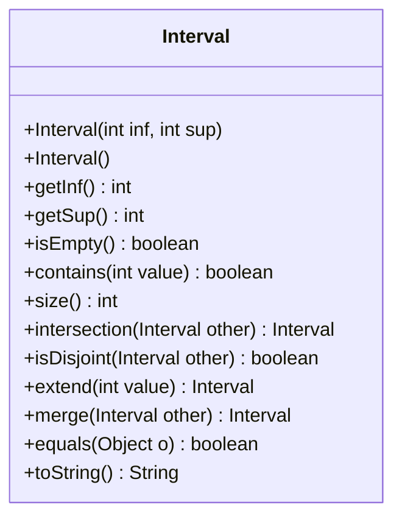
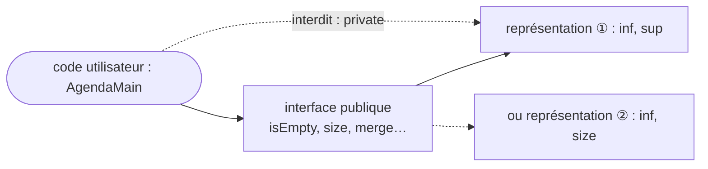
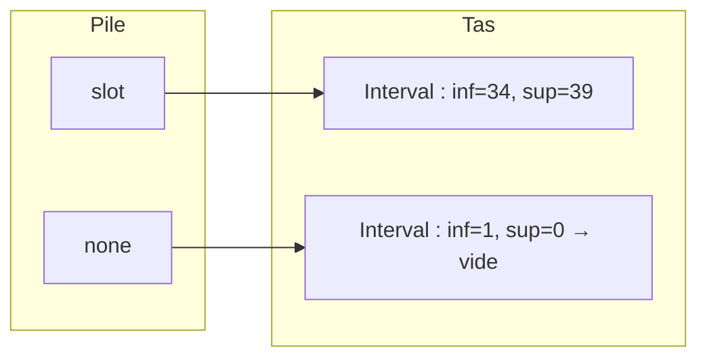
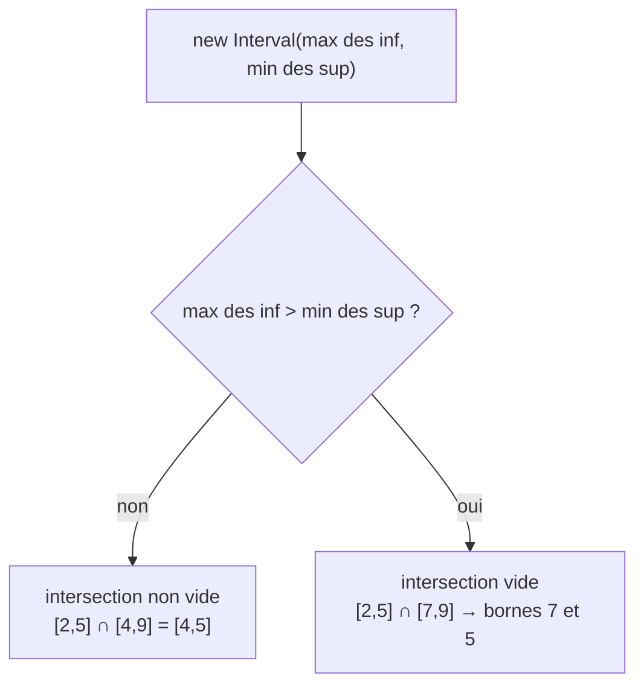
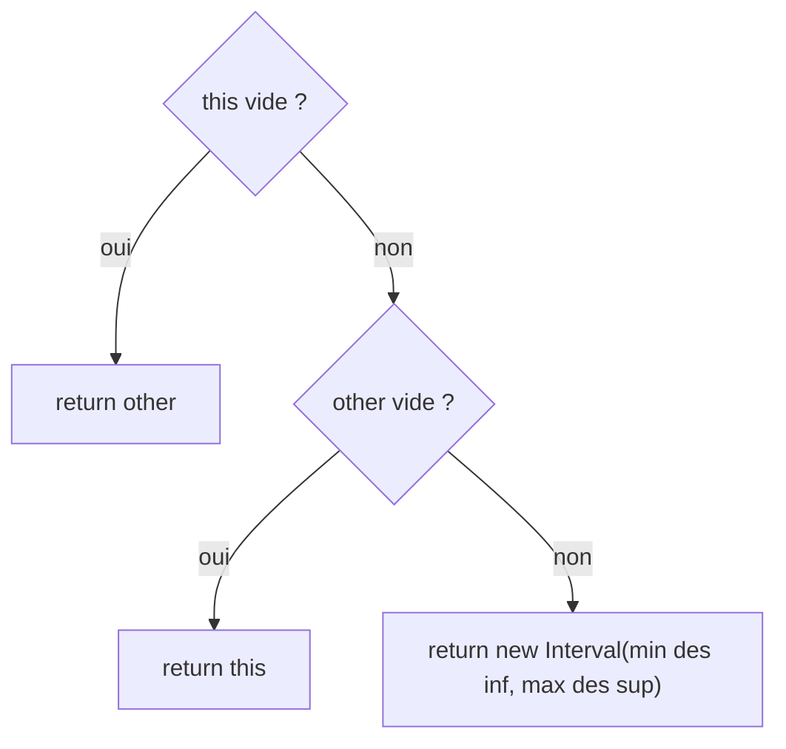
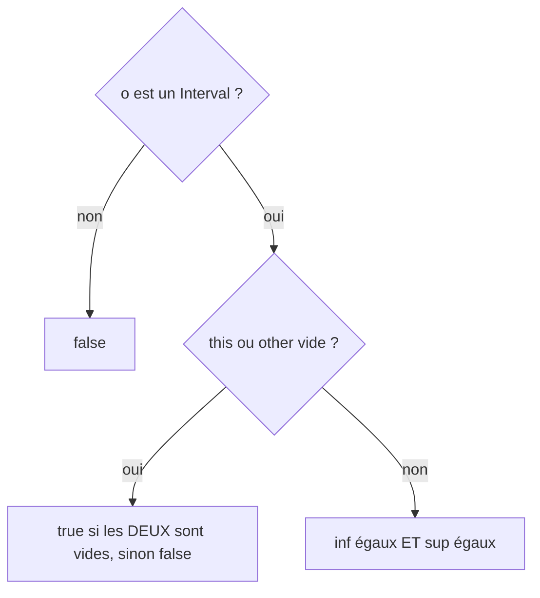

# TD2 — Intervalles d'entiers — Corrigé

> 📄 [Énoncé](./enonce.md) · 📚 Cours : [01 — Classes et objets](../../01-Cours/01-classes-et-objets.md)
> ✅ Code **compilé** (Java 21) et **testé** (JUnit 5 : 12 tests réussis, voir [§ Vérification](#-vérification--tests-junit-exécutés)).
> 💡 D'autres réponses justes sont possibles (noms de méthodes, affichage du vide…) : l'important est d'être **cohérent** et de le **documenter**.

---

## 🗺️ Vue d'ensemble

| Question | Ce qu'on décide | Choix du corrigé |
|---|---|---|
| Q1 | l'**interface publique** (le « quoi ») | 12 méthodes + 2 constructeurs |
| Q2 | la **représentation** cachée (le « comment ») | `private final int inf, sup` (classe **non modifiable**) |
| Q3 | les **constructeurs** | `Interval(int inf, int sup)` et `Interval()` = vide |
| Q4 | le **code** | `intersection` / `extend` / `merge` **renvoient** un intervalle ; **aucune** méthode ne modifie `this` |

---

## Q1 — Diagramme UML de l'interface publique

💡 **L'idée :** on décrit **ce que l'on peut demander** à un intervalle (les messages), **pas** comment il est fait : donc **aucun attribut** ici.



| Fonctionnalité de l'énoncé | Méthode | Renvoie |
|---|---|---|
| bornes inf / sup | `getInf()`, `getSup()` | `int` |
| est vide ? | `isEmpty()` | `boolean` |
| contient une valeur ? | `contains(int value)` | `boolean` |
| taille | `size()` | `int` |
| intersection | `intersection(Interval other)` | un **nouvel** `Interval` |
| disjoints ? | `isDisjoint(Interval other)` | `boolean` |
| prolonger de v | `extend(int value)` | un **nouvel** `Interval` (ou `this` si vide) ; `this` **inchangé** |
| fusionner | `merge(Interval other)` | un `Interval` (nouveau, ou l'autre si l'un est vide) |
| égalité | `equals(Object o)` | `boolean` |
| affichage | `toString()` | `String` |

- ⚠️ `intersection`, `isDisjoint`, `merge` n'ont **qu'un seul** paramètre : le premier intervalle est le **receveur** (`this`), comme `moreExpensiveThan(Item otherItem)` dans le cours.
- 📌 `equals` prend un **`Object`** (et pas un `Interval`) : c'est la signature attendue par Java.

---

## Q2 — Quels attributs ? Plusieurs représentations possibles

💡 **L'idée :** plusieurs états cachés peuvent offrir **la même** interface publique. Grâce à `private`, on peut changer de représentation **sans changer** le code des utilisateurs.

| Représentation | Attributs | Vide ⇔ | `size()` | `intersection` / `merge` | Avis |
|---|---|---|---|---|---|
| ① bornes | `int inf, sup` | `inf > sup` | `sup - inf + 1` | `max` / `min` directs | ✅ la plus naturelle, **choisie** |
| ② début + taille | `int inf, size` | `size == 0` | `size` | recalculer la fin `inf + size - 1` | ✅ correcte, un peu moins lisible |
| ③ bornes + drapeau | `int inf, sup` + `boolean empty` | `empty` | `sup - inf + 1` | il faut **maintenir** `empty` à jour | ⚠️ redondant : risque d'incohérence (`empty == false` avec `inf > sup`) |
| ④ toutes les valeurs | `int[] values` | `values.length == 0` | `values.length` | parcourir les tableaux | ❌ lourd, mémoire ∝ taille |



> 🌍 **Dans la vraie vie :** un créneau d'agenda peut s'écrire « 8h30 → 10h » ou « 8h30, durée 1h30 ». Pour toi qui lis l'agenda, c'est le **même** RDV.
> → en Java : `inf, sup` ou `inf, size`, même interface publique.

---

## Q3 — Les constructeurs

💡 **L'idée :** un constructeur « général » avec les deux bornes, et un constructeur **sans paramètre** pour l'intervalle vide.

```java
public Interval(int inf, int sup) {   // [inf, sup], vide si inf > sup
    this.inf = inf;
    this.sup = sup;
}

public Interval() {                   // intervalle vide
    this(1, 0);                       // appelle l'autre constructeur
}
```

| Appel | Objet créé | Vide ? |
|---|---|---|
| `new Interval(34, 39)` | `[34,39]` (8h30–10h) | non |
| `new Interval(5, 2)` | bornes 5 et 2 | oui (`5 > 2`) |
| `new Interval()` | bornes 1 et 0 | oui : **le plus simple** pour créer un vide |



- 📌 `this(1, 0)` doit être la **première** instruction du constructeur.
- 💡 Un vide n'a pas de « vraies » bornes : `[1,0]`, `[5,2]`, `[100,-100]` représentent **tous** l'intervalle vide (d'où le soin à prendre dans `equals`).

---

## Q4 — Code Java complet de la classe `Interval`

💡 **L'idée :** chaque méthode est courte ; `Math.max` / `Math.min` font tout le travail pour l'intersection et la fusion.
📌 La classe est **non modifiable** : attributs `private final`, et toute « opération » (`intersection`, `extend`, `merge`) **renvoie** un intervalle au lieu de changer `this` (comme les `String` de Java).

```java
/**
 * A closed interval [inf, sup] of integers (bounds included).
 * The interval is empty when inf > sup.
 */
public class Interval {
    private final int inf;
    private final int sup;

    /**
     * Builds the interval [inf, sup] (empty if inf > sup).
     * @param inf the lower bound
     * @param sup the upper bound
     */
    public Interval(int inf, int sup) {
        this.inf = inf;
        this.sup = sup;
    }

    /** Builds an empty interval. */
    public Interval() {
        this(1, 0);
    }

    /** @return the lower bound of this interval (meaningless if empty) */
    public int getInf() {
        return this.inf;
    }

    /** @return the upper bound of this interval (meaningless if empty) */
    public int getSup() {
        return this.sup;
    }

    /** @return true if this interval contains no integer */
    public boolean isEmpty() {
        return this.inf > this.sup;
    }

    /**
     * @param value the tested integer
     * @return true if value belongs to this interval
     */
    public boolean contains(int value) {
        return this.inf <= value && value <= this.sup;
    }

    /** @return the number of integers in this interval (0 if empty) */
    public int size() {
        if (this.isEmpty()) {
            return 0;
        }
        return this.sup - this.inf + 1;
    }

    /**
     * @param other another interval
     * @return a new interval, the common part of this and other (may be empty)
     */
    public Interval intersection(Interval other) {
        return new Interval(Math.max(this.inf, other.inf), Math.min(this.sup, other.sup));
    }

    /**
     * @param other another interval
     * @return true if this and other have no integer in common
     */
    public boolean isDisjoint(Interval other) {
        return this.intersection(other).isEmpty();
    }

    /**
     * Extends this interval by a value; this interval is not modified.
     * @param value the extension (assumed to be &gt;= 0)
     * @return a new interval [inf, sup + value], or this interval if it is empty
     */
    public Interval extend(int value) {
        if (this.isEmpty()) {
            return this;
        }
        return new Interval(this.inf, this.sup + value);
    }

    /**
     * @param other another interval
     * @return the smallest interval that contains this and other;
     *         if one of them is empty, the other one
     */
    public Interval merge(Interval other) {
        if (this.isEmpty()) {
            return other;
        }
        if (other.isEmpty()) {
            return this;
        }
        return new Interval(Math.min(this.inf, other.inf), Math.max(this.sup, other.sup));
    }

    /**
     * Two empty intervals are always equal; otherwise bounds must be equal.
     * @param o the compared object
     * @return true if o is an Interval equal to this one
     */
    public boolean equals(Object o) {
        if (!(o instanceof Interval)) {
            return false;
        }
        Interval other = (Interval) o;
        if (this.isEmpty() || other.isEmpty()) {
            return this.isEmpty() && other.isEmpty();
        }
        return this.inf == other.inf && this.sup == other.sup;
    }

    /** @return "[inf,sup]", or "[]" if this interval is empty */
    public String toString() {
        if (this.isEmpty()) {
            return "[]";
        }
        return "[" + this.inf + "," + this.sup + "]";
    }
}
```

### Q4.1 — `contains`, `size`, `isEmpty`

💡 Pas besoin de cas particulier dans `contains` : si l'intervalle est vide (`inf > sup`), aucun `value` ne vérifie `inf <= value <= sup`.
⚠️ En revanche `size()` **doit** tester le vide : `[5,2]` donnerait `2 - 5 + 1 = -2`.

### Q4.2 — `intersection` et `isDisjoint`

💡 **L'idée :** partie commune = `[plus grand des débuts, plus petite des fins]`. Si elle est « à l'envers », elle est **vide** : aucun `if` nécessaire !



- Ça marche aussi avec un vide : `[-10,10] ∩ [1,0]` → bornes `max(-10,1)=1` et `min(10,0)=0` → vide ✔.
- `isDisjoint` **réutilise** `intersection` (envoi de message à `this`) : pas de code dupliqué.

### Q4.3 — `extend` (prolonger)

💡 **L'idée :** l'énoncé le précise, prolonger **produit un nouvel intervalle** `[inf, sup + v]` ; `this` n'est **jamais** modifié. Si l'intervalle est vide, le résultat est l'intervalle inchangé : on renvoie `this`.

| `i` | Appel | Résultat | `i` après l'appel |
|---|---|---|---|
| `[2,5]` | `i.extend(3)` | `[2,8]` (nouvel objet) | `[2,5]` (inchangé) |
| `[]` | `i.extend(3)` | `[]` (`this` lui-même) | `[]` |

```java
Interval meeting = new Interval(38, 45);
meeting.extend(2);              // ⚠️ résultat perdu : meeting vaut toujours [38,45]
meeting = meeting.extend(2);    // ✅ meeting référence le nouvel intervalle [38,47]
```

- ⚠️ `if (this.isEmpty()) return this;` est **indispensable** : sinon `[1,0]` + 3 → `[1,3]`, le vide « réapparaît ».
- 📌 Renvoyer `this` est sans danger : personne ne peut le modifier (attributs `final`, aucune méthode de modification).

### Q4.4 — `merge` (fusionner)

💡 **L'idée :** le plus petit intervalle qui **englobe** les deux : `[min des inf, max des sup]`. Ce n'est **pas** l'union : `[2,5]` et `[10,16]` → `[2,16]` contient 7, qui n'est dans aucun des deux.



⚠️ Les tests de vide sont **indispensables** : `[2,5]` fusionné avec `[1,0]` donnerait sinon `[1,5]` ✘.
📌 On renvoie `other` (ou `this`) **lui-même**, sans copie : c'est acceptable **parce que la classe est non modifiable**. Partager une référence vers un objet que personne ne peut changer ne crée aucun effet de bord. (Avec une classe modifiable, il faudrait une copie `new Interval(other.inf, other.sup)`.)

### Q4.5 — `equals`

💡 **L'idée :** deux vides sont **toujours** égaux, même avec des bornes différentes (`[1,0]` et `[5,2]`).



- 📌 `o instanceof Interval` évite une `ClassCastException` (variante vue au [ch. 04](../../01-Cours/04-exceptions.md) : `try { (Interval) o } catch (ClassCastException e) { return false; }`).
- 📌 Pour ranger des `Interval` dans un `HashSet` / une `HashMap`, il faudra aussi `hashCode()` (voir [ch. 07](../../01-Cours/07-collections.md)) — hors TD.

### Q4.6 — `toString` : affichage du vide

| Intervalle | Affichage choisi |
|---|---|
| `[2,5]` | `"[2,5]"` |
| tout intervalle vide (`[1,0]`, `[5,2]`…) | `"[]"` |

💡 Afficher `"[5,2]"` pour un vide serait trompeur ; `"[]"` est **le même** pour tous les vides, cohérent avec `equals`.

### Q4.7 — Exemple d'usage : l'agenda

💡 **L'idée :** la journée = 96 quarts d'heure (0 à 95) ; le quart `q` commence à `q / 4` heures et `(q % 4) * 15` minutes.

```java
public class AgendaMain {

    /**
     * @param quarter a quarter of an hour of the day (0 to 95)
     * @return the matching time, e.g. 34 gives "8h30"
     */
    public static String time(int quarter) {
        int minutes = (quarter % 4) * 15;
        if (minutes == 0) {
            return (quarter / 4) + "h";
        }
        return (quarter / 4) + "h" + minutes;
    }

    public static void main(String[] args) {
        Interval course = new Interval(34, 39);    // 8h30 -> 10h (quarts 34 à 39)
        Interval meeting = new Interval(38, 45);   // 9h30 -> 11h30
        Interval lunch = new Interval(48, 51);     // 12h -> 13h

        System.out.println("Cours : " + course + ", de " + time(course.getInf())
                + " à " + time(course.getSup() + 1) + ", " + course.size() + " quarts d'heure");
        System.out.println("9h45 occupé ? " + course.contains(39));
        System.out.println("Conflit cours/réunion ? " + !course.isDisjoint(meeting));
        System.out.println("Partie commune : " + course.intersection(meeting));
        System.out.println("Conflit cours/repas ? " + !course.isDisjoint(lunch));
        System.out.println("Partie commune : " + course.intersection(lunch));
        System.out.println("Matinée englobante : " + course.merge(lunch));

        Interval longMeeting = meeting.extend(2);  // la réunion déborde de 30 min
        System.out.println("Réunion prolongée : " + longMeeting + ", fin à " + time(longMeeting.getSup() + 1));
        System.out.println("Réunion initiale inchangée : " + meeting);

        Interval none = new Interval();
        System.out.println("Créneau vide : " + none + ", taille " + none.size());
        System.out.println("vide prolongé : " + none.extend(2));
        System.out.println("vide fusionné avec repas : " + none.merge(lunch));
        System.out.println("[5,2] equals [] ? " + new Interval(5, 2).equals(none));
    }
}
```

Affichage obtenu (`java AgendaMain`) :

```text
Cours : [34,39], de 8h30 à 10h, 6 quarts d'heure
9h45 occupé ? true
Conflit cours/réunion ? true
Partie commune : [38,39]
Conflit cours/repas ? false
Partie commune : []
Matinée englobante : [34,51]
Réunion prolongée : [38,47], fin à 12h
Réunion initiale inchangée : [38,45]
Créneau vide : [], taille 0
vide prolongé : []
vide fusionné avec repas : [48,51]
[5,2] equals [] ? true
```

⚠️ Le créneau `[34,39]` **finit** à 10h : le quart 39 commence à 9h45, d'où `time(getSup() + 1)` pour l'heure de fin.

---

## ✅ Vérification : tests JUnit exécutés

Le TD ne demande pas de tests, mais voici ceux qui ont servi à **valider** ce corrigé (12/12 ✔).

<details><summary>Voir IntervalTest.java</summary>

```java
import org.junit.jupiter.api.Test;
import static org.junit.jupiter.api.Assertions.*;

public class IntervalTest {

    @Test
    public void boundsSizeAndContains() {
        Interval i = new Interval(2, 5);
        assertEquals(2, i.getInf());
        assertEquals(5, i.getSup());
        assertEquals(4, i.size());
        assertFalse(i.isEmpty());
        assertTrue(i.contains(2));
        assertTrue(i.contains(5));
        assertFalse(i.contains(6));
    }

    @Test
    public void emptyIntervals() {
        assertTrue(new Interval().isEmpty());
        assertTrue(new Interval(5, 2).isEmpty());
        assertEquals(0, new Interval(5, 2).size());
        assertFalse(new Interval().contains(0));
        assertEquals("[]", new Interval().toString());
    }

    @Test
    public void intersectionOfOverlappingIntervals() {
        Interval i1 = new Interval(2, 5);
        Interval i2 = new Interval(4, 9);
        assertEquals(new Interval(4, 5), i1.intersection(i2));
        assertEquals(new Interval(4, 5), i2.intersection(i1));
    }

    @Test
    public void intersectionOfDisjointIntervalsIsEmpty() {
        Interval i1 = new Interval(2, 5);
        Interval i2 = new Interval(7, 9);
        assertTrue(i1.intersection(i2).isEmpty());
        assertTrue(i1.isDisjoint(i2));
        assertFalse(i1.isDisjoint(new Interval(5, 9)));
    }

    @Test
    public void intersectionWithEmptyIntervalIsEmpty() {
        assertTrue(new Interval(-10, 10).intersection(new Interval()).isEmpty());
        assertTrue(new Interval().intersection(new Interval(-10, 10)).isEmpty());
    }

    @Test
    public void mergeOfTwoIntervals() {
        Interval i1 = new Interval(2, 5);
        Interval i2 = new Interval(10, 16);
        assertEquals(new Interval(2, 16), i1.merge(i2));
        assertEquals(new Interval(2, 16), i2.merge(i1));
    }

    @Test
    public void mergeWithEmptyIntervalGivesTheOther() {
        Interval i = new Interval(2, 5);
        assertEquals(i, i.merge(new Interval()));
        assertEquals(i, new Interval().merge(i));
        assertSame(i, new Interval().merge(i));
    }

    @Test
    public void emptyIntervalsAreAlwaysEqual() {
        assertEquals(new Interval(), new Interval(5, 2));
        assertEquals(new Interval(8, 3), new Interval(100, -100));
        assertNotEquals(new Interval(), new Interval(2, 5));
        assertNotEquals(new Interval(2, 5), new Interval());
    }

    @Test
    public void equalsComparesBounds() {
        assertEquals(new Interval(2, 5), new Interval(2, 5));
        assertNotEquals(new Interval(2, 5), new Interval(2, 6));
        assertNotEquals(new Interval(2, 5), "[2,5]");
    }

    @Test
    public void extendReturnsNewIntervalAndKeepsOriginal() {
        Interval i = new Interval(2, 5);
        Interval extended = i.extend(3);
        assertEquals(new Interval(2, 8), extended);
        assertEquals(new Interval(2, 5), i);
        assertNotSame(i, extended);
    }

    @Test
    public void extendEmptyIntervalGivesItUnchanged() {
        Interval empty = new Interval();
        Interval extended = empty.extend(3);
        assertTrue(extended.isEmpty());
        assertTrue(empty.isEmpty());
        assertSame(empty, extended);
    }

    @Test
    public void toStringShowsBounds() {
        assertEquals("[2,5]", new Interval(2, 5).toString());
    }
}
```

</details>

💡 `assertEquals(new Interval(4, 5), ...)` fonctionne **grâce à** notre `equals` ; `assertNotSame` vérifie que `extend` renvoie bien un **nouvel** objet, et `assertEquals(new Interval(2, 5), i)` que l'original n'a **pas** bougé.

---

## ⚠️ Erreurs fréquentes

| Erreur | Pourquoi c'est faux | Correction |
|---|---|---|
| attributs dans le diagramme de Q1 | Q1 = interface **publique** seulement | méthodes et constructeurs `+` uniquement |
| `intersection(Interval i1, Interval i2)` | le receveur `this` est déjà le 1er intervalle | **un seul** paramètre `other` |
| `size()` sans tester le vide | `[5,2]` → `-2` | `if (this.isEmpty()) return 0;` |
| `merge` sans tester le vide | `[2,5]` + `[1,0]` → `[1,5]` | si un est vide, renvoyer l'autre |
| confondre fusion et union | `[2,16]` contient 7, absent des deux | c'est l'intervalle **englobant**, documenté comme tel |
| `equals` qui compare seulement les bornes | `[1,0]` ≠ `[5,2]` alors que ce sont deux vides | tester d'abord le cas vide |
| `public boolean equals(Interval o)` | surcharge, pas redéfinition : `assertEquals`, collections ne l'appellent pas | paramètre de type `Object` + `instanceof` |
| `toString()` qui affiche `"[5,2]"` pour un vide | trompeur, incohérent avec `equals` | un affichage unique : `"[]"` |
| `extend` qui modifie `this` (`void`, `this.sup = ...`) | l'énoncé demande de **produire un nouvel** intervalle | `public Interval extend(int value)` + `return new Interval(this.inf, this.sup + value);` |
| `meeting.extend(2);` sans récupérer le résultat | le nouvel intervalle est perdu, `meeting` est inchangé | `meeting = meeting.extend(2);` ou une nouvelle variable |
| renvoyer `other` / `this` dans une classe **modifiable** | une modification du résultat modifierait aussi l'original (même référence) | classe non modifiable (`final`), ou renvoyer une copie |
| attributs `public` | casse l'encapsulation : impossible de changer de représentation (Q2) | `private final` + accesseurs `getInf()`, `getSup()` |
| `extend` qui prolonge un vide | `[1,0]` + 3 → `[1,3]` : le vide « réapparaît » | `if (this.isEmpty()) return this;` |

---
🏠 [Sommaire](../../README.md)
