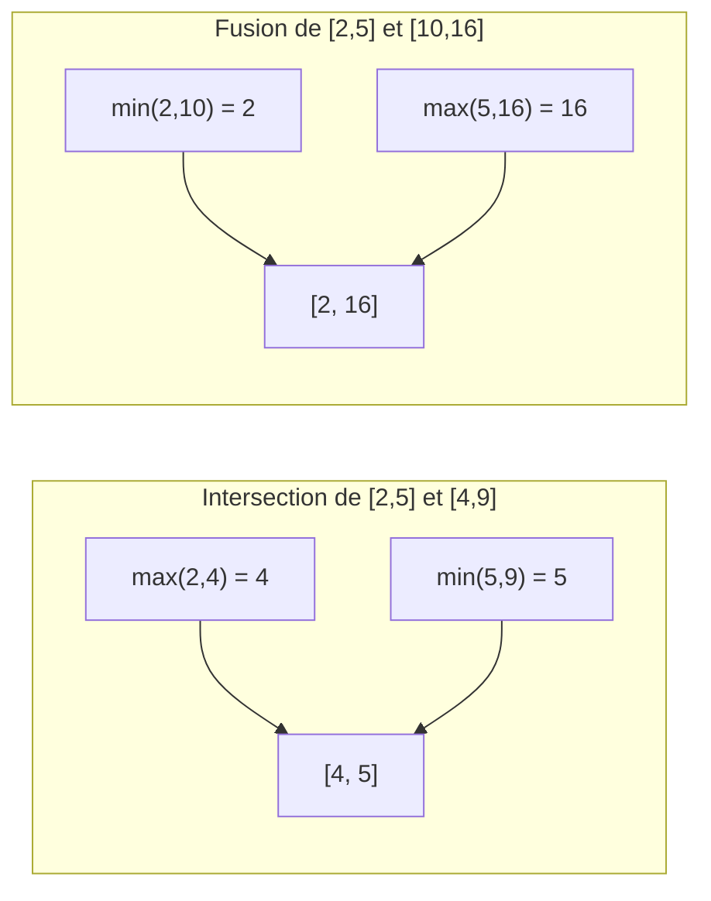

# TD2 — Intervalles d'entiers

> 🎯 **Objectifs** : concevoir l'**interface publique** d'une classe (UML), choisir ses attributs et constructeurs, coder des méthodes qui créent de **nouveaux objets**.
> 📚 Cours : [01 — Classes et objets](../../01-Cours/01-classes-et-objets.md)
> 📝 Préparation : lire l'énoncé et faire la **Q1**.

## 💡 Le contexte

Un intervalle **fermé** `[a, b]` contient tous les entiers de `a` à `b` (bornes incluses).
Il est **vide** si `a > b`.

Exemple d'usage : un agenda où la journée est découpée en 96 quarts d'heure (0 à 95).
Le créneau **8h30–10h** = intervalle **[34, 39]**.

## 📋 Fonctionnalités demandées

| Fonctionnalité | Exemple | Usage agenda |
|---|---|---|
| bornes inf / sup | `[2,5]` → 2 et 5 | début / fin du créneau |
| est vide ? | `[5,2]` → oui | créneau inexistant |
| contient une valeur ? | `[2,5]` contient 3 → oui | ce quart d'heure est-il occupé ? |
| taille | `[2,5]` → 4 | durée du créneau |
| intersection | `[2,5] ∩ [4,9]` = `[4,5]` (peut être vide) | partie commune de 2 RDV |
| disjoints ? | `[2,5]` et `[7,9]` → oui | 2 RDV sans conflit ? |
| prolonger de v | `[2,5]` +3 → `[2,8]` ; vide → inchangé | rallonger une réunion |
| fusionner | `[2,5]` et `[10,16]` → `[2,16]` ; si un est vide → l'autre | englober 2 créneaux |
| égalité | deux intervalles vides sont **toujours égaux** | même créneau ? |
| `toString()` | `"[2,5]"` (et pour un vide ?) | affichage |



💡 `Math.min(int, int)` et `Math.max(int, int)` sont tes amis pour l'intersection et la fusion.

## ✍️ Questions

- [ ] **Q1.** Diagramme UML de l'**interface publique** de la classe (méthodes publiques uniquement).
- [ ] **Q2.** Quel(s) attribut(s) ? Peux-tu imaginer **plusieurs** représentations possibles ?
- [ ] **Q3.** Quel(s) constructeur(s) ? On veut pouvoir créer un **intervalle vide** le plus simplement possible.
- [ ] **Q4.** Code Java complet de la classe.

<details><summary>💡 Indice Q2 : deux représentations possibles</summary>

| Représentation | Attributs | Remarque |
|---|---|---|
| bornes | `int inf, sup` | la plus naturelle |
| début + taille | `int inf, size` | vide ⇔ `size == 0` |

L'**interface publique ne change pas** : c'est l'intérêt de l'encapsulation (`private`).

</details>

<details><summary>💡 Indice Q3 : intervalle vide</summary>

Un constructeur **sans paramètre** peut créer un intervalle vide, par ex. `[1, 0]`.

</details>

<details><summary>💡 Indice Q4 : equals avec les vides</summary>

```java
if (this.isEmpty() && other.isEmpty()) return true;
```
Sinon, comparer les bornes.

</details>

---

## 📝 Mes réponses

*(écris ici tes réponses, ou ajoute tes fichiers `.java` dans ce dossier)*

---
🏠 [Sommaire](../../README.md)
