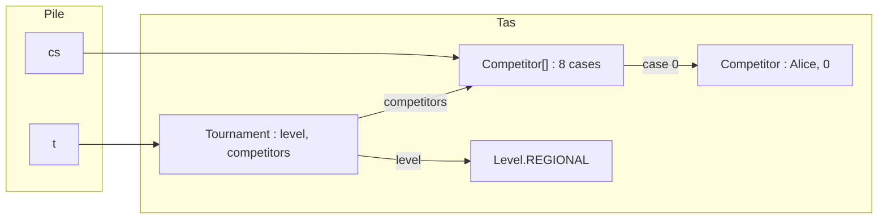
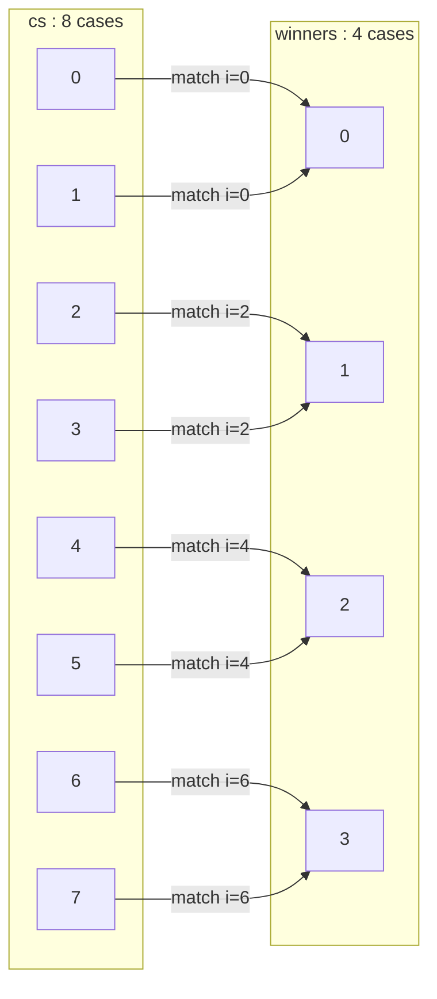
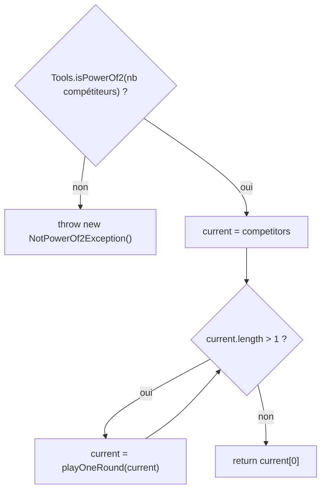
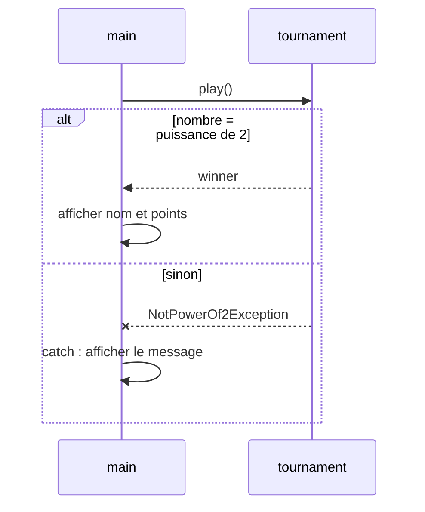

# TD3 — Tournois sportifs — Corrigé

> 📄 [Énoncé](./enonce.md) · 📚 Cours : [02 — static et enum](../../01-Cours/02-static-et-enum.md) · [03 — Tests](../../01-Cours/03-tests.md) · [04 — Exceptions](../../01-Cours/04-exceptions.md)
> ✅ Code **compilé** (Java 21) et **testé** : tous les tests de ce corrigé ont été exécutés avec JUnit 5 (8 tests réussis).
> 💡 D'autres réponses justes sont possibles.

## 📌 Hypothèses (non fixées par l'énoncé)

L'énoncé ne donne pas le code de ces éléments ; pour compiler et tester, le corrigé suppose :

| Élément | Hypothèse retenue |
|---|---|
| `NotPowerOf2Exception` | `public class NotPowerOf2Exception extends Exception { }` (exception **contrôlée** : `throws` obligatoire) |
| `Tools.isPowerOf2(int n)` | méthode `static` fournie : `true` pour 1, 2, 4, 8… ; `false` pour 0, 3, 6… |
| `playOneMatch(c1, c2)` | méthode `private` fournie : renvoie le vainqueur (dans nos essais : tiré **au hasard**) |
| points par victoire | constante `public static final int POINTS_PER_WIN = 10;` dans `Tournament` |

---

## Q1 — Méthode de test de `addPoints()`

💡 **L'idée :** état de départ connu → on envoie le message → on vérifie le **nouvel état** avec `assertEquals(attendu, obtenu)`.

```java
import org.junit.jupiter.api.Test;
import static org.junit.jupiter.api.Assertions.*;

public class CompetitorTest {

    @Test
    public void addPointsIncreasesPoints() {
        Competitor c = new Competitor("Alice");
        assertEquals(0, c.getPoints());     // 0 point au départ
        c.addPoints(10);
        assertEquals(10, c.getPoints());
        c.addPoints(5);
        assertEquals(15, c.getPoints());    // les points s'AJOUTENT
    }
}
```

- 📌 Deux appels successifs vérifient que `addPoints` **ajoute** (et ne remplace pas).
- ⚠️ Valeur **attendue en premier** : `assertEquals(10, c.getPoints())`.

<details><summary>Bonus : test de equals (exécuté aussi)</summary>

```java
    @Test
    public void equalsNeedsSameNameAndSamePoints() {
        Competitor c1 = new Competitor("Alice");
        Competitor c2 = new Competitor("Alice");
        assertEquals(c1, c2);
        c1.addPoints(10);
        assertNotEquals(c1, c2);
        assertNotEquals(new Competitor("Alice"), new Competitor("Bob"));
    }
```

</details>

---

## Q2 — La classe `Competitor`

💡 **L'idée :** deux attributs `private`, un constructeur qui fixe le nom et met les points à 0, et un `equals` qui compare **nom ET points**.

```java
/** A competitor of a tournament: a name and a number of points. */
public class Competitor {
    private String name;
    private int points;

    /**
     * Builds a competitor with the given name and 0 point.
     * @param name the name of this competitor
     */
    public Competitor(String name) {
        this.name = name;
        this.points = 0;
    }

    /** @return the name of this competitor */
    public String getName() {
        return this.name;
    }

    /** @return the current number of points of this competitor */
    public int getPoints() {
        return this.points;
    }

    /**
     * Adds points to this competitor.
     * @param p the number of points to add
     */
    public void addPoints(int p) {
        this.points = this.points + p;
    }

    /**
     * @param o the compared object
     * @return true if o is a Competitor with the same name and the same points
     */
    public boolean equals(Object o) {
        if (!(o instanceof Competitor)) {
            return false;
        }
        Competitor other = (Competitor) o;
        return this.name.equals(other.name) && this.points == other.points;
    }

    /** @return a description such as "Alice (20 points)" */
    public String toString() {
        return this.name + " (" + this.points + " points)";
    }
}
```

- ⚠️ `this.name.equals(other.name)` et **pas** `==` : `==` compare les **références** des `String`.
- 📌 `this.points == other.points` : `==` est correct pour un `int` (type primitif).

---

## Q3 — Le type `Level`

💡 **L'idée :** un ensemble **fini** de valeurs **connues à l'avance** ⇒ un **`enum`**.

```java
/** The level of a tournament. */
public enum Level {
    DEPARTMENTAL, REGIONAL, NATIONAL;
}
```

| Solution | Exemple | Problème |
|---|---|---|
| `int` constants | `public static final int REGIONAL = 1;` | `new Tournament(42, cs)` compile ! |
| `String` | `"regional"` | faute de frappe `"regionnal"` non détectée |
| ✅ `enum` | `Level.REGIONAL` | **seules** 3 valeurs possibles, vérifié par le compilateur |

- 📌 On compare deux `Level` avec `==` (une seule instance par valeur).
- 💡 Pour aller plus loin (ch. 02 § 11) : un `enum` peut porter un attribut, par ex. des points par victoire différents selon le niveau.

---

## Q4 — Attributs et constructeur de `Tournament`

💡 **L'idée :** le tournoi **connaît** son niveau et son tableau de compétiteurs (association `o-->` du diagramme).

```java
public class Tournament {
    /** points earned by the winner of a match (hypothesis) */
    public static final int POINTS_PER_WIN = 10;

    private Level level;
    private Competitor[] competitors;

    /**
     * Builds a tournament.
     * @param level the level of this tournament
     * @param competitors the initial competitors
     */
    public Tournament(Level level, Competitor[] competitors) {
        this.level = level;
        this.competitors = competitors;
    }
}
```



⚠️ Le constructeur **ne vérifie pas** la puissance de 2 : d'après Q6, c'est `play()` qui lève l'exception.

---

## Q5 — `playOneRound`

💡 **L'idée :** parcourir le tableau **de 2 en 2** ; le vainqueur du match `i, i+1` va dans la case `i / 2` du tableau résultat, deux fois plus petit.

```java
    /**
     * Plays one round: cs[0] against cs[1], cs[2] against cs[3], etc.
     * Each winner earns POINTS_PER_WIN points.
     * @param cs the competitors of the round (even number)
     * @return the winners of the round, in the order of the matches
     */
    public Competitor[] playOneRound(Competitor[] cs) {
        Competitor[] winners = new Competitor[cs.length / 2];
        for (int i = 0; i < cs.length; i = i + 2) {
            Competitor winner = this.playOneMatch(cs[i], cs[i + 1]);
            winner.addPoints(POINTS_PER_WIN);
            winners[i / 2] = winner;
        }
        return winners;
    }
```



- ⚠️ `i = i + 2` (et pas `i++`), sinon `cs[i + 1]` sort du tableau.
- 📌 `winners` contient des **références** vers les mêmes objets `Competitor` que `cs` : ce sont eux qui gagnent des points.
- 💡 `playOneMatch` est `private` mais appelable ici : on est **dans** la classe `Tournament`.

---

## Q6 — `play()`

### Q6.1 — Javadoc

```java
    /**
     * Plays the whole tournament: rounds are played until only one
     * competitor remains. Each match winner earns POINTS_PER_WIN points.
     * @return the winner of the tournament
     * @throws NotPowerOf2Exception if the number of competitors is not a power of 2
     */
```

💡 L'exception fait partie du **contrat** : `@throws` (ou `@exception`) + le **cas** où elle est levée.

### Q6.2 — Méthodes de test

💡 **L'idée :** tester les cas **normaux** (1, 2, 4, 8 compétiteurs), le **résultat précis** quand on peut le prévoir, et le cas **exceptionnel** avec `assertThrows`.

| Cas testé | Attendu |
|---|---|
| `playOneRound` sur 8 | 4 vainqueurs, chacun issu de **son** match, avec `POINTS_PER_WIN` points |
| `playOneRound` sur 4 | les perdants restent à 0 point |
| `play` avec 1, 2, 4, 8 | le vainqueur fait partie des inscrits |
| `play` avec 8 | le vainqueur a gagné **3** matchs → `3 * POINTS_PER_WIN` points |
| `play` avec 3 et 6 | `NotPowerOf2Exception` |

```java
import org.junit.jupiter.api.Test;
import static org.junit.jupiter.api.Assertions.*;

public class TournamentTest {

    private Competitor[] createCompetitors(int n) {
        Competitor[] cs = new Competitor[n];
        for (int i = 0; i < n; i++) {
            cs[i] = new Competitor("C" + i);
        }
        return cs;
    }

    private boolean isAmong(Competitor c, Competitor[] cs) {
        for (Competitor other : cs) {
            if (other == c) {
                return true;
            }
        }
        return false;
    }

    @Test
    public void playOneRoundReturnsOneWinnerPerMatch() {
        Competitor[] cs = this.createCompetitors(8);
        Tournament t = new Tournament(Level.REGIONAL, cs);
        Competitor[] winners = t.playOneRound(cs);
        assertEquals(4, winners.length);
        for (int i = 0; i < winners.length; i++) {
            assertTrue(winners[i] == cs[2 * i] || winners[i] == cs[2 * i + 1]);
            assertEquals(Tournament.POINTS_PER_WIN, winners[i].getPoints());
        }
    }

    @Test
    public void playOneRoundGivesNoPointsToLosers() {
        Competitor[] cs = this.createCompetitors(4);
        Tournament t = new Tournament(Level.REGIONAL, cs);
        Competitor[] winners = t.playOneRound(cs);
        for (Competitor c : cs) {
            if (!this.isAmong(c, winners)) {
                assertEquals(0, c.getPoints());
            }
        }
    }

    @Test
    public void playWithPowerOf2ReturnsARegisteredCompetitor() throws NotPowerOf2Exception {
        for (int n = 1; n <= 8; n = n * 2) {
            Competitor[] cs = this.createCompetitors(n);
            Tournament t = new Tournament(Level.REGIONAL, cs);
            Competitor winner = t.play();
            assertTrue(this.isAmong(winner, cs));
        }
    }

    @Test
    public void winnerOf8CompetitorsHas3Wins() throws NotPowerOf2Exception {
        Competitor[] cs = this.createCompetitors(8);
        Tournament t = new Tournament(Level.NATIONAL, cs);
        Competitor winner = t.play();
        assertEquals(3 * Tournament.POINTS_PER_WIN, winner.getPoints());
    }

    @Test
    public void playThrowsExceptionWhenNotPowerOf2() {
        Tournament t3 = new Tournament(Level.DEPARTMENTAL, this.createCompetitors(3));
        assertThrows(NotPowerOf2Exception.class, () -> t3.play());
        Tournament t6 = new Tournament(Level.DEPARTMENTAL, this.createCompetitors(6));
        assertThrows(NotPowerOf2Exception.class, () -> t6.play());
    }
}
```

- 💡 Le vainqueur d'un match est **imprévisible** (hasard) : on teste donc des **propriétés** toujours vraies (« fait partie des inscrits », « 3 victoires = 30 points »).
- 📌 `==` dans `isAmong` / `assertTrue(... == ...)` : on veut **le même objet**, pas un compétiteur « égal ».
- ⚠️ `throws NotPowerOf2Exception` sur les tests qui appellent `play()` normalement : exception **contrôlée**, sinon le test ne compile pas.
- ⚠️ `() -> t3.play()` : sans la lambda, l'exception partirait **avant** `assertThrows`.

### Q6.3 — Code de `play()`

```java
    public Competitor play() throws NotPowerOf2Exception {
        if (!Tools.isPowerOf2(this.competitors.length)) {
            throw new NotPowerOf2Exception();
        }
        Competitor[] current = this.competitors;
        while (current.length > 1) {
            current = this.playOneRound(current);
        }
        return current[0];
    }
```



| Tour | `current.length` avant | après `playOneRound` |
|---|---|---|
| 1 | 8 | 4 |
| 2 | 4 | 2 |
| 3 (finale) | 2 | 1 → `return current[0]` |

- 📌 `throw` (instruction, dans le corps) ≠ `throws` (déclaration, dans la signature).
- 💡 Vérifier **avant** de jouer : avec 6 joueurs, on aurait 3 puis… un match impossible au tour suivant.
- 📌 `Tools.isPowerOf2(...)` : méthode **`static`**, appelée sur la **classe**.
- 📌 Avec 1 seul compétiteur : pas de match, il est vainqueur avec 0 point.

---

## Q7 — Le `main` avec `try / catch`

💡 **L'idée :** `play()` peut lever une exception contrôlée ⇒ le `main` la **capture** et affiche un message au lieu de planter.

```java
public class TournamentMain {
    public static void main(String[] args) {
        Competitor[] competitors = {
            new Competitor("Alice"), new Competitor("Bob"),
            new Competitor("Chloé"), new Competitor("David"),
            new Competitor("Emma"), new Competitor("Farid"),
            new Competitor("Gaël"), new Competitor("Hugo")
        };
        Tournament tournament = new Tournament(Level.REGIONAL, competitors);
        try {
            Competitor winner = tournament.play();
            System.out.println("Vainqueur : " + winner.getName()
                    + " avec " + winner.getPoints() + " points");
        } catch (NotPowerOf2Exception e) {
            System.out.println("Le tournoi n'a pas pu avoir lieu : "
                    + competitors.length + " compétiteurs, ce n'est pas une puissance de 2");
        }
    }
}
```

Affichages obtenus :

```text
8 compétiteurs (3 exécutions, vainqueur tiré au hasard) :
Vainqueur : Emma avec 30 points
Vainqueur : Hugo avec 30 points
Vainqueur : David avec 30 points

Même main avec les 6 premiers compétiteurs seulement :
Le tournoi n'a pas pu avoir lieu : 6 compétiteurs, ce n'est pas une puissance de 2
```



- ⚠️ L'affichage du vainqueur est **dans** le `try` : si `play()` échoue, il n'y a pas de `winner` à afficher.

---

## ⚠️ Erreurs fréquentes

| Erreur | Pourquoi c'est faux | Correction |
|---|---|---|
| `assertEquals(c.getPoints(), 10)` | arguments inversés : message d'échec trompeur | `assertEquals(10, c.getPoints())` |
| tester `addPoints` une seule fois | ne distingue pas « ajouter » de « remplacer » | deux appels successifs |
| `this.name == other.name` dans `equals` | compare les références des `String` | `this.name.equals(other.name)` |
| `equals(Competitor o)` | surcharge, pas redéfinition de `equals(Object)` | paramètre `Object` + `instanceof` |
| `Level` en `int` ou `String` | valeurs invalides acceptées par le compilateur | `enum Level` |
| `for (... ; i++)` dans `playOneRound` | matchs qui se chevauchent, `cs[i + 1]` hors limites | `i = i + 2` et `winners[i / 2]` |
| oublier `addPoints` pour le vainqueur | personne ne marque de points | `winner.addPoints(POINTS_PER_WIN)` |
| `throws new NotPowerOf2Exception()` | confusion des mots-clés | `throw new ...` dans le corps, `throws ...` dans la signature |
| pas de `throws` sur `play()` | exception contrôlée : refus de compilation | `public Competitor play() throws NotPowerOf2Exception` |
| `assertThrows(NotPowerOf2Exception.class, t.play())` | l'exception part avant l'assertion | `() -> t.play()` |
| test du vainqueur exact (« c'est Alice ») | le match est aléatoire : test qui échoue au hasard | tester une **propriété** (inscrit, 30 points) |
| `main` sans `try / catch` | ne compile pas (ou plante) | `try { ... } catch (NotPowerOf2Exception e) { ... }` |
| `points` en dur : `addPoints(10)` | nombre magique | constante `static final` |

---
🏠 [Sommaire](../../README.md)
