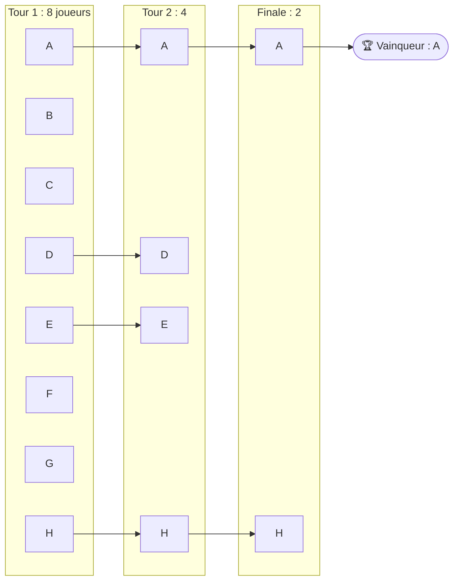
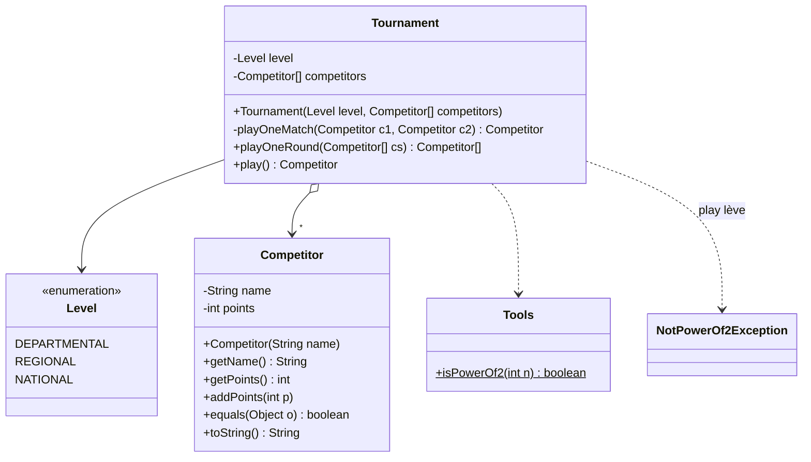
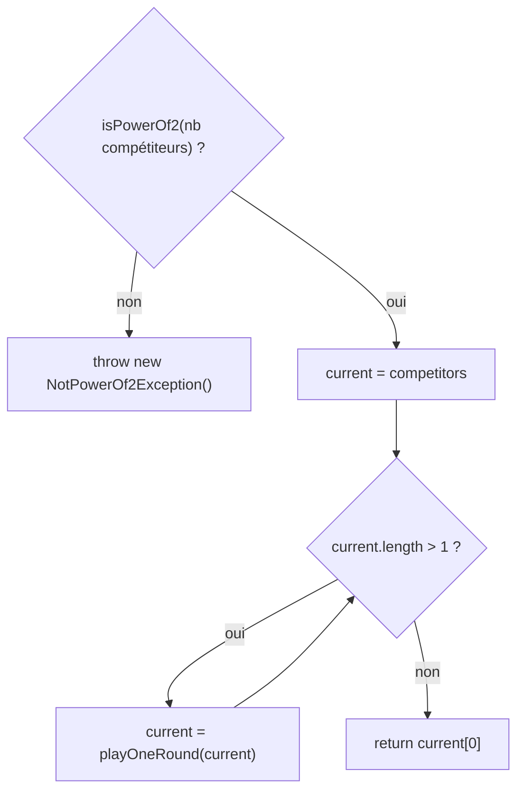

# TD3 — Tournois sportifs

> 🎯 **Objectifs** : écrire un **test unitaire**, choisir un **`enum`**, manipuler des **tableaux d'objets**, documenter et tester une méthode qui **lève une exception**.
> 📚 Cours : [02 — static et enum](../../01-Cours/02-static-et-enum.md) · [03 — Tests](../../01-Cours/03-tests.md) · [04 — Exceptions](../../01-Cours/04-exceptions.md)
> 📝 Préparation : lire l'énoncé et faire les **Q1, Q2, Q3**.

## 💡 Le principe d'un tournoi à élimination directe



- Nombre initial de compétiteurs = **puissance de 2**.
- À chaque tour : matchs **par paires dans l'ordre du tableau** (0 contre 1, 2 contre 3, …) ; le vainqueur **marque des points**.
- On continue jusqu'à **un seul** compétiteur.

## 🗺️ Les classes



## ✍️ Questions

### Les compétiteurs
- [ ] **Q1.** Code d'une **méthode de test** qui vérifie `addPoints()`.
- [ ] **Q2.** Code complet de `Competitor` (nom donné, 0 point au départ ; égaux si même nom **et** mêmes points).

### Niveaux
- [ ] **Q3.** Meilleure définition du type `Level` (départemental, régional, national) ?

### Le tournoi
- [ ] **Q4.** Attributs et constructeur de `Tournament` (niveau + tableau initial de compétiteurs).
- [ ] **Q5.** `playOneRound(Competitor[] cs)` : joue tous les matchs d'**un** tour, renvoie le **tableau des vainqueurs** (taille divisée par 2).
- [ ] **Q6.** `play()` : joue tous les tours, renvoie le vainqueur ; lève `NotPowerOf2Exception` si le nombre de compétiteurs n'est pas une puissance de 2.
  - **Q6.1** sa javadoc (avec `@throws`) ;
  - **Q6.2** les méthodes de test ;
  - **Q6.3** son code.
- [ ] **Q7.** Dans un `main`, avec un tableau `competitors` donné : créer un tournoi **régional**, le jouer, afficher le vainqueur et ses points — ou un message si le tournoi n'a pas pu avoir lieu (`try / catch`).

<details><summary>💡 Indice Q5 : parcourir par paires</summary>

```java
Competitor[] winners = new Competitor[cs.length / 2];
for (int i = 0; i < cs.length; i += 2) {
    winners[i / 2] = this.playOneMatch(cs[i], cs[i + 1]);
    // + ajouter les points au vainqueur
}
return winners;
```

</details>

<details><summary>💡 Indice Q6 : algorithme de play()</summary>



</details>

<details><summary>💡 Indice Q6.2 : quels tests ?</summary>

- un test avec 1, 2, 4 ou 8 compétiteurs → le vainqueur fait partie des inscrits ;
- un test avec 3 (ou 6) compétiteurs → `assertThrows(NotPowerOf2Exception.class, () -> t.play());`

</details>

---

## 📝 Mes réponses

*(écris ici tes réponses, ou ajoute tes fichiers `.java` dans ce dossier)*

---
🏠 [Sommaire](../../README.md)
