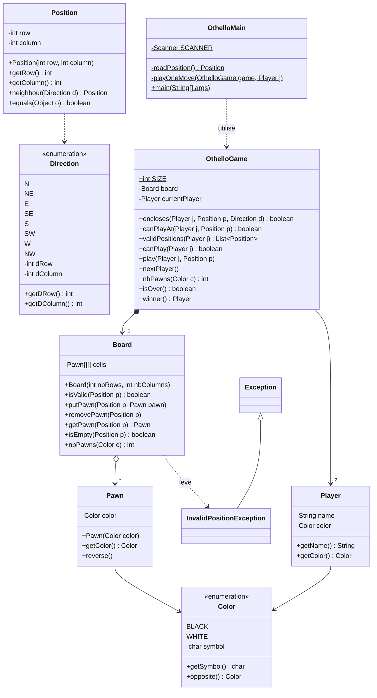
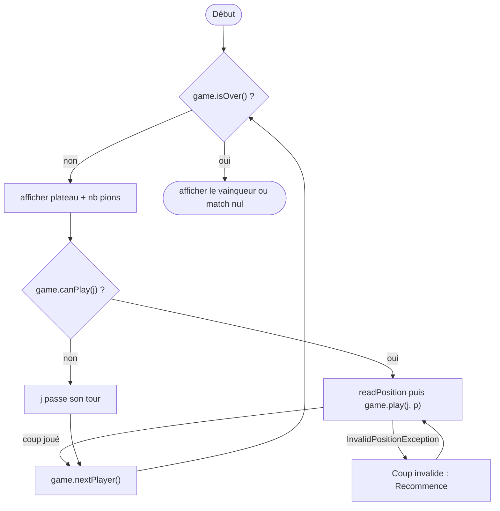

# TP Othello — Corrigé proposé

> ⚠️ **Corrigé non officiel**, rédigé pour réviser. Le code ci-dessous est **exactement** celui qui a été compilé (Java 21) et testé : **43 tests JUnit 5 réussis**, une partie complète jouée jusqu'au bout, jar exécutable lancé.
> D'autres solutions justes sont possibles. 📄 [Retour à l'énoncé](./ENONCE.md) · 📝 Analyse : [corrigé du TD Othello](../../02-TD/TD-othello/corrige.md)

## 🗺️ Vue d'ensemble

💡 **L'idée :** on reprend l'analyse du TD, une classe par fichier, **toutes** dans le paquetage `othello`.



| Étape (un commit) | Fichier(s) dans `src/othello/` | Tests dans `test/othello/` |
|---|---|---|
| 1 | `Color.java`, `Pawn.java` | `ColorTest`, `PawnTest` |
| 2 | `Direction.java`, `Position.java` | `PositionTest` (8 directions) |
| 3 | `InvalidPositionException.java`, `Board.java` | `BoardTest` (pose hors plateau…) |
| 4 | `Player.java` | — |
| 5 | `OthelloGame.java` | `OthelloGameTest` (encadrement, `canPlayAt`, retournements) |
| 6 | `OthelloMain.java` | à la main (trace plus bas) |
| 7 | `othello.jar` | `java -jar othello.jar` |

---

## 1. `Color`

💡 **L'idée :** `enum` avec un **attribut** (le symbole affiché) et une méthode `opposite()` utile pour « l'adversaire » et le retournement.

```java
package othello;

/**
 * The two colors of the Othello pawns.
 */
public enum Color {
    BLACK('X'), WHITE('O');

    private final char symbol;

    private Color(char symbol) {
        this.symbol = symbol;
    }

    /** @return the character used to display this color */
    public char getSymbol() {
        return this.symbol;
    }

    /** @return the other color (BLACK for WHITE, WHITE for BLACK) */
    public Color opposite() {
        if (this == BLACK) {
            return WHITE;
        }
        return BLACK;
    }
}
```

## 2. `Pawn`

💡 **L'idée :** un pion **change de couleur** quand il est encadré → méthode `reverse()`. `equals` compare les couleurs.

```java
package othello;

/**
 * A pawn of the Othello game. Its color can be reversed.
 */
public class Pawn {

    private Color color;

    /**
     * Creates a pawn of the given color.
     * @param color the color of the pawn
     */
    public Pawn(Color color) {
        this.color = color;
    }

    /** @return the color of this pawn */
    public Color getColor() {
        return this.color;
    }

    /** Reverses this pawn : its color becomes the opposite color. */
    public void reverse() {
        this.color = this.color.opposite();
    }

    @Override
    public boolean equals(Object o) {
        if (!(o instanceof Pawn)) {
            return false;
        }
        Pawn other = (Pawn) o;
        return this.color == other.color;
    }

    @Override
    public int hashCode() {
        return this.color.hashCode();
    }

    @Override
    public String toString() {
        return "" + this.color.getSymbol();
    }
}
```

⚠️ On redéfinit `hashCode` **avec** `equals` (règle du cours sur les collections).

## 3. `Direction`

💡 **L'idée :** chaque direction **porte** son décalage `(dRow, dColumn)` → plus aucun `if` sur les directions.

```java
package othello;

/**
 * The 8 directions on a board. Each direction is defined by the shift
 * of the row and of the column (rows increase towards the south).
 */
public enum Direction {
    N(-1, 0), NE(-1, 1), E(0, 1), SE(1, 1),
    S(1, 0), SW(1, -1), W(0, -1), NW(-1, -1);

    private final int dRow;
    private final int dColumn;

    private Direction(int dRow, int dColumn) {
        this.dRow = dRow;
        this.dColumn = dColumn;
    }

    /** @return the shift of the row in this direction (-1, 0 or 1) */
    public int getDRow() {
        return this.dRow;
    }

    /** @return the shift of the column in this direction (-1, 0 or 1) */
    public int getDColumn() {
        return this.dColumn;
    }
}
```

## 4. `Position`

💡 **L'idée :** objet **immuable** (`final`) ; `neighbour` crée une **nouvelle** position, éventuellement hors plateau.

```java
package othello;

/**
 * A position (row, column) on a board.
 */
public class Position {

    private final int row;
    private final int column;

    /**
     * Creates a position.
     * @param row the row of the position
     * @param column the column of the position
     */
    public Position(int row, int column) {
        this.row = row;
        this.column = column;
    }

    /** @return the row of this position */
    public int getRow() {
        return this.row;
    }

    /** @return the column of this position */
    public int getColumn() {
        return this.column;
    }

    /**
     * Gives the neighbour of this position in a direction.
     * The result may be outside of the board.
     * @param d the direction of the neighbour
     * @return the neighbour position of this position in direction d
     */
    public Position neighbour(Direction d) {
        return new Position(this.row + d.getDRow(), this.column + d.getDColumn());
    }

    @Override
    public boolean equals(Object o) {
        if (!(o instanceof Position)) {
            return false;
        }
        Position other = (Position) o;
        return this.row == other.row && this.column == other.column;
    }

    @Override
    public int hashCode() {
        return 31 * this.row + this.column;
    }

    @Override
    public String toString() {
        return "(" + this.row + ", " + this.column + ")";
    }
}
```

💡 `equals` est indispensable : `validPositions(j).contains(p)` et `assertEquals(position, …)` l'utilisent.

## 5. `InvalidPositionException`

💡 **L'idée :** une exception **vérifiée** (`extends Exception`) pour deux problèmes : position hors plateau, ou coup interdit.

```java
package othello;

/**
 * Exception raised when a position can not be used : outside of the board,
 * or not a valid move for a player.
 */
public class InvalidPositionException extends Exception {

    /**
     * @param message the explanation of the problem
     */
    public InvalidPositionException(String message) {
        super(message);
    }
}
```

## 6. `Board`

💡 **L'idée :** plateau **générique** (taille quelconque) : il ne connaît **pas** les règles d'Othello, seulement des cases vides (`null`) ou occupées.

```java
package othello;

/**
 * A rectangular board made of cells. Each cell, identified by a position,
 * is empty or contains a pawn.
 */
public class Board {

    private final Pawn[][] cells;

    /**
     * Creates an empty board.
     * @param nbRows the number of rows
     * @param nbColumns the number of columns
     */
    public Board(int nbRows, int nbColumns) {
        this.cells = new Pawn[nbRows][nbColumns];
    }

    /** @return the number of rows of this board */
    public int getNbRows() {
        return this.cells.length;
    }

    /** @return the number of columns of this board */
    public int getNbColumns() {
        return this.cells[0].length;
    }

    /**
     * @param p a position
     * @return true iff p is a position of this board
     */
    public boolean isValid(Position p) {
        return p.getRow() >= 0 && p.getRow() < this.getNbRows()
            && p.getColumn() >= 0 && p.getColumn() < this.getNbColumns();
    }

    /**
     * Puts a pawn at a position (replacing the pawn already there, if any).
     * @param p the position where the pawn is put
     * @param pawn the pawn to put
     * @exception InvalidPositionException if p is not a position of this board
     */
    public void putPawn(Position p, Pawn pawn) throws InvalidPositionException {
        try {
            this.cells[p.getRow()][p.getColumn()] = pawn;
        } catch (ArrayIndexOutOfBoundsException e) {
            throw new InvalidPositionException("la position " + p + " est hors du plateau");
        }
    }

    /**
     * Removes the pawn at a position (the cell becomes empty).
     * @param p the position of the pawn to remove
     * @exception InvalidPositionException if p is not a position of this board
     */
    public void removePawn(Position p) throws InvalidPositionException {
        this.putPawn(p, null);
    }

    /**
     * Gives the pawn at a position. Precondition : p is valid.
     * @param p a valid position of this board
     * @return the pawn at position p, null if the cell is empty
     */
    public Pawn getPawn(Position p) {
        return this.cells[p.getRow()][p.getColumn()];
    }

    /**
     * Precondition : p is valid.
     * @param p a valid position of this board
     * @return true iff there is no pawn at position p
     */
    public boolean isEmpty(Position p) {
        return this.getPawn(p) == null;
    }

    /**
     * @param c a color
     * @return the number of pawns of color c on this board
     */
    public int nbPawns(Color c) {
        int nb = 0;
        for (int row = 0; row < this.getNbRows(); row++) {
            for (int column = 0; column < this.getNbColumns(); column++) {
                Pawn pawn = this.cells[row][column];
                if (pawn != null && pawn.getColor() == c) {
                    nb++;
                }
            }
        }
        return nb;
    }

    @Override
    public String toString() {
        String result = "  ";
        for (int column = 0; column < this.getNbColumns(); column++) {
            result = result + " " + column;
        }
        result = result + "\n";
        for (int row = 0; row < this.getNbRows(); row++) {
            result = result + " " + row;
            for (int column = 0; column < this.getNbColumns(); column++) {
                Pawn pawn = this.cells[row][column];
                if (pawn == null) {
                    result = result + " .";
                } else {
                    result = result + " " + pawn;
                }
            }
            result = result + "\n";
        }
        return result;
    }
}
```

| Méthode | Hors plateau |
|---|---|
| `putPawn`, `removePawn` | lèvent `InvalidPositionException` |
| `isValid` | renvoie `false` |
| `getPawn`, `isEmpty` | **précondition** : `p` valide (on teste `isValid` avant) |

## 7. `Player`

```java
package othello;

/**
 * A player of the Othello game : a name and the color of his/her pawns.
 */
public class Player {

    private final String name;
    private final Color color;

    /**
     * @param name the name of the player
     * @param color the color of the pawns of the player
     */
    public Player(String name, Color color) {
        this.name = name;
        this.color = color;
    }

    /** @return the name of this player */
    public String getName() {
        return this.name;
    }

    /** @return the color of the pawns of this player */
    public Color getColor() {
        return this.color;
    }

    @Override
    public String toString() {
        return this.name + " (" + this.color.getSymbol() + ")";
    }
}
```

## 8. `OthelloGame`

💡 **L'idée :** toutes les **règles** sont ici. Chaque méthode correspond à une étape de la boucle de jeu.

```java
package othello;

import java.util.ArrayList;
import java.util.List;

/**
 * An Othello game between two players on a 8x8 board.
 * The black player starts.
 */
public class OthelloGame {

    /** the number of rows and columns of the board */
    public static final int SIZE = 8;

    private final Board board;
    private final Player blackPlayer;
    private final Player whitePlayer;
    private Player currentPlayer;

    /**
     * Creates a game : the 4 initial pawns are put at the center of the board
     * and the black player is the first to play.
     * @param blackPlayer the player with the black pawns
     * @param whitePlayer the player with the white pawns
     */
    public OthelloGame(Player blackPlayer, Player whitePlayer) {
        this.board = new Board(SIZE, SIZE);
        this.blackPlayer = blackPlayer;
        this.whitePlayer = whitePlayer;
        this.currentPlayer = blackPlayer;
        this.init();
    }

    /** puts the 4 initial pawns at the center of the board */
    private void init() {
        int middle = SIZE / 2;
        try {
            this.board.putPawn(new Position(middle - 1, middle - 1), new Pawn(Color.WHITE));
            this.board.putPawn(new Position(middle - 1, middle), new Pawn(Color.BLACK));
            this.board.putPawn(new Position(middle, middle - 1), new Pawn(Color.BLACK));
            this.board.putPawn(new Position(middle, middle), new Pawn(Color.WHITE));
        } catch (InvalidPositionException e) {
            // impossible : the 4 central positions are on the board
        }
    }

    /** @return the board of this game */
    public Board getBoard() {
        return this.board;
    }

    /** @return the player who has to play now */
    public Player getCurrentPlayer() {
        return this.currentPlayer;
    }

    /**
     * @param j a player of this game
     * @return the other player
     */
    public Player opponent(Player j) {
        if (j == this.blackPlayer) {
            return this.whitePlayer;
        }
        return this.blackPlayer;
    }

    /** the other player becomes the current player */
    public void nextPlayer() {
        this.currentPlayer = this.opponent(this.currentPlayer);
    }

    /**
     * @param p a position
     * @param c a color
     * @return true iff p is on the board and there is a pawn of color c at p
     */
    private boolean hasPawnOfColor(Position p, Color c) {
        return this.board.isValid(p) && !this.board.isEmpty(p)
            && this.board.getPawn(p).getColor() == c;
    }

    /**
     * Checks if player j, putting a pawn at p, encloses at least one pawn
     * of the opponent in direction d.
     * @param j the player
     * @param p the position where j puts a pawn
     * @param d the direction
     * @return true iff there are at least one opponent pawn, then a pawn of j,
     *         starting from the neighbour of p in direction d
     */
    public boolean encloses(Player j, Position p, Direction d) {
        Color opponentColor = j.getColor().opposite();
        Position q = p.neighbour(d);
        int nb = 0;
        while (this.hasPawnOfColor(q, opponentColor)) {
            nb++;
            q = q.neighbour(d);
        }
        return nb >= 1 && this.hasPawnOfColor(q, j.getColor());
    }

    /**
     * Checks if player j can put a pawn at position p.
     * @param j the player
     * @param p the position
     * @return true iff p is an empty cell of the board and j, putting a pawn
     *         at p, encloses opponent pawns in at least one direction
     */
    public boolean canPlayAt(Player j, Position p) {
        if (!this.board.isValid(p) || !this.board.isEmpty(p)) {
            return false;
        }
        for (Direction d : Direction.values()) {
            if (this.encloses(j, p, d)) {
                return true;
            }
        }
        return false;
    }

    /**
     * @param j a player
     * @return the list of the positions where j can play (row by row)
     */
    public List<Position> validPositions(Player j) {
        List<Position> result = new ArrayList<Position>();
        for (int row = 0; row < SIZE; row++) {
            for (int column = 0; column < SIZE; column++) {
                Position p = new Position(row, column);
                if (this.canPlayAt(j, p)) {
                    result.add(p);
                }
            }
        }
        return result;
    }

    /**
     * @param j a player
     * @return true iff j has at least one valid position
     */
    public boolean canPlay(Player j) {
        return !this.validPositions(j).isEmpty();
    }

    /**
     * Player j puts a pawn at position p : all the opponent pawns enclosed
     * (in the 8 directions) are reversed.
     * @param j the player
     * @param p the position where j puts a pawn
     * @exception InvalidPositionException if j can not play at p
     */
    public void play(Player j, Position p) throws InvalidPositionException {
        if (!this.canPlayAt(j, p)) {
            throw new InvalidPositionException("la position " + p + " n'est pas jouable pour " + j);
        }
        for (Direction d : Direction.values()) {
            if (this.encloses(j, p, d)) {
                this.reverseFrom(p, d);
            }
        }
        this.board.putPawn(p, new Pawn(j.getColor()));
    }

    /**
     * Reverses the enclosed pawns from p in direction d.
     * Precondition : there is an enclosure from p in direction d.
     */
    private void reverseFrom(Position p, Direction d) {
        Color opponentColor = this.board.getPawn(p.neighbour(d)).getColor();
        Position q = p.neighbour(d);
        while (this.board.getPawn(q).getColor() == opponentColor) {
            this.board.getPawn(q).reverse();
            q = q.neighbour(d);
        }
    }

    /**
     * @param c a color
     * @return the number of pawns of color c on the board
     */
    public int nbPawns(Color c) {
        return this.board.nbPawns(c);
    }

    /** @return true iff none of the two players can play */
    public boolean isOver() {
        return !this.canPlay(this.blackPlayer) && !this.canPlay(this.whitePlayer);
    }

    /**
     * @return the player with the most pawns, null in case of a draw
     */
    public Player winner() {
        int nbBlack = this.nbPawns(Color.BLACK);
        int nbWhite = this.nbPawns(Color.WHITE);
        if (nbBlack > nbWhite) {
            return this.blackPlayer;
        } else if (nbWhite > nbBlack) {
            return this.whitePlayer;
        }
        return null;
    }
}
```

| Méthode | Rôle | Question du TD |
|---|---|---|
| `init()` | 4 pions au centre, `(3,3)` et `(4,4)` blancs | — |
| `encloses(j, p, d)` | encadrement dans **une** direction | Q8 |
| `canPlayAt(j, p)` | case vide **et** au moins une direction qui encadre | Q9 |
| `validPositions(j)` | `List<Position>` des coups possibles | — |
| `play(j, p)` | retourne dans les 8 directions puis pose | Q10 |
| `isOver()` | **aucun** des deux joueurs ne peut jouer | règle « Fin » |
| `winner()` | plus de pions ; `null` si égalité | règle « Fin » |

💡 `init()` capture une exception « impossible » : le compilateur exige de traiter `InvalidPositionException` (exception vérifiée).

## 9. `OthelloMain` : boucle de jeu et saisie

💡 **L'idée :** une saisie peut être fausse (`abc`, `2`, `9 9`, case interdite) → schéma du cours « `while (!done) { try … done = true; } catch …` ».



```java
package othello;

import java.util.NoSuchElementException;
import java.util.Scanner;

/**
 * Plays an Othello game between two humans, using the keyboard.
 * Usage : java othello.OthelloMain [blackName whiteName]
 */
public class OthelloMain {

    private static final Scanner SCANNER = new Scanner(System.in);

    /**
     * Reads a position "row column" on one line.
     * @return the read position
     * @exception InvalidPositionException if the line does not contain two integers
     * @exception NoSuchElementException if there is nothing more to read
     */
    private static Position readPosition() throws InvalidPositionException {
        String line = SCANNER.nextLine();
        Scanner lineScanner = new Scanner(line);
        try {
            int row = lineScanner.nextInt();
            int column = lineScanner.nextInt();
            return new Position(row, column);
        } catch (NoSuchElementException e) {
            throw new InvalidPositionException("\"" + line + "\" ne contient pas deux entiers");
        }
    }

    /**
     * Asks player j a position until it is valid, then plays it.
     * @param game the game
     * @param j the player who must play (and can play)
     */
    private static void playOneMove(OthelloGame game, Player j) {
        boolean done = false;
        while (!done) {
            System.out.print(j + ", ta position (ligne colonne) : ");
            try {
                Position p = readPosition();
                game.play(j, p);
                done = true;
            } catch (InvalidPositionException e) {
                System.out.println("Coup invalide : " + e.getMessage() + ". Recommence.");
            }
        }
    }

    public static void main(String[] args) {
        String blackName = "Noir";
        String whiteName = "Blanc";
        if (args.length >= 2) {
            blackName = args[0];
            whiteName = args[1];
        }
        OthelloGame game = new OthelloGame(new Player(blackName, Color.BLACK),
                                           new Player(whiteName, Color.WHITE));
        try {
            while (!game.isOver()) {
                Player j = game.getCurrentPlayer();
                System.out.println();
                System.out.print(game.getBoard());
                System.out.println("Noirs (X) : " + game.nbPawns(Color.BLACK)
                                   + " - Blancs (O) : " + game.nbPawns(Color.WHITE));
                if (game.canPlay(j)) {
                    System.out.println("Positions possibles : " + game.validPositions(j));
                    playOneMove(game, j);
                } else {
                    System.out.println(j + " ne peut pas jouer : il passe son tour.");
                }
                game.nextPlayer();
            }
        } catch (NoSuchElementException e) {
            System.out.println();
            System.out.println("Plus de saisie : partie interrompue.");
            return;
        }
        System.out.println();
        System.out.print(game.getBoard());
        System.out.println("Partie terminée. Noirs (X) : " + game.nbPawns(Color.BLACK)
                           + " - Blancs (O) : " + game.nbPawns(Color.WHITE));
        Player winner = game.winner();
        if (winner == null) {
            System.out.println("Match nul !");
        } else {
            System.out.println("Vainqueur : " + winner);
        }
    }
}
```

| Saisie | Ce qui se passe |
|---|---|
| `abc` ou `2` | `nextInt` lève `InputMismatchException` / `NoSuchElementException` → traduite en `InvalidPositionException` |
| `9 9`, `0 0`, `3 3` | `play` lève `InvalidPositionException` (hors plateau, sans encadrement, case occupée) |
| fin du fichier / Ctrl-D | `SCANNER.nextLine()` lève `NoSuchElementException` → partie interrompue proprement |

💡 On lit **une ligne entière** puis on l'analyse : une saisie fausse est « consommée » et ne bloque pas la boucle.
💡 On peut donner les noms : `java -jar othello.jar Alice Bob`.

---

## 10. Les tests JUnit 5

💡 **L'idée :** un fichier de test par classe, dans `test/othello/`, même paquetage `othello`.

### `ColorTest`

```java
package othello;

import org.junit.jupiter.api.Test;
import static org.junit.jupiter.api.Assertions.*;

public class ColorTest {

    @Test
    public void oppositeOfBlackIsWhite() {
        assertEquals(Color.WHITE, Color.BLACK.opposite());
    }

    @Test
    public void oppositeOfWhiteIsBlack() {
        assertEquals(Color.BLACK, Color.WHITE.opposite());
    }
}
```

### `PawnTest`

```java
package othello;

import org.junit.jupiter.api.Test;
import static org.junit.jupiter.api.Assertions.*;

public class PawnTest {

    @Test
    public void pawnHasTheColorGivenAtCreation() {
        assertEquals(Color.BLACK, new Pawn(Color.BLACK).getColor());
        assertEquals(Color.WHITE, new Pawn(Color.WHITE).getColor());
    }

    @Test
    public void reverseChangesTheColor() {
        Pawn pawn = new Pawn(Color.BLACK);
        pawn.reverse();
        assertEquals(Color.WHITE, pawn.getColor());
        pawn.reverse();
        assertEquals(Color.BLACK, pawn.getColor());
    }

    @Test
    public void pawnsAreEqualIffSameColor() {
        assertEquals(new Pawn(Color.WHITE), new Pawn(Color.WHITE));
        assertNotEquals(new Pawn(Color.WHITE), new Pawn(Color.BLACK));
        assertNotEquals(new Pawn(Color.WHITE), "WHITE");
    }
}
```

### `PositionTest` — les 8 voisins

```java
package othello;

import org.junit.jupiter.api.Test;
import static org.junit.jupiter.api.Assertions.*;

public class PositionTest {

    private static final Position P = new Position(3, 5);

    @Test
    public void positionsAreEqualIffSameRowAndColumn() {
        assertEquals(new Position(3, 5), P);
        assertNotEquals(new Position(5, 3), P);
        assertNotEquals(new Position(3, 4), P);
    }

    @Test
    public void neighbourNorth() {
        assertEquals(new Position(2, 5), P.neighbour(Direction.N));
    }

    @Test
    public void neighbourNorthEast() {
        assertEquals(new Position(2, 6), P.neighbour(Direction.NE));
    }

    @Test
    public void neighbourEast() {
        assertEquals(new Position(3, 6), P.neighbour(Direction.E));
    }

    @Test
    public void neighbourSouthEast() {
        assertEquals(new Position(4, 6), P.neighbour(Direction.SE));
    }

    @Test
    public void neighbourSouth() {
        assertEquals(new Position(4, 5), P.neighbour(Direction.S));
    }

    @Test
    public void neighbourSouthWest() {
        assertEquals(new Position(4, 4), P.neighbour(Direction.SW));
    }

    @Test
    public void neighbourWest() {
        assertEquals(new Position(3, 4), P.neighbour(Direction.W));
    }

    @Test
    public void neighbourNorthWest() {
        assertEquals(new Position(2, 4), P.neighbour(Direction.NW));
    }

    @Test
    public void neighbourMayBeOutsideOfTheBoard() {
        assertEquals(new Position(-1, -1), new Position(0, 0).neighbour(Direction.NW));
    }
}
```

### `BoardTest` — pose, retrait, hors plateau

```java
package othello;

import org.junit.jupiter.api.Test;
import static org.junit.jupiter.api.Assertions.*;

public class BoardTest {

    @Test
    public void newBoardIsEmpty() {
        Board board = new Board(8, 8);
        assertTrue(board.isEmpty(new Position(0, 0)));
        assertTrue(board.isEmpty(new Position(7, 7)));
        assertEquals(0, board.nbPawns(Color.BLACK));
    }

    @Test
    public void putPawnThenGetPawn() throws InvalidPositionException {
        Board board = new Board(8, 8);
        Position p = new Position(2, 3);
        board.putPawn(p, new Pawn(Color.WHITE));
        assertFalse(board.isEmpty(p));
        assertEquals(Color.WHITE, board.getPawn(p).getColor());
        assertEquals(1, board.nbPawns(Color.WHITE));
    }

    @Test
    public void removePawnEmptiesTheCell() throws InvalidPositionException {
        Board board = new Board(8, 8);
        Position p = new Position(2, 3);
        board.putPawn(p, new Pawn(Color.WHITE));
        board.removePawn(p);
        assertTrue(board.isEmpty(p));
    }

    @Test
    public void putPawnOnCornersIsOk() throws InvalidPositionException {
        Board board = new Board(4, 6);
        board.putPawn(new Position(0, 0), new Pawn(Color.BLACK));
        board.putPawn(new Position(3, 5), new Pawn(Color.BLACK));
        assertEquals(2, board.nbPawns(Color.BLACK));
    }

    @Test
    public void putPawnThrowsExceptionWhenRowTooSmall() {
        Board board = new Board(8, 8);
        assertThrows(InvalidPositionException.class,
                     () -> board.putPawn(new Position(-1, 3), new Pawn(Color.BLACK)));
    }

    @Test
    public void putPawnThrowsExceptionWhenRowTooBig() {
        Board board = new Board(8, 8);
        assertThrows(InvalidPositionException.class,
                     () -> board.putPawn(new Position(8, 3), new Pawn(Color.BLACK)));
    }

    @Test
    public void putPawnThrowsExceptionWhenColumnTooSmall() {
        Board board = new Board(8, 8);
        assertThrows(InvalidPositionException.class,
                     () -> board.putPawn(new Position(3, -1), new Pawn(Color.BLACK)));
    }

    @Test
    public void putPawnThrowsExceptionWhenColumnTooBig() {
        Board board = new Board(4, 6);
        assertThrows(InvalidPositionException.class,
                     () -> board.putPawn(new Position(3, 6), new Pawn(Color.BLACK)));
    }

    @Test
    public void removePawnThrowsExceptionOutsideOfTheBoard() {
        Board board = new Board(8, 8);
        assertThrows(InvalidPositionException.class, () -> board.removePawn(new Position(8, 8)));
    }

    @Test
    public void isValidOnlyForPositionsOfTheBoard() {
        Board board = new Board(4, 6);
        assertTrue(board.isValid(new Position(0, 0)));
        assertTrue(board.isValid(new Position(3, 5)));
        assertFalse(board.isValid(new Position(4, 0)));
        assertFalse(board.isValid(new Position(0, 6)));
        assertFalse(board.isValid(new Position(-1, 2)));
    }
}
```

### `OthelloGameTest` — encadrement, `canPlayAt`, retournements, fin

```java
package othello;

import java.util.List;

import org.junit.jupiter.api.BeforeEach;
import org.junit.jupiter.api.Test;
import static org.junit.jupiter.api.Assertions.*;

public class OthelloGameTest {

    private Player black;
    private Player white;
    private OthelloGame game;

    @BeforeEach
    public void before() {
        this.black = new Player("Alice", Color.BLACK);
        this.white = new Player("Bob", Color.WHITE);
        this.game = new OthelloGame(this.black, this.white);
    }

    /** removes the 4 initial pawns : the board becomes empty */
    private void emptyTheBoard() throws InvalidPositionException {
        Board board = this.game.getBoard();
        board.removePawn(new Position(3, 3));
        board.removePawn(new Position(3, 4));
        board.removePawn(new Position(4, 3));
        board.removePawn(new Position(4, 4));
    }

    private void put(int row, int column, Color c) throws InvalidPositionException {
        this.game.getBoard().putPawn(new Position(row, column), new Pawn(c));
    }

    private Color colorAt(int row, int column) {
        return this.game.getBoard().getPawn(new Position(row, column)).getColor();
    }

    // ---------- initialisation ----------

    @Test
    public void initialBoardHas2PawnsOfEachColorAtTheCenter() {
        assertEquals(2, this.game.nbPawns(Color.BLACK));
        assertEquals(2, this.game.nbPawns(Color.WHITE));
        assertEquals(Color.WHITE, this.colorAt(3, 3));
        assertEquals(Color.BLACK, this.colorAt(3, 4));
        assertEquals(Color.BLACK, this.colorAt(4, 3));
        assertEquals(Color.WHITE, this.colorAt(4, 4));
    }

    @Test
    public void blackPlayerStarts() {
        assertSame(this.black, this.game.getCurrentPlayer());
        this.game.nextPlayer();
        assertSame(this.white, this.game.getCurrentPlayer());
    }

    // ---------- encadrement dans une direction ----------

    @Test
    public void enclosesWhenOneOpponentPawnThenOwnPawn() {
        // (2,3) : au sud, (3,3) blanc puis (4,3) noir
        assertTrue(this.game.encloses(this.black, new Position(2, 3), Direction.S));
    }

    @Test
    public void doesNotEncloseWhenNoOpponentPawnNextToP() {
        // (2,3) : au nord, case vide
        assertFalse(this.game.encloses(this.black, new Position(2, 3), Direction.N));
        // (2,4) : au sud, (3,4) est noir (pion du joueur, pas adverse)
        assertFalse(this.game.encloses(this.black, new Position(2, 4), Direction.S));
    }

    @Test
    public void doesNotEncloseWhenOpponentPawnsThenEmptyCell() throws InvalidPositionException {
        this.emptyTheBoard();
        this.put(0, 1, Color.WHITE);
        this.put(0, 2, Color.WHITE);
        assertFalse(this.game.encloses(this.black, new Position(0, 0), Direction.E));
    }

    @Test
    public void doesNotEncloseWhenOpponentPawnsUntilTheEdge() throws InvalidPositionException {
        this.emptyTheBoard();
        this.put(0, 6, Color.WHITE);
        this.put(0, 7, Color.WHITE);
        assertFalse(this.game.encloses(this.black, new Position(0, 5), Direction.E));
    }

    @Test
    public void enclosesSeveralOpponentPawns() throws InvalidPositionException {
        this.emptyTheBoard();
        this.put(1, 1, Color.WHITE);
        this.put(2, 2, Color.WHITE);
        this.put(3, 3, Color.WHITE);
        this.put(4, 4, Color.BLACK);
        assertTrue(this.game.encloses(this.black, new Position(0, 0), Direction.SE));
    }

    // ---------- canPlayAt ----------

    @Test
    public void blackCanPlayAtThe4InitialValidPositions() {
        assertTrue(this.game.canPlayAt(this.black, new Position(2, 3)));
        assertTrue(this.game.canPlayAt(this.black, new Position(3, 2)));
        assertTrue(this.game.canPlayAt(this.black, new Position(4, 5)));
        assertTrue(this.game.canPlayAt(this.black, new Position(5, 4)));
    }

    @Test
    public void blackHasExactly4ValidPositionsAtTheBeginning() {
        List<Position> valid = this.game.validPositions(this.black);
        assertEquals(4, valid.size());
        assertTrue(valid.contains(new Position(2, 3)));
        assertTrue(valid.contains(new Position(3, 2)));
        assertTrue(valid.contains(new Position(4, 5)));
        assertTrue(valid.contains(new Position(5, 4)));
    }

    @Test
    public void cannotPlayAtAnEmptyCellWithoutEnclosure() {
        assertFalse(this.game.canPlayAt(this.black, new Position(2, 4)));  // à côté de son propre pion
        assertFalse(this.game.canPlayAt(this.black, new Position(2, 2)));  // diagonale : (3,3) blanc, (4,4) blanc
        assertFalse(this.game.canPlayAt(this.black, new Position(0, 0)));  // loin de tout
    }

    @Test
    public void cannotPlayAtAnOccupiedCell() {
        assertFalse(this.game.canPlayAt(this.black, new Position(3, 3)));
        assertFalse(this.game.canPlayAt(this.white, new Position(3, 4)));
    }

    @Test
    public void cannotPlayOutsideOfTheBoard() {
        assertFalse(this.game.canPlayAt(this.black, new Position(-1, 3)));
        assertFalse(this.game.canPlayAt(this.black, new Position(3, 8)));
    }

    // ---------- pose et retournement ----------

    @Test
    public void playReversesTheEnclosedPawn() throws InvalidPositionException {
        this.game.play(this.black, new Position(2, 3));
        assertEquals(Color.BLACK, this.colorAt(2, 3));
        assertEquals(Color.BLACK, this.colorAt(3, 3));
        assertEquals(4, this.game.nbPawns(Color.BLACK));
        assertEquals(1, this.game.nbPawns(Color.WHITE));
    }

    @Test
    public void playReversesInSeveralDirections() throws InvalidPositionException {
        this.emptyTheBoard();
        this.put(3, 1, Color.BLACK);   // W : (3,2) blanc encadré
        this.put(3, 2, Color.WHITE);
        this.put(0, 3, Color.BLACK);   // N : (2,3) et (1,3) blancs encadrés
        this.put(1, 3, Color.WHITE);
        this.put(2, 3, Color.WHITE);
        this.put(5, 5, Color.BLACK);   // SE : (4,4) blanc encadré
        this.put(4, 4, Color.WHITE);
        this.put(3, 4, Color.WHITE);   // E : (3,4) blanc puis case vide -> pas encadré
        this.game.play(this.black, new Position(3, 3));
        assertEquals(Color.BLACK, this.colorAt(3, 3));
        assertEquals(Color.BLACK, this.colorAt(3, 2));
        assertEquals(Color.BLACK, this.colorAt(2, 3));
        assertEquals(Color.BLACK, this.colorAt(1, 3));
        assertEquals(Color.BLACK, this.colorAt(4, 4));
        assertEquals(Color.WHITE, this.colorAt(3, 4));
        assertEquals(8, this.game.nbPawns(Color.BLACK));
        assertEquals(1, this.game.nbPawns(Color.WHITE));
    }

    @Test
    public void playThrowsExceptionWhenPositionIsNotValid() {
        assertThrows(InvalidPositionException.class,
                     () -> this.game.play(this.black, new Position(0, 0)));
        assertThrows(InvalidPositionException.class,
                     () -> this.game.play(this.black, new Position(3, 3)));
        assertThrows(InvalidPositionException.class,
                     () -> this.game.play(this.black, new Position(9, 9)));
        assertEquals(2, this.game.nbPawns(Color.BLACK));
    }

    // ---------- fin de partie ----------

    @Test
    public void gameIsNotOverAtTheBeginning() {
        assertFalse(this.game.isOver());
    }

    @Test
    public void gameIsOverWhenNobodyCanPlay() throws InvalidPositionException {
        this.emptyTheBoard();
        this.put(0, 0, Color.BLACK);
        this.put(0, 1, Color.BLACK);
        this.put(7, 7, Color.WHITE);
        assertTrue(this.game.isOver());
        assertSame(this.black, this.game.winner());
    }

    @Test
    public void winnerIsNullInCaseOfDraw() throws InvalidPositionException {
        this.emptyTheBoard();
        this.put(0, 0, Color.BLACK);
        this.put(7, 7, Color.WHITE);
        assertTrue(this.game.isOver());
        assertNull(this.game.winner());
    }
}
```

Le test `playReversesInSeveralDirections`, avant et après le coup de Noir en `(3,3)` :

| Direction depuis `(3,3)` | Avant | Après |
|---|---|---|
| W | `(3,2)` O puis `(3,1)` X | `(3,2)` devient X |
| N | `(2,3)` O, `(1,3)` O puis `(0,3)` X | les **deux** deviennent X |
| SE | `(4,4)` O puis `(5,5)` X | `(4,4)` devient X |
| E | `(3,4)` O puis case **vide** | reste O (pas d'encadrement) |

Résultat obtenu :

```text
Test run finished after 1185 ms
[         8 containers found      ]
[         0 containers skipped    ]
[         8 containers started    ]
[         0 containers aborted    ]
[         8 containers successful ]
[         0 containers failed     ]
[        43 tests found           ]
[         0 tests skipped         ]
[        43 tests started         ]
[         0 tests aborted         ]
[        43 tests successful      ]
[         0 tests failed          ]
```

---

## 11. Toutes les commandes

Depuis le dossier du TP (`03-TP/TP-othello/`), avec `junit-console.jar` dans ce dossier :

```bash
# compilation des sources
javac -sourcepath src src/othello/*.java -d classes

# compilation des tests (les .class vont dans test/)
javac -classpath junit-console.jar:classes -d test test/othello/*Test.java

# exécution des tests
java -jar junit-console.jar -classpath test:classes -scan-classpath

# documentation
javadoc -sourcepath src -d docs othello

# exécution du jeu
java -classpath classes othello.OthelloMain
java -classpath classes othello.OthelloMain Alice Bob

# jar exécutable : création puis lancement
jar cvfe othello.jar othello.OthelloMain -C classes .
java -jar othello.jar
```

| Option | Sens |
|---|---|
| `-sourcepath src` | où chercher les `.java` |
| `-d classes` | où ranger les `.class` |
| `-classpath junit-console.jar:classes` | les tests ont besoin de JUnit **et** des classes testées |
| `jar c v f e` | **c**réer, **v**erbeux, nom du **f**ichier, point d'**e**ntrée (`othello.OthelloMain`) |
| `-C classes .` | prendre **tout** le contenu de `classes/` |

⚠️ Ne pas déposer sur GitLab `classes/`, `docs/`, les `.class` ni le jar : ils se **régénèrent** avec ces commandes.

---

## 12. Extrait de trace (partie réelle)

💡 Partie lancée avec `java -jar othello.jar < input.txt` (saisies dans un fichier) : les saisies **ne s'affichent pas** après l'invite. Ici, Noir a d'abord tapé `abc`, `2`, `9 9`, `0 0`, `3 3`, puis `2 3`.

**Début de partie, saisies invalides puis premier coup :**

```text

   0 1 2 3 4 5 6 7
 0 . . . . . . . .
 1 . . . . . . . .
 2 . . . . . . . .
 3 . . . O X . . .
 4 . . . X O . . .
 5 . . . . . . . .
 6 . . . . . . . .
 7 . . . . . . . .
Noirs (X) : 2 - Blancs (O) : 2
Positions possibles : [(2, 3), (3, 2), (4, 5), (5, 4)]
Noir (X), ta position (ligne colonne) : Coup invalide : "abc" ne contient pas deux entiers. Recommence.
Noir (X), ta position (ligne colonne) : Coup invalide : "2" ne contient pas deux entiers. Recommence.
Noir (X), ta position (ligne colonne) : Coup invalide : la position (9, 9) n'est pas jouable pour Noir (X). Recommence.
Noir (X), ta position (ligne colonne) : Coup invalide : la position (0, 0) n'est pas jouable pour Noir (X). Recommence.
Noir (X), ta position (ligne colonne) : Coup invalide : la position (3, 3) n'est pas jouable pour Noir (X). Recommence.
Noir (X), ta position (ligne colonne) :
   0 1 2 3 4 5 6 7
 0 . . . . . . . .
 1 . . . . . . . .
 2 . . . X . . . .
 3 . . . X X . . .
 4 . . . X O . . .
 5 . . . . . . . .
 6 . . . . . . . .
 7 . . . . . . . .
Noirs (X) : 4 - Blancs (O) : 1
Positions possibles : [(2, 2), (2, 4), (4, 2)]
Blanc (O), ta position (ligne colonne) :
```

**Milieu de partie : Noir doit passer son tour** (Blanc vient de jouer `(0, 6)`) :

```text
Blanc (O), ta position (ligne colonne) :
   0 1 2 3 4 5 6 7
 0 O O O O O O O .
 1 O O O O X . . .
 2 O X X X . . . .
 3 . . X X X . . .
 4 . . . X X X . .
 5 . . . . . . . .
 6 . . . . . . . .
 7 . . . . . . . .
Noirs (X) : 10 - Blancs (O) : 12
Noir (X) ne peut pas jouer : il passe son tour.

   0 1 2 3 4 5 6 7
 0 O O O O O O O .
 1 O O O O X . . .
 2 O X X X . . . .
 3 . . X X X . . .
 4 . . . X X X . .
 5 . . . . . . . .
 6 . . . . . . . .
 7 . . . . . . . .
Noirs (X) : 10 - Blancs (O) : 12
Positions possibles : [(1, 5), (2, 4), (2, 5), (3, 0), (3, 1), (4, 1), (4, 2), (5, 3), (5, 4), (5, 5), (5, 6)]
Blanc (O), ta position (ligne colonne) :
```

**Fin de partie** (60 coups joués, 4 tours passés) :

```text
Blanc (O), ta position (ligne colonne) :
   0 1 2 3 4 5 6 7
 0 O O O O O O O X
 1 O O O O O O X X
 2 O O O O O X O X
 3 O O O O X O O X
 4 O O O O O O O X
 5 O O O X O O O X
 6 O O O O X X O X
 7 X X X X X X O O
Partie terminée. Noirs (X) : 19 - Blancs (O) : 45
Vainqueur : Blanc (O)
```

---

## 13. Exemple de `README.md` de rendu

````markdown
# TP Othello

## Auteur·e
- Nom Prénom : Habiba X.
- Groupe : 3

## Sujet
Jeu d'Othello à deux joueurs sur un plateau 8×8, joué au clavier.
Noir commence ; à chaque tour on affiche le plateau, le nombre de pions
et les positions possibles. Un joueur sans coup valide passe son tour.

## Compilation
```bash
javac -sourcepath src src/othello/*.java -d classes
```

## Tests
```bash
javac -classpath junit-console.jar:classes -d test test/othello/*Test.java
java -jar junit-console.jar -classpath test:classes -scan-classpath
```

## Documentation
```bash
javadoc -sourcepath src -d docs othello
```

## Exécution
```bash
java -classpath classes othello.OthelloMain
```
Saisir une position sous la forme `ligne colonne`, par exemple `2 3`.

## Jar exécutable
```bash
jar cvfe othello.jar othello.OthelloMain -C classes .
java -jar othello.jar
```

## Exemple de trace
```text
   0 1 2 3 4 5 6 7
 0 . . . . . . . .
 ...
Noirs (X) : 2 - Blancs (O) : 2
Positions possibles : [(2, 3), (3, 2), (4, 5), (5, 4)]
Noir (X), ta position (ligne colonne) : 2 3
```

## Intelligence Artificielle générative
Aucune. *(ou : outil utilisé, pour quoi faire, avec quels prompts)*
````

⚠️ La section « Intelligence Artificielle générative » est **obligatoire** : sois honnête sur ce que tu as utilisé.

---

## ⚠️ Erreurs fréquentes

| Erreur | Pourquoi c'est faux | Correction |
|---|---|---|
| tout le code dans `OthelloMain` | impossible à tester, rien de réutilisable | règles dans `OthelloGame`, `main` ne fait que lire/afficher |
| `getPawn(q)` sans `isValid(q)` | `ArrayIndexOutOfBoundsException` au bord | `isValid(q) && !isEmpty(q) && …` |
| `getPawn(q).getColor()` sur case vide | `NullPointerException` | tester `isEmpty(q)` avant |
| encadrement accepté avec **0** pion adverse | `p X` n'est pas un coup valide | compteur `nb >= 1` |
| retourner sans vérifier l'encadrement | retourne `p O O .` (non encadré) | `if (encloses(j, p, d)) reverseFrom(p, d)` |
| ne retourner que dans **une** direction | il faut toutes les directions qui encadrent | boucle sur `Direction.values()` |
| fin de partie = « le joueur courant ne peut pas jouer » | il doit seulement **passer** | fin si **aucun** des deux ne peut jouer |
| `scanner.nextInt()` sans gérer `abc` | `InputMismatchException`, programme arrêté | lire la ligne, `try`/`catch`, redemander |
| boucle infinie sur une saisie fausse | le texte fautif reste dans le `Scanner` | lire **toute la ligne** (`nextLine`) |
| `equals(Position p)` | **surcharge** au lieu de **redéfinir** : `contains` ne marche pas | `equals(Object o)` + `instanceof` + cast |
| test sans `throws InvalidPositionException` | ne compile pas (exception vérifiée) | ajouter `throws` à la méthode de test |
| `jar cvf othello.jar …` sans `e` | `no main manifest attribute` au lancement | `jar cvfe othello.jar othello.OthelloMain -C classes .` |
| oublier `-classpath …:classes` pour les tests | `cannot find symbol` | `-classpath junit-console.jar:classes` |

---
📄 [Énoncé](./ENONCE.md) · 📝 [Corrigé du TD](../../02-TD/TD-othello/corrige.md) · 🏠 [Sommaire](../../README.md)
