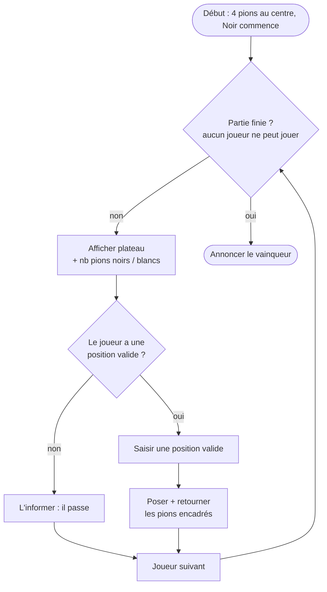

# TP Othello — Réaliser le jeu complet

> 🎯 **Objectif** : transformer ton analyse du TD en un **programme complet** : documentation + tests + code + **jar exécutable**.
> 📝 Préparation : le [TD Othello](../../02-TD/TD-othello/enonce.md) doit être fait.
> 📚 Cours : [04 — Exceptions](../../01-Cours/04-exceptions.md) · [05 — Polymorphisme et interfaces](../../01-Cours/05-polymorphisme-et-interfaces.md) · [07 — Collections](../../01-Cours/07-collections.md) · 🛠️ [Memento](../../05-Fiches/memento-commandes.md)

## ✅ Travail demandé

- [ ] **Q1.** Réaliser le programme (javadoc, tests, code) correspondant à ton analyse du TD.
- [ ] **Q2.** Déposer sur GitLab les fichiers du TP.

## 🧩 Découpage conseillé (un commit par étape)

| Étape | Classe(s) | Tests à écrire |
|---|---|---|
| 1 | `Color` (enum BLACK/WHITE), `Pawn` | couleur, `equals` |
| 2 | `Position` + `Direction` (enum des 8 directions) | `neighbour(Direction)` dans chaque direction |
| 3 | `Board` | poser/retirer un pion ; `InvalidPositionException` hors plateau |
| 4 | `Player` | — |
| 5 | `OthelloGame` : `canPlayAt()`, pose + retournement | encadrements dans plusieurs directions, cas sans encadrement |
| 6 | `OthelloMain` : boucle de jeu, saisie clavier | — (tester à la main) |
| 7 | jar exécutable | — |

## 🔁 Boucle de jeu



## 📤 `README.md` du TP doit contenir
- [ ] commandes : javadoc, compilation (src + tests), exécution des tests, exécution du jeu ;
- [ ] la commande de création du **jar exécutable** et son lancement :
  ```bash
  jar cvfe othello.jar othello.OthelloMain -C classes .
  java -jar othello.jar
  ```
- [ ] section « Intelligence Artificielle générative ».

---
📂 Ton code : [`src/`](./src/) · [`test/`](./test/) · 🏠 [Sommaire](../../README.md)
