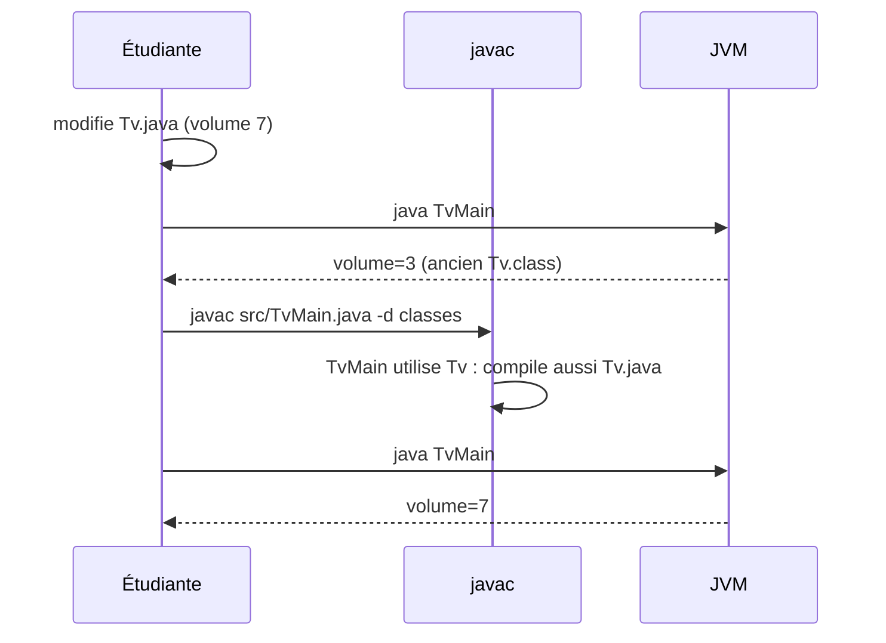
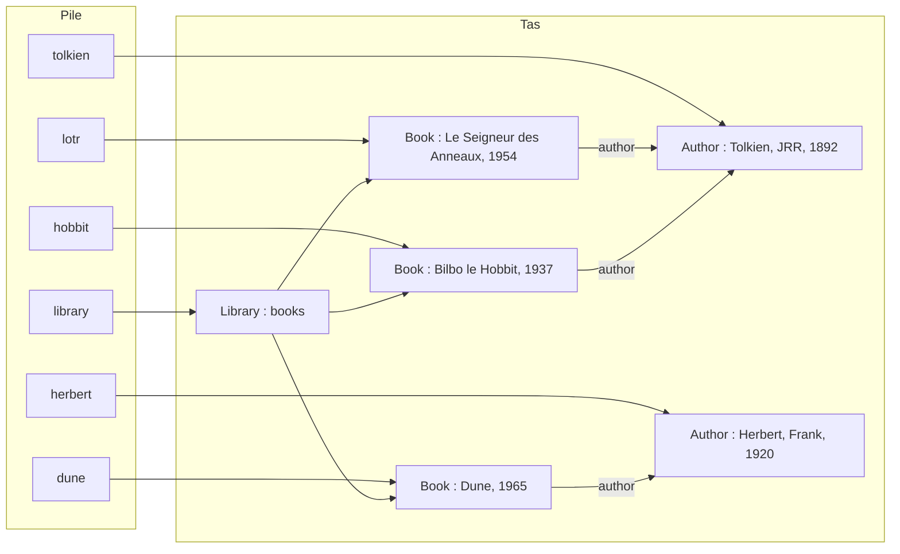
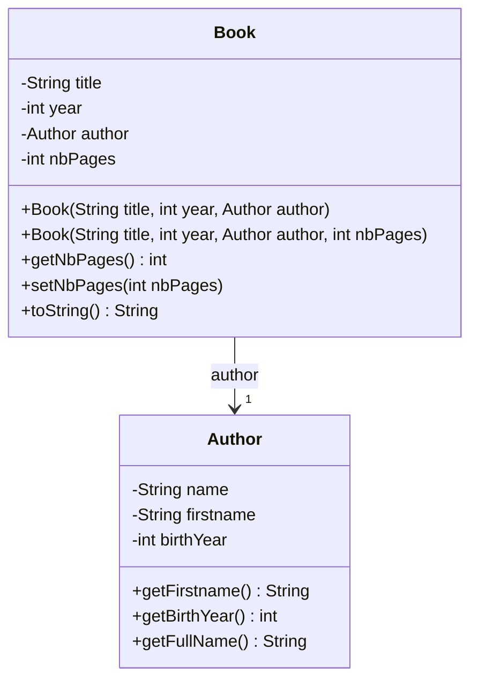
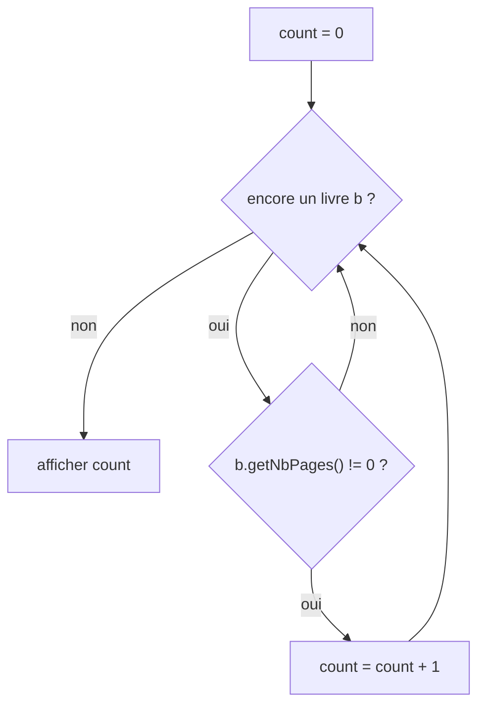

# TP1 — Corrigé : premières compilations, `Tv` et `Library`

📄 [Énoncé](./ENONCE.md) · 📚 [Cours 01 — Classes et objets](../../01-Cours/01-classes-et-objets.md) · 🛠️ [Memento des commandes](../../05-Fiches/memento-commandes.md)

> ⚠️ **Corrigé non officiel**, rédigé pour réviser. Tout le code ci-dessous a été **compilé et exécuté** (Java 21) : les traces affichées sont les vraies sorties.
> 📌 **Hypothèse** : le code fourni en TP (`Tv`, `TvMain`, `Book`, `Author`, `Library`) n'est pas dans ce dépôt. Le corrigé utilise une version **plausible minimale**. **Le code fourni peut différer légèrement (noms d'attributs, format de `toString()`)** : adapte les noms, la démarche reste la même.

## 🗺️ Vue d'ensemble

| Ex. | Ce qu'il faut retenir |
|---|---|
| 1 | `javac` produit un `.class` (bytecode) ; une erreur de compilation ⇒ **aucun** `.class` ; toujours `-sourcepath src … -d classes` |
| 2 | on **compile un fichier** (`src/TvMain.java`), on **exécute une classe** (`TvMain`) |
| 3 | modifier un `.java` sans recompiler ⇒ rien ne change ; `javac` compile aussi les classes **utilisées** |
| 4 | accesseurs, 2ᵉ constructeur avec `this(...)`, `toString()` conditionnel, compter avec une boucle |

<details><summary>📌 La classe <code>Tv</code> utilisée pour ce corrigé (hypothèse)</summary>

```java
/** a television that can be turned on/off, with a channel and a sound volume */
public class Tv {
    private boolean on;
    private int channel;
    private int soundVolume;

    /** build a tv, turned off, on channel 1 */
    public Tv() {
        this.on = false;
        this.channel = 1;
        this.soundVolume = 3;
    }

    /** build a tv, turned off, on given channel
     * @param channel the initial channel */
    public Tv(int channel) {
        this.on = false;
        this.channel = channel;
        this.soundVolume = 3;
    }

    /** turn this tv on */
    public void on() {
        this.on = true;
    }

    /** @return true iff this tv is on */
    public boolean isOn() {
        return this.on;
    }

    /** @return the current channel */
    public int getChannel() {
        return this.channel;
    }

    /** change the channel
     * @param channel the new channel */
    public void setChannel(int channel) {
        this.channel = channel;
    }

    /** @return the sound volume */
    public int getSoundVolume() {
        return this.soundVolume;
    }

    /** @return a description of this tv */
    public String toString() {
        return "Tv (on=" + this.on + ", channel=" + this.channel + ", volume=" + this.soundVolume + ")";
    }
}
```

```java
public class TvMain {
    public static void main(String[] args) {
        Tv tv1 = new Tv();
        Tv tv2 = new Tv(5);
        tv1.on();
        tv2.setChannel(8);
        System.out.println(tv1);
        System.out.println(tv2);
    }
}
```

</details>

---

## Exercice 1 — Premières compilations

### Q1. `javac Tv.java` dans `src/`

```bash
cd tv/src            # ici : 03-TP/TP1-tv-library/src
javac Tv.java
ls
```
```text
Tv.class
Tv.java
```
💡 Si tout va bien, `javac` **n'affiche rien** : il crée simplement `Tv.class` **à côté** de `Tv.java`.

### Q2. Contenu de `Tv.class`

💡 C'est du **bytecode** (binaire pour la JVM) : illisible dans un éditeur, à part quelques noms (`Tv`, `on`, `java/lang/Object`…).
- 📌 Curiosité : tout `.class` commence par les octets `CA FE BA BE` (« café babe »).
- On ne modifie **jamais** un `.class` à la main : on modifie le `.java` puis on recompile.

### Q3. Erreur de compilation

Code ajouté (avec les 2 fautes) :

```java
/** turn this tv off */
public void off() {
    this.on = False
}
```

```bash
rm Tv.class
javac Tv.java
```
Message obtenu (le n° de ligne dépend de l'endroit où tu as collé la méthode) :
```text
Tv.java:29: error: ';' expected
        this.on = False
                       ^
1 error
```
- **Quelle ligne ?** celle de `this.on = False` (ici 29) ; le `^` montre **où** le `;` manque.
- **Quelle erreur ?** `';' expected` = erreur de **syntaxe** ; `ls` montre qu'**aucun** `Tv.class` n'est créé.

⚠️ Si on corrige **seulement** le `;`, une **2ᵉ** erreur apparaît :
```text
Tv.java:29: error: cannot find symbol
        this.on = False;
                  ^
  symbol:   variable False
  location: class Tv
1 error
```
💡 `javac` vérifie d'abord la **syntaxe**, puis les **noms et types**. `False` n'existe pas en Java : les booléens s'écrivent `true` / `false` (minuscules).

Correction :
```java
/** turn this tv off */
public void off() {
    this.on = false;
}
```

### Q4. Séparer `src/` et `classes/`

```bash
cd ..                                   # retour dans tv/ (le dossier du TP)
rm src/Tv.class                         # on nettoie src/
javac -sourcepath src src/Tv.java -d classes
ls classes src
```
```text
classes:
Tv.class

src:
Tv.java
TvMain.java
```
💡 `-sourcepath src` = où chercher les `.java` ; `-d classes` = où **ranger** les `.class`. `src/` ne contient plus que des sources.
📌 Si `classes/` n'existe pas, `javac -d` le crée en général ; sinon `mkdir classes`.

---

## Exercice 2 — Première exécution

### Q1. Le `main`

💡 `public static void main(String[] args)` est le **point d'entrée** : c'est la méthode que la JVM lance. `System.out.println(tv1)` affiche `tv1.toString()`.

### Q2–Q3. Compiler puis exécuter

```bash
javac -sourcepath src src/TvMain.java -d classes
java -classpath classes TvMain
```
```text
Tv (on=true, channel=1, volume=3)
Tv (on=false, channel=8, volume=3)
```
*(affichage de ma version de `Tv` : le `toString()` fourni peut écrire autre chose)*

| | Compiler (`javac`) | Exécuter (`java`) |
|---|---|---|
| On donne | un **fichier** : `src/TvMain.java` | une **classe** : `TvMain` |
| Option de chemin | `-sourcepath src` + `-d classes` | `-classpath classes` |
| Extension | `.java` obligatoire | **aucune** (ni `.java` ni `.class`) |

---

## Exercice 3 — Seconde compilation

### Q1. Modifier sans recompiler

Dans **les deux** constructeurs : `this.soundVolume = 7;` puis, **sans** recompiler :
```bash
java -classpath classes TvMain
```
```text
Tv (on=true, channel=1, volume=3)
Tv (on=false, channel=8, volume=3)
```
💡 Rien ne change : la JVM exécute `classes/Tv.class`, qui date d'**avant** la modification.

### Q2. Compiler seulement `TvMain`

```bash
rm classes/*
javac -sourcepath src src/TvMain.java -d classes
ls classes
```
```text
Tv.class
TvMain.class
```
💡 `TvMain` **utilise** `Tv` ⇒ `javac` trouve `src/Tv.java` (grâce à `-sourcepath src`) et le compile aussi : c'est la **clôture transitive des dépendances**.

### Q3. Vérifier

```bash
java -classpath classes TvMain
```
```text
Tv (on=true, channel=1, volume=7)
Tv (on=false, channel=8, volume=7)
```



---

## Exercice 4 — `Book`, `Author`, `Library`

### Q1. Lecture du code

| Classe | Attributs | Remarque |
|---|---|---|
| `Book` | `String title`, `int year`, `Author author` | `author` est une **référence** vers un objet `Author` |
| `Author` | `String name`, `String firstname`, `int birthYear` | |
| `Library` | une **collection de `Book`** (ici `ArrayList<Book> books`) | selon le code fourni : liste ou tableau |

Méthodes de `Library` (ma version) : constructeur (bibliothèque vide), `addBook(Book b)`, `getBooks()`, `toString()`.

<details><summary>📌 Les classes de départ utilisées (hypothèse)</summary>

```java
/** an author of books */
public class Author {
    private String name;
    private String firstname;
    private int birthYear;

    /** build an author
     * @param name the name of the author
     * @param firstname the firstname of the author
     * @param birthYear the birth year of the author */
    public Author(String name, String firstname, int birthYear) {
        this.name = name;
        this.firstname = firstname;
        this.birthYear = birthYear;
    }

    /** @return the name of this author */
    public String getName() {
        return this.name;
    }

    /** @return a description of this author */
    public String toString() {
        return this.firstname + " " + this.name + " (" + this.birthYear + ")";
    }
}
```

```java
/** a book with a title, a publication year and an author */
public class Book {
    private String title;
    private int year;
    private Author author;

    /** build a book
     * @param title the title of the book
     * @param year the publication year
     * @param author the author of the book */
    public Book(String title, int year, Author author) {
        this.title = title;
        this.year = year;
        this.author = author;
    }

    /** @return the title of this book */
    public String getTitle() {
        return this.title;
    }

    /** @return the publication year of this book */
    public int getYear() {
        return this.year;
    }

    /** @return the author of this book */
    public Author getAuthor() {
        return this.author;
    }

    /** @return a description of this book */
    public String toString() {
        return this.title + " (" + this.year + "), by " + this.author;
    }
}
```

```java
import java.util.ArrayList;

/** a library that stores books */
public class Library {
    private ArrayList<Book> books;

    /** build an empty library */
    public Library() {
        this.books = new ArrayList<Book>();
    }

    /** add a book to this library
     * @param b the book to add */
    public void addBook(Book b) {
        this.books.add(b);
    }

    /** @return the books of this library */
    public ArrayList<Book> getBooks() {
        return this.books;
    }

    /** @return a description of this library, one book per line */
    public String toString() {
        String result = "Library of " + this.books.size() + " books:";
        for (Book b : this.books) {
            result = result + "\n - " + b;
        }
        return result;
    }
}
```

</details>

### Q2. Compiler les 3 classes

```bash
javac -sourcepath src src/*.java -d classes
```

### Q3–Q5. `LibraryMain` (première version)

```java
public class LibraryMain {
    public static void main(String[] args) {
        // Q3-Q4
        Author tolkien = new Author("Tolkien", "JRR", 1892);
        Book lotr = new Book("Le Seigneur des Anneaux", 1954, tolkien);
        System.out.println(lotr);

        // Q5
        Book hobbit = new Book("Bilbo le Hobbit", 1937, tolkien);
        Author herbert = new Author("Herbert", "Frank", 1920);
        Book dune = new Book("Dune", 1965, herbert);

        Library library = new Library();
        library.addBook(lotr);
        library.addBook(hobbit);
        library.addBook(dune);
        System.out.println(library);
    }
}
```
```bash
javac -sourcepath src src/LibraryMain.java -d classes
java -classpath classes LibraryMain
```
```text
Le Seigneur des Anneaux (1954), by JRR Tolkien (1892)
Library of 3 books:
 - Le Seigneur des Anneaux (1954), by JRR Tolkien (1892)
 - Bilbo le Hobbit (1937), by JRR Tolkien (1892)
 - Dune (1965), by Frank Herbert (1920)
```
💡 `println(lotr)` appelle `lotr.toString()`, qui appelle lui-même `author.toString()` (concaténation `"..." + this.author`) : c'est un **envoi de message** en cascade.

Les deux livres de Tolkien partagent **le même** objet `Author` :



### Q6–Q7. `Author` : `getFirstname()`, `getBirthYear()`, nom complet

```java
/** an author of books */
public class Author {
    private String name;
    private String firstname;
    private int birthYear;

    /** build an author
     * @param name the name of the author
     * @param firstname the firstname of the author
     * @param birthYear the birth year of the author */
    public Author(String name, String firstname, int birthYear) {
        this.name = name;
        this.firstname = firstname;
        this.birthYear = birthYear;
    }

    /** @return the name of this author */
    public String getName() {
        return this.name;
    }

    /** @return the firstname of this author */
    public String getFirstname() {
        return this.firstname;
    }

    /** @return the birth year of this author */
    public int getBirthYear() {
        return this.birthYear;
    }

    /** @return the full name of this author: name followed by firstname */
    public String getFullName() {
        return this.name + " " + this.firstname;
    }

    /** @return a description of this author */
    public String toString() {
        return this.firstname + " " + this.name + " (" + this.birthYear + ")";
    }
}
```
💡 Un accesseur (« getter ») renvoie simplement la valeur d'un attribut `private` : l'extérieur peut **lire** sans pouvoir **modifier**.
💡 `getFullName()` construit le nom complet « nom + prénom » (ex. `Herbert Frank`) : c'est un calcul, pas un nouvel attribut.

### Q9. `Book` : `nbPages`, accesseurs, 2ᵉ constructeur, `toString()` conditionnel

```java
/** a book with a title, a publication year, an author and a number of pages */
public class Book {
    private String title;
    private int year;
    private Author author;
    private int nbPages;

    /** build a book whose number of pages is unknown (0)
     * @param title the title of the book
     * @param year the publication year
     * @param author the author of the book */
    public Book(String title, int year, Author author) {
        this(title, year, author, 0);
    }

    /** build a book with a known number of pages
     * @param title the title of the book
     * @param year the publication year
     * @param author the author of the book
     * @param nbPages the number of pages of the book */
    public Book(String title, int year, Author author, int nbPages) {
        this.title = title;
        this.year = year;
        this.author = author;
        this.nbPages = nbPages;
    }

    /** @return the title of this book */
    public String getTitle() {
        return this.title;
    }

    /** @return the publication year of this book */
    public int getYear() {
        return this.year;
    }

    /** @return the author of this book */
    public Author getAuthor() {
        return this.author;
    }

    /** @return the number of pages of this book, 0 if unknown */
    public int getNbPages() {
        return this.nbPages;
    }

    /** change the number of pages of this book
     * @param nbPages the new number of pages */
    public void setNbPages(int nbPages) {
        this.nbPages = nbPages;
    }

    /** @return a description of this book (number of pages only if known) */
    public String toString() {
        String result = this.title + " (" + this.year + "), by " + this.author;
        if (this.nbPages != 0) {
            result = result + ", " + this.nbPages + " pages";
        }
        return result;
    }
}
```
- 💡 **2 constructeurs** différenciés par leurs paramètres. Le premier **délègue** au second avec `this(title, year, author, 0)` (1ʳᵉ instruction obligatoire) : pas de code dupliqué, et `nbPages` vaut bien **0**.
- 💡 `toString()` : on construit la chaîne de base, puis on **ajoute** les pages **seulement si** `nbPages != 0`.
- 📌 Variante acceptée : écrire le 1er constructeur « à la main » avec `this.nbPages = 0;`.



### Q11 et Q13. `LibraryMain` (version finale) et livres dont le nombre de pages est connu

`Library` complète (méthode ajoutée : `numberOfBooksWithKnownNbPages()`) :

```java
import java.util.ArrayList;

/** a library that stores books */
public class Library {
    private ArrayList<Book> books;

    /** build an empty library */
    public Library() {
        this.books = new ArrayList<Book>();
    }

    /** add a book to this library
     * @param b the book to add */
    public void addBook(Book b) {
        this.books.add(b);
    }

    /** @return the books of this library */
    public ArrayList<Book> getBooks() {
        return this.books;
    }

    /** @return the number of books of this library whose number of pages is known (not 0) */
    public int numberOfBooksWithKnownNbPages() {
        int count = 0;
        for (Book b : this.books) {
            if (b.getNbPages() != 0) {
                count = count + 1;
            }
        }
        return count;
    }

    /** @return a description of this library, one book per line */
    public String toString() {
        String result = "Library of " + this.books.size() + " books:";
        for (Book b : this.books) {
            result = result + "\n - " + b;
        }
        return result;
    }
}
```

```java
public class LibraryMain {
    public static void main(String[] args) {
        Author tolkien = new Author("Tolkien", "JRR", 1892);
        Author herbert = new Author("Herbert", "Frank", 1920);

        // Q11 : 2e constructeur pour le Seigneur des Anneaux
        Book lotr = new Book("Le Seigneur des Anneaux", 1954, tolkien, 1600);
        Book hobbit = new Book("Bilbo le Hobbit", 1937, tolkien);
        Book dune = new Book("Dune", 1965, herbert);
        System.out.println(lotr);
        System.out.println(hobbit);

        // Q11 : nombre de pages fixé APRES la création
        hobbit.setNbPages(408);
        System.out.println(hobbit);

        // Q6-Q7 : nouveaux accesseurs de Author
        System.out.println(tolkien.getFirstname() + " est né en " + tolkien.getBirthYear());
        System.out.println("Nom complet : " + herbert.getFullName());

        Library library = new Library();
        library.addBook(lotr);
        library.addBook(hobbit);
        library.addBook(dune);
        System.out.println(library);

        // Q13
        System.out.println("Livres dont le nombre de pages est connu : "
                           + library.numberOfBooksWithKnownNbPages());
    }
}
```
```bash
javac -sourcepath src src/*.java -d classes
java -classpath classes LibraryMain
```
```text
Le Seigneur des Anneaux (1954), by JRR Tolkien (1892), 1600 pages
Bilbo le Hobbit (1937), by JRR Tolkien (1892)
Bilbo le Hobbit (1937), by JRR Tolkien (1892), 408 pages
JRR est né en 1892
Nom complet : Herbert Frank
Library of 3 books:
 - Le Seigneur des Anneaux (1954), by JRR Tolkien (1892), 1600 pages
 - Bilbo le Hobbit (1937), by JRR Tolkien (1892), 408 pages
 - Dune (1965), by Frank Herbert (1920)
Livres dont le nombre de pages est connu : 2
```
- 💡 Q11 : le Seigneur des Anneaux utilise le **2ᵉ constructeur** ; Bilbo est créé **sans** pages (`toString()` ne les affiche pas), puis `setNbPages(408)` **modifie l'objet** déjà créé.
- 💡 Q13 : schéma « compteur » : `count = 0`, on parcourt les livres, `+1` si `getNbPages() != 0`. Résultat **2** (Dune est inconnu).

Variante, sans toucher à `Library`, directement dans le `main` (même boucle sur `getBooks()`) :

```java
int count = 0;
for (Book b : library.getBooks()) {
    if (b.getNbPages() != 0) {
        count++;
    }
}
System.out.println("Livres dont le nombre de pages est connu : " + count);
```
📌 Si le code fourni stocke les livres dans un **tableau** `Book[]`, la boucle `for (Book b : ...)` s'écrit exactement pareil.



---

## ⚠️ Erreurs fréquentes

| Erreur | Pourquoi c'est faux | Correction |
|---|---|---|
| `this.on = False` | `False` n'existe pas en Java | `false` (minuscule) |
| oublier le `;` | erreur de syntaxe, aucun `.class` produit | lire la ligne indiquée par `javac` |
| `java -classpath classes TvMain.class` | `java` attend une **classe**, pas un fichier | `java -classpath classes TvMain` |
| `javac TvMain` (sans `.java`) | `javac` attend un **fichier** | `javac -sourcepath src src/TvMain.java -d classes` |
| lancer les commandes depuis `src/` | les chemins `src/...` et `classes` ne marchent plus | se placer dans le dossier du TP |
| modifier sans recompiler | la JVM utilise l'ancien `.class` | recompiler **après chaque** modification |
| 2ᵉ constructeur qui recopie tout le code | duplication, risque d'oubli | `this(title, year, author, 0);` en 1ʳᵉ ligne |
| `this(...)` pas en 1ʳᵉ ligne | erreur de compilation | toujours la 1ʳᵉ instruction du constructeur |
| `toString()` qui affiche « 0 pages » | l'énoncé demande d'afficher seulement si ≠ 0 | `if (this.nbPages != 0)` |
| `getFirstname` qui fait `System.out.println` | un accesseur **renvoie** une valeur | `return this.firstname;` |

---
📄 [Énoncé](./ENONCE.md) · 🏠 [Sommaire](../../README.md)
