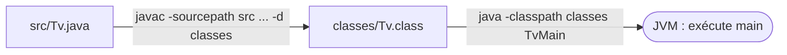
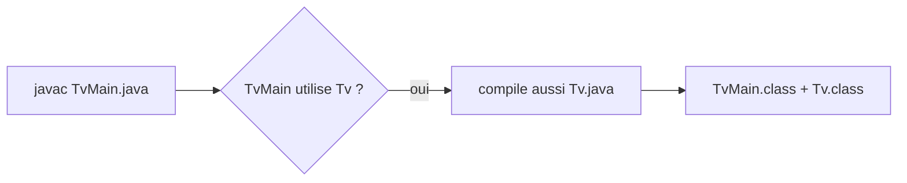
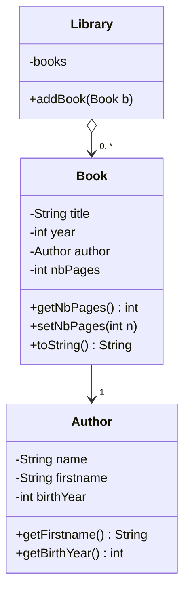

# TP1 — Premières compilations : `Tv` et `Library`

> 🎯 **Objectifs** : compiler (`javac`), exécuter (`java`), séparer `src/` et `classes/`, écrire ses premières classes.
> 📚 Cours : [01 — Classes et objets](../../01-Cours/01-classes-et-objets.md) · 🛠️ [Memento des commandes](../../05-Fiches/memento-commandes.md)

## 🗺️ Plan du TP

| Ex. | Thème | Ce que tu apprends |
|---|---|---|
| 1 | Compiler `Tv` | `javac`, lire une erreur de compilation, options `-sourcepath` / `-d` |
| 2 | Exécuter `TvMain` | `java -classpath`, la méthode `main` |
| 3 | Recompiler | modifier ⇒ recompiler ; compilation des dépendances |
| 4 | `Book`, `Author`, `Library` | accesseurs, 2ᵉ constructeur, `toString()` |



---

## Exercice 1 — Premières compilations

- [ ] **Q1.** Dans `tv/src/`, lance `javac Tv.java`. Que voit-on apparaître ?
- [ ] **Q2.** Ouvre `Tv.class` dans un éditeur. Qu'observe-t-on ? *(du bytecode, illisible)*
- [ ] **Q3.** Supprime `Tv.class`, puis ajoute dans `Tv.java` :
  ```java
  /** turn this tv off */
  public void off() {
      this.on = False
  }
  ```
  Compile → lis le message : **quelle ligne ? quelle erreur ?** Aucun `.class` n'est créé. Corrige (`false`, `;`) et recompile.
- [ ] **Q4. Bonne pratique** : sources dans `src/`, compilés dans `classes/`. Depuis `tv/` :
  ```bash
  javac -sourcepath src src/Tv.java -d classes
  ```
  Vérifie le contenu de `classes/` et que `src/` n'a pas changé.

> ✅ À partir de maintenant, **toujours** compiler ainsi.

## Exercice 2 — Première exécution

- [ ] **Q1.** Ouvre `TvMain.java` : repère `public static void main(String[] args)`.
  💡 `System.out.println(tv1)` appelle automatiquement `tv1.toString()`.
- [ ] **Q2.** Compile : `javac -sourcepath src src/TvMain.java -d classes`
- [ ] **Q3.** Exécute : `java -classpath classes TvMain`

| | Compiler | Exécuter |
|---|---|---|
| On donne | un **fichier** (`src/TvMain.java`) | une **classe** (`TvMain`) |

> ✅ Bonne pratique : mettre le `main` dans une classe dédiée (`XxxMain`).

## Exercice 3 — Seconde compilation

- [ ] **Q1.** Dans les constructeurs de `Tv`, change `soundVolume` de 3 à 7. Exécute **sans** recompiler → rien ne change.
- [ ] **Q2.** Vide `classes/`, compile **seulement** `TvMain.java` → `Tv.class` est aussi créé.
- [ ] **Q3.** Exécute pour vérifier la modification.


💡 C'est la « clôture transitive des dépendances ». Tout compiler : `javac -sourcepath src src/*.java -d classes`

## Exercice 4 — `Book`, `Author`, `Library`


*(les membres à ajouter pendant le TP sont inclus)*

- [ ] **Q1.** Lis le code : attributs de `Book` (types ?), structure qui stocke les livres dans `Library`, méthodes de `Library`.
- [ ] **Q2.** Compile les 3 classes.
- [ ] **Q3–Q4.** Crée `LibraryMain` : un `Book` « Le Seigneur des Anneaux » (1954, JRR Tolkien né en 1892) → affiche-le.
- [ ] **Q5.** Ajoute « Bilbo le Hobbit » (1937, Tolkien) et « Dune » (1965, Frank Herbert né en 1920) ; mets-les dans une `Library` ; affiche-la.
- [ ] **Q6.** Dans `Author` : ajoute `getFirstname()` et `getBirthYear()`.
- [ ] **Q7.** Ajoute une méthode qui renvoie le **nom complet** (nom + prénom).
- [ ] **Q9.** Dans `Book` :
  - attribut `nbPages` (initialisé à **0** par le constructeur existant) ;
  - `getNbPages()` / `setNbPages(int)` ;
  - **2ᵉ constructeur** avec `nbPages` en paramètre ;
  - `toString()` affiche le nombre de pages **seulement s'il ≠ 0**.
- [ ] **Q11.** Seigneur des Anneaux créé avec **1600** pages ; Bilbo passé à **408** pages *après* sa création (`setNbPages`).
- [ ] **Q13.** Calcule et affiche le **nombre de livres dont le nombre de pages est connu** (≠ 0).

> ⚠️ Recompile et exécute après **chaque** question.

---
📂 Ton code : [`src/`](./src/) · 🏠 [Sommaire](../../README.md)
