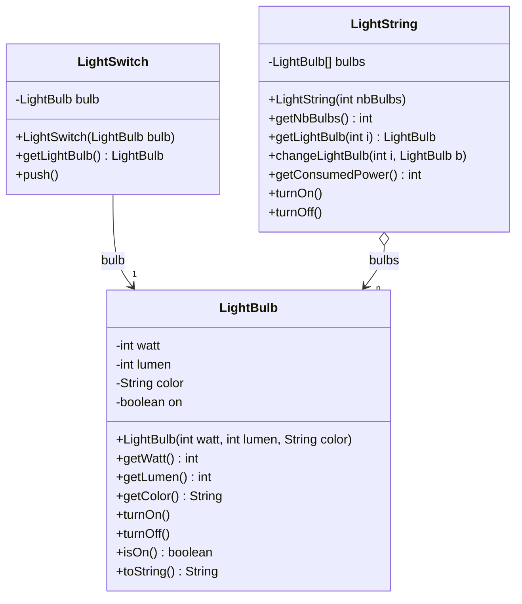
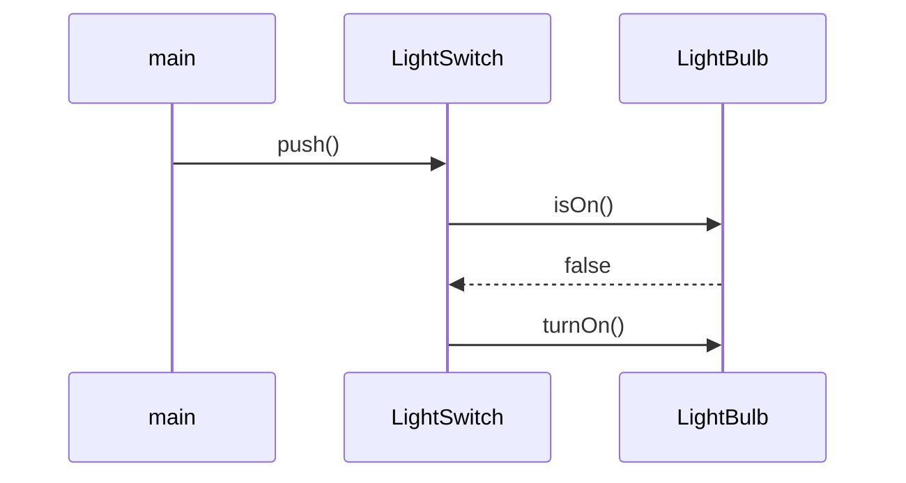
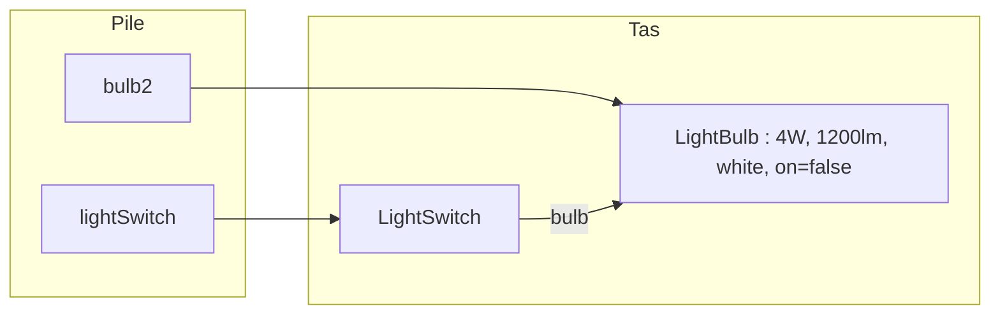

# TP2 — Corrigé : ampoules, interrupteurs et guirlandes

📄 [Énoncé](./ENONCE.md) · 📚 [Cours 01 — Classes et objets](../../01-Cours/01-classes-et-objets.md) · 🛠️ [Memento](../../05-Fiches/memento-commandes.md)

> ⚠️ **Corrigé non officiel**, rédigé pour réviser. Tout le code a été **compilé** (Java 21), la javadoc générée **sans aucun warning**, et les programmes **exécutés** : les traces sont les vraies sorties.
> D'autres réponses justes sont possibles (noms de méthodes « en plus », texte de `toString()`…).

## 🗺️ Vue d'ensemble



Commandes (depuis le dossier du TP, ex. `tp2/light/`) :
```bash
javac -sourcepath src src/*.java -d classes
javadoc -d docs src/*.java
java -classpath classes LightBulbMain
java -classpath classes LightStringMain
```

---

## Exercice 1 — `LightBulb`

### Q1. Spécification

💡 **On spécifie AVANT de coder** : ce que l'objet **sait** (attributs) et ce qu'il **sait faire** (méthodes).

| Élément | Choix | Justification |
|---|---|---|
| attribut `watt` | `int` | puissance consommée (W) |
| attribut `lumen` | `int` | puissance lumineuse (lm) |
| attribut `color` | `String` | couleur (« white », « yellow »…) |
| attribut `on` | `boolean` | 2 états : allumée (`true`) / éteinte (`false`) |
| constructeur | `LightBulb(int watt, int lumen, String color)` | **pas** de paramètre pour l'état : toujours **éteinte** à la création |

| Méthode | Rôle |
|---|---|
| `int getWatt()`, `int getLumen()`, `String getColor()` | accesseurs |
| `void turnOn()` / `void turnOff()` | allumer / éteindre |
| `boolean isOn()` | allumée ? |
| `String toString()` | description |

### Q2–Q4. Code (javadoc d'abord)

```java
/**
 * A light bulb, characterized by its power (in watts), its luminous flux
 * (in lumens) and its color. A light bulb can be turned on or off.
 */
public class LightBulb {
    /** consumed power, in watts */
    private int watt;
    /** luminous flux, in lumens */
    private int lumen;
    /** color of the light */
    private String color;
    /** true iff this light bulb is on */
    private boolean on;

    /**
     * Builds a light bulb, turned off.
     * @param watt the consumed power, in watts
     * @param lumen the luminous flux, in lumens
     * @param color the color of the light
     */
    public LightBulb(int watt, int lumen, String color) {
        this.watt = watt;
        this.lumen = lumen;
        this.color = color;
        this.on = false;
    }

    /**
     * Gives the consumed power of this light bulb.
     * @return the consumed power of this light bulb, in watts
     */
    public int getWatt() {
        return this.watt;
    }

    /**
     * Gives the luminous flux of this light bulb.
     * @return the luminous flux of this light bulb, in lumens
     */
    public int getLumen() {
        return this.lumen;
    }

    /**
     * Gives the color of this light bulb.
     * @return the color of this light bulb
     */
    public String getColor() {
        return this.color;
    }

    /**
     * Turns this light bulb on (no effect if it is already on).
     */
    public void turnOn() {
        this.on = true;
    }

    /**
     * Turns this light bulb off (no effect if it is already off).
     */
    public void turnOff() {
        this.on = false;
    }

    /**
     * Tells if this light bulb is on.
     * @return true if this light bulb is on, false otherwise
     */
    public boolean isOn() {
        return this.on;
    }

    /**
     * Describes this light bulb: color, power, luminous flux and state.
     * @return a description of this light bulb
     */
    public String toString() {
        String state;
        if (this.on) {
            state = "on";
        } else {
            state = "off";
        }
        return this.color + " light bulb " + this.watt + "W " + this.lumen + "lm (" + state + ")";
    }
}
```
- 💡 `this.on = false;` dans le constructeur traduit « **éteinte à la création** » (c'est aussi la valeur par défaut d'un `boolean`, mais l'écrire rend l'intention claire).
- 💡 `turnOn()` / `turnOff()` sont **idempotentes** : les appeler deux fois ne pose aucun problème.

### Q5–Q6. Javadoc sans warning, compilation

```bash
javadoc -d docs src/LightBulb.java
javac -sourcepath src src/LightBulb.java -d classes
```
⚠️ Avec un JDK récent (vérifié avec Java 21), `/** @return ... */` **seul** donne `warning: no main description` : il faut **une phrase de description** avant le `@return` (d'où « Gives the color of this light bulb. »).

### Q7. Programme (avec l'Ex. 2 Q3)

```java
/**
 * Program that uses a light bulb and a light switch.
 */
public class LightBulbMain {
    /** No instance of this class: it only contains the main method. */
    private LightBulbMain() {
    }

    /**
     * Main method.
     * @param args not used
     */
    public static void main(String[] args) {
        // Ex1 Q7
        LightBulb bulb = new LightBulb(4, 1200, "white");
        System.out.println(bulb);
        bulb.turnOn();
        System.out.println(bulb);

        // Ex2 Q3 : via l'interrupteur
        LightBulb bulb2 = new LightBulb(4, 1200, "white");
        LightSwitch lightSwitch = new LightSwitch(bulb2);
        System.out.println(lightSwitch.getLightBulb());
        lightSwitch.push();
        System.out.println(lightSwitch.getLightBulb());
        lightSwitch.push();
        System.out.println(lightSwitch.getLightBulb());
    }
}
```
```bash
java -classpath classes LightBulbMain
```
```text
white light bulb 4W 1200lm (off)
white light bulb 4W 1200lm (on)
white light bulb 4W 1200lm (off)
white light bulb 4W 1200lm (on)
white light bulb 4W 1200lm (off)
```
💡 Le constructeur `private LightBulbMain()` sert seulement à éviter le warning javadoc « *use of default constructor, which does not provide a comment* » : cette classe ne sert qu'à porter le `main`, on n'en crée jamais d'instance.

---

## Exercice 2 — `LightSwitch`

### Q1. Spécification et code

| Élément | Choix |
|---|---|
| attribut | `LightBulb bulb` : **référence** vers l'ampoule contrôlée (comme l'`Author` d'un `Book`) |
| constructeur | `LightSwitch(LightBulb bulb)` : l'ampoule est **donnée**, pas créée |
| `LightBulb getLightBulb()` | renvoie l'ampoule contrôlée |
| `void push()` | allume si éteinte, éteint si allumée |

```java
/**
 * A light switch, that controls one light bulb.
 */
public class LightSwitch {
    /** the light bulb controlled by this switch */
    private LightBulb bulb;

    /**
     * Builds a switch that controls the given light bulb.
     * @param bulb the light bulb controlled by this switch
     */
    public LightSwitch(LightBulb bulb) {
        this.bulb = bulb;
    }

    /**
     * Gives the light bulb controlled by this switch.
     * @return the light bulb controlled by this switch
     */
    public LightBulb getLightBulb() {
        return this.bulb;
    }

    /**
     * Pushes this switch: turns the light bulb on if it is off,
     * turns it off if it is on.
     */
    public void push() {
        if (this.bulb.isOn()) {
            this.bulb.turnOff();
        } else {
            this.bulb.turnOn();
        }
    }
}
```
💡 `push()` ne touche **pas** à l'attribut `on` de l'ampoule (il est `private` dans `LightBulb`) : il **envoie des messages** à l'ampoule (`isOn()`, `turnOn()`, `turnOff()`).



### Q2. Javadoc de toutes les classes

```bash
javadoc -d docs src/*.java
```
Ouvrir `docs/package-summary.html` (ou `docs/index.html`) : les 5 classes y apparaissent, **0 warning**.

### Q3. Allumer via l'interrupteur

Voir `LightBulbMain` ci-dessus (lignes 3 à 5 de la trace) : `lightSwitch.push()` allume, un 2ᵉ `push()` éteint.

📌 L'interrupteur et la variable `bulb2` désignent **le même** objet ampoule :



---

## Exercice 3 — `LightString`

### Q1–Q2. Code

```java
/**
 * A light string made of light bulbs. Bulbs are numbered from 1.
 */
public class LightString {
    /** the light bulbs of this light string */
    private LightBulb[] bulbs;

    /**
     * Builds a light string with the given number of light bulbs.
     * Each bulb is white, 1 watt, 100 lumens, and is turned off.
     * @param nbBulbs the number of light bulbs of this light string
     */
    public LightString(int nbBulbs) {
        this.bulbs = new LightBulb[nbBulbs];
        for (int i = 0; i < this.bulbs.length; i++) {
            this.bulbs[i] = new LightBulb(1, 100, "white");
        }
    }

    /**
     * Gives the number of light bulbs of this light string.
     * @return the number of light bulbs of this light string
     */
    public int getNbBulbs() {
        return this.bulbs.length;
    }

    /**
     * Returns the i-th light bulb of this light string (the first one is number 1).
     * @param i the number of the light bulb
     * @return the i-th light bulb, or null if i is not a valid number
     */
    public LightBulb getLightBulb(int i) {
        if (i >= 1 && i <= this.bulbs.length) {
            return this.bulbs[i - 1];
        } else {
            return null;
        }
    }

    /**
     * Replaces the i-th light bulb of this light string (the first one is number 1).
     * Nothing happens if i is not a valid number.
     * @param i the number of the light bulb to replace
     * @param b the new light bulb
     */
    public void changeLightBulb(int i, LightBulb b) {
        if (i >= 1 && i <= this.bulbs.length) {
            this.bulbs[i - 1] = b;
        }
    }

    /**
     * Gives the power consumed by this light string.
     * @return the power consumed by this light string, in watts: the sum
     *         of the power of the light bulbs that are on (bulbs that are
     *         off consume nothing)
     */
    public int getConsumedPower() {
        int power = 0;
        for (LightBulb b : this.bulbs) {
            if (b.isOn()) {
                power = power + b.getWatt();
            }
        }
        return power;
    }

    /**
     * Turns on all the light bulbs of this light string.
     */
    public void turnOn() {
        for (LightBulb b : this.bulbs) {
            b.turnOn();
        }
    }

    /**
     * Turns off all the light bulbs of this light string.
     */
    public void turnOff() {
        for (LightBulb b : this.bulbs) {
            b.turnOff();
        }
    }
}
```
- 💡 **Le constructeur crée les ampoules** : `new LightBulb[nbBulbs]` crée seulement un tableau de `null` ; la boucle crée **chaque** ampoule (sinon `NullPointerException` au premier `turnOn()`).
- 💡 Numérotation **à partir de 1** : n° `i` ⇒ indice `i - 1`. Le test `i >= 1 && i <= this.bulbs.length` évite l'`ArrayIndexOutOfBoundsException` ⇒ `null` (ou rien pour `changeLightBulb`) si `i` est invalide.
- 💡 `getConsumedPower()` : schéma « somme » avec condition `if (b.isOn())`.

| Numéro de l'ampoule | 1 | 2 | 3 | 4 | … | 10 |
|---|---|---|---|---|---|---|
| **Indice du tableau** | 0 | 1 | 2 | 3 | … | 9 |

### Q3. `LightStringMain`

```java
/**
 * Program that uses a light string.
 */
public class LightStringMain {
    /** No instance of this class: it only contains the main method. */
    private LightStringMain() {
    }

    /**
     * Main method.
     * @param args not used
     */
    public static void main(String[] args) {
        // 1. guirlande de 10 ampoules
        LightString lights = new LightString(10);
        System.out.println("Puissance (éteinte) : " + lights.getConsumedPower() + " W");

        // 2. allumer, afficher la puissance
        lights.turnOn();
        System.out.println("Puissance (allumée) : " + lights.getConsumedPower() + " W");

        // 3. remplacer la 4e ampoule par une jaune 2 W / 120 lumens
        LightBulb yellow = new LightBulb(2, 120, "yellow");
        lights.changeLightBulb(4, yellow);
        System.out.println("4e ampoule : " + lights.getLightBulb(4));

        // 4. afficher la puissance
        System.out.println("Puissance après remplacement : " + lights.getConsumedPower() + " W");

        // bonus : on rallume toute la guirlande
        lights.turnOn();
        System.out.println("Puissance après turnOn() : " + lights.getConsumedPower() + " W");

        // bonus : numéros invalides
        System.out.println("Ampoule n°0 : " + lights.getLightBulb(0));
        System.out.println("Ampoule n°11 : " + lights.getLightBulb(11));
    }
}
```
```bash
java -classpath classes LightStringMain
```
```text
Puissance (éteinte) : 0 W
Puissance (allumée) : 10 W
4e ampoule : yellow light bulb 2W 120lm (off)
Puissance après remplacement : 9 W
Puissance après turnOn() : 11 W
Ampoule n°0 : null
Ampoule n°11 : null
```

### 💡 Le choix pour la nouvelle ampoule éteinte (indice de l'énoncé)

**Mon choix : l'état « allumé » est porté par chaque ampoule**, la guirlande n'a pas d'attribut `on`.
- `getConsumedPower()` = somme des Watts des ampoules **allumées** ;
- la jaune a été créée **éteinte** ⇒ elle ne consomme rien : 10 − 1 = **9 W** ;
- après un nouveau `turnOn()`, elle s'allume : 9 + 2 = **11 W**.

C'est cohérent avec la réalité : une ampoule neuve vissée dans une guirlande ne s'allume pas toute seule… tant qu'on n'a pas rallumé.

| Choix possible | Puissance après remplacement | Inconvénient |
|---|---|---|
| ✅ état dans chaque ampoule (ce corrigé) | **9 W** | il faut rallumer pour que la nouvelle compte |
| attribut `boolean on` dans `LightString` + toutes les Watts comptées si `on` | **11 W** | **faux** : on compte une ampoule éteinte comme si elle consommait |
| attribut `on` dans `LightString` + `changeLightBulb` allume la nouvelle si la guirlande est allumée | **11 W** | correct aussi, mais l'état est stocké **deux fois** (risque d'incohérence) |

---

## ⚠️ Erreurs fréquentes

| Erreur | Pourquoi c'est faux | Correction |
|---|---|---|
| ajouter un paramètre `boolean on` au constructeur de `LightBulb` | l'ampoule est **toujours** éteinte à la création | `this.on = false;` sans paramètre |
| `new LightBulb[n]` sans boucle | le tableau ne contient que des `null` → `NullPointerException` | créer chaque ampoule dans une boucle |
| `this.bulbs[i]` dans `getLightBulb(i)` | décalage : la 1ʳᵉ ampoule a le **n° 1** | `this.bulbs[i - 1]` |
| test `i < this.bulbs.length` ou `i >= 0` | accepte 0, refuse le dernier numéro | `i >= 1 && i <= this.bulbs.length` |
| `LightSwitch` qui crée sa propre ampoule (`new LightBulb(...)`) | l'interrupteur doit contrôler l'ampoule **donnée** | `this.bulb = bulb;` |
| `push()` qui modifie `bulb.on` directement | `on` est `private` dans `LightBulb` → erreur de compilation | envoyer `turnOn()` / `turnOff()` |
| compter les Watts de **toutes** les ampoules | une ampoule éteinte ne consomme pas | `if (b.isOn())` |
| `/** @return ... */` sans phrase | `warning: no main description` | une phrase de description avant les `@` |
| oublier `@param` ou `@return` | warning javadoc | documenter **chaque** paramètre et retour |
| `System.out.println` dans `getConsumedPower()` | une méthode de calcul **renvoie** sa valeur | `return power;` et afficher dans le `main` |

---
📄 [Énoncé](./ENONCE.md) · 🏠 [Sommaire](../../README.md)
