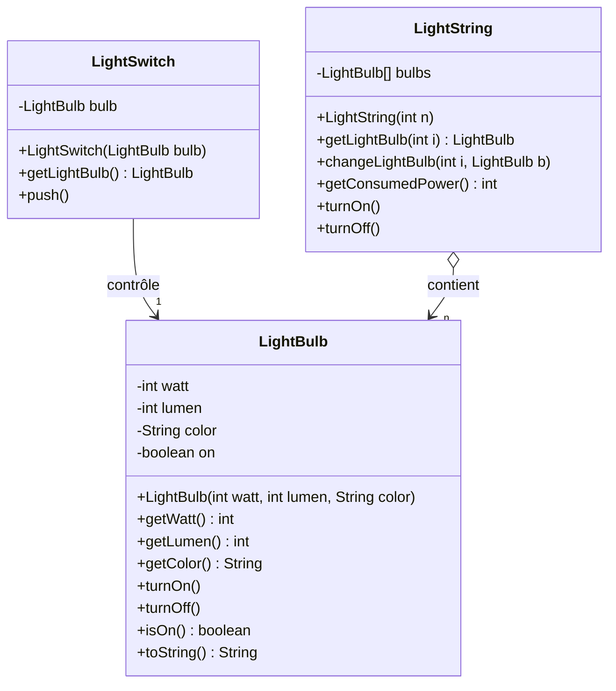
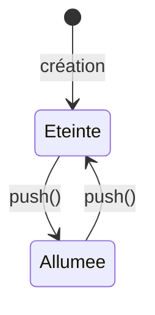

# TP2 — Ampoules, interrupteurs et guirlandes

> 🎯 **Objectifs** : **spécifier** une classe avant de la coder, écrire la **javadoc d'abord**, manipuler un objet attribut et un **tableau d'objets**.
> 📚 Cours : [01 — Classes et objets](../../01-Cours/01-classes-et-objets.md) · 🛠️ [Memento](../../05-Fiches/memento-commandes.md)
> 📝 Préparation : travail préparatoire + intro à Git (semainier).

## 🗺️ Les 3 classes

## 🔁 Méthode de travail (pour chaque classe)

> ✅ Bonne pratique : écrire la **documentation avant le code** — elle t'oblige à préciser ce que fait la méthode.

---

## Exercice 1 — `LightBulb` (ampoule)

Une ampoule a : une puissance consommée (Watts, `int`), une puissance lumineuse (lumens, `int`), une couleur (`String`). Elle est allumée ou éteinte — **éteinte à la création**.

- [ ] **Q1.** Spécification : signatures des méthodes ; attributs et types (allumé/éteint → `boolean`) ; paramètres du constructeur.
- [ ] **Q2–Q4.** Crée `tp2/light/src/LightBulb.java` et code-la (javadoc d'abord).
- [ ] **Q5.** Génère la javadoc : **aucun warning**.
- [ ] **Q6.** Compile.
- [ ] **Q7.** Programme : ampoule blanche 4 W / 1200 lumens → affiche → allume → affiche.

## Exercice 2 — `LightSwitch` (interrupteur)

Un interrupteur contrôle **une** ampoule, donnée au constructeur et mémorisée en attribut (comme l'`Author` d'un `Book`).

- [ ] **Q1.** Spécifie puis code `LightSwitch` (`getLightBulb()`, `push()`).
- [ ] **Q2.** Javadoc de toutes les classes (`*.java`) → ouvrir `package-summary.html`.
- [ ] **Q3.** Dans le programme : allume l'ampoule **via l'interrupteur**.

## Exercice 3 — `LightString` (guirlande)

| Contrainte | Détail |
|---|---|
| Création | nombre d'ampoules donné au constructeur ; **le constructeur crée** les ampoules |
| Ampoules initiales | éteintes, blanches, 1 W, 100 lumens |
| Stockage | attribut **tableau** `LightBulb[]` |
| `getLightBulb(int i)` | la i-ème ampoule (**la 1ʳᵉ a le n° 1**) ; `null` si i invalide |
| `changeLightBulb(int i, LightBulb b)` | remplace la i-ème ; rien si i invalide |
| `getConsumedPower()` | somme des Watts si allumée, **0 sinon** |
| `turnOn()` / `turnOff()` | allume / éteint **toutes** les ampoules |

⚠️ Numéro `i` (à partir de 1) ⇒ indice de tableau `i - 1`.

- [ ] **Q1.** Code `LightString` (+ méthodes utiles si besoin).
- [ ] **Q2.** Compile + javadoc.
- [ ] **Q3.** `LightStringMain` :
  1. guirlande de 10 ampoules ;
  2. l'allumer et afficher sa puissance (→ 10 W) ;
  3. remplacer la 4ᵉ par une ampoule jaune 2 W / 120 lumens ;
  4. afficher la puissance.

💡 Indice : la nouvelle ampoule est éteinte…

Elle a été créée éteinte : selon ton choix, `getConsumedPower()` doit-il la compter ? Réfléchis à ce que signifie « la guirlande est allumée » (un attribut ? l'état des ampoules ?).

---
📂 Ton code : [`src/`](./src/) · 🏠 [Sommaire](../../README.md)
