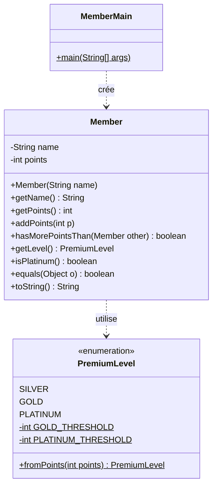
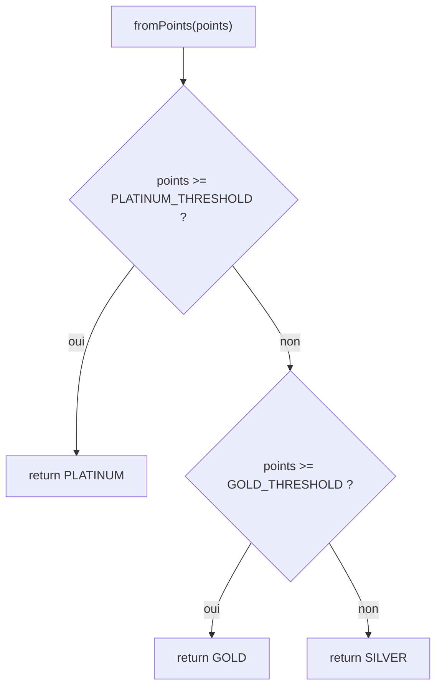
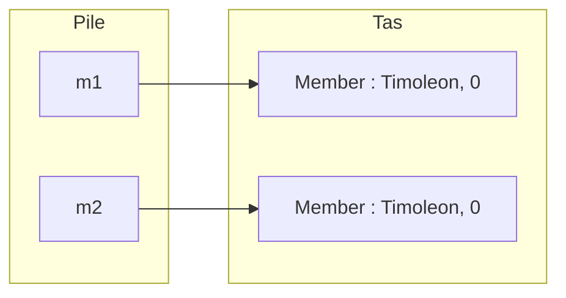
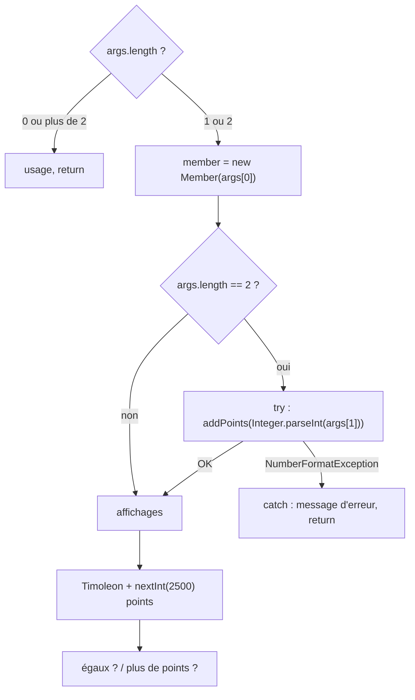

# TP3 — Corrigé : membres privilégiés (`enum`, `equals`, arguments du `main`)

📄 [Énoncé](./ENONCE.md) · 📚 [Cours 02 — static et enum](../../01-Cours/02-static-et-enum.md) · [Cours 01 — Classes et objets](../../01-Cours/01-classes-et-objets.md) · 🛠️ [Memento](../../05-Fiches/memento-commandes.md)

> ⚠️ **Corrigé non officiel**, rédigé pour réviser. Tout le code a été **compilé** (Java 21), la javadoc générée **sans warning**, et `MemberMain` **exécuté** dans chaque cas : les traces sont les vraies sorties.
> 📌 Les points de Timoleon sont **aléatoires** : chez toi, ces lignes-là auront d'autres valeurs.

## 🗺️ Vue d'ensemble



Commandes (depuis le dossier du TP, ex. `tp3/`) :
```bash
javac -sourcepath src src/*.java -d classes
javadoc -d docs src/*.java
java -classpath classes MemberMain Timoleon 1234
```

---

## Q1. `README.md` + premier `add / commit / push`

```bash
git add README.md
git commit -m "TP3 : README avec mon nom"
git push
```
💡 Un exemple **complet** de README de rendu est donné plus bas (section « Rendu GitLab »).

## Q2. `PremiumLevel`

```java
/**
 * The premium levels of a member, depending on his number of points.
 */
public enum PremiumLevel {
    /** from 0 to 999 points */
    SILVER,
    /** from 1000 to 2499 points */
    GOLD,
    /** 2500 points or more */
    PLATINUM;

    /** minimal number of points to reach the GOLD level */
    private static final int GOLD_THRESHOLD = 1000;
    /** minimal number of points to reach the PLATINUM level */
    private static final int PLATINUM_THRESHOLD = 2500;

    /**
     * Gives the highest level reached with the given number of points.
     * @param points a number of points
     * @return the highest level reached with these points
     */
    public static PremiumLevel fromPoints(int points) {
        if (points >= PLATINUM_THRESHOLD) {
            return PLATINUM;
        } else if (points >= GOLD_THRESHOLD) {
            return GOLD;
        } else {
            return SILVER;
        }
    }
}
```
- 💡 Les **3 valeurs** viennent **en premier**, suivies d'un `;`, puis le reste (constantes, méthodes).
- 💡 Seuils = constantes de classe **`private static final`** : pas de « nombres magiques » 1000 / 2500 dans le code, et invisibles de l'extérieur.
- 💡 `fromPoints` est **`static`** : on l'appelle sur le **type** (`PremiumLevel.fromPoints(1234)`), pas sur une valeur.
- 💡 On teste **du plus haut au plus bas** seuil : le 1er `if` vrai donne le **plus haut** niveau atteint.

Vérification des cas limites (programme de test rapide) :
```java
System.out.println(PremiumLevel.fromPoints(999) + " " + PremiumLevel.fromPoints(1000)
                   + " " + PremiumLevel.fromPoints(2499) + " " + PremiumLevel.fromPoints(2500));
```
```text
SILVER GOLD GOLD PLATINUM
```



## Q3. `Member`

```java
/**
 * A member of a loyalty program, who earns points.
 */
public class Member {
    /** the name of this member */
    private String name;
    /** the number of points of this member */
    private int points;

    /**
     * Builds a member with the given name and 0 point.
     * @param name the name of the member
     */
    public Member(String name) {
        this.name = name;
        this.points = 0;
    }

    /**
     * Gives the name of this member.
     * @return the name of this member
     */
    public String getName() {
        return this.name;
    }

    /**
     * Gives the number of points of this member.
     * @return the number of points of this member
     */
    public int getPoints() {
        return this.points;
    }

    /**
     * Adds points to this member.
     * @param p the number of points to add
     */
    public void addPoints(int p) {
        this.points = this.points + p;
    }

    /**
     * Tells if this member has more points than another one.
     * @param other the other member
     * @return true iff this member has strictly more points than other
     */
    public boolean hasMorePointsThan(Member other) {
        return this.points > other.points;
    }

    /**
     * Gives the premium level of this member, depending on his points.
     * @return the premium level of this member
     */
    public PremiumLevel getLevel() {
        return PremiumLevel.fromPoints(this.points);
    }

    /**
     * Tells if this member has the PLATINUM level.
     * @return true iff the level of this member is PLATINUM
     */
    public boolean isPlatinum() {
        return this.getLevel() == PremiumLevel.PLATINUM;
    }

    /**
     * Two members are equal if they have the same name and the same
     * number of points.
     * @param o the object to compare with this member
     * @return true iff o is a member with same name and same points
     */
    public boolean equals(Object o) {
        if (!(o instanceof Member)) {
            return false;
        }
        Member other = (Member) o;
        return this.name.equals(other.name) && this.points == other.points;
    }

    /**
     * Describes this member: name, points and level.
     * @return a description of this member
     */
    public String toString() {
        return this.name + " (" + this.points + " points, " + this.getLevel() + ")";
    }
}
```
- 💡 `getLevel()` **délègue** à `PremiumLevel.fromPoints` : le niveau n'est **pas** un attribut (il se déduit des points, donc toujours à jour).
- 💡 `isPlatinum()` : on compare des valeurs d'`enum` avec **`==`** (chaque valeur n'existe qu'en **un seul** exemplaire).
- 💡 `hasMorePointsThan` peut lire `other.points` : `private` = privé à la **classe**, pas à l'objet.
- 💡 `equals(Object o)` : paramètre de type **`Object`** (sinon ce n'est pas « le » `equals` de Java). On vérifie le type avec `instanceof`, on **convertit** (`(Member) o`), puis on compare : `String` avec **`equals`**, `int` avec **`==`**.

📌 Variante vue au [cours 04](../../01-Cours/04-exceptions.md) : `try { Member other = (Member) o; ... } catch (ClassCastException e) { return false; }`.

`==` ou `equals` ? (vrai programme exécuté)
```java
Member m1 = new Member("Timoleon");
Member m2 = new Member("Timoleon");
System.out.println(m1 == m2);          // false : 2 objets distincts
System.out.println(m1.equals(m2));     // true  : même nom, mêmes points
m2.addPoints(10);
System.out.println(m1.equals(m2));     // false : points différents
System.out.println(m1.equals("Timoleon")); // false : pas un Member
```


💡 `m1 == m2` compare les **références** (2 flèches vers 2 objets différents ⇒ `false`) ; `m1.equals(m2)` compare le **contenu** ⇒ `true`.

## Q4–Q5. Compiler, javadoc sans warning

```bash
javac -sourcepath src src/*.java -d classes
javadoc -d docs src/*.java
```
- ⚠️ Avec Java 21, chaque commentaire doit avoir **une phrase de description** avant `@param` / `@return` (sinon `warning: no main description`).
- ⚠️ Les valeurs de l'`enum` et les constantes privées se documentent aussi (`/** from 0 to 999 points */`).
- 📌 Avec l'option `javac -Xlint:all`, le compilateur signale que `Member` redéfinit `equals` sans `hashCode` : c'est vu au [cours 07 — Collections](../../01-Cours/07-collections.md) ; sans l'option, aucun warning.

## Q6. `MemberMain`

```java
import java.util.Random;

/**
 * Program that creates members from the command line arguments.
 * Usage: java MemberMain name [points]
 */
public class MemberMain {
    /** No instance of this class: it only contains the main method. */
    private MemberMain() {
    }

    /**
     * Main method.
     * @param args the name of a member, optionally followed by his points
     */
    public static void main(String[] args) {
        if (args.length == 0 || args.length > 2) {
            System.out.println("usage : java MemberMain <name> [<points>]");
            return;
        }

        Member member = new Member(args[0]);
        if (args.length == 2) {
            try {
                member.addPoints(Integer.parseInt(args[1]));
            } catch (NumberFormatException e) {
                System.out.println("erreur : \"" + args[1] + "\" n'est pas un nombre entier de points");
                return;
            }
        }

        System.out.println(member);
        System.out.println("niveau : " + member.getLevel());
        System.out.println("platine ? " + member.isPlatinum());

        Random alea = new Random();
        Member timoleon = new Member("Timoleon");
        timoleon.addPoints(alea.nextInt(2500));
        System.out.println(timoleon);
        System.out.println("égaux ? " + member.equals(timoleon));
        System.out.println(member.getName() + " a plus de points que Timoleon ? "
                           + member.hasMorePointsThan(timoleon));
    }
}
```
- 💡 On vérifie `args.length` **avant** de lire `args[0]` : sans argument, `args[0]` lèverait une `ArrayIndexOutOfBoundsException`.
- 💡 `Integer.parseInt` lève une `NumberFormatException` si `args[1]` n'est pas un entier : on la **capture** pour afficher un message clair et s'arrêter (`return;` quitte le `main`).
- 💡 `args` ne contient que des **`String`** : `"1234"` n'est pas `1234` tant qu'on n'a pas fait `parseInt`.
- 📌 Plus de 2 arguments : on a choisi d'afficher aussi l'usage (l'énoncé ne le précise pas).

Sans ces précautions, voici ce qu'on obtiendrait (vraies traces) :
```text
$ java -classpath classes MemberMain Timoleon abc
Exception in thread "main" java.lang.NumberFormatException: For input string: "abc"
	at java.base/java.lang.NumberFormatException.forInputString(NumberFormatException.java:67)
	at java.base/java.lang.Integer.parseInt(Integer.java:662)
	at java.base/java.lang.Integer.parseInt(Integer.java:778)
	at MemberMain.main(MemberMain.java:4)
$ java -classpath classes MemberMain
Exception in thread "main" java.lang.ArrayIndexOutOfBoundsException: Index 0 out of bounds for length 0
	at MemberMain.main(MemberMain.java:3)
```

## Q7. Tous les cas (traces réelles)

**0 argument** → usage, arrêt :
```text
$ java -classpath classes MemberMain
usage : java MemberMain <name> [<points>]
```

**1 argument** → membre à 0 point :
```text
$ java -classpath classes MemberMain Timoleon
Timoleon (0 points, SILVER)
niveau : SILVER
platine ? false
Timoleon (1641 points, GOLD)
égaux ? false
Timoleon a plus de points que Timoleon ? false
```
💡 « égaux ? false » : même nom, mais Timoleon (aléatoire) a d'autres points. Ils ne seraient égaux que si le tirage donnait **0**.

**2 arguments** valides :
```text
$ java -classpath classes MemberMain Timoleon 1234
Timoleon (1234 points, GOLD)
niveau : GOLD
platine ? false
Timoleon (2440 points, GOLD)
égaux ? false
Timoleon a plus de points que Timoleon ? false
```

**2ᵉ argument non entier** → message d'erreur, arrêt :
```text
$ java -classpath classes MemberMain Timoleon abc
erreur : "abc" n'est pas un nombre entier de points
```

**Cas platine** (bonus) :
```text
$ java -classpath classes MemberMain Alice 3000
Alice (3000 points, PLATINUM)
niveau : PLATINUM
platine ? true
Timoleon (1019 points, GOLD)
égaux ? false
Alice a plus de points que Timoleon ? true
```



---

## 📤 Rendu GitLab : exemple de `README.md` et `.gitignore`

`README.md` (à la racine du dossier `tp3/`) :

````markdown
# TP3 — Membres privilégiés

## Auteur
Prénom NOM — groupe X

## Sujet
Un membre d'un programme de fidélité cumule des points. Son niveau
(SILVER, GOLD, PLATINUM) dépend de ses points (type énuméré `PremiumLevel`).
`MemberMain` crée un membre à partir des arguments de la ligne de commande
et le compare à « Timoleon », qui a un nombre de points aléatoire.

## Compilation (depuis le dossier tp3/)
```bash
javac -sourcepath src src/*.java -d classes
```

## Documentation (depuis le dossier tp3/)
```bash
javadoc -d docs src/*.java
```

## Exécution (depuis le dossier tp3/)
```bash
java -classpath classes MemberMain <nom> [<points>]
```

## Exemples d'exécution
```text
$ java -classpath classes MemberMain Timoleon 1234
Timoleon (1234 points, GOLD)
niveau : GOLD
platine ? false
Timoleon (2440 points, GOLD)
égaux ? false
Timoleon a plus de points que Timoleon ? false

$ java -classpath classes MemberMain Timoleon abc
erreur : "abc" n'est pas un nombre entier de points

$ java -classpath classes MemberMain
usage : java MemberMain <name> [<points>]
```

## Intelligence Artificielle générative
Aucune. (sinon : nom de l'outil utilisé et prompts exacts)
````

`.gitignore` (à la racine du dépôt) :
```text
*.class
classes/
docs/
*.jar
```

Puis :
```bash
git add .gitignore README.md src
git commit -m "TP3 : PremiumLevel, Member, MemberMain + README"
git push
```
✅ Sur GitLab : *Manage → Members* → ajouter l'enseignant·e avec le rôle **Developer**.

---

## ⚠️ Erreurs fréquentes

| Erreur | Pourquoi c'est faux | Correction |
|---|---|---|
| constantes de l'`enum` **après** les attributs | la liste des valeurs doit venir **en premier** | `SILVER, GOLD, PLATINUM;` puis le reste |
| seuils `public` ou en dur (`1000`) | l'énoncé veut des constantes **privées** ; nombres magiques | `private static final int GOLD_THRESHOLD = 1000;` |
| `fromPoints` non `static` | il faudrait déjà un niveau pour calculer le niveau ! | `public static PremiumLevel fromPoints(int points)` |
| tester `>= GOLD` avant `>= PLATINUM` | 3000 points donnerait GOLD | du **plus haut** au plus bas seuil |
| attribut `level` dans `Member` | redondant, peut devenir faux après `addPoints` | calculer avec `PremiumLevel.fromPoints(this.points)` |
| `equals(Member o)` | ne **redéfinit** pas `equals(Object)` : non utilisé par Java | paramètre `Object` + `instanceof` + conversion |
| `this.name == other.name` | compare des **références** de `String` | `this.name.equals(other.name)` |
| lire `args[0]` sans tester `args.length` | `ArrayIndexOutOfBoundsException` | tester le nombre d'arguments d'abord |
| `parseInt` sans `try / catch` | trace d'exception si `abc` | `catch (NumberFormatException e)` |
| `nextInt(2501)` ou `nextInt(2499)` | mauvaise borne | `nextInt(2500)` donne un entier de 0 à 2499 |
| `.class` et `docs/` poussés sur GitLab | fichiers **générés**, à ne pas rendre | `.gitignore` |
| README sans commandes exactes ni section IA | consignes de rendu non respectées | commandes **avec le dossier** + section « IA générative » |

---
📄 [Énoncé](./ENONCE.md) · 🏠 [Sommaire](../../README.md)
