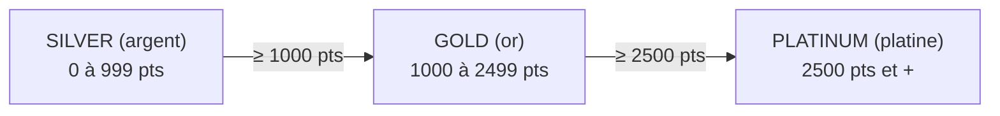
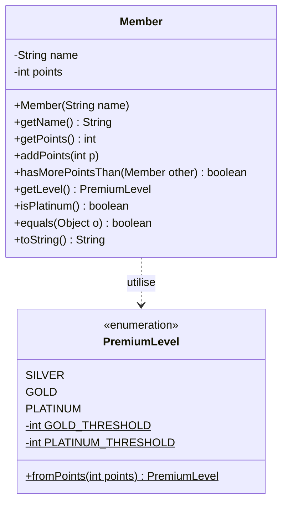
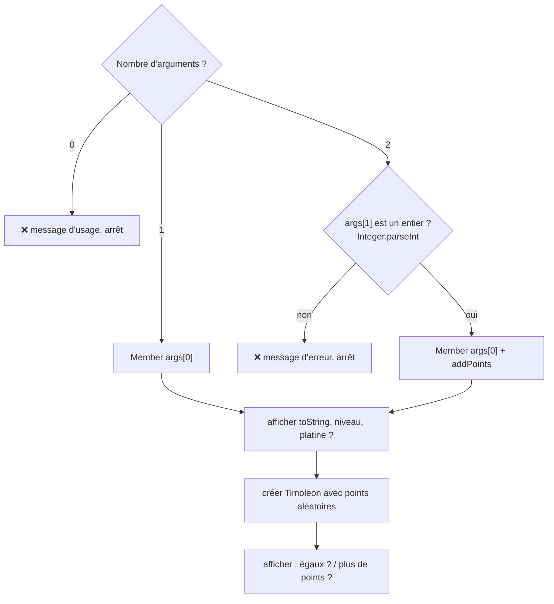

# TP3 — Membres privilégiés (`enum`, `equals`, arguments du `main`)

> 🎯 **Objectifs** : définir un **type énuméré** avec constantes et méthode `static`, écrire `equals()`, utiliser les **arguments** de `main`, rendre un TP sur **GitLab**.
> 📚 Cours : [02 — static et enum](../../01-Cours/02-static-et-enum.md) · [01 — Classes et objets](../../01-Cours/01-classes-et-objets.md) · 🛠️ [Memento](../../05-Fiches/memento-commandes.md)

## 🗺️ Le sujet en deux schémas




*(soulignés / `$` = membres `static`)*

---

- [ ] **Q1.** Crée `tp3/README.md` avec ton nom → `add / commit / push`.
- [ ] **Q2.** `src/PremiumLevel.java` :
  - les 3 valeurs ;
  - 2 constantes **privées** pour les seuils (1000, 2500) ;
  - `public static PremiumLevel fromPoints(int points)` → **plus haut** niveau atteint.
- [ ] **Q3.** `src/Member.java` (avec javadoc) :

| Règle / méthode | Détail |
|---|---|
| Création | nom donné, **0 point** |
| `getName()`, `getPoints()` | accesseurs |
| `addPoints(int)` | ajoute des points |
| `hasMorePointsThan(Member other)` | plus de points que l'autre ? |
| `getLevel()` | `PremiumLevel.fromPoints(points)` |
| `isPlatinum()` | niveau == `PLATINUM` ? |
| `equals(Object o)` | même **nom** et même **nombre de points** |
| `toString()` | description du membre |

- [ ] **Q4–Q5.** Compile, génère la javadoc, corrige les warnings.
- [ ] **Q6.** `MemberMain` — comportement selon les arguments :



```bash
java -classpath classes MemberMain Timoleon 1234
```

💡 Outils :
```java
int n = Integer.parseInt(args[1]);         // NumberFormatException si pas un entier
java.util.Random alea = new java.util.Random();
int x = alea.nextInt(2500);                // entre 0 et 2499
```

- [ ] **Q7.** Teste tous les cas : 0 argument, `Timoleon`, `Timoleon 1234`, `Timoleon abc`.

## 📤 Rendu GitLab

- [ ] Tous les fichiers du TP3 poussés (sauf `.class` et docs → `.gitignore`).
- [ ] Enseignant·e ajouté·e au dépôt avec le rôle **developer**.
- [ ] `README.md` contient : nom · description du sujet · commandes **exactes** de compilation et d'exécution (avec le dossier) · exemples d'exécution avec leur trace · section **« Intelligence Artificielle générative »** (outil et prompts utilisés, ou « aucune »).

---
📂 Ton code : [`src/`](./src/) · 🏠 [Sommaire](../../README.md)
