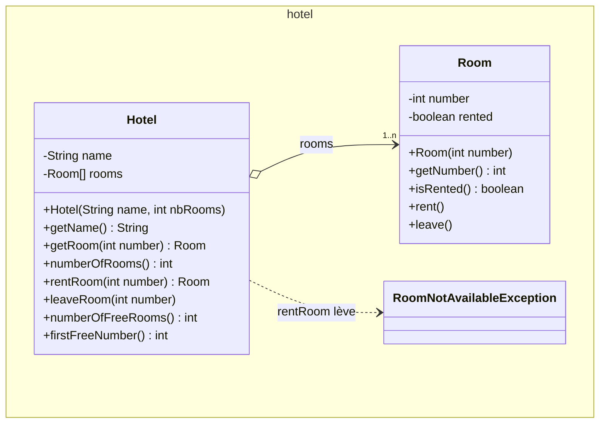
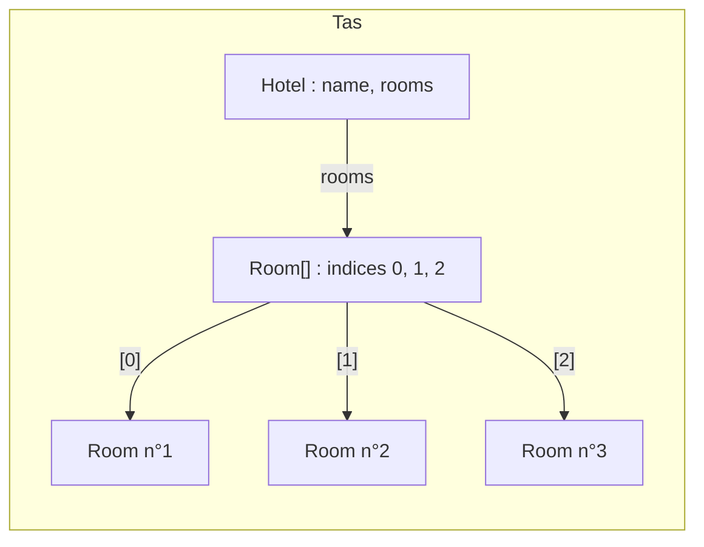
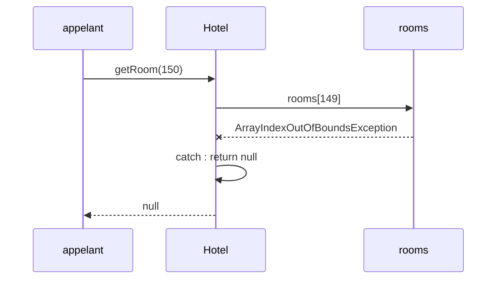
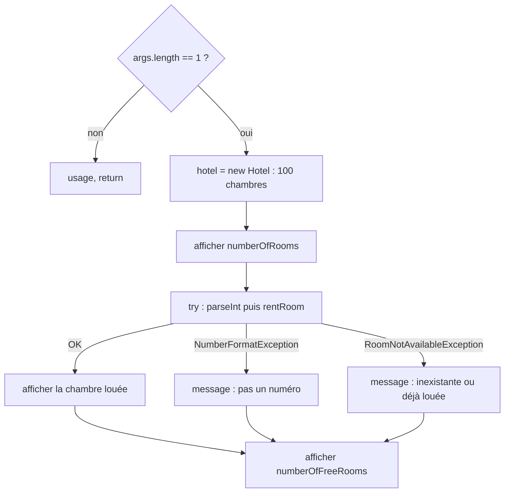

# TP4 — Corrigé : hôtels (tests JUnit et exceptions)

📄 [Énoncé](./ENONCE.md) · 📚 [Cours 03 — Tests](../../01-Cours/03-tests.md) · [Cours 04 — Exceptions](../../01-Cours/04-exceptions.md) · 🛠️ [Memento](../../05-Fiches/memento-commandes.md)

> ⚠️ **Corrigé non officiel**, rédigé pour réviser. Le code a été **compilé** (Java 21), la javadoc générée **sans warning**, les tests **exécutés avec JUnit 5** (13 tests réussis, 0 échec) et `HotelMain` lancé dans chaque cas : les traces sont les vraies sorties.

> 📌 **Hypothèses (à lire !)** : `Room` (travail préparatoire), `RoomTest` et `HotelTest` sont **fournis en TP mais absents de ce dépôt**.
> - `Room` est ici une version **plausible** : `Room(int number)`, `getNumber()`, `isRented()`, `rent()`, `leave()`. Ta classe peut utiliser d'autres noms (ex. `isAvailable()`, `free()`…) : adapte les appels.
> - `RoomNotAvailableException` est écrite ici (elle est peut-être fournie).
> - `HotelTest` ci-dessous est **écrit pour ce corrigé** : il reprend les **3 noms de tests cités** dans l'énoncé et invente les 7 autres (10 en tout, comme annoncé). Le vrai `HotelTest` peut différer.

## 🗺️ Vue d'ensemble



Organisation des fichiers (paquetage `hotel` ⇒ dossier `hotel/` + `package hotel;`) :

| Fichier | Contenu |
|---|---|
| `src/hotel/Room.java` | fourni (préparation) |
| `src/hotel/RoomNotAvailableException.java` | exception |
| `src/hotel/Hotel.java` | **à écrire** |
| `src/hotel/HotelMain.java` | **à écrire** |
| `test/hotel/RoomTest.java`, `test/hotel/HotelTest.java` | fournis |

Commandes (depuis le dossier du TP, ex. `tp4/`) :
```bash
javac -sourcepath src src/hotel/*.java -d classes
javac -classpath junit-console.jar:classes test/hotel/*Test.java
java -jar junit-console.jar -classpath test:classes -scan-classpath
javadoc -sourcepath src -d docs hotel
java -classpath classes hotel.HotelMain 42
```

---

## Classes supposées fournies

<details><summary>📌 <code>Room</code> (hypothèse)</summary>

```java
package hotel;

/**
 * A room of a hotel, identified by its number. A room is free or rented.
 */
public class Room {
    /** the number of this room */
    private int number;
    /** true iff this room is rented */
    private boolean rented;

    /**
     * Builds a free room with the given number.
     * @param number the number of the room
     */
    public Room(int number) {
        this.number = number;
        this.rented = false;
    }

    /**
     * Gives the number of this room.
     * @return the number of this room
     */
    public int getNumber() {
        return this.number;
    }

    /**
     * Tells if this room is rented.
     * @return true iff this room is rented
     */
    public boolean isRented() {
        return this.rented;
    }

    /**
     * Rents this room.
     */
    public void rent() {
        this.rented = true;
    }

    /**
     * Leaves this room: it becomes free.
     */
    public void leave() {
        this.rented = false;
    }

    /**
     * Describes this room.
     * @return a description of this room
     */
    public String toString() {
        String state;
        if (this.rented) {
            state = "louée";
        } else {
            state = "libre";
        }
        return "chambre n°" + this.number + " (" + state + ")";
    }
}
```

</details>

<details><summary>📌 <code>RoomNotAvailableException</code></summary>

```java
package hotel;

/**
 * Exception thrown when a room cannot be rented (already rented, or
 * the number does not exist).
 */
public class RoomNotAvailableException extends Exception {
    /**
     * Builds the exception.
     */
    public RoomNotAvailableException() {
        super();
    }

    /**
     * Builds the exception with a message.
     * @param message the message of the exception
     */
    public RoomNotAvailableException(String message) {
        super(message);
    }
}
```
💡 `extends Exception` : « est une sorte d'`Exception` » (héritage, [cours 08](../../01-Cours/08-heritage.md)). Ce n'est **pas** une `RuntimeException` ⇒ le compilateur **oblige** à la capturer ou à l'annoncer avec `throws`.

</details>

<details><summary>📌 <code>RoomTest</code> (hypothèse)</summary>

```java
package hotel;

import org.junit.jupiter.api.Test;
import static org.junit.jupiter.api.Assertions.*;

public class RoomTest {

    @Test
    public void roomIsFreeAtCreation() {
        Room room = new Room(12);
        assertEquals(12, room.getNumber());
        assertFalse(room.isRented());
    }

    @Test
    public void roomIsRentedAfterRent() {
        Room room = new Room(12);
        room.rent();
        assertTrue(room.isRented());
    }

    @Test
    public void roomIsFreeAfterLeave() {
        Room room = new Room(12);
        room.rent();
        room.leave();
        assertFalse(room.isRented());
    }
}
```

</details>

## Q1–Q2. Les tests d'abord

```bash
javac -classpath junit-console.jar:classes test/hotel/HotelTest.java
java -jar junit-console.jar -classpath test:classes -scan-classpath
```
💡 Au départ, `RoomTest` passe et les tests de `HotelTest` échouent : **normal**, `Hotel` n'est pas encore codée. L'objectif est de les faire passer **un par un**.
⚠️ Pour que `HotelTest` **compile**, `Hotel` doit déjà avoir **toutes** les signatures (corps provisoires, ex. `return 0;` / `return null;`).

`HotelTest` utilisé pour ce corrigé :

```java
package hotel;

import org.junit.jupiter.api.Test;
import static org.junit.jupiter.api.Assertions.*;

public class HotelTest {

    private static final int NB_ROOMS = 10;

    @Test
    public void roomsAreCreatedAtCreationAndStatusIsCorrect() {
        Hotel hotel = new Hotel("Test", NB_ROOMS);
        for (int number = 1; number <= NB_ROOMS; number++) {
            Room room = hotel.getRoom(number);
            assertNotNull(room);
            assertEquals(number, room.getNumber());
            assertFalse(room.isRented());
        }
    }

    @Test
    public void getRoomReturnsNullIfNumberNotValid() {
        Hotel hotel = new Hotel("Test", NB_ROOMS);
        assertNull(hotel.getRoom(0));
        assertNull(hotel.getRoom(-1));
        assertNull(hotel.getRoom(NB_ROOMS + 1));
    }

    @Test
    public void numberOfRoomsIsCorrectAtCreation() {
        Hotel hotel = new Hotel("Test", NB_ROOMS);
        assertEquals(NB_ROOMS, hotel.numberOfRooms());
    }

    @Test
    public void rentRoomRentsAndReturnsTheRoom() throws RoomNotAvailableException {
        Hotel hotel = new Hotel("Test", NB_ROOMS);
        assertFalse(hotel.getRoom(3).isRented());
        Room room = hotel.rentRoom(3);
        assertSame(hotel.getRoom(3), room);
        assertTrue(room.isRented());
    }

    @Test
    public void rentRoomThrowsExceptionIfRoomAlreadyRented() throws RoomNotAvailableException {
        Hotel hotel = new Hotel("Test", NB_ROOMS);
        hotel.rentRoom(3);
        assertThrows(RoomNotAvailableException.class, () -> hotel.rentRoom(3));
    }

    @Test
    public void rentRoomThrowsExceptionIfNumberNotValid() {
        Hotel hotel = new Hotel("Test", NB_ROOMS);
        assertThrows(RoomNotAvailableException.class, () -> hotel.rentRoom(0));
        assertThrows(RoomNotAvailableException.class, () -> hotel.rentRoom(NB_ROOMS + 1));
    }

    @Test
    public void leaveRoomMakesRentedRoomFree() throws RoomNotAvailableException {
        Hotel hotel = new Hotel("Test", NB_ROOMS);
        hotel.rentRoom(3);
        hotel.leaveRoom(3);
        assertFalse(hotel.getRoom(3).isRented());
    }

    @Test
    public void leaveRoomHasNoEffectIfRoomNotRented() {
        Hotel hotel = new Hotel("Test", NB_ROOMS);
        hotel.leaveRoom(3);
        assertFalse(hotel.getRoom(3).isRented());
        assertEquals(NB_ROOMS, hotel.numberOfFreeRooms());
    }

    @Test
    public void numberOfFreeRoomsIsCorrect() throws RoomNotAvailableException {
        Hotel hotel = new Hotel("Test", NB_ROOMS);
        assertEquals(NB_ROOMS, hotel.numberOfFreeRooms());
        hotel.rentRoom(2);
        hotel.rentRoom(5);
        assertEquals(NB_ROOMS - 2, hotel.numberOfFreeRooms());
        hotel.leaveRoom(2);
        assertEquals(NB_ROOMS - 1, hotel.numberOfFreeRooms());
    }

    @Test
    public void firstFreeNumberIsCorrect() throws RoomNotAvailableException {
        Hotel hotel = new Hotel("Test", 3);
        assertEquals(1, hotel.firstFreeNumber());
        hotel.rentRoom(1);
        assertEquals(2, hotel.firstFreeNumber());
        hotel.rentRoom(2);
        hotel.rentRoom(3);
        assertEquals(0, hotel.firstFreeNumber());
        hotel.leaveRoom(2);
        assertEquals(2, hotel.firstFreeNumber());
    }
}
```
- 💡 Les tests qui appellent `rentRoom` portent `throws RoomNotAvailableException` : l'exception est **vérifiée** (« checked »), le compilateur exige qu'on l'annonce.
- 💡 `assertThrows(RoomNotAvailableException.class, () -> hotel.rentRoom(3))` : la lambda `() ->` laisse JUnit lancer l'appel **lui-même**.

| Q | Tests concernés |
|---|---|
| 3 | `roomsAreCreatedAtCreationAndStatusIsCorrect` |
| 4 | `getRoomReturnsNullIfNumberNotValid` |
| 5 | `numberOfRoomsIsCorrectAtCreation` |
| 6 | `rentRoomRentsAndReturnsTheRoom`, `rentRoomThrowsExceptionIfRoomAlreadyRented`, `rentRoomThrowsExceptionIfNumberNotValid` |
| 7 | `leaveRoomMakesRentedRoomFree`, `leaveRoomHasNoEffectIfRoomNotRented`, `numberOfFreeRoomsIsCorrect`, `firstFreeNumberIsCorrect` |

---

## Q3 à Q7. La classe `Hotel` complète

```java
package hotel;

/**
 * A hotel, with a name and rooms numbered from 1 to the number of rooms.
 */
public class Hotel {
    /** the name of this hotel */
    private String name;
    /** the rooms of this hotel: room number n is at index n - 1 */
    private Room[] rooms;

    /**
     * Builds a hotel whose rooms, numbered from 1 to nbRooms, are all free.
     * @param name the name of the hotel
     * @param nbRooms the number of rooms of the hotel
     */
    public Hotel(String name, int nbRooms) {
        this.name = name;
        this.rooms = new Room[nbRooms];
        for (int i = 0; i < nbRooms; i++) {
            this.rooms[i] = new Room(i + 1);
        }
    }

    /**
     * Gives the name of this hotel.
     * @return the name of this hotel
     */
    public String getName() {
        return this.name;
    }

    /**
     * Gives the room with the given number.
     * @param number the number of the room
     * @return the room with this number, or null if the number is not valid
     */
    public Room getRoom(int number) {
        try {
            return this.rooms[number - 1];
        } catch (ArrayIndexOutOfBoundsException e) {
            return null;
        }
    }

    /**
     * Gives the number of rooms of this hotel.
     * @return the number of rooms of this hotel
     */
    public int numberOfRooms() {
        return this.rooms.length;
    }

    /**
     * Rents the room with the given number.
     * @param number the number of the room to rent
     * @return the rented room
     * @throws RoomNotAvailableException if the room is already rented
     *         or if the number is not valid
     */
    public Room rentRoom(int number) throws RoomNotAvailableException {
        Room room = this.getRoom(number);
        if (room == null || room.isRented()) {
            throw new RoomNotAvailableException();
        }
        room.rent();
        return room;
    }

    /**
     * Leaves the room with the given number: it becomes free.
     * No effect if the room is not rented or if the number is not valid.
     * @param number the number of the room to leave
     */
    public void leaveRoom(int number) {
        Room room = this.getRoom(number);
        if (room != null) {
            room.leave();
        }
    }

    /**
     * Gives the number of free rooms of this hotel.
     * @return the number of rooms that are not rented
     */
    public int numberOfFreeRooms() {
        int count = 0;
        for (Room room : this.rooms) {
            if (!room.isRented()) {
                count = count + 1;
            }
        }
        return count;
    }

    /**
     * Gives the smallest number of a free room.
     * @return the smallest number of a free room, 0 if all rooms are rented
     */
    public int firstFreeNumber() {
        for (Room room : this.rooms) {
            if (!room.isRented()) {
                return room.getNumber();
            }
        }
        return 0;
    }
}
```

### Q3. Constructeur

💡 `new Room[nbRooms]` ne crée qu'un tableau de **`null`** : il faut **créer chaque chambre**. La chambre d'indice `i` a le **numéro `i + 1`**.



### Q4. `getRoom` : capturer l'exception

💡 Numéro `n` ⇒ indice `n - 1`. Si `n` vaut 0, −1 ou dépasse le nombre de chambres, l'accès au tableau lève `ArrayIndexOutOfBoundsException` : on la **capture** et on renvoie `null` (code **correctif**, pas un simple affichage).



### Q5. `numberOfRooms`

💡 La taille d'un tableau : `this.rooms.length` (attribut, **sans** parenthèses).

### Q6. `rentRoom` : lever l'exception

💡 On **réutilise** `getRoom` (il gère déjà les numéros invalides). Si `room == null` **ou** déjà louée ⇒ `throw new RoomNotAvailableException();` : la méthode s'arrête là, **rien** n'est loué. Sinon on loue et on **renvoie** la chambre.
⚠️ `throw` (instruction, dans le corps) ≠ `throws` (déclaration, dans la signature) : il faut **les deux**.
⚠️ L'ordre `room == null || room.isRented()` compte : si `room` est `null`, le `||` ne regarde pas la 2ᵉ partie (sinon `NullPointerException`).

### Q7. `leaveRoom`, `numberOfFreeRooms`, `firstFreeNumber`

- 💡 `leaveRoom` : si la chambre existe, `leave()` ; elle n'était pas louée ⇒ `leave()` ne change rien (« sans effet »). Numéro invalide : choix ici de ne rien faire.
- 💡 `numberOfFreeRooms` : schéma **compteur** sur toutes les chambres.
- 💡 `firstFreeNumber` : on parcourt dans l'ordre ⇒ la 1ʳᵉ chambre libre a le **plus petit** numéro ; on renvoie son **numéro** (pas son indice !) ; `0` après la boucle si aucune.

### Résultat des tests (vraie exécution)

```bash
java -jar junit-console.jar -classpath test:classes -scan-classpath
```
```text
╷
├─ JUnit Jupiter ✔
│  ├─ HotelTest ✔
│  │  ├─ roomsAreCreatedAtCreationAndStatusIsCorrect() ✔
│  │  ├─ getRoomReturnsNullIfNumberNotValid() ✔
│  │  ├─ rentRoomRentsAndReturnsTheRoom() ✔
│  │  ├─ rentRoomThrowsExceptionIfNumberNotValid() ✔
│  │  ├─ numberOfFreeRoomsIsCorrect() ✔
│  │  ├─ firstFreeNumberIsCorrect() ✔
│  │  ├─ leaveRoomHasNoEffectIfRoomNotRented() ✔
│  │  ├─ rentRoomThrowsExceptionIfRoomAlreadyRented() ✔
│  │  ├─ numberOfRoomsIsCorrectAtCreation() ✔
│  │  └─ leaveRoomMakesRentedRoomFree() ✔
│  └─ RoomTest ✔
│     ├─ roomIsRentedAfterRent() ✔
│     ├─ roomIsFreeAtCreation() ✔
│     └─ roomIsFreeAfterLeave() ✔
├─ JUnit Vintage ✔
└─ JUnit Platform Suite ✔

Test run finished after 805 ms
[         5 containers found      ]
[         0 containers skipped    ]
[         5 containers started    ]
[         0 containers aborted    ]
[         5 containers successful ]
[         0 containers failed     ]
[        13 tests found           ]
[         0 tests skipped         ]
[        13 tests started         ]
[         0 tests aborted         ]
[        13 tests successful      ]
[         0 tests failed          ]
```
📌 Vérification de la pertinence des tests : en remplaçant `rooms[number - 1]` par `rooms[number]` dans `getRoom`, **4 tests échouent** ⇒ les tests détectent bien l'erreur de décalage.

---

## Q8. `HotelMain`

```java
package hotel;

/**
 * Program that rents a room in the "Hôtel California".
 * Usage: java hotel.HotelMain roomNumber
 */
public class HotelMain {
    /** No instance of this class: it only contains the main method. */
    private HotelMain() {
    }

    /**
     * Main method.
     * @param args the number of the room to rent
     */
    public static void main(String[] args) {
        if (args.length != 1) {
            System.out.println("usage : java hotel.HotelMain <numéro de chambre>");
            return;
        }

        Hotel hotel = new Hotel("Hôtel California", 100);
        System.out.println(hotel.getName() + " : " + hotel.numberOfRooms() + " chambres");

        try {
            int number = Integer.parseInt(args[0]);
            Room room = hotel.rentRoom(number);
            System.out.println("chambre louée : " + room);
        } catch (NumberFormatException e) {
            System.out.println("\"" + args[0] + "\" n'est pas un numéro de chambre");
        } catch (RoomNotAvailableException e) {
            System.out.println("la chambre " + args[0] + " n'existe pas ou est déjà louée");
        }

        System.out.println("chambres libres : " + hotel.numberOfFreeRooms());
    }
}
```
- 💡 Sans argument ⇒ message d'usage et `return;` **avant** de lire `args[0]`.
- 💡 Un seul `try` avec **deux** `catch` : `NumberFormatException` (argument non entier, lancée par `parseInt`) et `RoomNotAvailableException` (lancée par `rentRoom`).
- 💡 Le code qui dépend de la location (affichage de la chambre) est **dans** le `try` : si une exception survient, on saute directement au `catch`.
- 💡 « chambres libres » est **après** le `try / catch` : affiché dans tous les cas.

```bash
javac -sourcepath src src/hotel/HotelMain.java -d classes
```

Traces réelles :
```text
$ java -classpath classes hotel.HotelMain 42
Hôtel California : 100 chambres
chambre louée : chambre n°42 (louée)
chambres libres : 99
```
```text
$ java -classpath classes hotel.HotelMain
usage : java hotel.HotelMain <numéro de chambre>
```
```text
$ java -classpath classes hotel.HotelMain 0
Hôtel California : 100 chambres
la chambre 0 n'existe pas ou est déjà louée
chambres libres : 100
```
```text
$ java -classpath classes hotel.HotelMain 150
Hôtel California : 100 chambres
la chambre 150 n'existe pas ou est déjà louée
chambres libres : 100
```
```text
$ java -classpath classes hotel.HotelMain abc
Hôtel California : 100 chambres
"abc" n'est pas un numéro de chambre
chambres libres : 100
```



## 📤 Rendu GitLab

```bash
git add src test README.md
git commit -m "Hotel : rentRoom + tests OK"
git push
```
✅ Un commit **par méthode** qui passe ses tests ; `classes/`, `docs/` et `*.jar` dans le `.gitignore`.

---

## ⚠️ Erreurs fréquentes

| Erreur | Pourquoi c'est faux | Correction |
|---|---|---|
| `new Room[n]` sans boucle | chambres à `null` → `NullPointerException` dans les tests | créer `new Room(i + 1)` pour chaque case |
| `new Room(i)` dans la boucle | numéros de 0 à n−1 au lieu de 1 à n | `new Room(i + 1)` |
| `this.rooms[number]` | décalage numéro / indice | `this.rooms[number - 1]` |
| `catch (Exception e)` dans `getRoom` | masque **toutes** les erreurs, même les bugs | capturer **précisément** `ArrayIndexOutOfBoundsException` |
| `getRoom` qui affiche un message au lieu de renvoyer `null` | un `catch` doit **corriger** | `return null;` |
| `rentRoom` sans `throws RoomNotAvailableException` | exception vérifiée ⇒ erreur de compilation | annoncer avec `throws` dans la signature |
| `throws new RoomNotAvailableException()` | confusion des mots-clés | `throw new ...` dans le corps |
| tester `room.isRented()` avant `room == null` | `NullPointerException` si numéro invalide | `room == null \|\| room.isRented()` |
| `firstFreeNumber` qui renvoie l'**indice** | décalage de 1 | renvoyer `room.getNumber()` (ou `i + 1`) |
| `firstFreeNumber` qui renvoie `-1` si complet | l'énoncé demande **0** | `return 0;` après la boucle |
| `main` qui lit `args[0]` sans test | `ArrayIndexOutOfBoundsException` sans argument | tester `args.length` d'abord |
| `java -classpath classes HotelMain` | la classe est dans le paquetage `hotel` | `java -classpath classes hotel.HotelMain 42` |
| oublier `package hotel;` dans les tests | `HotelTest` ne trouve pas `Hotel` | même paquetage que la classe testée |
| `assertThrows(X.class, hotel.rentRoom(3))` | l'exception part **avant** l'assertion | `() -> hotel.rentRoom(3)` |

---
📄 [Énoncé](./ENONCE.md) · 🏠 [Sommaire](../../README.md)
