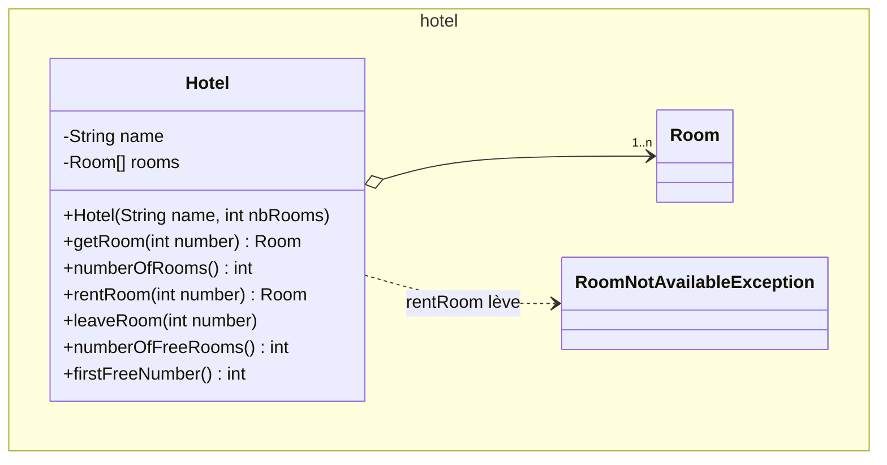
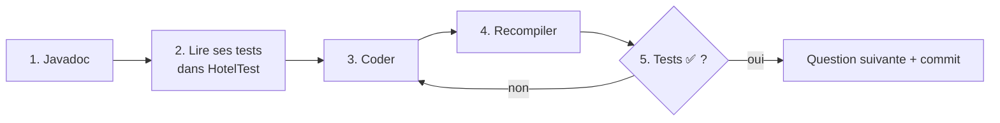
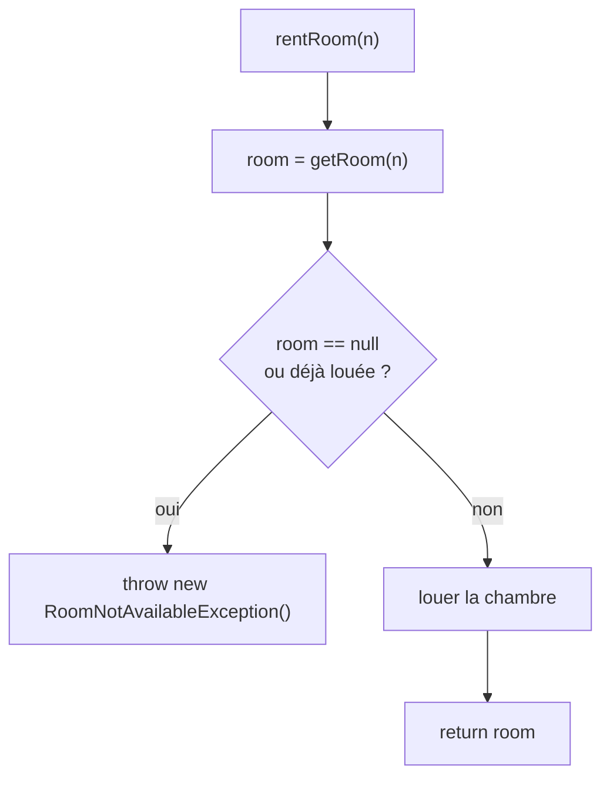

# TP4 — Hôtels (tests JUnit et exceptions)

> 🎯 **Objectifs** : coder **guidé par les tests** (objectif : 0 test en échec), gérer un **décalage numéro / indice**, lancer et capturer des **exceptions**, utiliser des **paquetages**.
> 📚 Cours : [03 — Tests](../../01-Cours/03-tests.md) · [04 — Exceptions](../../01-Cours/04-exceptions.md) · 🛠️ [Memento](../../05-Fiches/memento-commandes.md)
> 📝 Préparation : travail préparatoire obligatoire (classe `Room`, `RoomTest`).

## 🗺️ Le sujet



| Numéro de chambre | 1 | 2 | 3 | … | n |
|---|---|---|---|---|---|
| **Indice du tableau** | 0 | 1 | 2 | … | n-1 |

⚠️ `rooms[numero - 1]`

## 🔁 Méthode pour CHAQUE méthode



---

- [ ] **Q1.** Copie `HotelTest.java` de `tmp/` vers `test/hotel/` et compile-le.
- [ ] **Q2.** Lance **tous** les tests : `java -jar junit-console.jar -classpath test:classes -scan-classpath`
  → `RoomTest` ✅, `HotelTest` : 10 ❌. C'est normal !

| Q | Méthode | Comportement attendu | Tests qui doivent passer |
|---|---|---|---|
| 3 | constructeur | crée **toutes** les chambres du tableau `rooms` | `roomsAreCreatedAtCreationAndStatusIsCorrect` |
| 4 | `getRoom(int n)` | chambre n° n ; **`null`** si n invalide (capturer `ArrayIndexOutOfBoundsException`) | `getRoomReturnsNullIfNumberNotValid` |
| 5 | `numberOfRooms()` | nombre de chambres | `numberOfRoomsIsCorrectAtCreation` |
| 6 | `rentRoom(int n)` | loue et **renvoie** la chambre ; lève `RoomNotAvailableException` si déjà louée **ou** n invalide | tests liés à `rentRoom` |
| 7 | `leaveRoom(int n)` | libère la chambre (sans effet si pas louée) | tests associés |
| 7 | `numberOfFreeRooms()` | nombre de chambres libres | tests associés |
| 7 | `firstFreeNumber()` | plus petit **numéro** libre, **0** si aucune | tests associés |

<details><summary>💡 Indice Q4 : capturer l'exception</summary>

```java
try {
    return this.rooms[number - 1];
} catch (ArrayIndexOutOfBoundsException e) {
    return null;
}
```

</details>

<details><summary>💡 Indice Q6 : logique de rentRoom</summary>



</details>

- [ ] **Q8.** `hotel.HotelMain` :
  ```bash
  java -classpath classes hotel.HotelMain 42
  ```
  1. crée l'« Hôtel California » de 100 chambres ;
  2. affiche le nombre de chambres ;
  3. loue la chambre passée en argument et affiche ses infos — ou un message si le numéro est invalide / indisponible (`try / catch`) ;
  4. affiche le nombre de chambres libres ;
  5. ⚠️ **sans argument** → message d'usage.

## 📤 Rendu GitLab
- [ ] Suivre le document « consignes de rendu des TP et synthèse des commandes ».
- [ ] `add / commit / push` **au fur et à mesure** (ex. à chaque méthode qui passe ses tests), avec un message clair.

---
📂 Ton code : [`src/`](./src/) · [`test/`](./test/) · 🏠 [Sommaire](../../README.md)
