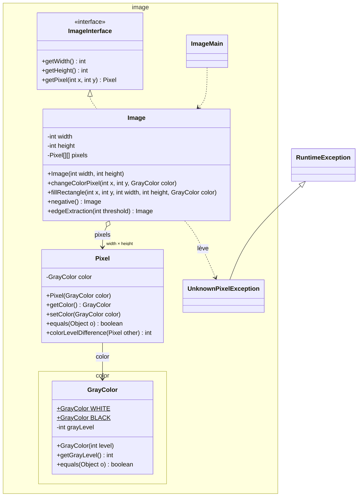
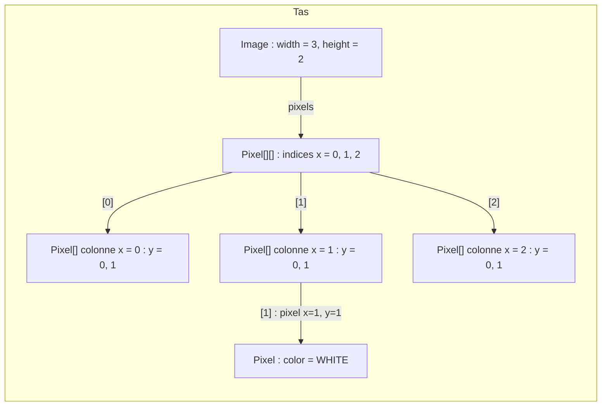
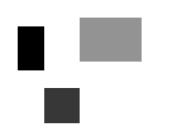
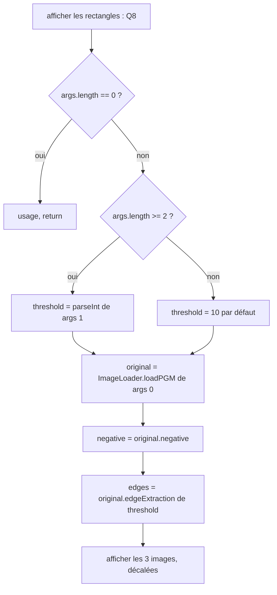

# TP6 — Corrigé : manipulation d'images (niveaux de gris)

📄 [Énoncé](./ENONCE.md) · 📚 [Cours 02 — static](../../01-Cours/02-static-et-enum.md) · [03 — Tests](../../01-Cours/03-tests.md) · [04 — Exceptions](../../01-Cours/04-exceptions.md) · [05 — Interfaces](../../01-Cours/05-polymorphisme-et-interfaces.md) · [06 — Interfaces (suite)](../../01-Cours/06-interfaces-suite.md) · 🛠️ [Memento](../../05-Fiches/memento-commandes.md)

> ⚠️ **Corrigé non officiel**, rédigé pour réviser. Le code ci-dessous a été **compilé** (Java 21), la javadoc générée **sans warning**, les tests **exécutés avec JUnit 5** (20 tests réussis, 0 échec), `ImageMain` exécuté (avec et sans arguments) et le **jar** construit puis lancé. Les images produites (négatif, contours au seuil 10) ont été enregistrées et comparées à la figure 1 : elles y correspondent.

> 📌 **Hypothèses (à lire !)**
> - `ImageInterface` et `UnknownPixelException` sont **fournies en TP mais absentes de ce dépôt** : elles sont réécrites ici (version plausible, la javadoc de `getPixel` est celle du sujet).
> - `image.util.ImageLoader` et `image.util.ImageDisplayer` sont fournies et **ne sont pas réécrites ici**. On suppose, comme dans `ImageExampleMain` : `Image img = ImageLoader.loadPGM("/images/lamp.pgm");` (méthode **statique**) et `new ImageDisplayer().display(img, "titre", x, y);` (x, y = position de la fenêtre à l'écran). **Vérifie dans la documentation fournie** et adapte si besoin.
> - Pour les vérifications, ces deux classes ont été remplacées par un petit lecteur PGM et un écrivain PNG « maison » (non donnés : ils ne font pas partie du TP).

## 🗺️ Vue d'ensemble



| Fichier | Contenu | Question |
|---|---|---|
| `src/image/color/GrayColor.java` | couleur (niveau de gris) | Q1-Q2 |
| `src/image/Pixel.java` | pixel | Q3 |
| `src/image/ImageInterface.java`, `src/image/UnknownPixelException.java` | **fournis** | Q4 |
| `src/image/Image.java` | image | Q6, Q9, Q11 |
| `src/image/ImageMain.java` | programme principal | Q8, Q10, Q12 |
| `src/image/ImageExampleMain.java`, `src/image/util/*.java` | **fournis** | Q7 |
| `test/image/color/GrayColorTest.java`, `test/image/PixelTest.java` | tests (bonus) | Q2-Q3 |
| `test/image/ImageTest.java` | tests de `Image` | Q5, Q9.1, Q11 |
| `images/` | images `.pgm` **fournies** (à rendre aussi) | Q7 |

Commandes (depuis `tp6/`) :
```bash
cp -r images classes/
javac -sourcepath src src/image/ImageMain.java -d classes
javac -classpath junit-console.jar:classes -d test test/image/*Test.java test/image/color/*Test.java
java -jar junit-console.jar -classpath test:classes -scan-classpath
javadoc -sourcepath src -d docs image image.color
java -classpath classes image.ImageMain /images/lamp.pgm 10
jar cvfe image.jar image.ImageMain images -C classes image
java -jar image.jar /images/lamp.pgm 10
```

---

## Q1. Définir `BLACK` et `WHITE`

💡 Ce sont des **constantes de classe** : un seul exemplaire, partagé, figé ⇒ `public static final`, de type **`GrayColor`** (des **objets**, pas des `int`).

```java
public static final GrayColor WHITE = new GrayColor(255);
public static final GrayColor BLACK = new GrayColor(0);
```

Utilisation : **nom de la classe** + `.` + nom de la constante (pas besoin de `new`) :
```java
image.changeColorPixel(0, 0, GrayColor.BLACK);
Pixel pixel = new Pixel(GrayColor.WHITE);
```

- 📌 Comme `Math.PI` ou `System.out` ([cours 02 § 3](../../01-Cours/02-static-et-enum.md)).
- 📌 Partager **le même** objet `GrayColor.WHITE` entre plusieurs pixels est **sans danger** : une `GrayColor` ne peut pas changer.
- ⚠️ Un `enum` ne convient pas : il faut **aussi** pouvoir créer d'autres gris (`new GrayColor(128)`).

## Q2. `GrayColor`

```java
package image.color;

/**
 * A gray level color, coded on 8 bits: from 0 (black) to 255 (white).
 * The gray level of a color cannot change.
 */
public class GrayColor {
    /** the white color (gray level 255) */
    public static final GrayColor WHITE = new GrayColor(255);
    /** the black color (gray level 0) */
    public static final GrayColor BLACK = new GrayColor(0);

    /** the gray level of this color, between 0 and 255 */
    private final int grayLevel;

    /**
     * Builds a color with the given gray level.
     * @param level the gray level of the color, between 0 and 255
     */
    public GrayColor(int level) {
        this.grayLevel = level;
    }

    /**
     * Gives the gray level of this color.
     * @return the gray level of this color
     */
    public int getGrayLevel() {
        return this.grayLevel;
    }

    /**
     * Two colors are equal if they have the same gray level.
     * @param o the object to compare with this color
     * @return true iff o is a GrayColor with the same gray level
     */
    public boolean equals(Object o) {
        if (!(o instanceof GrayColor)) {
            return false;
        }
        GrayColor other = (GrayColor) o;
        return this.grayLevel == other.grayLevel;
    }
}
```

- 💡 `final` sur `grayLevel` : affecté **une fois** dans le constructeur, puis **non modifiable** ; et **aucun** `setGrayLevel`.
- 💡 `equals(Object o)` : paramètre **`Object`** (sinon c'est une **surcharge** et pas la redéfinition attendue) ; `instanceof` d'abord, puis conversion `(GrayColor) o`.
- 📌 Le niveau n'est pas vérifié (non demandé). On pourrait lever une `IllegalArgumentException` si `level` n'est pas entre 0 et 255.
- 📌 `javac -Xlint` signale qu'on redéfinit `equals` sans `hashCode` : indispensable seulement avec les `HashSet` / `HashMap` ([cours 07](../../01-Cours/07-collections.md)), hors sujet ici.

Tests (bonus) :
```java
package image.color;

import org.junit.jupiter.api.Test;
import static org.junit.jupiter.api.Assertions.*;

public class GrayColorTest {

    @Test
    public void grayLevelIsTheOneGivenAtCreation() {
        GrayColor color = new GrayColor(128);
        assertEquals(128, color.getGrayLevel());
    }

    @Test
    public void blackAndWhiteHaveTheRightGrayLevels() {
        assertEquals(0, GrayColor.BLACK.getGrayLevel());
        assertEquals(255, GrayColor.WHITE.getGrayLevel());
    }

    @Test
    public void colorsWithSameGrayLevelAreEqual() {
        assertEquals(new GrayColor(42), new GrayColor(42));
        assertEquals(GrayColor.WHITE, new GrayColor(255));
        assertNotEquals(new GrayColor(42), new GrayColor(43));
        assertNotEquals(new GrayColor(42), "42");
    }
}
```

## Q3. `Pixel`

```java
package image;

import image.color.GrayColor;

/**
 * A pixel of an image, characterized by its gray color.
 */
public class Pixel {
    /** the color of this pixel */
    private GrayColor color;

    /**
     * Builds a pixel with the given color.
     * @param color the color of the pixel
     */
    public Pixel(GrayColor color) {
        this.color = color;
    }

    /**
     * Gives the color of this pixel.
     * @return the color of this pixel
     */
    public GrayColor getColor() {
        return this.color;
    }

    /**
     * Changes the color of this pixel.
     * @param color the new color of this pixel
     */
    public void setColor(GrayColor color) {
        this.color = color;
    }

    /**
     * Two pixels are equal if their colors are equal.
     * @param o the object to compare with this pixel
     * @return true iff o is a Pixel whose color is equal to the color of this pixel
     */
    public boolean equals(Object o) {
        if (!(o instanceof Pixel)) {
            return false;
        }
        Pixel other = (Pixel) o;
        return this.color.equals(other.color);
    }

    /**
     * Gives the (positive) difference between the gray levels of the colors
     * of this pixel and of another pixel.
     * @param other the other pixel
     * @return the absolute value of the difference of the gray levels
     */
    public int colorLevelDifference(Pixel other) {
        return Math.abs(this.color.getGrayLevel() - other.color.getGrayLevel());
    }
}
```

- 💡 `import image.color.GrayColor;` : la classe est dans **un autre paquetage**.
- 💡 `equals` **réutilise** `GrayColor.equals` : on compare les **couleurs** (objets), pas les références (`==` serait faux : deux `new GrayColor(50)` sont deux objets différents).
- 💡 `colorLevelDifference` : on travaille sur les **niveaux** (`getGrayLevel()`), puis valeur absolue ⇒ résultat ≥ 0 quel que soit l'ordre.
- ⚠️ **`Math.abs`** : le sujet cite `public static double abs(double x)`, mais `Math` propose **aussi** `public static int abs(int a)` (même nom, paramètres différents : **surcharge**). Le compilateur choisit selon le **type de l'argument** : ici une différence d'`int` ⇒ c'est la version `int` qui est appelée, le résultat est un `int` ⇒ `return` direct. Avec la version `double`, il faudrait un cast : `(int) Math.abs((double) d)`.

Tests (bonus) :
```java
package image;

import image.color.GrayColor;
import org.junit.jupiter.api.Test;
import static org.junit.jupiter.api.Assertions.*;

public class PixelTest {

    @Test
    public void colorCanBeReadAndChanged() {
        Pixel pixel = new Pixel(GrayColor.BLACK);
        assertEquals(GrayColor.BLACK, pixel.getColor());
        pixel.setColor(new GrayColor(100));
        assertEquals(new GrayColor(100), pixel.getColor());
    }

    @Test
    public void pixelsWithEqualColorsAreEqual() {
        assertEquals(new Pixel(new GrayColor(50)), new Pixel(new GrayColor(50)));
        assertNotEquals(new Pixel(new GrayColor(50)), new Pixel(new GrayColor(51)));
    }

    @Test
    public void colorLevelDifferenceIsPositive() {
        Pixel dark = new Pixel(new GrayColor(30));
        Pixel light = new Pixel(new GrayColor(200));
        assertEquals(170, dark.colorLevelDifference(light));
        assertEquals(170, light.colorLevelDifference(dark));
        assertEquals(0, dark.colorLevelDifference(dark));
    }
}
```

## Q4. `ImageInterface` et `UnknownPixelException` (fournies)

Version utilisée pour ce corrigé :

```java
package image;

/**
 * An image made of pixels. (0,0) is the top left corner pixel.
 */
public interface ImageInterface {
    /**
     * Gives the width of this image.
     * @return the width of this image, in pixels
     */
    public int getWidth();

    /**
     * Gives the height of this image.
     * @return the height of this image, in pixels
     */
    public int getHeight();

    /** get the pixel at coordinates (x,y) for this image. (0,0) is top left corner pixel.
     * @param x the horizontal coordinate
     * @param y the vertical coordinate
     * @return pixel at coordinates (x,y) for this image.
     * @exception UnknownPixelException if pixel at coordinates (i,j) does not exist for this image.
     */
    public Pixel getPixel(int x, int y);
}
```

```java
package image;

/**
 * Exception thrown when a pixel does not exist in an image.
 */
public class UnknownPixelException extends RuntimeException {
    /**
     * Builds the exception with a message.
     * @param message the message of the exception
     */
    public UnknownPixelException(String message) {
        super(message);
    }
}
```

- 💡 Dans la javadoc fournie, « (i,j) » désigne en fait les coordonnées **(x,y)**.
- 💡 **Déduction** (le code fourni n'est pas dans ce dépôt) : la signature de `getPixel` **n'a pas de `throws`**. Si `UnknownPixelException` était **vérifiée** (`extends Exception`), `Image.getPixel` ne pourrait **pas** la lever : une méthode qui implémente une interface ne peut pas annoncer plus d'exceptions vérifiées que l'interface. Elle est donc forcément **non vérifiée** : `extends RuntimeException` ([cours 04 § 13](../../01-Cours/04-exceptions.md)).
- 💡 Conséquence pratique : **pas** de `throws` obligatoire dans `changeColorPixel`, `fillRectangle`, les tests… ni de `try/catch` obligatoire dans le `main`.
- 📌 L'`@exception` de la javadoc (synonyme de `@throws`) **documente** quand même l'exception.

## Q5. Tests de `Image`

💡 On écrit les tests **avant** le code ([cours 03 § 8](../../01-Cours/03-tests.md)) : pour compiler `ImageTest`, `Image` doit déjà avoir **toutes** les signatures (corps provisoires).

Fichier complet (il contient aussi les tests de Q9.1 et Q11, repérés par des commentaires) :

```java
package image;

import image.color.GrayColor;
import org.junit.jupiter.api.Test;
import static org.junit.jupiter.api.Assertions.*;

public class ImageTest {

    /** checks that the pixel (x,y) of img has the given gray level */
    private void assertGrayLevel(int expected, Image img, int x, int y) {
        assertEquals(expected, img.getPixel(x, y).getColor().getGrayLevel(),
                "pixel (" + x + "," + y + ")");
    }

    // ===== Q5 : constructor, getWidth, getHeight, getPixel =====

    @Test
    public void widthAndHeightAreTheOnesGivenAtCreation() {
        Image img = new Image(20, 10);
        assertEquals(20, img.getWidth());
        assertEquals(10, img.getHeight());
    }

    @Test
    public void allPixelsAreWhiteAtCreation() {
        Image img = new Image(20, 10);
        for (int x = 0; x < 20; x++) {
            for (int y = 0; y < 10; y++) {
                assertEquals(GrayColor.WHITE, img.getPixel(x, y).getColor());
            }
        }
    }

    @Test
    public void getPixelThrowsExceptionIfPixelDoesNotExist() {
        Image img = new Image(20, 10);
        assertThrows(UnknownPixelException.class, () -> img.getPixel(-1, 0));
        assertThrows(UnknownPixelException.class, () -> img.getPixel(0, -1));
        assertThrows(UnknownPixelException.class, () -> img.getPixel(20, 0));
        assertThrows(UnknownPixelException.class, () -> img.getPixel(0, 10));
        // x < 20 and y < 10 : (19,9) exists but (9,19) does not
        assertNotNull(img.getPixel(19, 9));
        assertThrows(UnknownPixelException.class, () -> img.getPixel(9, 19));
    }

    // ===== Q5 : changeColorPixel =====

    @Test
    public void changeColorPixelChangesOnlyThisPixel() {
        Image img = new Image(20, 10);
        img.changeColorPixel(15, 3, GrayColor.BLACK);
        assertEquals(GrayColor.BLACK, img.getPixel(15, 3).getColor());
        assertEquals(GrayColor.WHITE, img.getPixel(14, 3).getColor());
        assertEquals(GrayColor.WHITE, img.getPixel(16, 3).getColor());
        assertEquals(GrayColor.WHITE, img.getPixel(15, 4).getColor());
    }

    @Test
    public void changeColorPixelThrowsExceptionIfPixelDoesNotExist() {
        Image img = new Image(20, 10);
        assertThrows(UnknownPixelException.class, () -> img.changeColorPixel(20, 5, GrayColor.BLACK));
        assertThrows(UnknownPixelException.class, () -> img.changeColorPixel(5, 10, GrayColor.BLACK));
    }

    // ===== Q5 : fillRectangle =====

    @Test
    public void fillRectangleColorsExactlyTheRectangle() {
        Image img = new Image(20, 10);
        GrayColor gray = new GrayColor(128);
        img.fillRectangle(2, 3, 5, 4, gray);       // x in [2,6], y in [3,6]
        for (int x = 0; x < 20; x++) {
            for (int y = 0; y < 10; y++) {
                if (x >= 2 && x < 7 && y >= 3 && y < 7) {
                    assertEquals(gray, img.getPixel(x, y).getColor());
                } else {
                    assertEquals(GrayColor.WHITE, img.getPixel(x, y).getColor());
                }
            }
        }
    }

    // ===== Q9 : negative =====

    @Test
    public void negativeReplacesLevelLBy255MinusL() {
        Image img = new Image(20, 10);
        img.fillRectangle(0, 0, 5, 5, new GrayColor(100));
        img.changeColorPixel(10, 8, GrayColor.BLACK);
        Image neg = img.negative();
        assertEquals(20, neg.getWidth());
        assertEquals(10, neg.getHeight());
        assertGrayLevel(155, neg, 0, 0);
        assertGrayLevel(155, neg, 4, 4);
        assertGrayLevel(255, neg, 10, 8);
        assertGrayLevel(0, neg, 19, 9);
    }

    @Test
    public void negativeDoesNotModifyTheInitialImage() {
        Image img = new Image(20, 10);
        img.fillRectangle(0, 0, 5, 5, new GrayColor(100));
        Image neg = img.negative();
        assertNotSame(img, neg);
        assertGrayLevel(100, img, 0, 0);
        assertGrayLevel(255, img, 19, 9);
    }

    @Test
    public void negativeOfNegativeIsTheInitialImage() {
        Image img = new Image(20, 10);
        img.fillRectangle(3, 2, 6, 4, new GrayColor(37));
        Image negneg = img.negative().negative();
        for (int x = 0; x < 20; x++) {
            for (int y = 0; y < 10; y++) {
                assertEquals(img.getPixel(x, y), negneg.getPixel(x, y));
            }
        }
    }

    // ===== Q11 : edgeExtraction =====

    @Test
    public void edgeExtractionOfUniformImageIsWhite() {
        Image img = new Image(6, 4);
        img.fillRectangle(0, 0, 6, 4, new GrayColor(80));
        Image edges = img.edgeExtraction(10);
        assertEquals(6, edges.getWidth());
        assertEquals(4, edges.getHeight());
        for (int x = 0; x < 6; x++) {
            for (int y = 0; y < 4; y++) {
                assertGrayLevel(255, edges, x, y);
            }
        }
    }

    @Test
    public void pixelVeryDifferentFromRightPixelIsBlack() {
        // left half (x = 0, 1, 2) black, right half (x = 3, 4, 5) white
        Image img = new Image(6, 4);
        img.fillRectangle(0, 0, 3, 4, GrayColor.BLACK);
        Image edges = img.edgeExtraction(10);
        for (int y = 0; y < 3; y++) {
            assertGrayLevel(0, edges, 2, y);
            assertGrayLevel(255, edges, 1, y);
            assertGrayLevel(255, edges, 3, y);
        }
        // last line is not examined
        assertGrayLevel(255, edges, 2, 3);
    }

    @Test
    public void pixelVeryDifferentFromPixelBelowIsBlack() {
        // top half (y = 0, 1) black, bottom half (y = 2, 3) white
        Image img = new Image(6, 4);
        img.fillRectangle(0, 0, 6, 2, GrayColor.BLACK);
        Image edges = img.edgeExtraction(10);
        for (int x = 0; x < 5; x++) {
            assertGrayLevel(0, edges, x, 1);
            assertGrayLevel(255, edges, x, 0);
            assertGrayLevel(255, edges, x, 2);
        }
        // last column is not examined
        assertGrayLevel(255, edges, 5, 1);
    }

    @Test
    public void differenceMustBeGreaterThanThreshold() {
        // two gray levels with a difference of exactly 10
        Image img = new Image(6, 4);
        img.fillRectangle(0, 0, 6, 4, new GrayColor(100));
        img.fillRectangle(0, 0, 3, 4, new GrayColor(110));
        assertGrayLevel(255, img.edgeExtraction(10), 2, 0);
        assertGrayLevel(0, img.edgeExtraction(9), 2, 0);
    }

    @Test
    public void edgeExtractionDoesNotModifyTheInitialImage() {
        Image img = new Image(6, 4);
        img.fillRectangle(0, 0, 3, 4, new GrayColor(100));
        img.edgeExtraction(10);
        assertGrayLevel(100, img, 0, 0);
        assertGrayLevel(255, img, 5, 3);
    }
}
```

| Exigence du cahier des charges | Test |
|---|---|
| largeur / hauteur données au constructeur | `widthAndHeightAreTheOnesGivenAtCreation` |
| tous les pixels blancs à la création | `allPixelsAreWhiteAtCreation` |
| `getPixel` hors image ⇒ exception | `getPixelThrowsExceptionIfPixelDoesNotExist` |
| `changeColorPixel` change **ce** pixel et **seulement** lui | `changeColorPixelChangesOnlyThisPixel` |
| `changeColorPixel` hors image ⇒ exception | `changeColorPixelThrowsExceptionIfPixelDoesNotExist` |
| `fillRectangle` colore **exactement** le rectangle | `fillRectangleColorsExactlyTheRectangle` |

- 💡 Image **non carrée** (20 × 10) : `getPixel(19, 9)` existe mais `getPixel(9, 19)` non ⇒ le test détecte une **inversion x / y**.
- 💡 `assertThrows(UnknownPixelException.class, () -> img.getPixel(-1, 0))` : sans `() ->`, l'exception partirait **avant** l'assertion.
- 💡 `assertGrayLevel` : méthode **privée** d'aide (pas un test, pas de `@Test`) pour éviter de répéter `getPixel(x, y).getColor().getGrayLevel()`.

## Q6. `Image`

Version **finale** (elle contient aussi `negative`, Q9, et `edgeExtraction`, Q11) :

```java
package image;

import image.color.GrayColor;

/**
 * A gray level image. The pixel at coordinates (x,y) is stored in
 * pixels[x][y]: first index = x (column), second index = y (line).
 */
public class Image implements ImageInterface {
    /** the width of this image, in pixels */
    private final int width;
    /** the height of this image, in pixels */
    private final int height;
    /** the pixels of this image: pixels[x][y] is the pixel at coordinates (x,y) */
    private Pixel[][] pixels;

    /**
     * Builds a white image with the given size.
     * @param width the width of the image, in pixels
     * @param height the height of the image, in pixels
     */
    public Image(int width, int height) {
        this.width = width;
        this.height = height;
        this.pixels = new Pixel[width][height];
        for (int x = 0; x < width; x++) {
            for (int y = 0; y < height; y++) {
                this.pixels[x][y] = new Pixel(GrayColor.WHITE);
            }
        }
    }

    /**
     * Gives the width of this image.
     * @return the width of this image, in pixels
     */
    public int getWidth() {
        return this.width;
    }

    /**
     * Gives the height of this image.
     * @return the height of this image, in pixels
     */
    public int getHeight() {
        return this.height;
    }

    /** get the pixel at coordinates (x,y) for this image. (0,0) is top left corner pixel.
     * @param x the horizontal coordinate
     * @param y the vertical coordinate
     * @return pixel at coordinates (x,y) for this image.
     * @exception UnknownPixelException if pixel at coordinates (x,y) does not exist for this image.
     */
    public Pixel getPixel(int x, int y) {
        try {
            return this.pixels[x][y];
        } catch (ArrayIndexOutOfBoundsException e) {
            throw new UnknownPixelException("no pixel at (" + x + "," + y + ")");
        }
    }

    /**
     * Changes the color of the pixel at coordinates (x,y).
     * @param x the horizontal coordinate
     * @param y the vertical coordinate
     * @param color the new color of the pixel
     * @exception UnknownPixelException if pixel at coordinates (x,y) does not exist for this image.
     */
    public void changeColorPixel(int x, int y, GrayColor color) {
        this.getPixel(x, y).setColor(color);
    }

    /**
     * Draws in this image a filled rectangle of the given color. Its top left
     * corner is the pixel at coordinates (x,y).
     * @param x the horizontal coordinate of the top left corner
     * @param y the vertical coordinate of the top left corner
     * @param width the width of the rectangle
     * @param height the height of the rectangle
     * @param color the color of the rectangle
     * @exception UnknownPixelException if the rectangle goes out of this image
     *            (the pixels already colored remain colored)
     */
    public void fillRectangle(int x, int y, int width, int height, GrayColor color) {
        for (int i = x; i < x + width; i++) {
            for (int j = y; j < y + height; j++) {
                this.changeColorPixel(i, j, color);
            }
        }
    }

    /**
     * Builds the negative of this image: each pixel of gray level l is
     * replaced by a pixel of gray level 255 - l. This image is not modified.
     * @return a new image, the negative of this image
     */
    public Image negative() {
        Image result = new Image(this.width, this.height);
        for (int x = 0; x < this.width; x++) {
            for (int y = 0; y < this.height; y++) {
                int level = this.getPixel(x, y).getColor().getGrayLevel();
                result.changeColorPixel(x, y, new GrayColor(255 - level));
            }
        }
        return result;
    }

    /**
     * Builds the image of the edges of this image. A pixel belongs to an edge
     * if the difference between its gray level and the gray level of the pixel
     * on its right, or of the pixel below it, is greater than the threshold.
     * Such pixels are black in the result, the others are white. The pixels of
     * the last column and of the last line are not examined (they stay white).
     * This image is not modified.
     * @param threshold the threshold above which two pixels are "very different"
     * @return a new image, of the same size, with the edges of this image in black
     */
    public Image edgeExtraction(int threshold) {
        Image result = new Image(this.width, this.height);
        for (int x = 0; x < this.width - 1; x++) {
            for (int y = 0; y < this.height - 1; y++) {
                Pixel pixel = this.getPixel(x, y);
                Pixel right = this.getPixel(x + 1, y);
                Pixel below = this.getPixel(x, y + 1);
                if (pixel.colorLevelDifference(right) > threshold
                        || pixel.colorLevelDifference(below) > threshold) {
                    result.changeColorPixel(x, y, GrayColor.BLACK);
                }
            }
        }
        return result;
    }
}
```

💡 **Choix du tableau : `pixels[x][y]`** (1er indice = colonne x, 2ᵉ = ligne y), créé par `new Pixel[width][height]`. Avantage : on écrit `pixels[x][y]` **dans le même ordre** que `getPixel(x, y)`, donc moins de risque d'inversion. Ce choix est écrit dans la javadoc de l'attribut et respecté **partout**.



- 💡 Constructeur : `new Pixel[width][height]` ne contient que des `null` ⇒ un `new Pixel(GrayColor.WHITE)` **par case**. ⚠️ Un **seul** `Pixel` partagé par toutes les cases serait faux : changer sa couleur changerait **toute** l'image.
- 💡 `width` / `height` gardés en attributs (`final`) : plus lisible que `pixels.length` / `pixels[0].length`.
- 💡 `getPixel` : même schéma que `getRoom` au TP4 (capturer `ArrayIndexOutOfBoundsException`), mais on **lève** l'exception du sujet au lieu de renvoyer `null`. Variante équivalente : tester les bornes (`x < 0 || x >= this.width || …`) puis `throw`.
- 💡 **Réutilisation** : `changeColorPixel` passe par `getPixel` (l'exception est donc levée **automatiquement**), `fillRectangle` par `changeColorPixel`.
- 💡 `fillRectangle` : `i` de `x` à `x + width - 1` (d'où `<`), `j` de `y` à `y + height - 1`.
- 📌 Le sujet ne dit rien d'un rectangle qui **dépasse** de l'image : ici l'exception est propagée (choix **documenté** dans la javadoc). Ne dessiner que la partie visible serait aussi acceptable, si c'est documenté.

Résultat des tests (vraie exécution) :

```bash
java -jar junit-console.jar -classpath test:classes -scan-classpath
```
```text
╷
├─ JUnit Jupiter ✔
│  ├─ PixelTest ✔
│  │  ├─ colorLevelDifferenceIsPositive() ✔
│  │  ├─ colorCanBeReadAndChanged() ✔
│  │  └─ pixelsWithEqualColorsAreEqual() ✔
│  ├─ GrayColorTest ✔
│  │  ├─ blackAndWhiteHaveTheRightGrayLevels() ✔
│  │  ├─ grayLevelIsTheOneGivenAtCreation() ✔
│  │  └─ colorsWithSameGrayLevelAreEqual() ✔
│  └─ ImageTest ✔
│     ├─ changeColorPixelChangesOnlyThisPixel() ✔
│     ├─ changeColorPixelThrowsExceptionIfPixelDoesNotExist() ✔
│     ├─ negativeDoesNotModifyTheInitialImage() ✔
│     ├─ pixelVeryDifferentFromRightPixelIsBlack() ✔
│     ├─ fillRectangleColorsExactlyTheRectangle() ✔
│     ├─ negativeOfNegativeIsTheInitialImage() ✔
│     ├─ edgeExtractionOfUniformImageIsWhite() ✔
│     ├─ negativeReplacesLevelLBy255MinusL() ✔
│     ├─ pixelVeryDifferentFromPixelBelowIsBlack() ✔
│     ├─ getPixelThrowsExceptionIfPixelDoesNotExist() ✔
│     ├─ widthAndHeightAreTheOnesGivenAtCreation() ✔
│     ├─ edgeExtractionDoesNotModifyTheInitialImage() ✔
│     ├─ differenceMustBeGreaterThanThreshold() ✔
│     └─ allPixelsAreWhiteAtCreation() ✔
├─ JUnit Vintage ✔
└─ JUnit Platform Suite ✔

Test run finished after 1246 ms
[         6 containers found      ]
[         0 containers skipped    ]
[         6 containers started    ]
[         0 containers aborted    ]
[         6 containers successful ]
[         0 containers failed     ]
[        20 tests found           ]
[         0 tests skipped         ]
[        20 tests started         ]
[         0 tests aborted         ]
[        20 tests successful      ]
[         0 tests failed          ]
```
📌 Pertinence des tests vérifiée : en inversant `pixels[x][y]` en `pixels[y][x]` dans `getPixel` seulement, **13 tests échouent** ; avec `>=` au lieu de `>` dans `edgeExtraction`, **1 test échoue** ; avec `<=` au lieu de `<` dans `fillRectangle`, **5 tests échouent**.

## Q7. `ImageExampleMain` (fournie)

```bash
cp -r images classes/
javac -sourcepath src src/image/ImageExampleMain.java -d classes
java -classpath classes image.ImageExampleMain
```
- 💡 `images/` est copié dans `classes/` car `ImageLoader` cherche le fichier dans le **classpath** : d'où un nom comme **`/images/lamp.pgm`** (le `/` part de la racine du classpath, ici `classes/`).
- 💡 Lien code ↔ affichage : `ImageLoader.loadPGM(...)` **crée un objet `Image`** (avec **ton** constructeur et **ton** `changeColorPixel`) ; `displayer.display(img, titre, x, y)` ouvre **une fenêtre** de titre `titre` à la position `(x, y)` de l'écran, en lisant les pixels avec **ton** `getPixel`.
- ⚠️ Si l'image s'affiche **tournée / déformée** : inversion x / y dans ta classe `Image`.

## Q8. `ImageMain` : rectangles

```java
package image;

import image.color.GrayColor;
import image.util.ImageDisplayer;

/**
 * Draws rectangles in a white image and displays it.
 */
public class ImageMain {

    /** No instance of this class: it only contains the main method. */
    private ImageMain() {
    }

    /**
     * Main method.
     * @param args not used
     */
    public static void main(String[] args) {
        Image img = new Image(200, 150);
        img.fillRectangle(20, 30, 30, 50, GrayColor.BLACK);
        img.fillRectangle(50, 100, 40, 40, new GrayColor(128));
        img.fillRectangle(90, 20, 70, 50, new GrayColor(200));

        ImageDisplayer displayer = new ImageDisplayer();
        displayer.display(img, "rectangles", 100, 100);
    }
}
```

- 💡 Chaque rectangle = **un** appel à `fillRectangle(x, y, largeur, hauteur, couleur)` : attention à l'**ordre** des paramètres (coin d'abord, taille ensuite).
- 💡 `GrayColor.BLACK` (constante) mais `new GrayColor(128)` pour les autres gris.
- 💡 Constructeur `private` : on n'instancie pas `ImageMain` (et la javadoc ne signale plus de « default constructor »).

Image produite par ce code (fond **blanc** 200 × 150, donc invisible sur une page blanche) : 

| Rectangle | x de… à | y de… à |
|---|---|---|
| noir 30×50 en (20,30) | 20 → 49 | 30 → 79 |
| gris 128, 40×40 en (50,100) | 50 → 89 | 100 → 139 |
| gris 200, 70×50 en (90,20) | 90 → 159 | 20 → 69 |

## Q9. `negative()`

### Q9.1. Tests

💡 Pas besoin de fichier : une petite image dont on **connaît** les niveaux. On vérifie : niveau `l` ⇒ `255 − l` (100 ⇒ 155, noir 0 ⇒ 255, blanc 255 ⇒ 0), **même taille**, image initiale **inchangée**, et le négatif du négatif redonne l'image de départ (`assertEquals` sur les pixels ⇒ utilise **`Pixel.equals`**).

```java
    // ===== Q9 : negative =====

    @Test
    public void negativeReplacesLevelLBy255MinusL() {
        Image img = new Image(20, 10);
        img.fillRectangle(0, 0, 5, 5, new GrayColor(100));
        img.changeColorPixel(10, 8, GrayColor.BLACK);
        Image neg = img.negative();
        assertEquals(20, neg.getWidth());
        assertEquals(10, neg.getHeight());
        assertGrayLevel(155, neg, 0, 0);
        assertGrayLevel(155, neg, 4, 4);
        assertGrayLevel(255, neg, 10, 8);
        assertGrayLevel(0, neg, 19, 9);
    }

    @Test
    public void negativeDoesNotModifyTheInitialImage() {
        Image img = new Image(20, 10);
        img.fillRectangle(0, 0, 5, 5, new GrayColor(100));
        Image neg = img.negative();
        assertNotSame(img, neg);
        assertGrayLevel(100, img, 0, 0);
        assertGrayLevel(255, img, 19, 9);
    }

    @Test
    public void negativeOfNegativeIsTheInitialImage() {
        Image img = new Image(20, 10);
        img.fillRectangle(3, 2, 6, 4, new GrayColor(37));
        Image negneg = img.negative().negative();
        for (int x = 0; x < 20; x++) {
            for (int y = 0; y < 10; y++) {
                assertEquals(img.getPixel(x, y), negneg.getPixel(x, y));
            }
        }
    }
```

### Q9.2. Code

```java
    /**
     * Builds the negative of this image: each pixel of gray level l is
     * replaced by a pixel of gray level 255 - l. This image is not modified.
     * @return a new image, the negative of this image
     */
    public Image negative() {
        Image result = new Image(this.width, this.height);
        for (int x = 0; x < this.width; x++) {
            for (int y = 0; y < this.height; y++) {
                int level = this.getPixel(x, y).getColor().getGrayLevel();
                result.changeColorPixel(x, y, new GrayColor(255 - level));
            }
        }
        return result;
    }
```

- 💡 On crée **une nouvelle** image (`new Image(...)`) : l'image courante n'est **pas** modifiée.
- 💡 Ne pas confondre : `getPixel(x, y)` → un `Pixel` ; `.getColor()` → une `GrayColor` ; `.getGrayLevel()` → un `int`.
- 💡 `new GrayColor(255 - level)` : une **nouvelle** couleur (on ne peut pas modifier une `GrayColor`).

## Q10 et Q12. `ImageMain` complet

```java
package image;

import image.color.GrayColor;
import image.util.ImageDisplayer;
import image.util.ImageLoader;

/**
 * Displays an image with rectangles, then an image read from a PGM file,
 * its negative and its edges.
 * Usage: java image.ImageMain fileName [threshold]
 */
public class ImageMain {
    /** the threshold used for edge extraction when none is given */
    private static final int DEFAULT_THRESHOLD = 10;

    /** No instance of this class: it only contains the main method. */
    private ImageMain() {
    }

    /**
     * Main method.
     * @param args the name of the PGM file (ex. /images/lamp.pgm) and,
     *             optionally, the threshold for edge extraction
     */
    public static void main(String[] args) {
        ImageDisplayer displayer = new ImageDisplayer();

        // Q8 : rectangles
        Image rectangles = new Image(200, 150);
        rectangles.fillRectangle(20, 30, 30, 50, GrayColor.BLACK);
        rectangles.fillRectangle(50, 100, 40, 40, new GrayColor(128));
        rectangles.fillRectangle(90, 20, 70, 50, new GrayColor(200));
        displayer.display(rectangles, "rectangles", 0, 0);

        if (args.length == 0) {
            System.out.println("usage : java image.ImageMain <fichier .pgm> [seuil]");
            return;
        }

        int threshold = DEFAULT_THRESHOLD;
        if (args.length >= 2) {
            try {
                threshold = Integer.parseInt(args[1]);
            } catch (NumberFormatException e) {
                System.out.println("seuil invalide \"" + args[1] + "\", seuil par défaut : " + DEFAULT_THRESHOLD);
            }
        }

        // Q10 : image from the file and its negative
        Image original = ImageLoader.loadPGM(args[0]);
        Image negative = original.negative();
        // Q12 : edges
        Image edges = original.edgeExtraction(threshold);

        int shift = original.getWidth() + 20;
        displayer.display(original, args[0], 0, 200);
        displayer.display(negative, "negative : " + args[0], shift, 200);
        displayer.display(edges, "edges (" + threshold + ") : " + args[0], 2 * shift, 200);
    }
}
```

- 💡 **Sans argument** : on affiche les rectangles puis un message d'usage, et `return` **avant** de lire `args[0]`.
- 💡 Seuil : valeur **par défaut** (constante `DEFAULT_THRESHOLD = 10`), remplacée par `Integer.parseInt(args[1])` **si** l'argument existe ; un seuil non entier ⇒ `NumberFormatException` capturée, on garde le défaut.
- 💡 Décalage des fenêtres : `shift = largeur + 20` ⇒ x = 0, `shift`, `2 * shift` : les trois images sont **côte à côte**, sous les rectangles (y = 200).
- 💡 Les deux traitements partent de **la même** image `original` (qui n'est pas modifiée).
- 📌 Les titres `"negative : …"` rappellent ceux de la figure 1.

Traces réelles :
```text
$ java -classpath classes image.ImageMain
usage : java image.ImageMain <fichier .pgm> [seuil]
```
```text
$ java -classpath classes image.ImageMain /images/lamp.pgm abc
seuil invalide "abc", seuil par défaut : 10
```
(Seuls les messages du programme sont recopiés : les fenêtres s'ouvrent en plus.) Avec `/images/lamp.pgm` et le seuil par défaut 10, les fenêtres « négatif » et « contours » correspondent aux deux images de droite de la figure 1 (vérifié en enregistrant les images produites).



## Q11. `edgeExtraction(int threshold)`

### Documentation et code

```java
    /**
     * Builds the image of the edges of this image. A pixel belongs to an edge
     * if the difference between its gray level and the gray level of the pixel
     * on its right, or of the pixel below it, is greater than the threshold.
     * Such pixels are black in the result, the others are white. The pixels of
     * the last column and of the last line are not examined (they stay white).
     * This image is not modified.
     * @param threshold the threshold above which two pixels are "very different"
     * @return a new image, of the same size, with the edges of this image in black
     */
    public Image edgeExtraction(int threshold) {
        Image result = new Image(this.width, this.height);
        for (int x = 0; x < this.width - 1; x++) {
            for (int y = 0; y < this.height - 1; y++) {
                Pixel pixel = this.getPixel(x, y);
                Pixel right = this.getPixel(x + 1, y);
                Pixel below = this.getPixel(x, y + 1);
                if (pixel.colorLevelDifference(right) > threshold
                        || pixel.colorLevelDifference(below) > threshold) {
                    result.changeColorPixel(x, y, GrayColor.BLACK);
                }
            }
        }
        return result;
    }
```

- 💡 Boucles jusqu'à `width - 1` et `height - 1` **exclus** : on n'examine **ni la dernière colonne ni la dernière ligne** (elles n'ont pas de voisin à droite / en dessous ⇒ sinon `UnknownPixelException`).
- 💡 **Réutilisation** de `Pixel.colorLevelDifference` (Q3) et de `changeColorPixel`.
- 💡 Le résultat est **blanc** au départ (constructeur) : on ne colore **que** les pixels de contour en noir.
- 💡 « Supérieure au seuil » ⇒ `>` **strict**.

### Tests

```java
    // ===== Q11 : edgeExtraction =====

    @Test
    public void edgeExtractionOfUniformImageIsWhite() {
        Image img = new Image(6, 4);
        img.fillRectangle(0, 0, 6, 4, new GrayColor(80));
        Image edges = img.edgeExtraction(10);
        assertEquals(6, edges.getWidth());
        assertEquals(4, edges.getHeight());
        for (int x = 0; x < 6; x++) {
            for (int y = 0; y < 4; y++) {
                assertGrayLevel(255, edges, x, y);
            }
        }
    }

    @Test
    public void pixelVeryDifferentFromRightPixelIsBlack() {
        // left half (x = 0, 1, 2) black, right half (x = 3, 4, 5) white
        Image img = new Image(6, 4);
        img.fillRectangle(0, 0, 3, 4, GrayColor.BLACK);
        Image edges = img.edgeExtraction(10);
        for (int y = 0; y < 3; y++) {
            assertGrayLevel(0, edges, 2, y);
            assertGrayLevel(255, edges, 1, y);
            assertGrayLevel(255, edges, 3, y);
        }
        // last line is not examined
        assertGrayLevel(255, edges, 2, 3);
    }

    @Test
    public void pixelVeryDifferentFromPixelBelowIsBlack() {
        // top half (y = 0, 1) black, bottom half (y = 2, 3) white
        Image img = new Image(6, 4);
        img.fillRectangle(0, 0, 6, 2, GrayColor.BLACK);
        Image edges = img.edgeExtraction(10);
        for (int x = 0; x < 5; x++) {
            assertGrayLevel(0, edges, x, 1);
            assertGrayLevel(255, edges, x, 0);
            assertGrayLevel(255, edges, x, 2);
        }
        // last column is not examined
        assertGrayLevel(255, edges, 5, 1);
    }

    @Test
    public void differenceMustBeGreaterThanThreshold() {
        // two gray levels with a difference of exactly 10
        Image img = new Image(6, 4);
        img.fillRectangle(0, 0, 6, 4, new GrayColor(100));
        img.fillRectangle(0, 0, 3, 4, new GrayColor(110));
        assertGrayLevel(255, img.edgeExtraction(10), 2, 0);
        assertGrayLevel(0, img.edgeExtraction(9), 2, 0);
    }

    @Test
    public void edgeExtractionDoesNotModifyTheInitialImage() {
        Image img = new Image(6, 4);
        img.fillRectangle(0, 0, 3, 4, new GrayColor(100));
        img.edgeExtraction(10);
        assertGrayLevel(100, img, 0, 0);
        assertGrayLevel(255, img, 5, 3);
    }
```

- 💡 Images **à deux zones** dessinées avec `fillRectangle` : frontière **verticale** (voisin de droite), **horizontale** (voisin du dessous), image **uniforme**, différence **égale** au seuil.
- 💡 On vérifie aussi la **dernière ligne / colonne** (jamais noires) et que l'image initiale n'est pas modifiée.

## Q12. Commandes d'exécution et jar

```bash
cp -r images classes/
javac -sourcepath src src/image/ImageMain.java -d classes
java -classpath classes image.ImageMain /images/lamp.pgm        # seuil par défaut : 10
java -classpath classes image.ImageMain /images/fruit.pgm 15

jar cvfe image.jar image.ImageMain images -C classes image
java -jar image.jar /images/lamp.pgm 10
```
- 💡 `jar cvfe image.jar image.ImageMain images -C classes image` : `e image.ImageMain` = point d'entrée ; `images` = le dossier d'images (pris dans `tp6/`) ajouté à la **racine** de l'archive ; `-C classes image` = le paquetage `image` (et ses sous-paquetages `color`, `util`) pris dans `classes/`.
- 💡 Dans le jar, `/images/lamp.pgm` est trouvé **dans l'archive** : le jar fonctionne depuis **n'importe quel** dossier.

## 📤 Exemple de `readme.md` de rendu

````markdown
# TP6 — Manipulation d'images

## Auteur
Prénom NOM — groupe X

## Sujet
Images en niveaux de gris (0 noir à 255 blanc) : création, dessin de rectangles,
négatif et extraction de contours. Le pixel (0,0) est en haut à gauche.

## Compilation
```bash
cp -r images classes/
javac -sourcepath src src/image/ImageMain.java -d classes
```

## Tests
```bash
javac -classpath junit-console.jar:classes -d test test/image/*Test.java test/image/color/*Test.java
java -jar junit-console.jar -classpath test:classes -scan-classpath
```

## Documentation
```bash
javadoc -sourcepath src -d docs image image.color
```

## Exécution
`java -classpath classes image.ImageMain <fichier> [seuil]` (seuil par défaut : 10)
```bash
java -classpath classes image.ImageMain /images/lamp.pgm 10
```
Affiche 4 fenêtres : les rectangles, l'image, son négatif et ses contours.

## Archive exécutable
```bash
jar cvfe image.jar image.ImageMain images -C classes image
java -jar image.jar /images/lamp.pgm 10
```

## IA générative
Aucune.
````

---

## ⚠️ Erreurs fréquentes

| Erreur | Pourquoi c'est faux | Correction |
|---|---|---|
| `public static final int BLACK = 0;` | le sujet veut des **`GrayColor`** | `public static final GrayColor BLACK = new GrayColor(0);` |
| `new GrayColor.BLACK` ou `this.BLACK` | constante de **classe** | `GrayColor.BLACK` |
| `setGrayLevel` dans `GrayColor` | le niveau ne doit pas changer | attribut `final`, pas de modificateur |
| `equals(GrayColor o)` | surcharge, pas redéfinition de `equals(Object)` | `public boolean equals(Object o)` + `instanceof` |
| `this.color == other.color` dans `Pixel.equals` | compare les **références** | `this.color.equals(other.color)` |
| `colorLevelDifference` qui renvoie un `double` | `Math.abs(double)` choisi à tort | différence d'`int` ⇒ `Math.abs(int)` |
| `new Pixel[w][h]` sans boucle | pixels `null` ⇒ `NullPointerException` | `new Pixel(GrayColor.WHITE)` pour **chaque** case |
| un seul `Pixel` mis dans toutes les cases | tous les pixels sont **le même objet** | un `new Pixel(...)` par case |
| `new Pixel[height][width]` puis `pixels[x][y]` | inversion x / y : image tournée, exceptions | **un** choix, respecté partout |
| `getPixel` qui renvoie `null` hors image | le sujet demande une **exception** | `throw new UnknownPixelException(...)` |
| `catch (Exception e)` dans `getPixel` | masque les vrais bugs | capturer `ArrayIndexOutOfBoundsException` |
| `fillRectangle` avec `i <= x + width` | une colonne de trop | `i < x + width` |
| `negative()` qui modifie `this` | on doit créer une **nouvelle** image | `Image result = new Image(...)`, `return result;` |
| `edgeExtraction` qui boucle jusqu'à `width` | pas de voisin à droite ⇒ exception | `x < width - 1`, `y < height - 1` |
| `>= threshold` | « supérieure » est strict | `> threshold` |
| `java ... image.ImageMain images/lamp.pgm` | le fichier est cherché dans le **classpath** | `/images/lamp.pgm` et `images/` copié dans `classes/` |
| oublier `images` dans la commande `jar` | le jar ne trouve plus les images | `jar cvfe image.jar image.ImageMain images -C classes image` |
| oublier de rendre `images/` | demandé par le sujet | `git add images` |

---
📄 [Énoncé](./ENONCE.md) · 🏠 [Sommaire](../../README.md)
