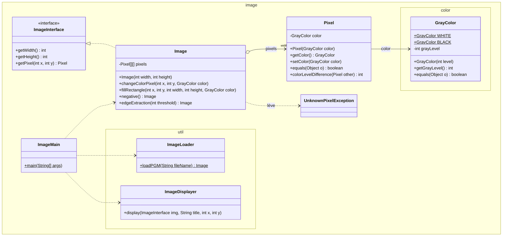
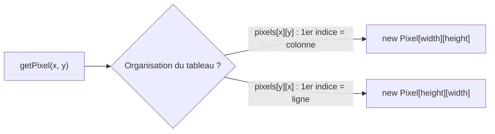
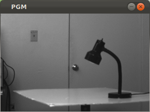
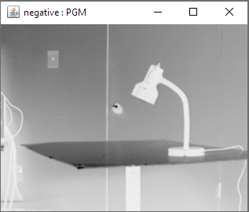
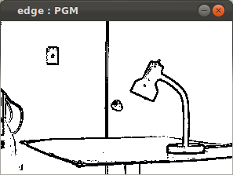
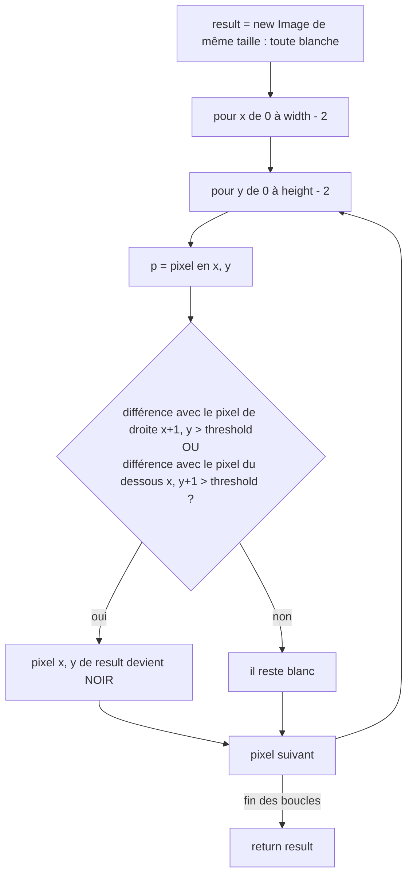

# TP6 — Manipulation d'images (niveaux de gris)

> 🎯 **Objectifs** : définir des **constantes** objets (`static final`), coder `equals(Object)`, **implémenter une interface** (`ImageInterface`), gérer un **tableau à 2 dimensions** sans confondre **coordonnées (x,y)** et **indices**, lever une **exception**, écrire des **tests JUnit** puis des **algorithmes sur les images** (négatif, contours), produire un **jar** avec des ressources.
> 📚 Cours : [02 — static et enum](../../01-Cours/02-static-et-enum.md) · [03 — Tests](../../01-Cours/03-tests.md) · [04 — Exceptions](../../01-Cours/04-exceptions.md) · [05 — Interfaces](../../01-Cours/05-polymorphisme-et-interfaces.md) · [06 — Interfaces (suite)](../../01-Cours/06-interfaces-suite.md) (§ 5 « Manipulation d'images ») · 🛠️ [Memento](../../05-Fiches/memento-commandes.md)
> 📝 Préparation : **lire tout le sujet** et faire **Q1 et Q2** avant la séance.
> 📁 Rendu : dossier **`tp6/`** de ton dépôt GitLab (avec le dossier `images/` fourni).

> ✅ [Corrigé](./CORRIGE.md) — essaie d'abord seul·e !

## 🗺️ Le sujet

💡 **L'idée :** une image = un **rectangle de pixels** ; chaque pixel a une **couleur** = un **niveau de gris** entre **0 (noir)** et **255 (blanc)**.



| Classe | Qui l'écrit ? |
|---|---|
| `GrayColor`, `Pixel`, `Image`, `ImageMain` + tests | **toi** |
| `ImageInterface`, `UnknownPixelException`, `ImageExampleMain` | fournies |
| `image.util.ImageLoader`, `image.util.ImageDisplayer` | fournies (pas besoin de lire leur code, seulement leur doc) |

⚠️ Ne confonds pas un objet **`GrayColor`** et son attribut **`grayLevel`** (un `int`), ni un objet **`Pixel`** et son attribut **`color`** (un `GrayColor`).

### 📌 Coordonnées de l'image ≠ indices du tableau

- `(0,0)` = pixel **en haut à gauche** ; **x** vers la **droite** (colonne), **y** vers le **bas** (ligne).
- Image de largeur 4 et hauteur 3 :

| | x = 0 | x = 1 | x = 2 | x = 3 |
|---|---|---|---|---|
| **y = 0** | (0,0) | (1,0) | (2,0) | (3,0) |
| **y = 1** | (0,1) | (1,1) | (2,1) | (3,1) |
| **y = 2** | (0,2) | (1,2) | (2,2) | (3,2) |



⚠️ Les deux choix sont possibles, mais **choisis-en un** et respecte-le **partout** (constructeur, `getPixel`, boucles).

### Figure 1

| Image initiale | Négatif (Q9-Q10) | Contours, seuil 10 (Q11-Q12) |
|---|---|---|
|  |  |  |

---

## 1. Les couleurs — `image.color.GrayColor` (préparation)

Spécification de `GrayColor` (voir diagramme) :
- `grayLevel` : niveau de gris entre 0 et 255, **ne peut pas changer** ;
- `BLACK` et `WHITE` : **constantes**, niveaux de gris **0** et **255** ;
- deux couleurs sont **égales** si elles ont le **même niveau de gris**.

- [ ] **Q1.** Comment définir `BLACK` et `WHITE` ? Comment les utilise-t-on dans un code ?
- [ ] **Q2.** Code la classe `GrayColor`.

<details><summary>💡 Indice Q1-Q2</summary>

- Une constante partagée par toute la classe : `public static final …` (cours 02 § 3), écrite en MAJUSCULES.
- « Ne peut pas changer » ⇒ mot-clé `final` sur l'attribut, et **pas** de `setGrayLevel`.
- `equals` prend un **`Object`** en paramètre : vérifier `instanceof`, puis convertir.

</details>

## 2. Les pixels — `image.Pixel`

- [ ] **Q3.** Code la classe `Pixel` :
  - paquetage **`image`** ;
  - attribut `color` de type `image.color.GrayColor` + `getColor()` / `setColor()` ;
  - un constructeur qui reçoit la couleur initiale ;
  - `equals()` : deux pixels sont égaux si leurs **couleurs sont égales** ;
  - `colorLevelDifference(Pixel other)` : entier **positif** = différence des **niveaux de gris** de ce pixel et de `other`. Valeur absolue : méthode statique `Math.abs` (le sujet cite `public static double abs(double x)`).

<details><summary>💡 Indice Q3</summary>

- `Pixel` est dans `image`, `GrayColor` dans `image.color` ⇒ `import image.color.GrayColor;`
- Pour comparer les couleurs, **réutilise** `GrayColor.equals`.
- `Math.abs` existe aussi en version `int` : regarde le type du résultat !

</details>

## 3. Les images — `image.Image implements ImageInterface`

Interface **fournie** (`image.ImageInterface`) :
- `getWidth()` / `getHeight()` : largeur / hauteur de l'image ;
- `getPixel(int x, int y)`, documentée ainsi :

```java
/** get the pixel at coordinates (x,y) for this image. (0,0) is top left corner pixel.
 * @param x the horizontal coordinate
 * @param y the vertical coordinate
 * @return pixel at coordinates (x,y) for this image.
 * @exception UnknownPixelException if pixel at coordinates (i,j) does not exist for this image.
 */
```

En plus, la classe `Image` :
- a un **constructeur** `Image(int width, int height)` ; les pixels sont rangés dans un **tableau à 2 dimensions** de `Pixel` ; à la création, **tous blancs** ;
- `public void changeColorPixel(int x, int y, GrayColor color)` : donne la couleur `color` au pixel `(x,y)` ; lève `image.UnknownPixelException` (fournie) si ce pixel n'existe pas ;
- `public void fillRectangle(int x, int y, int width, int height, GrayColor color)` : dessine un **rectangle plein** de couleur `color`, de largeur `width`, hauteur `height`, coin **supérieur gauche** en `(x,y)`.

- [ ] **Q4.** Lis le code de `ImageInterface` et la documentation de ses méthodes.
- [ ] **Q5.** Écris les **méthodes de test** de `Image` correspondant à ce cahier des charges.
- [ ] **Q6.** Code la classe `Image`.
- [ ] **Q7.** Affiche des images avec la classe fournie `image.ImageExampleMain` :
  1. copie le dossier `images/` (et son contenu) dans ton dossier `classes/` ;
  2. étudie le code de `image.ImageExampleMain` ;
  3. elle utilise `image.util.ImageLoader` et `image.util.ImageDisplayer` : inutile d'étudier leur code, lis leur **documentation** (fournie) ;
  4. compile `image.ImageExampleMain` ;
  5. exécute son `main()` : deux images s'affichent, dont celle de gauche de la figure 1. Fais le lien entre les appels à `ImageLoader` / `ImageDisplayer` et ce qui s'affiche.

  ```bash
  cp -r images classes/
  javac -sourcepath src src/image/ImageExampleMain.java -d classes
  java -classpath classes image.ImageExampleMain
  ```

- [ ] **Q8.** Écris puis exécute le `main` d'une classe `ImageMain` qui :
  - crée une image **blanche** de largeur **200** et hauteur **150** ;
  - y dessine les rectangles :
    - **noir**, taille 30×50, à partir du pixel (20,30) ;
    - **gris niveau 128**, taille 40×40, à partir du pixel (50,100) ;
    - **gris niveau 200**, taille 70×50, à partir du pixel (90,20) ;
  - l'affiche avec un objet `ImageDisplayer` et sa méthode `display`.

<details><summary>💡 Indice Q5-Q6</summary>

- Tests à prévoir : taille après construction, **tous** les pixels blancs, `getPixel` hors de l'image ⇒ `assertThrows(UnknownPixelException.class, () -> …)`, `changeColorPixel` ne change **que** ce pixel, `fillRectangle` colore **exactement** le rectangle.
- `new Pixel[w][h]` ne crée que des `null` : il faut un `new Pixel(...)` **par case** (comme les chambres du TP4).
- `getPixel` : comme `getRoom` au TP4, capture `ArrayIndexOutOfBoundsException`… mais ici on **lève** `UnknownPixelException`.
- **Réutilise** : `changeColorPixel` utilise `getPixel`, `fillRectangle` utilise `changeColorPixel`.

</details>

## 4. Manipuler les images

💡 Pense à **réutiliser** les méthodes de `Pixel` et `Image`.

- [ ] **Q9.** Ajoute à `Image` la méthode `public Image negative()` : crée une **nouvelle** image où chaque pixel de niveau `l` devient un pixel de niveau **`255 − l`**.
  - [ ] **Q9.1.** Comment tester cette méthode ? Écris la méthode de test.
  - [ ] **Q9.2.** Code `negative()` et teste-la.
- [ ] **Q10.** En t'inspirant de `ImageExampleMain`, complète le `main()` de `ImageMain` pour :
  1. créer un objet `Image` à partir d'un fichier dont le **nom est passé sur la ligne de commande** ;
  2. calculer son négatif avec `negative()` ;
  3. afficher les **deux** images (⚠️ **décale** les coordonnées d'affichage pour qu'elles ne se superposent pas).

  Avec `images/lamp.pgm`, tu dois obtenir les deux images de gauche de la figure 1.

- [ ] **Q11.** Méthode `public Image edgeExtraction(int threshold)` (*threshold* = seuil) : crée une **nouvelle** image des **contours** (image de droite de la figure 1). Algorithme (simple mais imparfait) :
  1. créer une image résultat de **même taille** (donc initialement **blanche**) ;
  2. parcourir l'image initiale pixel par pixel : un pixel du résultat devient **noir** s'il appartient à un **contour**, les autres restent blancs ;
  3. un pixel appartient à un contour s'il est « **très différent** » du pixel **à sa droite** **ou** du pixel **en dessous** ⇒ on n'examine **ni la dernière colonne ni la dernière ligne** ;
  4. deux pixels sont « très différents » si la différence de leurs niveaux de gris est **strictement supérieure** au seuil `threshold`.

  Écris la **documentation**, les **tests** et le **code** de `edgeExtraction()`.



- [ ] **Q12.** Complète le `main()` de `ImageMain` pour :
  1. calculer l'image des contours avec `edgeExtraction()` ; le **seuil** peut lui aussi être passé en argument (avec une **valeur par défaut** s'il est absent) ;
  2. l'afficher **en plus** des autres (coordonnées décalées).

  Le nom du fichier et le seuil sont des arguments de la ligne de commande, par exemple :

  ```bash
  java -classpath classes image.ImageMain /images/fruit.pgm 15
  ```

<details><summary>💡 Indice Q9</summary>

Un test **sans** charger de fichier : crée une petite image, colore quelques pixels avec des niveaux **connus** (ex. 100), puis vérifie que le négatif a le niveau 155 à ces endroits, 0 ailleurs (blanc 255 → 0), la **même taille**, et que l'image de départ **n'a pas changé**. Bonus : le négatif du négatif redonne l'image de départ.

</details>

<details><summary>💡 Indice Q10-Q12 : arguments du main</summary>

- `args[0]` = nom du fichier (ex. `/images/lamp.pgm` : il est cherché dans le **classpath**, d'où la copie de `images/` dans `classes/`).
- Seuil : `Integer.parseInt(args[1])` **seulement si** `args.length >= 2`, sinon une constante par défaut (ex. 10).
- Décalage : afficher la 2ᵉ image à `x + largeur de l'image + une marge`.

</details>

<details><summary>💡 Indice Q11 : tests de edgeExtraction</summary>

Petites images à **deux zones** (`fillRectangle`) : une frontière **verticale** (teste le voisin de droite), une **horizontale** (voisin du dessous), une image **uniforme** (aucun contour), une différence **égale** au seuil (pas de contour : « supérieure » est strict).

</details>

## 🌍 Dans la vraie vie

> 🌍 **Dans la vraie vie :** le filtre « noir et blanc » de l'appareil photo du téléphone ne garde que le niveau de gris de chaque pixel ; le filtre « négatif » rappelle les **négatifs argentiques** des anciennes pellicules (clair ↔ foncé). La **détection de contours** sert à lire les **plaques d'immatriculation** aux péages, à repérer les bords d'une feuille quand on **scanne** un document avec son téléphone…
> → en Java : chaque filtre est une **méthode** de `Image` qui **fabrique une nouvelle image** (`negative()`, `edgeExtraction(seuil)`) sans modifier l'originale.

## 📤 Rendu GitLab
- [ ] Dossier **`tp6/`** : `src/`, `test/`, le dossier **`images/`** fourni et un **`README.md`** ([modèle](./README.md)) respectant les consignes de rendu.
- [ ] Dans le README : comment **exécuter** `ImageMain` et comment **produire un jar** qui lance ce même `main`. Le dossier `images/` s'ajoute à la racine de l'archive **comme un paquetage** :

  ```bash
  jar cvfe image.jar image.ImageMain images -C classes image
  java -jar image.jar /images/lamp.pgm 10
  ```

- [ ] `add / commit / push` **au fur et à mesure**.

---
📂 Ton code : [src/](./src/) · [test/](./test/) · 🏠 [Sommaire](../../README.md)
