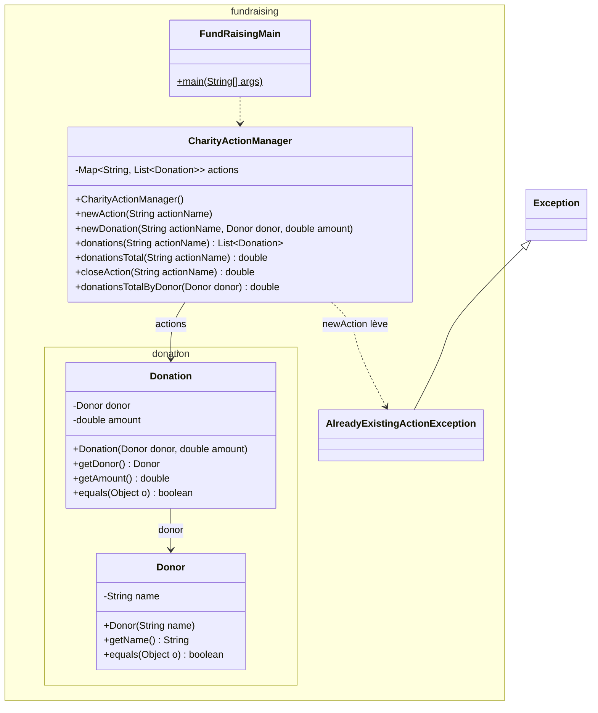
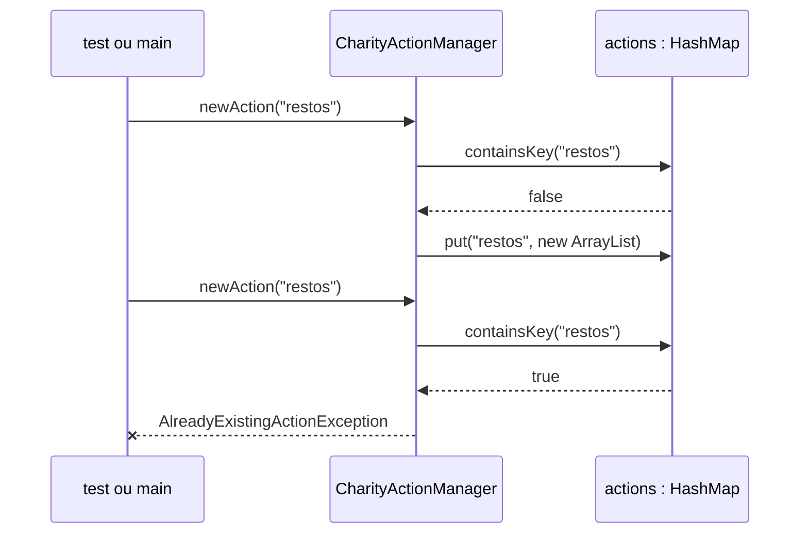
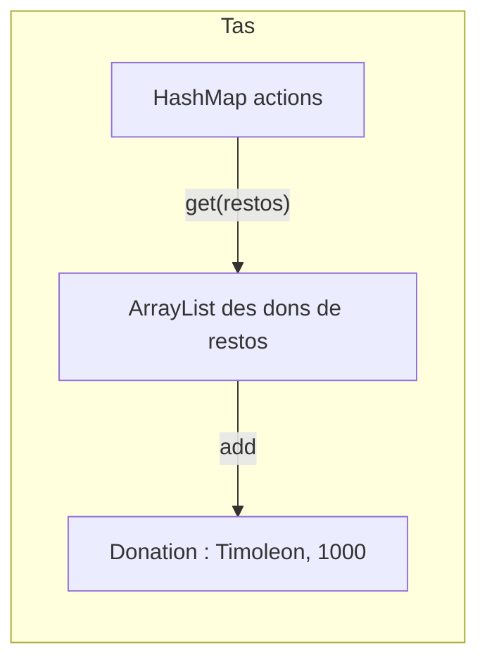
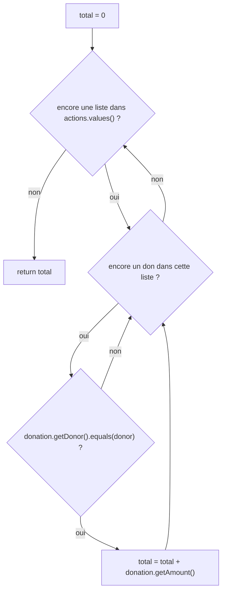
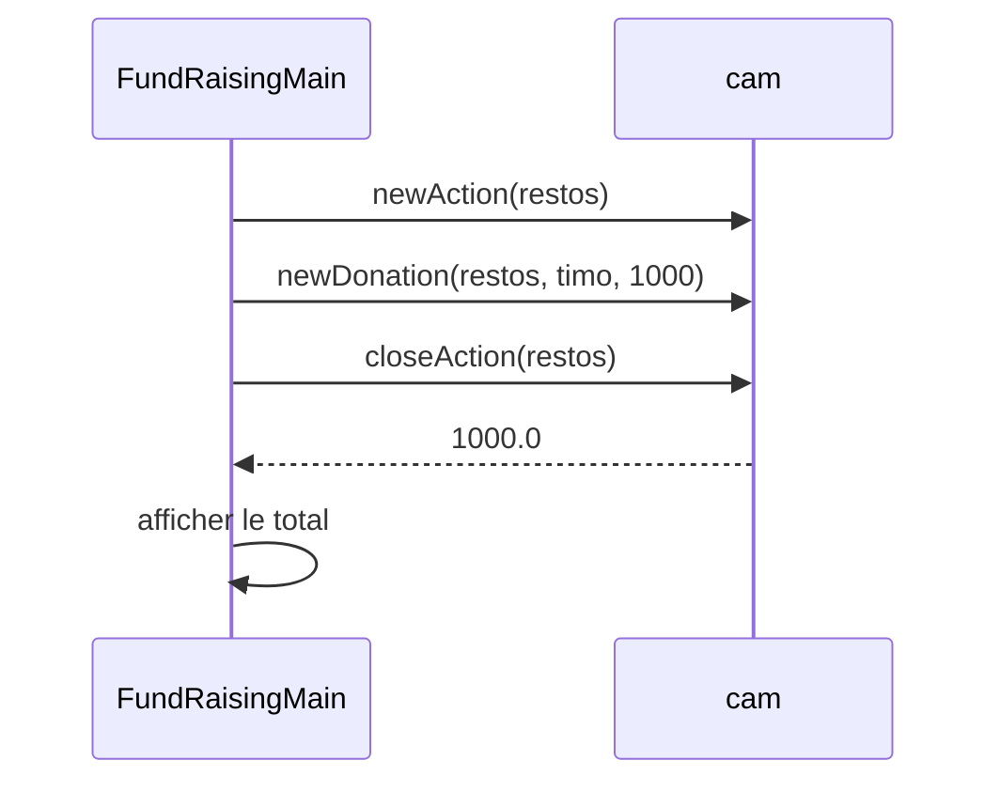

# TP6bis — Corrigé : collecte de fonds (Map, List, exceptions, tests)

📄 [Énoncé](./ENONCE.md) · 📚 [Cours 07 — Collections](../../01-Cours/07-collections.md) · [Cours 04 — Exceptions](../../01-Cours/04-exceptions.md) · [Cours 03 — Tests](../../01-Cours/03-tests.md) · 🛠️ [Memento](../../05-Fiches/memento-commandes.md)

> ⚠️ **Corrigé non officiel**, rédigé pour réviser. Le code a été **compilé** (Java 21), les tests **exécutés avec JUnit 5** (18 tests réussis, 0 échec) et `FundRaisingMain` lancé : les traces sont les vraies sorties. Le code a aussi été recompilé et testé avec les fichiers `Donor`, `Donation` et `AlreadyExistingActionException` **du portail** : mêmes résultats.

> 📌 **Hypothèses et choix (à lire !)**
> - `Donor` et `Donation` sont **fournies** : les versions ci-dessous sont **réécrites avec javadoc** ; le code fourni peut différer légèrement (mise en forme, cas `donor == null` dans `equals`…), mais l'interface est la même.
> - ⚠️ L'UML du sujet écrit `amount()`, le fichier fourni `Donation.java` définit **`getAmount()`** : ce corrigé utilise `getAmount()`. Si ta version a `amount()`, remplace les appels.
> - Le sujet **ne précise pas** ce qui se passe pour une action **inexistante** dans `donations`, `donationsTotal` et `closeAction`. Choix de ce corrigé (documentés dans la javadoc et **testés**) :
>
> | Méthode | Action inexistante ⇒ |
> |---|---|
> | `donations` | liste **vide** (ni `null`, ni exception) |
> | `donationsTotal` | `0` |
> | `closeAction` | `0`, rien n'est retiré |
>
> - Autre choix : `donations` renvoie une **copie** de la liste (modifier le résultat ne modifie pas le gestionnaire).
> - D'autres choix sont défendables (ex. lever une exception) : l'important est de les **documenter** et de les **tester**.

## 🗺️ Vue d'ensemble



Organisation des fichiers (paquetage `fundraising.donation` ⇒ dossier `fundraising/donation/` + `package fundraising.donation;`) :

| Fichier | Contenu |
|---|---|
| `src/fundraising/donation/Donor.java` | fourni |
| `src/fundraising/donation/Donation.java` | fourni |
| `src/fundraising/AlreadyExistingActionException.java` | fourni (Q1 : à refaire seul·e) |
| `src/fundraising/CharityActionManager.java` | **à écrire** (Q3) |
| `src/fundraising/FundRaisingMain.java` | fourni, **à compléter** (Q4) |
| `test/fundraising/CharityActionManagerTest.java` | **à écrire** (Q2) |

Commandes (depuis `tp6bis/`) :
```bash
javac -sourcepath src src/fundraising/*.java -d classes
javac -classpath junit-console.jar:classes -d test test/fundraising/*Test.java
java -jar junit-console.jar -classpath test:classes -scan-classpath
javadoc -sourcepath src -d docs fundraising fundraising.donation
java -classpath classes fundraising.FundRaisingMain
```
💡 Grâce à `-sourcepath src`, compiler `src/fundraising/*.java` compile **aussi** `Donor` et `Donation` (classes utilisées, importées).

---

## Classes fournies

<details><summary>📌 <code>Donor</code> (version réécrite, le fichier fourni peut différer)</summary>

```java
package fundraising.donation;

/**
 * A donor, identified by his name.
 */
public class Donor {
    /** the name of this donor */
    private String name;

    /**
     * Builds a donor with the given name.
     * @param name the name of the donor
     */
    public Donor(String name) {
        this.name = name;
    }

    /**
     * Gives the name of this donor.
     * @return the name of this donor
     */
    public String getName() {
        return this.name;
    }

    /**
     * Two donors are equal if they have the same name.
     * @param o the object to compare with this donor
     * @return true iff o is a donor with the same name as this donor
     */
    public boolean equals(Object o) {
        if (!(o instanceof Donor)) {
            return false;
        }
        Donor other = (Donor) o;
        return other.name.equals(this.name);
    }
}
```

</details>

<details><summary>📌 <code>Donation</code> (version réécrite, le fichier fourni peut différer)</summary>

```java
package fundraising.donation;

/**
 * A donation: a donor and the amount (in euros) he gave.
 */
public class Donation {
    /** the donor of this donation */
    private Donor donor;
    /** the amount of this donation */
    private double amount;

    /**
     * Builds a donation.
     * @param donor the donor
     * @param amount the amount of the donation
     */
    public Donation(Donor donor, double amount) {
        this.donor = donor;
        this.amount = amount;
    }

    /**
     * Gives the donor of this donation.
     * @return the donor of this donation
     */
    public Donor getDonor() {
        return this.donor;
    }

    /**
     * Gives the amount of this donation.
     * @return the amount of this donation
     */
    public double getAmount() {
        return this.amount;
    }

    /**
     * Two donations are equal if they have equal donors and the same amount.
     * @param o the object to compare with this donation
     * @return true iff o is a donation with an equal donor and the same amount
     */
    public boolean equals(Object o) {
        if (!(o instanceof Donation)) {
            return false;
        }
        Donation other = (Donation) o;
        return this.donor.equals(other.donor) && this.amount == other.amount;
    }
}
```

</details>

💡 Les deux classes redéfinissent **`equals(Object o)`** (paramètre de type `Object` !) : deux `Donor` sont égaux s'ils ont le **même nom** ; deux `Donation` sont égales si donateurs égaux **et** même montant. C'est ce qui permet `assertEquals` sur des listes de dons dans les tests.
📌 `javac -Xlint` signale qu'elles redéfinissent `equals` **sans** `hashCode` : sans conséquence ici (on ne les range que dans des `List`), mais **indispensable** si on utilisait un `Donor` comme **clé** d'une `HashMap` ([cours 07 § 7](../../01-Cours/07-collections.md)).

---

## Q1. `AlreadyExistingActionException`

```java
package fundraising;

/**
 * Exception thrown when one tries to add an action whose name is
 * already used by an action of a charity action manager.
 */
public class AlreadyExistingActionException extends Exception {
    /**
     * Builds the exception.
     */
    public AlreadyExistingActionException() {
        super();
    }

    /**
     * Builds the exception with a message.
     * @param message the message of the exception
     */
    public AlreadyExistingActionException(String message) {
        super(message);
    }
}
```
- 💡 `extends Exception` : « est une sorte d'`Exception` ». Ce n'est **pas** une `RuntimeException` ⇒ exception **vérifiée** : le compilateur **oblige** à la capturer (`try / catch`) ou à l'annoncer (`throws`).
- 💡 Deux constructeurs : sans message, et avec message transmis à `Exception` par `super(message)` (récupérable avec `e.getMessage()`).
- 📌 La version **fournie** sur le portail peut différer : elle ne contient que le constructeur **avec** message (`String msg`). Les deux versions conviennent pour la suite, puisque `newAction` utilise le constructeur avec message.

---

## Q2. Les tests d'abord : `CharityActionManagerTest`

💡 **L'idée :** écrire les tests **avant** le code, d'après le cahier des charges : chaque phrase du sujet (« il ne se passe rien si… », « retire cette action… ») devient **au moins un test**.
⚠️ Pour que les tests **compilent**, `CharityActionManager` doit déjà avoir **toutes** les signatures (corps provisoires : `return null;`, `return 0;`…).

```java
package fundraising;

import static org.junit.jupiter.api.Assertions.*;

import java.util.ArrayList;
import java.util.List;

import org.junit.jupiter.api.BeforeEach;
import org.junit.jupiter.api.Test;

import fundraising.donation.Donation;
import fundraising.donation.Donor;

public class CharityActionManagerTest {

    private CharityActionManager cam;
    private Donor timo;
    private Donor bilbo;

    @BeforeEach
    public void before() {
        this.cam = new CharityActionManager();
        this.timo = new Donor("Timoleon");
        this.bilbo = new Donor("Bilbo");
    }

    // ---------- Q2.1 : newAction ----------

    @Test
    public void newActionCreatesAnActionWithNoDonation() throws AlreadyExistingActionException {
        this.cam.newAction("restos");
        assertTrue(this.cam.donations("restos").isEmpty());
        assertEquals(0, this.cam.donationsTotal("restos"));
        // the action exists: a donation can be recorded
        this.cam.newDonation("restos", this.timo, 100);
        assertEquals(1, this.cam.donations("restos").size());
    }

    @Test
    public void newActionThrowsExceptionIfActionAlreadyExists() throws AlreadyExistingActionException {
        this.cam.newAction("restos");
        assertThrows(AlreadyExistingActionException.class, () -> this.cam.newAction("restos"));
    }

    @Test
    public void newActionWithExistingNameDoesNotChangeTheAction() throws AlreadyExistingActionException {
        this.cam.newAction("restos");
        this.cam.newDonation("restos", this.timo, 100);
        assertThrows(AlreadyExistingActionException.class, () -> this.cam.newAction("restos"));
        assertEquals(1, this.cam.donations("restos").size());
        assertEquals(100, this.cam.donationsTotal("restos"));
    }

    @Test
    public void newActionAcceptsSeveralActionsWithDifferentNames() throws AlreadyExistingActionException {
        this.cam.newAction("restos");
        this.cam.newAction("telethon");
        this.cam.newDonation("restos", this.timo, 100);
        this.cam.newDonation("telethon", this.timo, 30);
        assertEquals(100, this.cam.donationsTotal("restos"));
        assertEquals(30, this.cam.donationsTotal("telethon"));
    }

    // ---------- Q2.2 : newDonation ----------

    @Test
    public void newDonationIsRecordedForAnExistingAction() throws AlreadyExistingActionException {
        this.cam.newAction("restos");
        this.cam.newDonation("restos", this.timo, 100);
        List<Donation> donations = this.cam.donations("restos");
        assertEquals(1, donations.size());
        assertEquals(new Donation(this.timo, 100), donations.get(0));
    }

    @Test
    public void newDonationDoesNothingIfActionDoesNotExist() throws AlreadyExistingActionException {
        this.cam.newDonation("restos", this.timo, 100);
        assertEquals(0, this.cam.donationsTotalByDonor(this.timo));
        // the action created afterwards has no donation
        this.cam.newAction("restos");
        assertTrue(this.cam.donations("restos").isEmpty());
    }

    // ---------- Q2.2 : donations ----------

    @Test
    public void donationsGivesAllTheDonationsOfTheAction() throws AlreadyExistingActionException {
        this.cam.newAction("restos");
        this.cam.newAction("telethon");
        this.cam.newDonation("restos", this.timo, 100);
        this.cam.newDonation("telethon", this.bilbo, 30);
        this.cam.newDonation("restos", this.bilbo, 50);
        List<Donation> expected = new ArrayList<Donation>();
        expected.add(new Donation(new Donor("Timoleon"), 100));
        expected.add(new Donation(new Donor("Bilbo"), 50));
        assertEquals(expected, this.cam.donations("restos"));
    }

    @Test
    public void donationsOfUnknownActionIsEmpty() {
        // choice of this solution: empty list (not null, no exception)
        assertNotNull(this.cam.donations("restos"));
        assertTrue(this.cam.donations("restos").isEmpty());
    }

    @Test
    public void modifyingTheResultOfDonationsDoesNotModifyTheManager() throws AlreadyExistingActionException {
        // choice of this solution: donations() gives a copy
        this.cam.newAction("restos");
        this.cam.newDonation("restos", this.timo, 100);
        this.cam.donations("restos").clear();
        assertEquals(1, this.cam.donations("restos").size());
    }

    // ---------- Q2.2 : donationsTotal ----------

    @Test
    public void donationsTotalIsTheSumOfTheAmounts() throws AlreadyExistingActionException {
        this.cam.newAction("restos");
        this.cam.newDonation("restos", this.timo, 100);
        this.cam.newDonation("restos", this.bilbo, 50);
        this.cam.newDonation("restos", this.timo, 20);
        assertEquals(170, this.cam.donationsTotal("restos"));
    }

    @Test
    public void donationsTotalIsZeroIfNoDonation() throws AlreadyExistingActionException {
        this.cam.newAction("restos");
        assertEquals(0, this.cam.donationsTotal("restos"));
    }

    @Test
    public void donationsTotalOfUnknownActionIsZero() {
        // choice of this solution: 0
        assertEquals(0, this.cam.donationsTotal("restos"));
    }

    // ---------- Q2.2 : closeAction ----------

    @Test
    public void closeActionGivesTheTotalAndRemovesTheAction() throws AlreadyExistingActionException {
        this.cam.newAction("restos");
        this.cam.newDonation("restos", this.timo, 100);
        this.cam.newDonation("restos", this.bilbo, 50);
        assertEquals(150, this.cam.closeAction("restos"));
        // the action no longer exists
        assertTrue(this.cam.donations("restos").isEmpty());
        this.cam.newDonation("restos", this.timo, 10);
        assertTrue(this.cam.donations("restos").isEmpty());
        // so an action with the same name can be created again
        this.cam.newAction("restos");
        assertEquals(0, this.cam.donationsTotal("restos"));
    }

    @Test
    public void closeActionDoesNotModifyTheOtherActions() throws AlreadyExistingActionException {
        this.cam.newAction("restos");
        this.cam.newAction("telethon");
        this.cam.newDonation("restos", this.timo, 100);
        this.cam.newDonation("telethon", this.timo, 30);
        this.cam.closeAction("restos");
        assertEquals(30, this.cam.donationsTotal("telethon"));
        assertEquals(1, this.cam.donations("telethon").size());
    }

    @Test
    public void closeActionOfUnknownActionGivesZero() {
        // choice of this solution: 0, nothing happens
        assertEquals(0, this.cam.closeAction("restos"));
    }

    // ---------- Q2.2 : donationsTotalByDonor ----------

    @Test
    public void donationsTotalByDonorSumsOverAllTheActions() throws AlreadyExistingActionException {
        this.cam.newAction("restos");
        this.cam.newAction("telethon");
        this.cam.newDonation("restos", this.timo, 100);
        this.cam.newDonation("telethon", this.timo, 30);
        this.cam.newDonation("restos", this.bilbo, 50);
        this.cam.newDonation("restos", this.timo, 20);
        assertEquals(150, this.cam.donationsTotalByDonor(this.timo));
        assertEquals(50, this.cam.donationsTotalByDonor(this.bilbo));
        // equals: another Donor object with the same name is the same donor
        assertEquals(150, this.cam.donationsTotalByDonor(new Donor("Timoleon")));
    }

    @Test
    public void donationsTotalByDonorIsZeroForAnAbsentDonor() throws AlreadyExistingActionException {
        this.cam.newAction("restos");
        this.cam.newDonation("restos", this.timo, 100);
        assertEquals(0, this.cam.donationsTotalByDonor(this.bilbo));
    }

    @Test
    public void donationsTotalByDonorIgnoresClosedActions() throws AlreadyExistingActionException {
        this.cam.newAction("restos");
        this.cam.newAction("telethon");
        this.cam.newDonation("restos", this.timo, 100);
        this.cam.newDonation("telethon", this.timo, 30);
        this.cam.closeAction("restos");
        assertEquals(30, this.cam.donationsTotalByDonor(this.timo));
    }
}
```

### Q2.1. Tester `newAction`

- 💡 Pas de méthode « l'action existe-t-elle ? » : on vérifie le **comportement observable**. Une action créée a une liste **vide**, un total **nul**, et accepte les dons (`newActionCreatesAnActionWithNoDonation`).
- 💡 Doublon ⇒ `assertThrows(AlreadyExistingActionException.class, () -> this.cam.newAction("restos"))`. La lambda `() ->` laisse JUnit faire l'appel **lui-même**.
- 💡 Plus rigoureux : après l'exception, l'action existante n'est **pas** remise à zéro (`newActionWithExistingNameDoesNotChangeTheAction`) — c'est exactement l'erreur d'un `put` sans test `containsKey` (le `put` **remplace** la liste).
- 💡 Les méthodes qui appellent `newAction` portent `throws AlreadyExistingActionException` : exception vérifiée, le compilateur l'exige (même si on sait qu'elle ne sera pas levée).

### Q2.2. Tester les autres méthodes

| Méthode | Tests | Ce qui est vérifié |
|---|---|---|
| `newAction` | `newActionCreatesAnActionWithNoDonation`, `newActionThrowsExceptionIfActionAlreadyExists`, `newActionWithExistingNameDoesNotChangeTheAction`, `newActionAcceptsSeveralActionsWithDifferentNames` | création, exception si doublon |
| `newDonation` | `newDonationIsRecordedForAnExistingAction`, `newDonationDoesNothingIfActionDoesNotExist` | don enregistré ; **rien** si action inconnue |
| `donations` | `donationsGivesAllTheDonationsOfTheAction`, `donationsOfUnknownActionIsEmpty`, `modifyingTheResultOfDonationsDoesNotModifyTheManager` | tous les dons, dans l'ordre ; choix « liste vide » et « copie » |
| `donationsTotal` | `donationsTotalIsTheSumOfTheAmounts`, `donationsTotalIsZeroIfNoDonation`, `donationsTotalOfUnknownActionIsZero` | somme ; `0` sans don ; choix « `0` si inconnue » |
| `closeAction` | `closeActionGivesTheTotalAndRemovesTheAction`, `closeActionDoesNotModifyTheOtherActions`, `closeActionOfUnknownActionGivesZero` | total renvoyé **et** action retirée ; choix « `0` si inconnue » |
| `donationsTotalByDonor` | `donationsTotalByDonorSumsOverAllTheActions`, `donationsTotalByDonorIsZeroForAnAbsentDonor`, `donationsTotalByDonorIgnoresClosedActions` | plusieurs actions ; donateur absent ⇒ `0` ; actions fermées ignorées |

- 💡 `@BeforeEach` : la méthode `before()` est exécutée **avant chaque** test ⇒ chaque test part d'un gestionnaire **neuf** (les tests sont indépendants).
- 💡 `assertEquals(expected, this.cam.donations("restos"))` compare deux `List` : `List.equals` compare les éléments un à un avec **`Donation.equals`** — d'où des `new Donation(new Donor("Timoleon"), 100)` **différents** des objets stockés mais **égaux**.
- 💡 `donationsTotalByDonor(new Donor("Timoleon"))` : un **autre** objet de même nom doit compter ⇒ vérifie que le code utilise `equals` et pas `==`.
- 💡 Montants `double` : `assertEquals(150, ...)` compare des `double` (le `150` est converti). Les sommes d'entiers sont exactes ; avec des centimes (`0.1 + 0.2`), utiliser une tolérance : `assertEquals(0.3, total, 0.001)`.
- 💡 `closeActionGivesTheTotalAndRemovesTheAction` prouve la **suppression** de 3 façons : liste vide, nouveau don ignoré, et `newAction` du même nom possible **sans** exception.

📌 Pertinence des tests vérifiée en introduisant volontairement des erreurs dans `CharityActionManager` :

| Erreur introduite | Tests en échec |
|---|---|
| `newAction` sans le `throw` | 2 |
| `closeAction` sans `remove` | 2 |
| `==` au lieu de `equals` dans `donationsTotalByDonor` | 1 |
| `donations` renvoie la liste interne (pas une copie) | 1 |

---

## Q3. La classe `CharityActionManager`

```java
package fundraising;

import java.util.ArrayList;
import java.util.HashMap;
import java.util.List;
import java.util.Map;

import fundraising.donation.Donation;
import fundraising.donation.Donor;

/**
 * A manager of charity actions. Each action is identified by its name
 * and is associated to the list of the donations made for this action.
 */
public class CharityActionManager {
    /** the table that associates to each action name its list of donations */
    private Map<String, List<Donation>> actions;

    /**
     * Builds a charity action manager with no action.
     */
    public CharityActionManager() {
        this.actions = new HashMap<String, List<Donation>>();
    }

    /**
     * Adds a new action, with no donation, to this manager.
     * @param actionName the name of the new action
     * @throws AlreadyExistingActionException if an action with the same name
     *         already exists in this manager
     */
    public void newAction(String actionName) throws AlreadyExistingActionException {
        if (this.actions.containsKey(actionName)) {
            throw new AlreadyExistingActionException("action " + actionName + " already exists");
        }
        this.actions.put(actionName, new ArrayList<Donation>());
    }

    /**
     * Records a new donation of donor for the action actionName.
     * Nothing happens if this action does not exist.
     * @param actionName the name of the action
     * @param donor the donor
     * @param amount the amount of the donation
     */
    public void newDonation(String actionName, Donor donor, double amount) {
        if (this.actions.containsKey(actionName)) {
            this.actions.get(actionName).add(new Donation(donor, amount));
        }
    }

    /**
     * Gives the list of the donations made for the action actionName.
     * The result is a copy: modifying it does not modify this manager.
     * @param actionName the name of the action
     * @return the list of the donations for this action, an empty list
     *         if this action does not exist
     */
    public List<Donation> donations(String actionName) {
        List<Donation> result = new ArrayList<Donation>();
        if (this.actions.containsKey(actionName)) {
            result.addAll(this.actions.get(actionName));
        }
        return result;
    }

    /**
     * Gives the total amount of the donations made for the action actionName.
     * @param actionName the name of the action
     * @return the total amount of the donations for this action, 0 if this
     *         action does not exist
     */
    public double donationsTotal(String actionName) {
        double total = 0;
        for (Donation donation : this.donations(actionName)) {
            total = total + donation.getAmount();
        }
        return total;
    }

    /**
     * Closes the action actionName: it is removed from this manager.
     * Nothing is removed if this action does not exist.
     * @param actionName the name of the action
     * @return the total amount of the donations received by this action,
     *         0 if this action does not exist
     */
    public double closeAction(String actionName) {
        double total = this.donationsTotal(actionName);
        this.actions.remove(actionName);
        return total;
    }

    /**
     * Gives the total amount of the donations made by donor for all the
     * actions of this manager.
     * @param donor the donor
     * @return the total amount of the donations of this donor, 0 if he made
     *         no donation
     */
    public double donationsTotalByDonor(Donor donor) {
        double total = 0;
        for (List<Donation> donationList : this.actions.values()) {
            for (Donation donation : donationList) {
                if (donation.getDonor().equals(donor)) {
                    total = total + donation.getAmount();
                }
            }
        }
        return total;
    }
}
```

### L'attribut et le constructeur

💡 On **déclare** avec les interfaces (`Map`, `List`) et on **crée** avec les implémentations (`HashMap`, `ArrayList`) : « programmer avec l'interface » ([cours 07 § 4.2](../../01-Cours/07-collections.md)).
⚠️ Le constructeur crée la **table** (vide), pas les listes : il n'y a encore aucune action.

### `newAction` : lever l'exception, créer la liste

💡 Si la clé existe ⇒ `throw` ; sinon on associe au nom une **nouvelle liste vide**.


- ⚠️ `throw` (dans le corps) **et** `throws` (dans la signature) : il faut les **deux**.
- ⚠️ Sans `containsKey`, le second `put` **remplace** silencieusement la liste : tous les dons de l'action seraient **perdus**.

### `newDonation` : `get` puis `add`

💡 `this.actions.get(actionName)` donne **la** liste stockée dans la table (une **référence**) : l'`add` modifie donc directement la liste de la table, inutile de refaire un `put`.


⚠️ Sans le test `containsKey`, `get` d'une clé absente renvoie **`null`** ⇒ `null.add(...)` ⇒ `NullPointerException`. Le sujet demande « **il ne se passe rien** ».

### `donations` et `donationsTotal`

- 💡 `donations` construit une **nouvelle** `ArrayList` et y copie (`addAll`) les dons de l'action ⇒ liste vide si l'action n'existe pas, et l'appelant ne peut pas « tricher » en vidant la liste interne.
- 💡 `donationsTotal` **réutilise** `donations` : schéma **accumulateur** sur une liste (`for` each). Action inconnue ⇒ liste vide ⇒ `0`, sans cas particulier à écrire.

### `closeAction` : calculer **avant** de retirer

💡 On calcule le total **d'abord**, on retire **ensuite** : après le `remove`, la liste n'est plus accessible par la table.
- `this.actions.remove(actionName)` sur une clé absente ne fait **rien** (pas d'exception) ⇒ action inconnue : total `0`, rien retiré.

### `donationsTotalByDonor` : parcourir toute la table

💡 Une `Map` n'est **pas** une collection : on parcourt la **collection de ses valeurs** (`values()`), ici des `List<Donation>`, puis chaque liste.


📌 Variante équivalente du cours : `for (String name : this.actions.keySet())` puis `this.actions.get(name)` (ou `entrySet()`).

### Résultat des tests (vraie exécution)

```bash
java -jar junit-console.jar -classpath test:classes -scan-classpath
```
```text
╷
├─ JUnit Jupiter ✔
│  └─ CharityActionManagerTest ✔
│     ├─ newDonationIsRecordedForAnExistingAction() ✔
│     ├─ donationsTotalOfUnknownActionIsZero() ✔
│     ├─ donationsGivesAllTheDonationsOfTheAction() ✔
│     ├─ donationsTotalByDonorIsZeroForAnAbsentDonor() ✔
│     ├─ newActionWithExistingNameDoesNotChangeTheAction() ✔
│     ├─ newActionCreatesAnActionWithNoDonation() ✔
│     ├─ closeActionDoesNotModifyTheOtherActions() ✔
│     ├─ newDonationDoesNothingIfActionDoesNotExist() ✔
│     ├─ closeActionGivesTheTotalAndRemovesTheAction() ✔
│     ├─ donationsTotalByDonorIgnoresClosedActions() ✔
│     ├─ closeActionOfUnknownActionGivesZero() ✔
│     ├─ donationsTotalIsZeroIfNoDonation() ✔
│     ├─ modifyingTheResultOfDonationsDoesNotModifyTheManager() ✔
│     ├─ donationsTotalByDonorSumsOverAllTheActions() ✔
│     ├─ donationsOfUnknownActionIsEmpty() ✔
│     ├─ newActionAcceptsSeveralActionsWithDifferentNames() ✔
│     ├─ newActionThrowsExceptionIfActionAlreadyExists() ✔
│     └─ donationsTotalIsTheSumOfTheAmounts() ✔
├─ JUnit Vintage ✔
└─ JUnit Platform Suite ✔

Test run finished after 115 ms
[         4 containers found      ]
[         0 containers skipped    ]
[         4 containers started    ]
[         0 containers aborted    ]
[         4 containers successful ]
[         0 containers failed     ]
[        18 tests found           ]
[         0 tests skipped         ]
[        18 tests started         ]
[         0 tests aborted         ]
[        18 tests successful      ]
[         0 tests failed          ]
```

---

## Q4. `FundRaisingMain`

Lignes à ajouter à l'endroit `// COMPLETER LE CODE ICI` :

```java
try {
    cam.newAction(restos);
    cam.newDonation(restos, timo, 1000);
    double total = cam.closeAction(restos);
    System.out.println("Total collecté pour " + restos + " : " + total + " €");
} catch (AlreadyExistingActionException e) {
    System.out.println("L'action " + restos + " existe déjà");
}
```

Classe complète :

```java
package fundraising;

import fundraising.donation.Donor;

public class FundRaisingMain {
    public static void main(String[] args) {
        CharityActionManager cam = new CharityActionManager();
        Donor timo = new Donor("Timoleon");
        String restos = "Restos du Coeur";
        // COMPLETER LE CODE ICI
        try {
            cam.newAction(restos);
            cam.newDonation(restos, timo, 1000);
            double total = cam.closeAction(restos);
            System.out.println("Total collecté pour " + restos + " : " + total + " €");
        } catch (AlreadyExistingActionException e) {
            System.out.println("L'action " + restos + " existe déjà");
        }
    }
}
```

Trace réelle :
```text
$ java -classpath classes fundraising.FundRaisingMain
Total collecté pour Restos du Coeur : 1000.0 €
```

- 💡 `newAction` déclare `throws AlreadyExistingActionException` (exception **vérifiée**) : sans `try / catch`, le compilateur refuse (vraie erreur obtenue) :
  ```text
  fundraising/FundRaisingMain.java:10: error: unreported exception AlreadyExistingActionException; must be caught or declared to be thrown
          cam.newAction(restos);
                       ^
  1 error
  ```
- 💡 Le don et la fermeture sont **dans** le `try` : si l'action n'avait pas pu être créée, on saute directement au `catch`.
- 💡 On affiche le **résultat de `closeAction`** : après la fermeture, `cam.donationsTotal(restos)` donnerait `0.0` (l'action n'existe plus).
- 💡 `1000.0` : le montant est un `double`, d'où le `.0` à l'affichage.
- 📌 Autre solution acceptée par le compilateur : `public static void main(String[] args) throws AlreadyExistingActionException` — mais en cas d'erreur le programme s'arrête avec une trace de pile au lieu d'un message clair.



## 📤 Rendu GitLab

```bash
git add src test README.md
git commit -m "CharityActionManager : closeAction + tests OK"
git push
```
✅ Un commit **par méthode** qui passe ses tests ; `classes/`, `docs/` et `*.jar` dans le `.gitignore`.

---

## ⚠️ Erreurs fréquentes

| Erreur | Pourquoi c'est faux | Correction |
|---|---|---|
| oublier de créer la liste dans `newAction` (`put(name, null)` ou rien) | `get(name)` renvoie `null` ⇒ `NullPointerException` au premier `add` | `put(actionName, new ArrayList<Donation>())` |
| `newAction` sans test `containsKey` | `put` **remplace** la liste : les dons sont perdus, et pas d'exception | `if (containsKey) throw ...` **avant** le `put` |
| `get(actionName).add(...)` sans tester l'existence | clé absente ⇒ `get` renvoie `null` ⇒ `NullPointerException` | tester `containsKey` (le sujet dit « il ne se passe rien ») |
| comparer des noms ou des donateurs avec `==` | compare les **références**, pas le contenu : `new Donor("Timoleon")` ≠ `timo` | `equals` : `donation.getDonor().equals(donor)` |
| `closeAction` qui fait `remove` **puis** calcule le total | la liste n'est plus dans la table ⇒ total `0` | calculer le total **avant** le `remove` |
| modifier la `Map` pendant son parcours (ex. `remove` dans un `for` sur `keySet()`) | itérateur **fail-fast** ⇒ `ConcurrentModificationException` | ne pas modifier la table dans la boucle (ou `it.remove()`) |
| `for (Donation d : this.actions)` | une `Map` **n'est pas** une collection : pas d'itérateur direct | parcourir `values()`, `keySet()` ou `entrySet()` |
| `throws new AlreadyExistingActionException()` | confusion des mots-clés | `throw new ...` dans le corps, `throws ...` dans la signature |
| tests sans `throws AlreadyExistingActionException` | exception vérifiée ⇒ le test **ne compile pas** | ajouter `throws` à la méthode de test |
| `assertThrows(X.class, cam.newAction("restos"))` | l'exception part **avant** l'assertion | `() -> cam.newAction("restos")` |
| `main` sans `try / catch` autour de `newAction` | erreur de compilation « unreported exception » | `try { ... } catch (AlreadyExistingActionException e) { ... }` |
| afficher `cam.donationsTotal(restos)` **après** `closeAction` | l'action n'existe plus ⇒ `0.0` | utiliser la valeur **renvoyée** par `closeAction` |
| `donation.amount()` alors que le fichier fourni a `getAmount()` | erreur de compilation « cannot find symbol » | utiliser le nom de **ton** fichier `Donation.java` |
| `java -classpath classes FundRaisingMain` | la classe est dans le paquetage `fundraising` | `java -classpath classes fundraising.FundRaisingMain` |

---
📄 [Énoncé](./ENONCE.md) · 🏠 [Sommaire](../../README.md)
