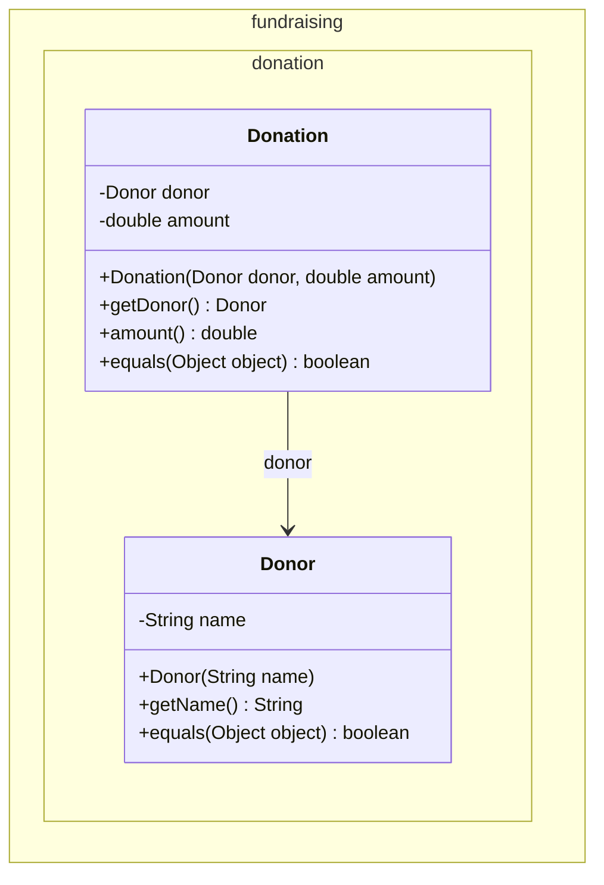
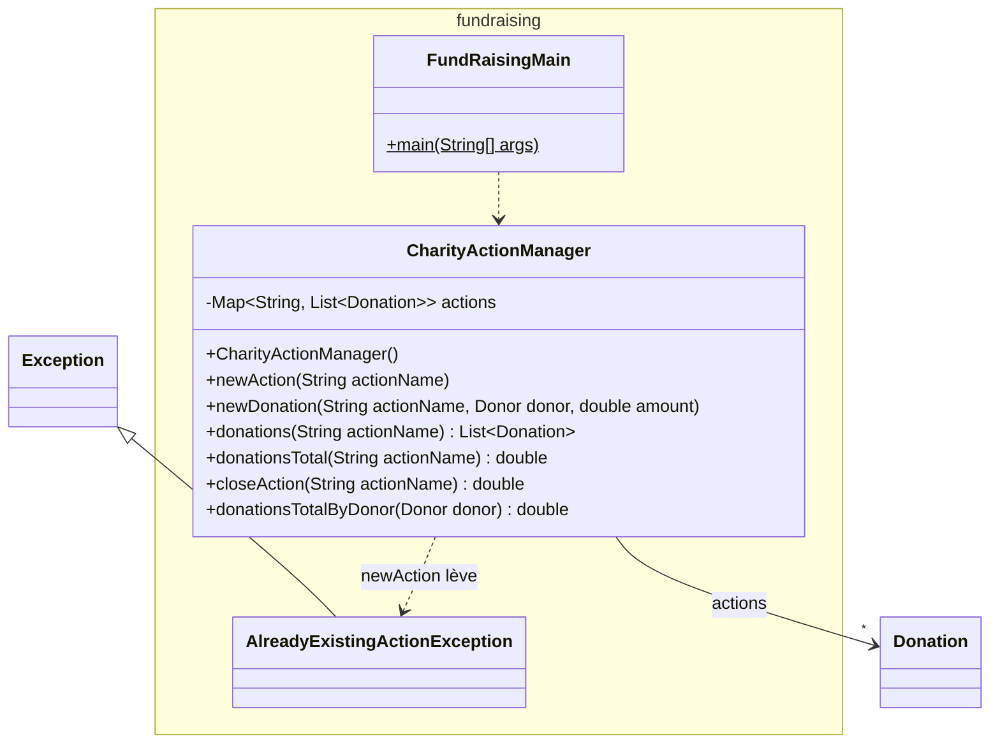
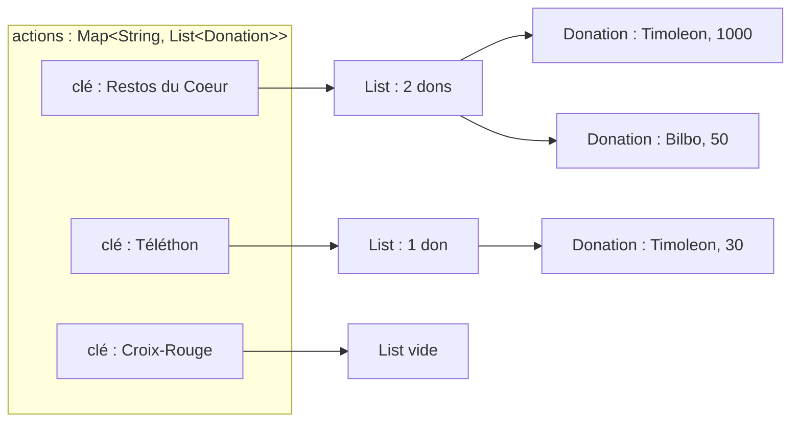
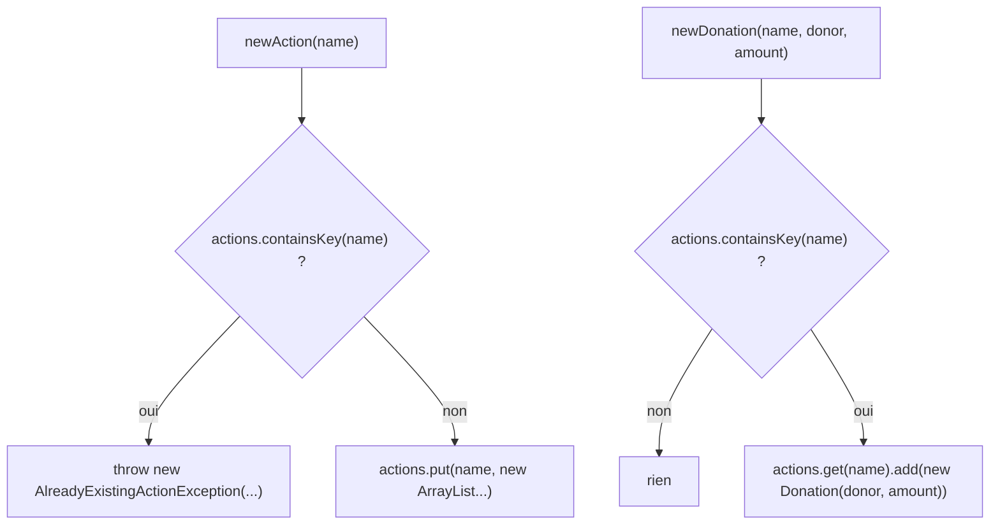

# TP6bis — Collecte de fonds (Map, List, exceptions, tests)

> 🎯 **Objectifs** : utiliser une **`Map<String, List<Donation>>`** (une table dont les valeurs sont des listes), parcourir une `Map`, **lever** une exception vérifiée et la **capturer** dans un `main`, écrire les **tests JUnit** d'une classe **avant** de la coder, s'appuyer sur `equals`.
> 📚 Cours : [07 — Collections](../../01-Cours/07-collections.md) · [04 — Exceptions](../../01-Cours/04-exceptions.md) · [03 — Tests](../../01-Cours/03-tests.md) · 🛠️ [Memento](../../05-Fiches/memento-commandes.md)
> 📝 Préparation : récupère les fichiers sur le portail et décompresse-les dans un dossier **`tp6bis/`**.

> ✅ [Corrigé](./CORRIGE.md) — essaie d'abord seul·e !

## 🗺️ Le sujet

💡 **L'idée :** des **donateurs** font des **dons** en faveur d'**actions caritatives** ; un **gestionnaire** retient, pour chaque action, la liste des dons reçus.

> 🌍 **Dans la vraie vie :** une plateforme de **cagnotte en ligne** affiche, pour chaque cagnotte (« Téléthon 2026 », « Restos du Cœur »…), la liste des participations : qui a donné, combien. À la clôture, on annonce le total collecté et la cagnotte disparaît de la page d'accueil.
> → en Java : le nom de la cagnotte = la **clé** (`String`), la liste des participations = la **valeur** (`List<Donation>`) ; clôturer = `remove` de la clé.

| Élément | Représentation |
|---|---|
| une **action** caritative | simplement son **nom** : une `String` |
| un **donateur** | un objet `fundraising.donation.Donor` (**fourni**) |
| un **don** | un objet `fundraising.donation.Donation` = un donateur + un montant (**fourni**) |
| le **gestionnaire** | un objet `fundraising.CharityActionManager` (**à écrire**) |

### Classes fournies (paquetage `fundraising.donation`)



⚠️ Le sujet écrit `amount()` dans l'UML, mais dans les fichiers fournis la méthode s'appelle **`getAmount()`** : utilise le nom qui est **dans ton fichier** `Donation.java`.

### Classes à écrire (paquetage `fundraising`)



📌 Le nom de l'attribut (`actions`) est libre ; les types de retour sont déduits du cahier des charges.

### La structure de données : une table « action ⟶ liste de dons »

💡 **L'idée :** une `Map` dont chaque **valeur est elle-même une liste**. Retrouver les dons d'une action = un `get` ; ajouter un don = `get` **puis** `add` sur la liste obtenue.



- Une action qui vient d'être créée a une liste **vide** (mais elle **existe** !).
- Un même donateur peut apparaître dans **plusieurs** listes (Timoleon ci-dessus).

> 🌍 **Dans la vraie vie :** les **Restos du Cœur** tiennent un registre par campagne ; le **Téléthon** additionne en direct toutes les promesses de dons ; à la fin de la soirée, on « ferme » le compteur et on annonce le total.
> → en Java : `donationsTotal` = la somme d'**une** liste ; `closeAction` = donner ce total **et** retirer l'action de la table.

## 📋 Cahier des charges de `CharityActionManager`

Le gestionnaire mémorise les actions sous la forme d'une **table** qui associe à une action (son nom) la **liste des dons** effectués pour cette action.

| Méthode | Rôle | Résultat | Cas particulier |
|---|---|---|---|
| `newAction(String actionName)` | ajoute une nouvelle action ; elle n'a initialement **aucun don** | — | lève `fundraising.AlreadyExistingActionException` si une action **du même nom** existe déjà |
| `newDonation(String actionName, Donor donor, double amount)` | le donateur `donor` déclare un don de `amount` € pour l'action `actionName` | — | **il ne se passe rien** si l'action n'existe pas |
| `donations(String actionName)` | — | la **liste des dons** réalisés pour l'action | non précisé si l'action n'existe pas |
| `donationsTotal(String actionName)` | — | le **montant total** des dons pour l'action | non précisé si l'action n'existe pas |
| `closeAction(String actionName)` | met fin à la collecte : **retire** l'action de la table | le **montant total** des dons reçus pour l'action | non précisé si l'action n'existe pas |
| `donationsTotalByDonor(Donor donor)` | — | le montant total des dons de `donor` sur **l'ensemble** des actions gérées | — |

⚠️ Pour les 3 cas « non précisé », **choisis** un comportement raisonnable, **écris-le dans la javadoc** et **teste-le**.

---

## 📝 Questions

- [ ] **Q1.** Le code de la classe `fundraising.AlreadyExistingActionException` est **fourni**. Essaie de la coder par toi-même, puis compare ta proposition avec celle fournie.

<details><summary>💡 Indice Q1</summary>

Une exception est un objet d'une classe qui **hérite** de `Exception` ([cours 04](../../01-Cours/04-exceptions.md)). Un constructeur qui reçoit un message le transmet avec `super(message);`.

</details>

- [ ] **Q2.** Définis une classe de test `CharityActionManagerTest` (dans `test/fundraising/`) pour tester la classe `CharityActionManager`.
  - [ ] **Q2.1.** Donne le code des méthodes de test qui vérifient que `newAction()` respecte le cahier des charges.
  - [ ] **Q2.2.** Donne le code des autres méthodes de test, pour **l'ensemble** des méthodes de `CharityActionManager`.

<details><summary>💡 Indice Q2.1 : comment « voir » qu'une action existe ?</summary>

Il n'y a **pas** de méthode `hasAction(...)` : on le vérifie par le **comportement observable**.
- Après `newAction("restos")`, `donations("restos")` est vide **et** un `newDonation("restos", …)` est bien enregistré.
- Un second `newAction("restos")` doit lever l'exception : `assertThrows(AlreadyExistingActionException.class, () -> cam.newAction("restos"));`
- Les méthodes de test qui appellent `newAction` doivent porter `throws AlreadyExistingActionException` (exception **vérifiée**).

</details>

<details><summary>💡 Indice Q2.2 : idées de tests</summary>

- `newDonation` sur une action **inconnue** : rien n'est enregistré (ni dans `donations`, ni dans `donationsTotalByDonor`).
- `donations` : comparer avec une liste attendue grâce à `assertEquals(expected, obtained)` → utilise `equals` de `Donation` (et donc de `Donor`).
- `closeAction` : vérifie le total renvoyé **et** que l'action a disparu (on peut à nouveau faire `newAction` du même nom sans exception).
- `donationsTotalByDonor` : un donateur présent dans **plusieurs** actions ; un donateur **absent** → `0` ; un `new Donor("Timoleon")` **différent** mais de même nom doit compter.
- Rassemble la création du gestionnaire et des donateurs dans une méthode `@BeforeEach`.

</details>

- [ ] **Q3.** Code la classe `CharityActionManager` (attribut `Map<String, List<Donation>>`, javadoc complète) jusqu'à obtenir **0 test en échec**.

<details><summary>💡 Indice Q3 : newAction et newDonation</summary>



⚠️ Sans le test `containsKey`, `actions.get(name)` renvoie **`null`** pour une action inconnue ⇒ `NullPointerException` sur `.add(...)`.

</details>

<details><summary>💡 Indice Q3 : donationsTotalByDonor</summary>

Deux boucles imbriquées : sur **toutes les listes** de la table (`actions.values()`, ou `actions.keySet()` + `get`), puis sur **tous les dons** de chaque liste. Compare les donateurs avec **`equals`**, pas `==`.

</details>

- [ ] **Q4.** Donne les lignes de code qui complètent, à l'endroit indiqué, la classe ci-dessous de manière à :
  1. ajouter une nouvelle action de nom `restos` au gestionnaire `cam` ;
  2. enregistrer un don de **1000 €** fait par `timo` à l'action `restos` ;
  3. fermer l'action `restos` **puis** afficher le total des fonds collectés par l'action `restos`.

```java
package fundraising;

import fundraising.donation.Donor;

public class FundRaisingMain {
    public static void main(String[] args) {
        CharityActionManager cam = new CharityActionManager();
        Donor timo = new Donor("Timoleon");
        String restos = "Restos du Coeur";
        // COMPLETER LE CODE ICI
    }
}
```

<details><summary>💡 Indice Q4</summary>

`newAction` peut lever une exception **vérifiée** : sans `try / catch`, le `main` **ne compile pas**. Et une fois l'action fermée, `donationsTotal(restos)` ne la connaît plus : utilise le **résultat** de `closeAction`.

</details>

## ⚙️ Commandes (depuis `tp6bis/`)

```bash
javac -sourcepath src src/fundraising/*.java -d classes
javac -classpath junit-console.jar:classes -d test test/fundraising/*Test.java
java -jar junit-console.jar -classpath test:classes -scan-classpath
javadoc -sourcepath src -d docs fundraising fundraising.donation
java -classpath classes fundraising.FundRaisingMain
```

## 📤 Rendu GitLab
- [ ] Compléter le [README.md](./README.md) (nom, sujet, commandes, trace, section IA).
- [ ] `add / commit / push` **au fur et à mesure** (ex. à chaque méthode qui passe ses tests), avec un message clair.

---
📂 Ton code : [src/](./src/) · [test/](./test/) · 🏠 [Sommaire](../../README.md)
