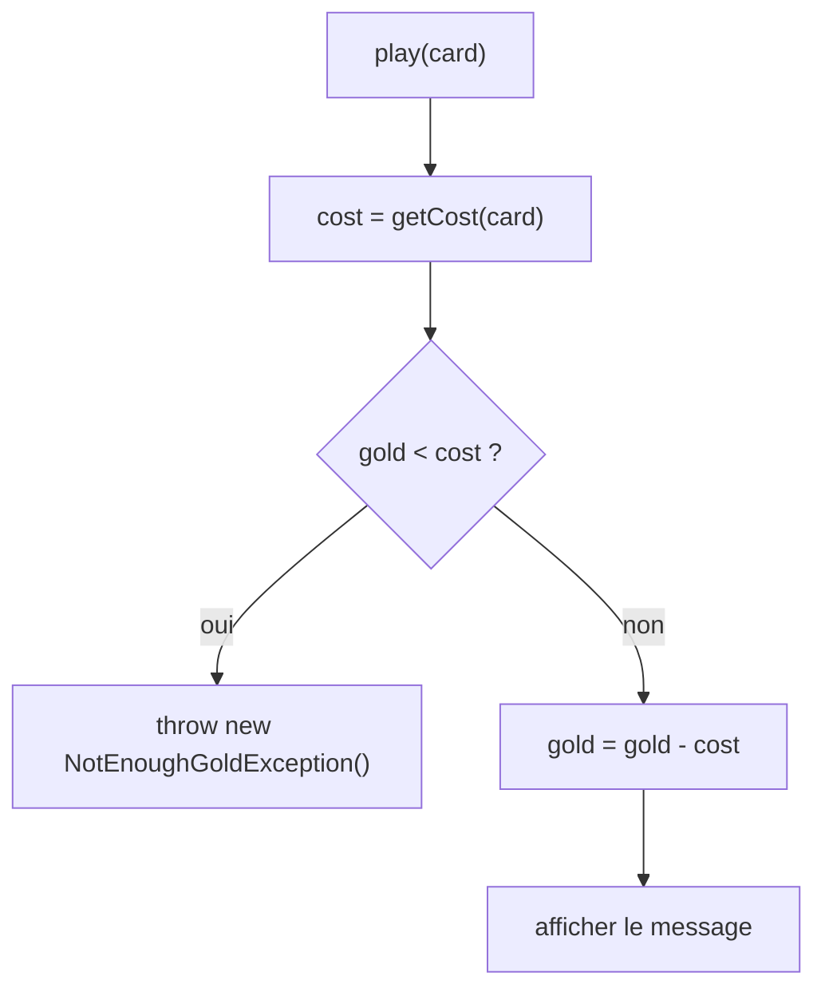

# DS1 POO 2023-2024 — Corrigé proposé

> ⚠️ **Corrigé non officiel**, rédigé pour réviser. Le code a été **compilé et testé** (JUnit 5 : 6 tests réussis).
> D'autres réponses justes sont possibles. 📄 [Retour au sujet](./sujet.md)

---

# Exercice 1 — Jeu de cartes

## Q1 & Q2 — `Element`

```java
package exoUn.card;

import java.util.Random;

public enum Element {
    EARTH, AIR, FIRE, WATER;

    private static final Random ALEA = new Random();

    /** @return an element chosen randomly */
    public static Element random() {
        Element[] all = Element.values();
        return all[ALEA.nextInt(all.length)];
    }
}
```

| Choix « pertinent » attendu | Pourquoi |
|---|---|
| `enum` | 4 valeurs **fixes et connues** |
| `Element.values()` | pas de liste recopiée à la main ; marche si on ajoute un élément |
| `nextInt(all.length)` plutôt que `nextInt(4)` | pas de « nombre magique » |
| `Random` en **constante `static`** | un seul générateur, pas un nouvel objet à chaque appel |

## Q3 — `Card`

```java
package exoUn.card;

public class Card {
    private final String description;
    private final Element element;
    private final int cost;

    public Card(String description, Element element, int cost) {
        this.description = description;
        this.element = element;
        this.cost = cost;
    }

    public String getDescription() { return this.description; }

    public Element getElement() { return this.element; }

    public int getCost() { return this.cost; }

    @Override
    public boolean equals(Object o) {
        if (!(o instanceof Card)) {
            return false;
        }
        Card other = (Card) o;
        return this.description.equals(other.description)
            && this.element == other.element
            && this.cost == other.cost;
    }

    @Override
    public String toString() {
        return this.description + " (" + this.element + ", " + this.cost + " gold)";
    }
}
```
⚠️ `String` → `equals` ; `enum` et `int` → `==`.

## Q4 — Javadoc de `play(Card)`

```java
/**
 * Plays the given card: the gold of this player decreases by the cost of
 * the card for this player, and a message is displayed.
 * @param card the card to play
 * @throws NotEnoughGoldException if this player does not have enough gold
 *         to pay the card (the gold is then unchanged)
 */
```

## Q5 — Tests de `play(Card)`

| Cas | Attendu |
|---|---|
| carte de l'élément **favori** | or diminue du coût de **base** |
| carte d'un **autre** élément | or diminue du **double** |
| or **exactement** suffisant (cas limite) | autorisé, or = 0 |
| or insuffisant | `NotEnoughGoldException` **et** or inchangé |

```java
@Test
public void playCardOfFavoriteElementCostsBaseCost() throws NotEnoughGoldException {
    Player player = new Player("timoleon", Element.FIRE);
    Card card = new Card("dragon", Element.FIRE, 5);
    player.play(card);
    assertEquals(Player.INITIAL_GOLD - 5, player.getGold());
}

@Test
public void playCardOfOtherElementCostsTwiceBaseCost() throws NotEnoughGoldException {
    Player player = new Player("timoleon", Element.FIRE);
    Card card = new Card("wave", Element.WATER, 5);
    player.play(card);
    assertEquals(Player.INITIAL_GOLD - 10, player.getGold());
}

@Test
public void playCardWithExactlyEnoughGoldIsPossible() throws NotEnoughGoldException {
    Player player = new Player("timoleon", Element.FIRE);
    Card card = new Card("dragon", Element.FIRE, Player.INITIAL_GOLD);
    player.play(card);
    assertEquals(0, player.getGold());
}

@Test
public void playCardWithoutEnoughGoldThrowsException() {
    Player player = new Player("timoleon", Element.FIRE);
    Card card = new Card("wave", Element.WATER, Player.INITIAL_GOLD);  // coûte 2 × 20
    assertThrows(NotEnoughGoldException.class, () -> player.play(card));
    assertEquals(Player.INITIAL_GOLD, player.getGold());
}
```
💡 Utiliser la constante `Player.INITIAL_GOLD` rend les tests indépendants de sa valeur.

## Q6 — `Player`

```java
package exoUn;

import exoUn.card.Card;
import exoUn.card.Element;

public class Player {

    /** initial number of gold coins of every player */
    public static final int INITIAL_GOLD = 20;

    private final String name;
    private int gold;
    private final Element favorite;

    public Player(String name, Element favorite) {
        this.name = name;
        this.favorite = favorite;
        this.gold = INITIAL_GOLD;
    }

    public String getName() { return this.name; }

    public int getGold() { return this.gold; }

    public Element getFavorite() { return this.favorite; }

    /**
     * @param card a card
     * @return the base cost of card if it belongs to the favorite element
     *         of this player, twice its base cost otherwise
     */
    public int getCost(Card card) {
        if (card.getElement() == this.favorite) {
            return card.getCost();
        }
        return 2 * card.getCost();
    }

    public void play(Card card) throws NotEnoughGoldException {
        int cost = this.getCost(card);
        if (this.gold < cost) {
            throw new NotEnoughGoldException();
        }
        this.gold = this.gold - cost;
        System.out.println(this.name + " plays " + card);
    }
}
```



## Programme — `Exo1Main`

```java
package exoUn;

import exoUn.card.Card;
import exoUn.card.Element;

public class Exo1Main {
    public static void main(String[] args) {
        Player timoleon = new Player("timoleon", Element.FIRE);
        int cost = 10;
        if (args.length > 0) {
            cost = Integer.parseInt(args[0]);
        }
        Card card = new Card("surprise", Element.random(), cost);
        try {
            timoleon.play(card);
        } catch (NotEnoughGoldException e) {
            System.out.println("timoleon n'a pas assez de pièces d'or pour jouer " + card);
        }
    }
}
```

```bash
$ java -classpath classes exoUn.Exo1Main
timoleon plays surprise (AIR, 10 gold)
$ java -classpath classes exoUn.Exo1Main 15
timoleon n'a pas assez de pièces d'or pour jouer surprise (WATER, 15 gold)
```

---

# Exercice 2 — Jeu de la vie

## Q1 — `nextState`

```java
public boolean nextState(int nbActiveNeighbours) {
    if (this.active) {
        return nbActiveNeighbours == 2 || nbActiveNeighbours == 3;
    }
    return nbActiveNeighbours == 3;
}
```
💡 Version courte : `return nbActiveNeighbours == 3 || (this.active && nbActiveNeighbours == 2);`

## Q2 — Constructeur

```java
public GameOfLife(int width, int height) {
    this.theCells = new Cell[width][height];        // theCells[x][y]
    for (int x = 0; x < width; x++) {
        for (int y = 0; y < height; y++) {
            this.theCells[x][y] = new Cell(false);
        }
    }
}
```
⚠️ `new Cell[width][height]` ne crée **que le tableau** (rempli de `null`) : il faut **créer chaque `Cell`**.

## Q3 — `nextGeneration`

```java
private Cell[][] nextGeneration() {
    int width = this.theCells.length;
    int height = this.theCells[0].length;
    Cell[][] next = new Cell[width][height];
    for (int x = 0; x < width; x++) {
        for (int y = 0; y < height; y++) {
            boolean state = this.theCells[x][y].nextState(this.activeNeighBours(x, y));
            next[x][y] = new Cell(state);
        }
    }
    return next;
}
```
💡 On construit une **nouvelle** grille : les voisins sont comptés sur l'**ancienne**, ce qui garantit l'évolution **simultanée**.

## Q4 — `run`

```java
public void run(int nbGenerations) {
    for (int i = 0; i < nbGenerations; i++) {
        this.theCells = this.nextGeneration();
        this.display();
    }
}
```

---

## ⚠️ Erreurs classiques à ce DS

| Erreur | Correction |
|---|---|
| `Element` en constantes `int` ou `String` | `enum` |
| `nextInt(4)` codé en dur | `values().length` |
| `new Random()` à chaque appel de `random()` | une constante `static` |
| oublier le cas « or exactement suffisant » | `gold < cost` (et pas `<=`) déclenche l'exception |
| débiter l'or **avant** de vérifier | vérifier, **puis** débiter (or inchangé en cas d'exception) |
| modifier `theCells` pendant le parcours | calculer dans une **nouvelle** grille |
| oublier de créer les `Cell` dans le constructeur | double boucle + `new Cell(false)` |

---
📂 [Autres examens](../README.md) · 🏠 [Sommaire](../../README.md)
