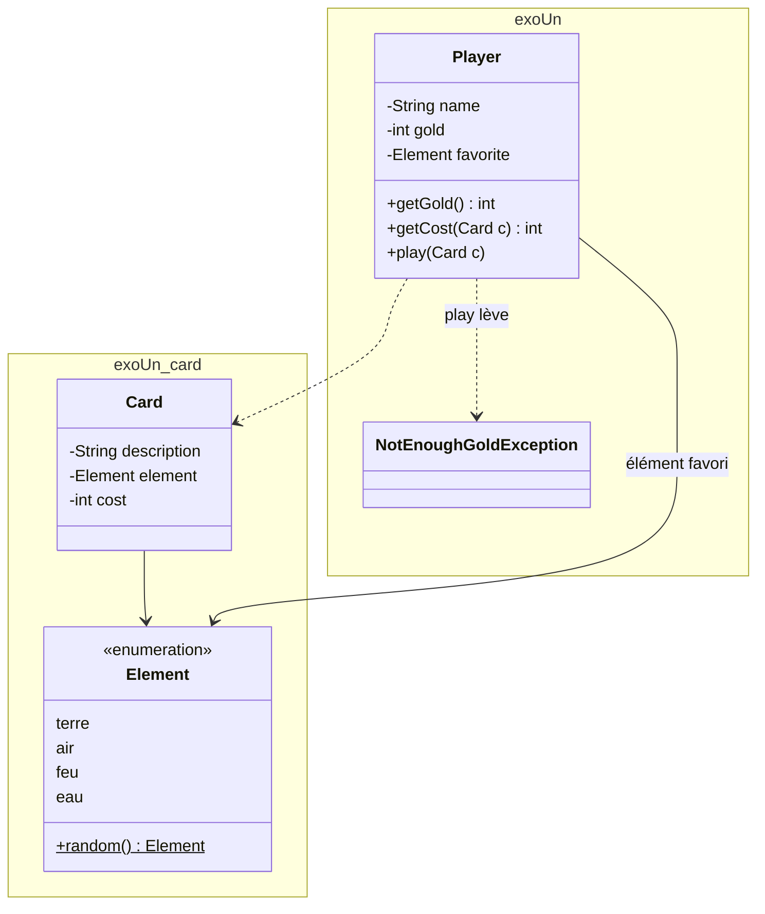
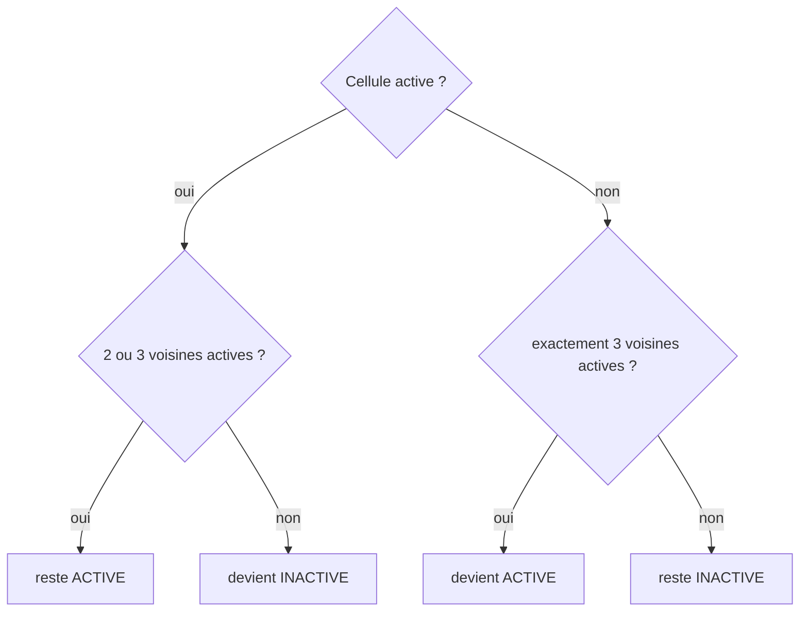
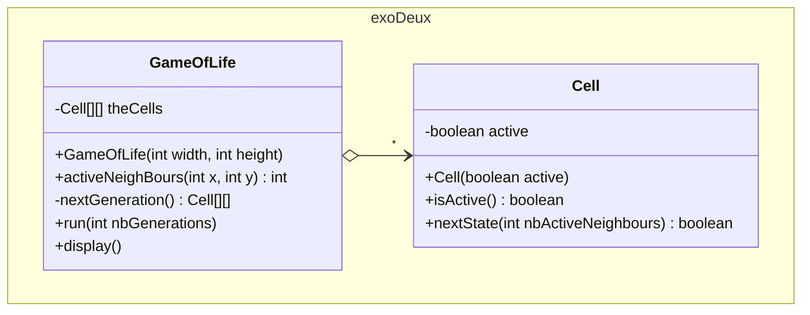

# DS1 POO 2023-2024 — Jeu de cartes & Jeu de la vie (sujet)

> ⏱️ **1 h 30** · Documents de cours annotés autorisés · Dictionnaire de langue autorisé
> 📚 Notions évaluées : [01 Classes et objets](../../01-Cours/01-classes-et-objets.md) · [02 static et enum](../../01-Cours/02-static-et-enum.md) · [03 Tests](../../01-Cours/03-tests.md) · [04 Exceptions](../../01-Cours/04-exceptions.md)
> ✅ [Corrigé proposé](./corrige.md) — essaie d'abord **sans** le regarder, en temps limité !

## 📌 Consignes
- Les exercices sont **indépendants**.
- Tests et javadoc : **seulement s'ils sont demandés**.
- Tests demandés : seulement le code des **méthodes de test** (pas l'en-tête de la classe de test).

---

## Exercice 1 — Jeu de cartes

Des joueurs jouent des cartes en payant un **coût** en pièces d'or.

### Les éléments
4 familles : **terre, air, feu, eau** → type `Element` du paquetage `exoUn.card`.

- [ ] **Q1.** Code Java **le plus pertinent** pour le type `Element`.
- [ ] **Q2.** Code de `public static Element random()` : un élément **au hasard** à chaque appel.
  💡 `Random alea = new Random();` puis `alea.nextInt(100)` → entier de 0 à 99.
  ⚠️ L'évaluation tient compte de la **pertinence des choix**.

### Les cartes — `exoUn.card.Card`

| Caractéristique | Type |
|---|---|
| description | `String` |
| élément | `Element` |
| coût de base | `int` (pièces d'or) |

Fournies à la création · accesseurs · **égales** si description, élément **et** coût égaux · `toString()`.

- [ ] **Q3.** Code de la classe `Card`.

### Les joueurs — `exoUn.Player`

| Caractéristique | Détail |
|---|---|
| nom | `String`, donné à la création |
| pièces d'or | `int`, **constante prédéfinie** au départ (ex. 20) |
| élément favori | `Element`, donné à la création |

**Règle du coût** : si la carte n'est **pas** de l'élément favori → le joueur paie **le double**.

| Méthode | Rôle |
|---|---|
| `int getGold()` | pièces d'or du joueur |
| `int getCost(Card)` | coût de la carte **pour ce joueur** |
| `play(Card)` | pas assez d'or → `NotEnoughGoldException` ; sinon l'or diminue du coût et un message est affiché |

(`exoUn.NotEnoughGoldException` existe, avec un constructeur sans paramètre.)

- [ ] **Q4.** **Javadoc** de `play(Card)`.
- [ ] **Q5.** **Méthodes de test** de `play(Card)`.
- [ ] **Q6.** Code **complet** de `Player`.

### Programme — `Exo1Main`
- [ ] Méthode `main` qui :
  1. crée le joueur `"timoleon"`, élément favori **feu** ;
  2. crée une carte `"surprise"`, d'élément **aléatoire**, de coût = **1ᵉʳ argument** de la ligne de commande, ou **10** sans argument (on suppose l'argument entier positif) ;
  3. fait jouer la carte ; si impossible → message « pas assez de pièces d'or ».

---

## Exercice 2 — Jeu de la vie

Une grille 2D de **cellules** actives ou inactives évolue **simultanément** à chaque génération.

`activeNeighBours(x, y)` (nb de voisines actives) et `display()` (affiche la grille) existent — **code non demandé**.

- [ ] **Q1.** Code de `nextState(nbActiveNeighbours)` de `Cell` : état à la génération suivante.
- [ ] **Q2.** Constructeur de `GameOfLife(width, height)` : toutes les cellules **inactives**.
- [ ] **Q3.** Code de la méthode privée `nextGeneration()` : renvoie une **nouvelle** grille obtenue en appliquant les règles.
- [ ] **Q4.** Code de `run(n)` : fait évoluer la grille pendant **n** générations, en **affichant** chaque nouvel état.

---

## 📝 Mes réponses

*(entraîne-toi ici ou sur papier, puis compare avec le [corrigé](./corrige.md))*

---
📂 [Autres examens](../README.md) · 🏠 [Sommaire](../../README.md)
