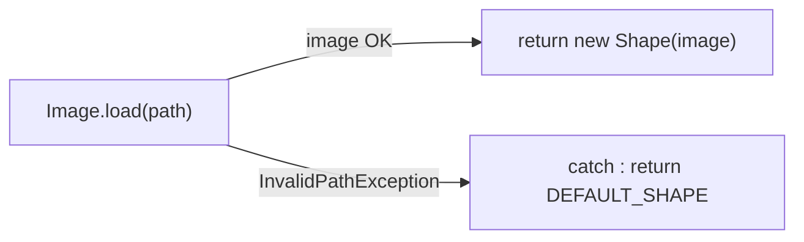
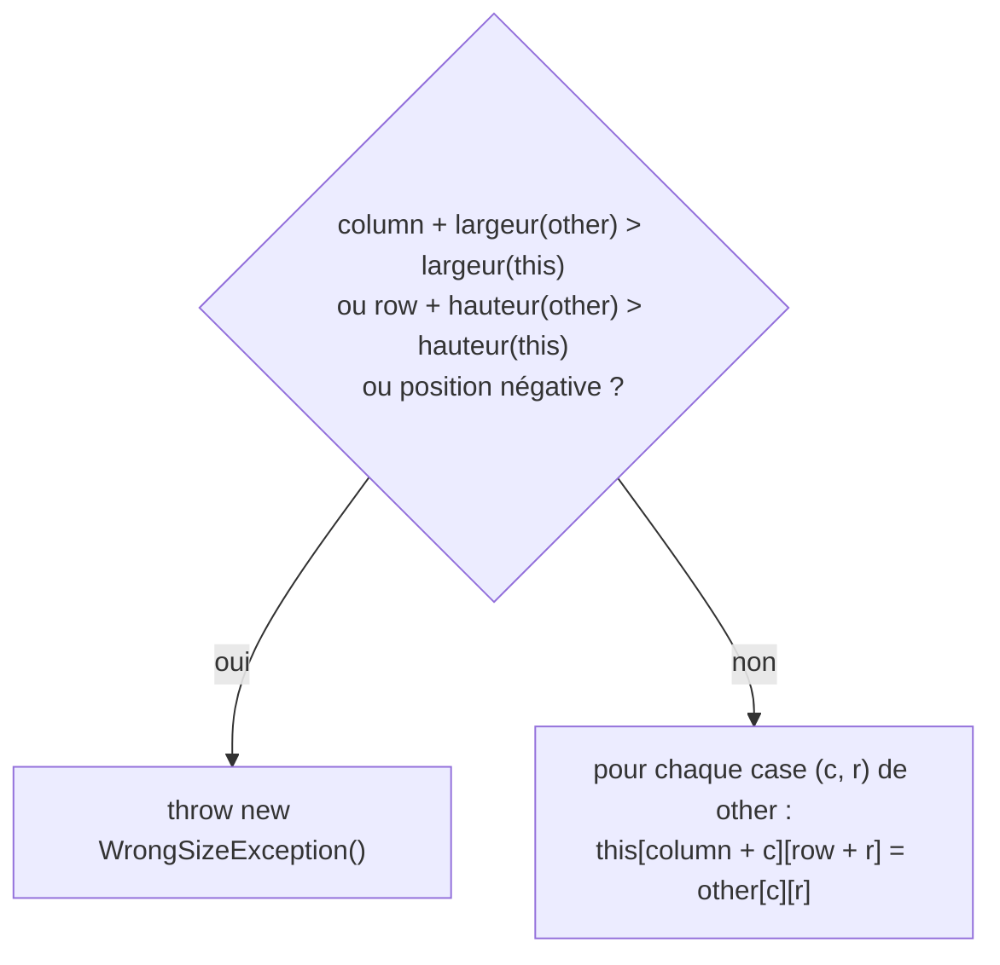

# DS1 POO 2024-2025 — Corrigé proposé

> ⚠️ **Corrigé non officiel**, rédigé pour réviser. Le code a été **compilé et testé** (JUnit 5 : 7 tests réussis, avec une version simplifiée de la classe `Image`, supposée connue dans le sujet).
> D'autres réponses justes sont possibles. 📄 [Retour au sujet](./sujet.md)

---

## Q1 — Constante `DEFAULT_SHAPE` (dans `Shape`)

```java
public static final Shape DEFAULT_SHAPE = new Shape(Image.DEFAULT_IMAGE);
```

## Q2 — `generateFromPath`

```java
/**
 * @param path path of a folder containing image files
 * @return a shape built from a random image of the folder, or the default
 *         shape if the folder does not contain valid images
 */
public static Shape generateFromPath(String path) {
    try {
        return new Shape(Image.load(path));
    } catch (InvalidPathException e) {
        return DEFAULT_SHAPE;
    }
}
```


💡 La méthode **capture** l'exception (elle ne la propage pas) : son résultat est « toujours un objet `Shape` ».

## Q3 — `Color.java`

```java
package grid.pattern;

import java.util.Random;

public enum Color {
    BLUE, RED, YELLOW, GREEN;

    private static final Random ALEA = new Random();

    /** @return a color chosen randomly */
    public static Color random() {
        Color[] all = Color.values();
        return all[ALEA.nextInt(all.length)];
    }
}
```

## Q4 — `Pattern.java`

```java
package grid.pattern;

public class Pattern {
    private final Color color;
    private final Shape shape;

    public Pattern(Color color, Shape shape) {
        this.color = color;
        this.shape = shape;
    }

    public Color getColor() { return this.color; }

    public Shape getShape() { return this.shape; }

    @Override
    public boolean equals(Object o) {
        if (!(o instanceof Pattern)) {
            return false;
        }
        Pattern other = (Pattern) o;
        return this.color == other.color && this.shape.equals(other.shape);
    }
}
```

## Q5 — En-tête, attribut, constructeur de `Grid`

```java
package grid;

import grid.pattern.*;

public class Grid {

    private Pattern[][] patterns;   // patterns[column][row]

    public Grid(int nbColumns, int nbRows) {
        this.patterns = new Pattern[nbColumns][nbRows];
    }
}
```
💡 « Aucun motif » au départ ⇒ cases à `null` : **pas** de boucle de remplissage ici.

## Q6 — `getPatternAt`

```java
public Pattern getPatternAt(int column, int row) {
    return this.patterns[column][row];
}
```

## Q7 — `randomInitFromPath`

```java
public void randomInitFromPath(String path) {
    for (int c = 0; c < this.numberOfColumns(); c++) {
        for (int r = 0; r < this.numberOfRows(); r++) {
            this.setPatternAt(c, r, new Pattern(Color.random(), Shape.generateFromPath(path)));
        }
    }
}
```
💡 Réutiliser `Color.random()` et `Shape.generateFromPath()` : **pas besoin de `try/catch`** ici, Q2 s'en charge.

## Q8.1 — Javadoc de `copyGridAtPosition`

```java
/**
 * Copies the patterns of another grid into this grid, from a given position:
 * the pattern at (0,0) of other is copied at (column, row) of this grid, etc.
 * This grid is modified, other is not.
 * @param column the column of this grid where the copy starts
 * @param row the row of this grid where the copy starts
 * @param other the grid to copy
 * @throws WrongSizeException if other does not fit in this grid from
 *         (column, row); this grid is then unchanged
 */
```

## Q8.2 — Tests

| Cas testé | Attendu |
|---|---|
| copie valide (l'exemple : G2 3×3 dans G1 7×6 en (3,2)) | zone recopiée = G2 ; **reste inchangé** |
| copie qui tient **pile** dans le coin bas-droit (4,3) | OK (cas limite) |
| trop à **droite** (5,0) | `WrongSizeException` |
| trop **bas** (4,5) — l'exemple du sujet | `WrongSizeException` |
| position **négative** | `WrongSizeException` |
| après un échec | grille **inchangée** |

```java
private static final String PATH = "./some/path/shapeimages";

private Grid createGrid(int nbColumns, int nbRows) {
    Grid grid = new Grid(nbColumns, nbRows);
    grid.randomInitFromPath(PATH);
    return grid;
}

private Pattern[][] copyOfPatterns(Grid grid) {
    Pattern[][] copy = new Pattern[grid.numberOfColumns()][grid.numberOfRows()];
    for (int c = 0; c < grid.numberOfColumns(); c++) {
        for (int r = 0; r < grid.numberOfRows(); r++) {
            copy[c][r] = grid.getPatternAt(c, r);
        }
    }
    return copy;
}

@Test
public void copyGridAtValidPositionCopiesPatternsAndKeepsOthers() throws WrongSizeException {
    Grid g1 = this.createGrid(7, 6);
    Grid g2 = this.createGrid(3, 3);
    Pattern[][] before = this.copyOfPatterns(g1);
    g1.copyGridAtPosition(3, 2, g2);
    for (int c = 0; c < 7; c++) {
        for (int r = 0; r < 6; r++) {
            if (c >= 3 && c < 6 && r >= 2 && r < 5) {
                assertSame(g2.getPatternAt(c - 3, r - 2), g1.getPatternAt(c, r));
            } else {
                assertSame(before[c][r], g1.getPatternAt(c, r));
            }
        }
    }
}

@Test
public void copyGridThatFitsExactlyInBottomRightCorner() throws WrongSizeException {
    Grid g1 = this.createGrid(7, 6);
    Grid g2 = this.createGrid(3, 3);
    g1.copyGridAtPosition(4, 3, g2);
    assertSame(g2.getPatternAt(2, 2), g1.getPatternAt(6, 5));
}

@Test
public void copyGridThrowsExceptionWhenTooFarRight() {
    Grid g1 = this.createGrid(7, 6);
    Grid g2 = this.createGrid(3, 3);
    assertThrows(WrongSizeException.class, () -> g1.copyGridAtPosition(5, 0, g2));
}

@Test
public void copyGridThrowsExceptionWhenTooFarDown() {
    Grid g1 = this.createGrid(7, 6);
    Grid g2 = this.createGrid(3, 3);
    assertThrows(WrongSizeException.class, () -> g1.copyGridAtPosition(4, 5, g2));
}

@Test
public void copyGridThrowsExceptionWhenNegativePosition() {
    Grid g1 = this.createGrid(7, 6);
    Grid g2 = this.createGrid(3, 3);
    assertThrows(WrongSizeException.class, () -> g1.copyGridAtPosition(-1, 0, g2));
    assertThrows(WrongSizeException.class, () -> g1.copyGridAtPosition(0, -1, g2));
}

@Test
public void gridIsUnchangedWhenCopyFails() {
    Grid g1 = this.createGrid(7, 6);
    Grid g2 = this.createGrid(3, 3);
    Pattern[][] before = this.copyOfPatterns(g1);
    assertThrows(WrongSizeException.class, () -> g1.copyGridAtPosition(4, 5, g2));
    for (int c = 0; c < 7; c++) {
        for (int r = 0; r < 6; r++) {
            assertSame(before[c][r], g1.getPatternAt(c, r));
        }
    }
}
```
💡 `assertSame` vérifie que c'est **le même objet** — plus précis que `assertEquals` ici, car deux motifs aléatoires peuvent être égaux par hasard.

## Q8.3 — `copyGridAtPosition`

```java
public void copyGridAtPosition(int column, int row, Grid other) throws WrongSizeException {
    if (column < 0 || row < 0
            || column + other.numberOfColumns() > this.numberOfColumns()
            || row + other.numberOfRows() > this.numberOfRows()) {
        throw new WrongSizeException();
    }
    for (int c = 0; c < other.numberOfColumns(); c++) {
        for (int r = 0; r < other.numberOfRows(); r++) {
            this.setPatternAt(column + c, row + r, other.getPatternAt(c, r));
        }
    }
}
```


⚠️ Vérifier **avant** de copier : sinon la grille serait à moitié modifiée quand l'exception survient.
✅ Vérification avec l'exemple : (3,2) → `3 + 3 = 6 ≤ 7` et `2 + 3 = 5 ≤ 6` ✔ ; (4,5) → `5 + 3 = 8 > 6` ✘.

## Q9 — `shuffle`

```java
private static final int NB_SWAPS = 100;

public void shuffle() {
    for (int i = 0; i < NB_SWAPS; i++) {
        Position p1 = this.randomPosition();
        Position p2 = this.randomPosition();
        Pattern tmp = this.getPatternAt(p1);
        this.setPatternAt(p1, this.getPatternAt(p2));
        this.setPatternAt(p2, tmp);
    }
}
```
💡 L'échange classique a besoin d'une **variable temporaire** `tmp`.

---

## ⚠️ Erreurs classiques à ce DS

| Erreur | Correction |
|---|---|
| `generateFromPath` qui laisse passer l'exception (`throws`) | elle doit **capturer** et renvoyer `DEFAULT_SHAPE` |
| `DEFAULT_SHAPE` non `static` | constante de classe : `public static final` |
| `try/catch` dans `randomInitFromPath` | inutile : `generateFromPath` ne lève rien |
| oublier les positions **négatives** dans `copyGridAtPosition` | tester `column < 0` et `row < 0` |
| `>=` au lieu de `>` dans le test de taille | une copie qui tient **pile** est valide |
| copier puis vérifier | vérifier **d'abord** |
| échange sans variable temporaire | `tmp` obligatoire |
| `100` en dur dans la boucle | constante nommée |

---
📂 [Autres examens](../README.md) · 🏠 [Sommaire](../../README.md)
