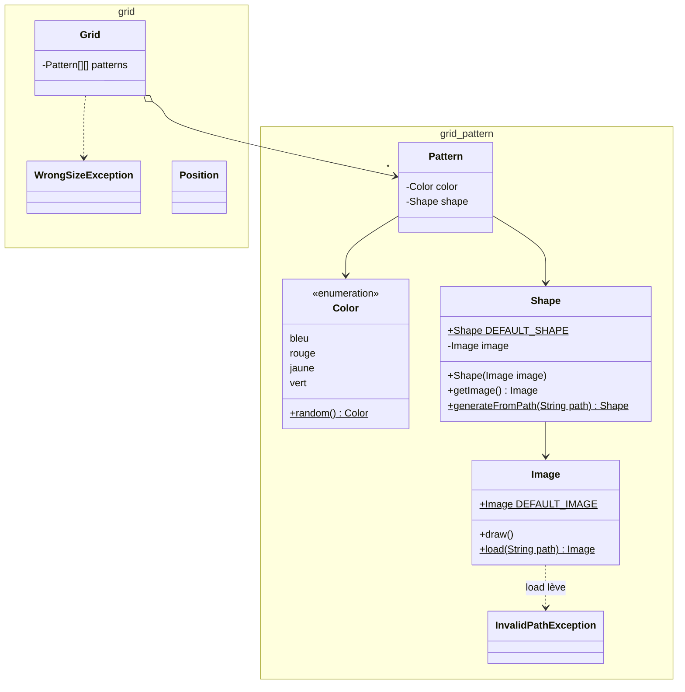

# DS1 POO 2024-2025 — Grilles de motifs (sujet)

> ⏱️ **1 h 30** · Documents de cours annotés autorisés · Dictionnaire de langue autorisé
> 📚 Notions évaluées : [01 Classes et objets](../../01-Cours/01-classes-et-objets.md) · [02 static et enum](../../01-Cours/02-static-et-enum.md) · [03 Tests](../../01-Cours/03-tests.md) · [04 Exceptions](../../01-Cours/04-exceptions.md)
> ✅ [Corrigé proposé](./corrige.md) — essaie d'abord **sans** le regarder, en temps limité !

## 📌 Consignes
- Les temps indiqués par question sont **indicatifs**.
- Lis attentivement : **tous les mots** peuvent compter.
- Tests et javadoc : **seulement s'ils sont demandés**.
- Tests demandés : seulement le code des **méthodes de test**.

**Exercice 1 — Q1.** Écris très lisiblement ton **numéro de groupe**.

---

## Exercice 2 — Grilles de motifs (lecture : 10 min)

Une **grille** rectangulaire contient des **motifs**. Un motif = une **forme** + une **couleur** (bleu, rouge, jaune, vert). La forme provient d'une **image** ; les fichiers image d'une grille sont dans un même dossier.

### `grid.pattern.Image` — fournie, **aucun code à écrire**
- `equals()` · constante statique `DEFAULT_IMAGE` · `draw()`.
- `static Image load(String path)` : `path` = dossier d'images. S'il contient des images valides → une image **au hasard** ; **sinon** → `InvalidPathException`.

### `grid.pattern.Shape`
Constructeur `Shape(Image)`, `getImage()` et `equals()` sont **déjà écrits**.

- [ ] **Q1** *(2 min)*. Constante `DEFAULT_SHAPE` : la forme construite avec l'image par défaut.
- [ ] **Q2** *(10 min)*. Méthode **statique** `generateFromPath(String path)` : renvoie **toujours** une `Shape` :
  - une forme d'image **au hasard** du dossier (via `Image.load`) si le dossier est valide ;
  - **sinon** la forme par défaut.

### `grid.pattern.Color`
- [ ] **Q3** *(6 min)*. Fichier `Color.java` complet : 4 couleurs + méthode statique `random()`.
  💡 `alea.nextInt(n)` → entier entre 0 inclus et n exclu.

### `grid.pattern.Pattern`
Couleur et forme données au constructeur ; **égaux** si même forme **et** même couleur.
- [ ] **Q4** *(10 min)*. Fichier `Pattern.java` complet.

### `grid.Grid`
Tableau **2D** de motifs ; dimensions données à la création ; **aucun motif** au départ.

- [ ] **Q5** *(4 min)*. En-tête de `Grid`, attribut(s), constructeur.

On suppose écrites : `int numberOfColumns()`, `int numberOfRows()`.

- [ ] **Q6** *(4 min)*. `getPatternAt(int c, int l)` : motif en colonne c, ligne l (sans traiter les positions invalides).

On suppose écrite : `void setPatternAt(int column, int row, Pattern p)`.

- [ ] **Q7** *(10 min)*. `public void randomInitFromPath(String path)` : chaque case reçoit un motif de **couleur aléatoire** et de **forme** tirée du dossier `path` (ou forme par défaut si `path` incorrect). Réutilise les méthodes précédentes.

### Q8 — `copyGridAtPosition(int column, int row, Grid other)`

Recopie les motifs de `other` **dans** cette grille à partir de `(column, row)`. Exemple : G2 recopiée dans G1 en **(3, 2)** (colonne 3, ligne 2).

**G1 avant** (colonnes 0-6, lignes 0-5) :

| | 0 | 1 | 2 | 3 | 4 | 5 | 6 |
|---|---|---|---|---|---|---|---|
| **0** | X | * | O | X | O | * | * |
| **1** | * | X | O | * | X | = | * |
| **2** | X | O | = | * | O | * | = |
| **3** | X | O | = | O | O | * | * |
| **4** | * | * | O | O | X | = | * |
| **5** | X | * | O | * | O | = | * |

**G2** :

| | 0 | 1 | 2 |
|---|---|---|---|
| **0** | @ | # | # |
| **1** | % | % | @ |
| **2** | # | @ | % |

**G1 après** (zone recopiée en gras) :

| | 0 | 1 | 2 | 3 | 4 | 5 | 6 |
|---|---|---|---|---|---|---|---|
| **0** | X | * | O | X | O | * | * |
| **1** | * | X | O | * | X | = | * |
| **2** | X | O | = | **@** | **#** | **#** | = |
| **3** | X | O | = | **%** | **%** | **@** | * |
| **4** | * | * | O | **#** | **@** | **%** | * |
| **5** | X | * | O | * | O | = | * |

⚠️ Impossible si la copie **sort** de la grille : ex. G2 dans G1 en **(4, 5)**.

Spécification :
- 3 paramètres : colonne, ligne, grille à recopier ;
- la grille est modifiée **sur place** ;
- `WrongSizeException` si la recopie est impossible à partir de cette position.

- [ ] **Q8.1** *(4 min)*. **Javadoc** de `copyGridAtPosition()`.
- [ ] **Q8.2** *(10 min)*. **Méthodes de test** (on suppose que `"./some/path/shapeimages"` est un dossier d'images valide).
- [ ] **Q8.3** *(10 min)*. Code de `copyGridAtPosition()`.

### Q9 — `shuffle()` *(10 min)*

On ajoute `grid.Position` (`Position(int x, int y)`, `getX()`, `getY()`) et dans `Grid` :
- `Pattern getPatternAt(Position pos)` · `void setPatternAt(Position pos, Pattern p)` ;
- `private Position randomPosition()` : une position valide au hasard.

- [ ] Code de `shuffle()` : mélange la grille en faisant **100 échanges** de deux motifs à deux positions aléatoires (peu importe les doublons).

---

## 📝 Mes réponses

*(entraîne-toi ici ou sur papier, puis compare avec le [corrigé](./corrige.md))*

---
📂 [Autres examens](../README.md) · 🏠 [Sommaire](../../README.md)
