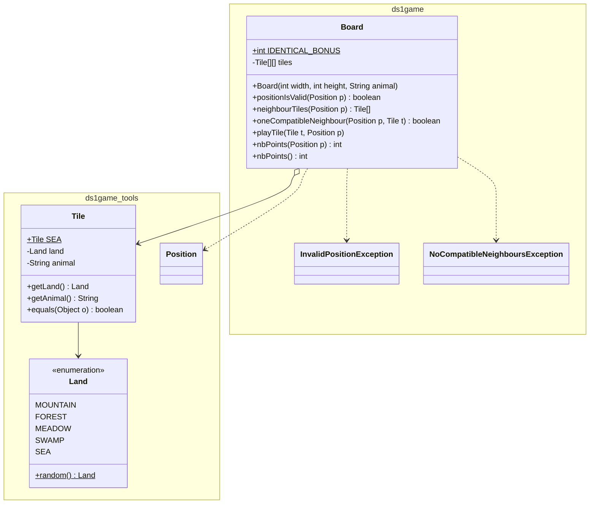
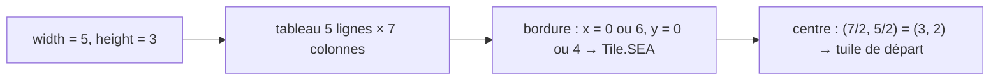

# DS1 POO 2025-2026 — Corrigé proposé

> ⚠️ **Corrigé non officiel**, rédigé pour réviser. Le code a été **compilé et testé** (JUnit 5 : 8 tests réussis).
> D'autres réponses justes sont possibles. 📄 [Retour au sujet](./sujet.md)

## 🗺️ Vue d'ensemble de la solution



---

## Q1 — `Land` (type énuméré)

```java
package ds1game.tools;

public enum Land {
    MOUNTAIN, FOREST, MEADOW, SWAMP, SEA;
}
```
💡 Un nombre **fini et fixe** de valeurs ⇒ `enum` (et non des constantes `int` ou `String`).
*(Le sujet nomme la méthode `Random()` ; en Java on écrirait plutôt `random()`.)*

## Q2 — `Tile`

```java
package ds1game.tools;

public class Tile {

    /** the sea tile, used for the border of the boards */
    public static final Tile SEA = new Tile(Land.SEA, "shark");

    private final Land land;
    private final String animal;

    public Tile(Land land, String animal) {
        this.land = land;
        this.animal = animal;
    }

    public Land getLand() {
        return this.land;
    }

    public String getAnimal() {
        return this.animal;
    }

    @Override
    public boolean equals(Object o) {
        if (!(o instanceof Tile)) {
            return false;
        }
        Tile other = (Tile) o;
        return this.land == other.land && this.animal.equals(other.animal);
    }
}
```

| Point noté | Pourquoi |
|---|---|
| `public static final Tile SEA` | « constante **globale** » ⇒ `static final` |
| `this.land == other.land` | valeurs d'`enum` uniques ⇒ `==` suffit |
| `this.animal.equals(...)` | `String` = objet ⇒ **`equals`**, jamais `==` |
| `equals(Object o)` + `instanceof` | sinon on **surcharge** au lieu de **redéfinir** |

## Q3 — En-tête, attributs, constructeur de `Board`

```java
package ds1game;

import ds1game.tools.*;

public class Board {

    private Tile[][] tiles;   // tiles[y][x] : ligne y, colonne x

    public Board(int width, int height, String animal) {
        this.tiles = new Tile[height + 2][width + 2];
        for (int y = 0; y < height + 2; y++) {
            for (int x = 0; x < width + 2; x++) {
                if (x == 0 || y == 0 || x == width + 1 || y == height + 1) {
                    this.tiles[y][x] = Tile.SEA;
                }
            }
        }
        this.tiles[(height + 2) / 2][(width + 2) / 2] = new Tile(Land.random(), animal);
    }
}
```


⚠️ Les autres cases restent à **`null`** = emplacement vide.

## Q4 — `positionIsValid`

```java
public boolean positionIsValid(Position p) {
    return p.getX() >= 1 && p.getX() <= this.nbColumns() - 2
        && p.getY() >= 1 && p.getY() <= this.nbRows() - 2;
}
```
💡 On **exclut la bordure** : indices de 1 à `taille - 2`.

## Q5 — `neighbourTiles`

```java
public Tile[] neighbourTiles(Position p) {
    return new Tile[] {
        this.getTile(p.above()), this.getTile(p.below()),
        this.getTile(p.onLeft()), this.getTile(p.onRight())
    };
}
```
💡 p valide ⇒ ses 4 voisins sont **dans** le tableau (au pire sur la bordure). Certains peuvent être `null`.

## Q6.1 — Javadoc de `oneCompatibleNeighbour`

```java
/**
 * Checks if at least one neighbour tile of a position is compatible with
 * a given tile, i.e. has the same land or the same animal.
 * @param p the position whose neighbours are checked
 * @param t the tile to compare to the neighbours
 * @return true iff one of the 4 neighbour tiles of p has the same land
 *         or the same animal as t
 */
```

## Q6.2 — Tests de `oneCompatibleNeighbour`

💡 Plateau 3 × 3 : centre en `(2,2)`. Le terrain du centre est aléatoire → on le **lit** avec `getTile`.

```java
private static final Position CENTER = new Position(2, 2);

// un terrain différent de l, et différent de la mer
private Land otherLand(Land l) {
    for (Land candidate : Land.values()) {
        if (candidate != l && candidate != Land.SEA) return candidate;
    }
    return null;
}

@Test
public void compatibleWhenNeighbourHasSameAnimal() {
    Board board = new Board(3, 3, "turtle");
    Land centerLand = board.getTile(CENTER).getLand();
    Tile t = new Tile(this.otherLand(centerLand), "turtle");
    assertTrue(board.oneCompatibleNeighbour(CENTER.onLeft(), t));
}

@Test
public void compatibleWhenNeighbourHasSameLand() {
    Board board = new Board(3, 3, "turtle");
    Land centerLand = board.getTile(CENTER).getLand();
    Tile t = new Tile(centerLand, "fox");
    assertTrue(board.oneCompatibleNeighbour(CENTER.above(), t));
}

@Test
public void notCompatibleWhenNeighbourHasNeitherSameLandNorSameAnimal() {
    Board board = new Board(3, 3, "turtle");
    Land centerLand = board.getTile(CENTER).getLand();
    Tile t = new Tile(this.otherLand(centerLand), "fox");
    assertFalse(board.oneCompatibleNeighbour(CENTER.onRight(), t));
}

@Test
public void notCompatibleWhenNoTileAround() {
    Board board = new Board(3, 3, "turtle");
    Tile t = new Tile(Land.FOREST, "turtle");
    // (1,1) : 2 voisins mer + 2 emplacements vides
    assertFalse(board.oneCompatibleNeighbour(new Position(1, 1), t));
}
```

| Cas testé | Résultat attendu |
|---|---|
| voisin de même **animal** | `true` |
| voisin de même **terrain** | `true` |
| voisin ni l'un ni l'autre | `false` |
| que de la mer / du vide autour | `false` |

## Q6.3 — `oneCompatibleNeighbour`

```java
public boolean oneCompatibleNeighbour(Position p, Tile t) {
    for (Tile n : this.neighbourTiles(p)) {
        if (n != null && (n.getLand() == t.getLand() || n.getAnimal().equals(t.getAnimal()))) {
            return true;
        }
    }
    return false;
}
```
⚠️ Tester `n != null` **d'abord** sinon `NullPointerException` sur un emplacement vide.

## Q7.1 — Tests des `InvalidPositionException`

```java
@Test
public void playTileThrowsExceptionWhenPositionOnSeaBorder() {
    Board board = new Board(3, 3, "turtle");
    Tile t = new Tile(Land.FOREST, "turtle");
    assertThrows(InvalidPositionException.class, () -> board.playTile(t, new Position(0, 2)));
}

@Test
public void playTileThrowsExceptionWhenPositionOutsideBoard() {
    Board board = new Board(3, 3, "turtle");
    Tile t = new Tile(Land.FOREST, "turtle");
    assertThrows(InvalidPositionException.class, () -> board.playTile(t, new Position(10, 10)));
}

@Test
public void playTileThrowsExceptionWhenTileAlreadyThere() {
    Board board = new Board(3, 3, "turtle");
    Tile t = new Tile(Land.FOREST, "turtle");
    assertThrows(InvalidPositionException.class, () -> board.playTile(t, new Position(2, 2)));
}
```

## Q7.2 — `playTile`

```java
public void playTile(Tile t, Position p)
        throws InvalidPositionException, NoCompatibleNeighboursException {
    if (!this.positionIsValid(p) || !this.noTileAt(p)) {
        throw new InvalidPositionException();
    }
    if (!this.oneCompatibleNeighbour(p, t)) {
        throw new NoCompatibleNeighboursException();
    }
    this.putTile(p, t);
}
```
💡 L'**ordre** des tests compte : `positionIsValid` **avant** `noTileAt` (sinon accès hors du tableau).

## Q8 — Constante du bonus

```java
public static final int IDENTICAL_BONUS = 3;
```

## Q9 — `nbPoints(Position p)`

```java
public int nbPoints(Position p) {
    if (this.noTileAt(p)) {
        return 0;
    }
    int points = Math.min(this.nbNeighboursWithSameLand(p), this.nbNeighboursWithSameAnimal(p));
    for (Tile n : this.neighbourTiles(p)) {
        if (this.getTile(p).equals(n)) {
            points = points + IDENTICAL_BONUS;
        }
    }
    return points;
}
```
💡 `this.getTile(p).equals(n)` fonctionne même si `n` est `null` (`instanceof` renvoie `false`).

## Q10 — `nbPoints()`

```java
public int nbPoints() {
    int total = 0;
    for (int y = 1; y <= this.nbRows() - 2; y++) {
        for (int x = 1; x <= this.nbColumns() - 2; x++) {
            total = total + this.nbPoints(new Position(x, y));
        }
    }
    return total;
}
```

## Q11 — `main`

```java
public static void main(String[] args) {
    Board board = new Board(7, 9, "turtle");
    Tile t = new Tile(Land.FOREST, "turtle");
    Position p = board.randomPosition();
    try {
        board.playTile(t, p);
        System.out.println("Points du plateau : " + board.nbPoints());
    } catch (InvalidPositionException | NoCompatibleNeighboursException e) {
        System.out.println("Attention : la tuile n'a pas pu être posée à cette position.");
    }
}
```

---

## ⚠️ Erreurs classiques à ce DS

| Erreur | Correction |
|---|---|
| `animal == other.animal` | `animal.equals(other.animal)` |
| `equals(Tile t)` | `equals(Object o)` + `instanceof` + cast |
| oublier `static` sur `SEA` ou le bonus | constante globale = `public static final` |
| oublier la bordure (`+2`) dans le constructeur | tableau `[height+2][width+2]` |
| confondre `tiles[x][y]` et `tiles[y][x]` | choisir **une** convention et s'y tenir |
| `n.getLand()` sans tester `n != null` | `NullPointerException` |
| `playTile` sans `throws` | exceptions vérifiées ⇒ `throws` obligatoire |
| tests avec un terrain « supposé » pour le centre | le terrain est aléatoire → le **lire** |

---
📂 [Autres examens](../README.md) · 🏠 [Sommaire](../../README.md)
