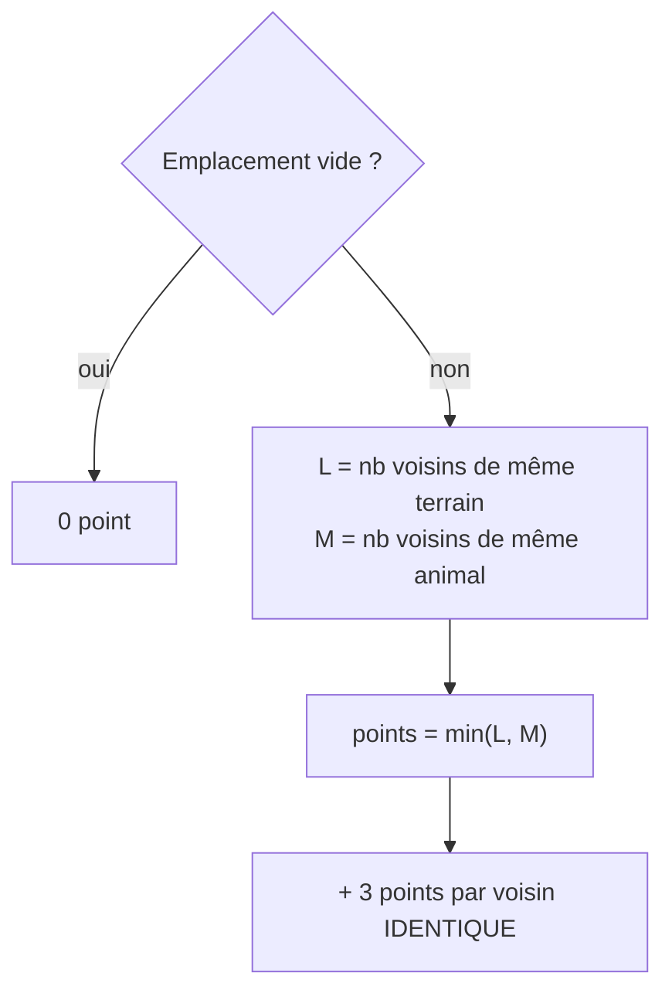
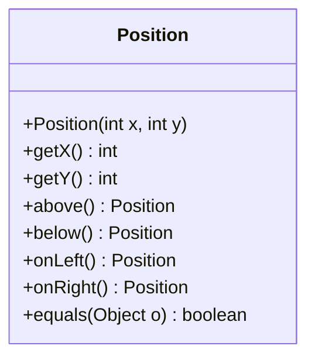

# DS1 POO 2025-2026 — Jeu de tuiles (sujet)

> ⏱️ **2 h** · Document autorisé : 1 feuille recto-verso distribuée en cours · Dictionnaire de langue autorisé
> 📚 Notions évaluées : [01 Classes et objets](../../01-Cours/01-classes-et-objets.md) · [02 static et enum](../../01-Cours/02-static-et-enum.md) · [03 Tests](../../01-Cours/03-tests.md) · [04 Exceptions](../../01-Cours/04-exceptions.md)
> ✅ [Corrigé proposé](./corrige.md) — essaie d'abord **sans** le regarder, en temps limité !

## 📌 Consignes
- Les temps indiqués par question sont **indicatifs**.
- Lis attentivement : **tous les mots** peuvent compter.
- Tests et javadoc : **seulement s'ils sont demandés**.
- Tests demandés : seulement le code des **méthodes de test** (pas l'en-tête de la classe de test).

---

## 🧩 Le jeu (lecture : 12 min)

### Les tuiles
- Une **tuile** = un **terrain** + un **animal** (une `String`).
- 5 terrains : **montagne, forêt, prairie, marécage, mer**.
- Deux tuiles sont **égales** si même terrain **et** même animal.
- Tuiles **mer** : animal toujours `"shark"` (requin) ; elles forment la **bordure** du plateau et ne sont **jamais jouées**.

### Le plateau
Plateau de largeur `l` et hauteur `h` (impairs) **+ une bordure de mer** ⇒ `(l+2)` colonnes × `(h+2)` lignes.
Exemple avec `l = 5`, `h = 3` :

| | x=0 | 1 | 2 | 3 | 4 | 5 | 6 |
|---|---|---|---|---|---|---|---|
| **y=0** | 🌊 | 🌊 | 🌊 | 🌊 | 🌊 | 🌊 | 🌊 |
| **y=1** | 🌊 | | | · | | | 🌊 |
| **y=2** | 🌊 | | · | **X** | · | | 🌊 |
| **y=3** | 🌊 | | | · | | | 🌊 |
| **y=4** | 🌊 | 🌊 | 🌊 | 🌊 | 🌊 | 🌊 | 🌊 |

- **X** = tuile de départ, au **centre** : animal fixé par le plateau, terrain **aléatoire** (pas la mer).
- **·** = les **4 voisins** (haut, bas, gauche, droite). Sur le bord, certains voisins sont des tuiles mer.

### Poser une tuile — règles
1. l'emplacement doit être **vide** ;
2. au moins **un des 4 voisins** doit être **compatible** : même terrain **ou** même animal.

### Compter les points

Points du joueur = **somme** des points de toutes ses tuiles (hors mer).

### Les positions — classe fournie `ds1game.tools.Position`

`x` vers la **droite**, `y` vers le **bas** ; `(0,0)` = coin haut-gauche.

---

## ✍️ Questions

| Q | Temps | Demande |
|---|---|---|
| **Ex. 1** | — | Écris très lisiblement ton **numéro de groupe**. |
| **Q1** | 3 min | Code du type `ds1game.tools.Land` (5 terrains). On suppose qu'il définit aussi `public static Land random()` (un des 4 terrains hors mer, au hasard) — *code non demandé*. |
| **Q2** | 13 min | Code **complet** de `ds1game.tools.Tile` : accesseurs terrain/animal, `equals()`, et une **constante globale `SEA`** (terrain mer, animal `"shark"`). |
| **Q3** | 12 min | `ds1game.Board` : en-tête, **attributs** (tableau 2D de tuiles) et **constructeur** `(largeur, hauteur, animal de départ)`. |
| **Q4** | 6 min | `positionIsValid(Position p)` : `true` ssi p peut accueillir une tuile **du joueur**. |
| **Q5** | 7 min | `neighbourTiles(Position p)` : tableau des **4 tuiles voisines**. |
| **Q6.1** | 5 min | **Javadoc** de `oneCompatibleNeighbour(Position p, Tile t)`. |
| **Q6.2** | 12 min | **Méthodes de test** de `oneCompatibleNeighbour()` (astuce : la tuile de départ n'est jamais mer). |
| **Q6.3** | 8 min | Code de `oneCompatibleNeighbour()`. |
| **Q7.1** | 12 min | **Tests** des cas où `playTile(Tile t, Position p)` lève `InvalidPositionException`. |
| **Q7.2** | 7 min | Code de `playTile()` (voir exceptions ci-dessous). |
| **Q8** | 2 min | Constante du **bonus** (3 points) pour une tuile voisine identique. |
| **Q9** | 8 min | `nbPoints(Position p)` : points de l'emplacement p (penser à `Math.min`). |
| **Q10** | 7 min | `nbPoints()` : total des points du plateau. |
| **Q11** | 6 min | `main` : plateau **7 × 9**, animal de départ **tortue** ; tuile t = forêt/tortue ; p = `randomPosition()` ; jouer t en p ; afficher les points **ou** un message d'alerte. |

### Méthodes supposées déjà écrites dans `Board`

| Méthode | Rôle |
|---|---|
| `int nbColumns()` / `int nbRows()` | dimensions **bordure de mer comprise** |
| `Tile getTile(Position p)` | tuile en p |
| `void putTile(Position p, Tile t)` | place t en p |
| `boolean noTileAt(Position p)` | `true` ssi pas de tuile en p |
| `int nbNeighboursWithSameAnimal(Position p)` / `…SameLand(…)` | nb de voisins de même animal / terrain (0 si p vide) |
| `Position randomPosition()` | position valide aléatoire |

> Sauf mention contraire, la `Position` reçue en paramètre est supposée **valide**.

### Exceptions de `playTile(Tile t, Position p)`
- `InvalidPositionException` : p **non valide** ou **déjà occupée** ;
- `NoCompatibleNeighboursException` : **aucun voisin compatible**.

(Ces deux classes existent dans `ds1game`, avec un constructeur sans paramètre.)

---

## 📝 Mes réponses

*(entraîne-toi ici ou sur papier, puis compare avec le [corrigé](./corrige.md))*

---
📂 [Autres examens](../README.md) · 🏠 [Sommaire](../../README.md)
