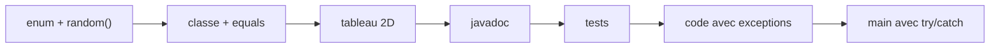

# 📝 Examens — Annales du DS1

> 🎯 Conseil : fais chaque sujet **en temps limité, sur papier**, puis corrige-toi avec le corrigé et note tes erreurs dans le [carnet d'erreurs](../05-Fiches/checklist-revision.md#-mon-carnet-derreurs).

| Année | Durée | Thème | Sujet | Corrigé |
|---|---|---|---|---|
| 2023-2024 | 1 h 30 | Jeu de cartes + Jeu de la vie | [sujet](./DS1-2023-2024/sujet.md) | [corrigé](./DS1-2023-2024/corrige.md) |
| 2024-2025 | 1 h 30 | Grilles de motifs | [sujet](./DS1-2024-2025/sujet.md) | [corrigé](./DS1-2024-2025/corrige.md) |
| 2025-2026 | 2 h | Jeu de tuiles | [sujet](./DS1-2025-2026/sujet.md) | [corrigé](./DS1-2025-2026/corrige.md) |

## 🔁 Ce qui revient à CHAQUE DS1

| Compétence | 2023-24 | 2024-25 | 2025-26 | Cours |
|---|:---:|:---:|:---:|---|
| `enum` + méthode `static random()` | `Element` | `Color` | `Land` | [02](../01-Cours/02-static-et-enum.md) |
| Constante `public static final` | or initial | `DEFAULT_SHAPE` | `SEA`, bonus | [02](../01-Cours/02-static-et-enum.md) |
| Classe complète + `equals(Object)` | `Card` | `Pattern` | `Tile` | [01](../01-Cours/01-classes-et-objets.md) |
| Tableau **2D** d'objets (constructeur + doubles boucles) | `GameOfLife` | `Grid` | `Board` | [01](../01-Cours/01-classes-et-objets.md) |
| Javadoc d'une méthode (`@param`, `@return`, `@throws`) | `play` | `copyGridAtPosition` | `oneCompatibleNeighbour` | [03](../01-Cours/03-tests.md) |
| **Méthodes de test** JUnit (`assertThrows`…) | `play` | `copyGridAtPosition` | `oneCompatibleNeighbour`, `playTile` | [03](../01-Cours/03-tests.md) |
| Lever une exception (`throw` / `throws`) | `NotEnoughGold…` | `WrongSize…` | `InvalidPosition…` | [04](../01-Cours/04-exceptions.md) |
| Capturer une exception (`try/catch`) | `main` | `generateFromPath` | `main` | [04](../01-Cours/04-exceptions.md) |
| `main` avec `args` / message d'erreur | ✅ | — | ✅ | [01](../01-Cours/01-classes-et-objets.md) |

💡 Le **schéma type** d'un DS1 : on construit les petites classes d'abord, puis la grande classe qui les utilise, en finissant par documentation → tests → code d'une méthode à exception, et un `main`.

## ✅ Les 5 réflexes qui rapportent des points
1. `equals(Object o)` avec `instanceof` + cast ; `String` → `.equals`, `enum`/`int` → `==`.
2. Constantes nommées (`static final`) plutôt que des nombres en dur.
3. Dans les tests : cas **normal**, cas **limite**, cas d'**erreur** (`assertThrows`) et vérifier que l'état est **inchangé** après une erreur.
4. **Vérifier avant de modifier** : on lève l'exception avant tout changement.
5. Ne pas oublier `throws` dans la signature d'une méthode qui lève une exception vérifiée.

---
🏠 [Sommaire](../README.md)
