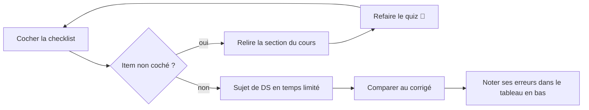

# ✅ Checklist de révision

> Coche ce que tu sais faire **sans regarder le cours**. Ce qui reste décoché = à retravailler (lien direct vers le chapitre).
> 🎯 Astuce : refais le **quiz 🧠** en fin de chapitre, puis les [annales du DS1](../04-Examens/README.md) **en temps limité**.

## 🔁 Méthode de révision

---

## 01 — [Classes et objets](../01-Cours/01-classes-et-objets.md)
- [ ] Je distingue **classe** (le moule) et **instance** (l'objet créé par `new`).
- [ ] J'écris une classe : attributs `private`, constructeur(s), accesseurs, `toString()`.
- [ ] Je sais ce qu'est une **référence** et dessiner la mémoire après `a = b;`.
- [ ] Je sais à quoi sert `this` (attribut vs paramètre, passer l'objet courant).
- [ ] Je passe d'un énoncé à un **diagramme UML** (attributs, méthodes, constructeurs).
- [ ] Je sais compiler et exécuter (`javac -sourcepath src ... -d classes`, `java -classpath classes ...`).

## 02 — [static et enum](../01-Cours/02-static-et-enum.md)
- [ ] Je sais quand un attribut/une méthode doit être `static`.
- [ ] J'écris une constante : `public static final int MAX = 10;`.
- [ ] J'écris un `enum`, avec attributs, constructeur **privé** et méthodes.
- [ ] J'utilise `values()`, `valueOf()`, `ordinal()`, `==` sur les valeurs d'enum.

## 03 — [Tests](../01-Cours/03-tests.md)
- [ ] J'écris une méthode `@Test` avec `assertEquals`, `assertTrue`, `assertFalse`, `assertSame`…
- [ ] Je teste une exception : `assertThrows(XxxException.class, () -> ...)`.
- [ ] Je choisis les **cas** à tester (cas normal, limites, cas d'erreur).
- [ ] Je compile et lance les tests JUnit en ligne de commande.

## 04 — [Exceptions](../01-Cours/04-exceptions.md)
- [ ] Je lève une exception : `throw new XxxException();`.
- [ ] Je déclare : `throws XxxException` (exceptions **vérifiées**).
- [ ] Je capture : `try { ... } catch (XxxException e) { ... }`.
- [ ] Je distingue `Exception` (vérifiée) et `RuntimeException` (non vérifiée).
- [ ] J'écris ma propre classe d'exception.
- [ ] J'écris la javadoc `@throws`.

## 05 — [Polymorphisme et interfaces](../01-Cours/05-polymorphisme-et-interfaces.md)
- [ ] Je définis et implémente une **interface** (`implements`).
- [ ] Je distingue **type statique** (déclaré) et **type dynamique** (objet réel).
- [ ] J'explique le **late binding** : la méthode exécutée dépend de l'objet.
- [ ] Je connais les méthodes `default`.

## 06 — [Interfaces (suite)](../01-Cours/06-interfaces-suite.md)
- [ ] J'implémente `Comparable<T>` (`compareTo`) pour pouvoir **trier** mes objets.
- [ ] J'explique le principe **ouvert/fermé (OCP)** et pourquoi les interfaces l'appliquent.

## 07 — [Collections](../01-Cours/07-collections.md)
- [ ] Je choisis entre `List`, `Set` et `Map` selon le besoin.
- [ ] Je parcours avec `for (E e : coll)` et avec un `Iterator` (et je sais supprimer pendant un parcours).
- [ ] Je redéfinis `equals` **et** `hashCode` ensemble.
- [ ] Je type mes collections : `List<Book> books = new ArrayList<>();`.

## 08 — [Héritage](../01-Cours/08-heritage.md)
- [ ] J'écris une sous-classe (`extends`) et son constructeur avec `super(...)` en **première** ligne.
- [ ] Je **redéfinis** une méthode (`@Override`) et j'appelle `super.methode()`.
- [ ] Je déroule la **recherche de méthode** (lookup) à partir de la classe de l'objet.
- [ ] Je connais `protected` et la classe `Object`.
- [ ] Je fais un transtypage (cast) en sécurité avec `instanceof`.

## 09 — [Classes abstraites et final](../01-Cours/09-classes-abstraites.md)
- [ ] J'écris une classe `abstract` avec des méthodes `abstract`.
- [ ] Je sais choisir entre **interface** et **classe abstraite**.
- [ ] Je sais ce que signifie `final` sur une classe, une méthode, un attribut.

---

## 📝 Mon carnet d'erreurs

| Date | Chapitre | Erreur commise | Ce que je dois retenir |
|---|---|---|---|
| | | | |

---
🏠 [Retour à l'accueil](../README.md)
