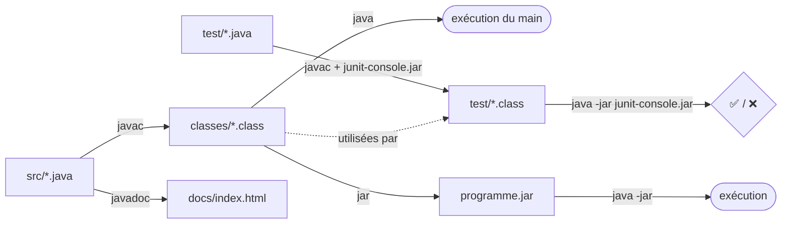

# 🛠️ Memento des commandes Java (compilation, exécution, tests, doc, jar, git)

> 🎯 À la fin des TP, tu dois savoir taper **toutes** ces commandes sans aide.
> 📌 Toutes les commandes se lancent **depuis le dossier du TP** (ex. `poo/tp4/`), jamais depuis `src/`.

## 🗺️ Vue d'ensemble : le cycle de travail



## 📁 Organisation d'un dossier de TP

| Élément | Contenu | À rendre ? |
|---|---|---|
| `README.md` | nom, sujet, commandes, section IA | ✅ |
| `src/` | code source `.java` (ex. `src/hotel/Hotel.java`) | ✅ |
| `test/` | classes de test (ex. `test/hotel/HotelTest.java`) | ✅ |
| `classes/` | fichiers `.class` générés | ❌ |
| `docs/` | javadoc générée | ❌ |

> ⚠️ Un paquetage `hotel` ⇔ un dossier `hotel/` **et** la ligne `package hotel;` en haut du fichier.

---

## 1. Compiler — `javac`

| Besoin | Commande |
|---|---|
| Une classe | `javac -sourcepath src src/Tv.java -d classes` |
| Classe dans un paquetage | `javac -sourcepath src src/hotel/HotelMain.java -d classes` |
| Toutes les classes d'un dossier | `javac -sourcepath src src/*.java -d classes` |

| Option | Rôle | Moyen mnémotechnique |
|---|---|---|
| `-sourcepath src` | où chercher les `.java` | *source* |
| `-d classes` | où ranger les `.class` | *destination* |

💡 Le compilateur compile aussi **automatiquement les classes utilisées** (« clôture transitive des dépendances »).
⚠️ Toute modification du `.java` ⇒ **recompiler**, sinon la JVM utilise l'ancien `.class`.
⚠️ Sur Mac, il faut parfois créer `classes/` avant : `mkdir classes`.

## 2. Exécuter — `java`

```bash
java -classpath classes TvMain                 # classe sans paquetage
java -classpath classes hotel.HotelMain 42     # avec paquetage + argument
```

| Compilation (`javac`) | Exécution (`java`) |
|---|---|
| un **fichier** : chemin + `.java` | une **classe** : nom complet, **sans** extension |
| `src/hotel/HotelMain.java` | `hotel.HotelMain` |

- La classe exécutée doit contenir **exactement** : `public static void main(String[] args)`.
- Les arguments après le nom de classe arrivent dans `args` (des `String` !) → `Integer.parseInt(args[1])`.
- Plusieurs dossiers : `-classpath classes:autre` (Linux/Mac) — `-classpath "classes;autre"` (Windows).

## 3. Tester — JUnit 5

```bash
# Compiler une classe de test (les .class restent dans test/)
javac -classpath junit-console.jar:classes test/hotel/HotelTest.java

# Exécuter UNE classe de test
java -jar junit-console.jar -classpath test:classes -select-class hotel.HotelTest

# Exécuter TOUS les tests du dossier test/
java -jar junit-console.jar -classpath test:classes -scan-classpath
```

> 📌 `junit-console.jar` = `junit-platform-console-standalone-1.9.3.jar` renommé.
> ⚠️ Compiler d'abord `src/` (dans `classes/`), **puis** les tests.

## 4. Documenter — `javadoc`

```bash
javadoc -sourcepath src -d docs hotel          # tout le paquetage hotel
javadoc -d docs src/LightBulb.java             # une seule classe
```
Ouvrir `docs/index.html` (ou `package-summary.html`).
✅ La génération doit se faire **sans erreur ni warning**.

## 5. Archive exécutable — `jar`

```bash
jar cvfe othello.jar othello.OthelloMain -C classes .
java -jar othello.jar
```

| Lettre | Sens |
|---|---|
| `c` | créer |
| `v` | verbeux (affiche ce qui est ajouté) |
| `f` | nom du fichier jar |
| `e` | point d'entrée (classe contenant le `main`) |
| `-C classes .` | prendre tout le contenu de `classes/` |

## 6. Rendre son travail — Git / GitLab

```bash
git add src test README.md       # 1. ajouter
git commit -m "Hotel: méthode rentRoom + tests OK"   # 2. valider
git push                          # 3. envoyer
```

`.gitignore` (à la racine du dépôt) pour ne **pas** rendre les fichiers générés :
```
*.class
classes/
docs/
*.jar
```

✅ Bonne pratique : un `add/commit/push` **à chaque étape réussie** (méthode écrite, test qui passe, bug corrigé).
✅ Ajouter l'enseignant·e de TP au dépôt avec le rôle **developer**.

---

## 🧠 Auto-évaluation

1. Depuis `tp4/`, compile `src/hotel/HotelMain.java` en rangeant le résultat dans `classes/`.
<details><summary>Réponse</summary>

`javac -sourcepath src src/hotel/HotelMain.java -d classes`

</details>

2. Pourquoi `java -classpath classes hotel/HotelMain.class` ne marche pas ?
<details><summary>Réponse</summary>

`java` attend un **nom de classe**, pas un fichier : `java -classpath classes hotel.HotelMain`.

</details>

3. J'ai modifié `Tv.java`, j'exécute `TvMain` et rien n'a changé. Pourquoi ?
<details><summary>Réponse</summary>

Je n'ai pas recompilé : la JVM n'utilise que les `.class`.

</details>

4. Quelle commande lance tous les tests ?
<details><summary>Réponse</summary>

`java -jar junit-console.jar -classpath test:classes -scan-classpath`

</details>

---
🏠 [Retour au sommaire](../README.md)
