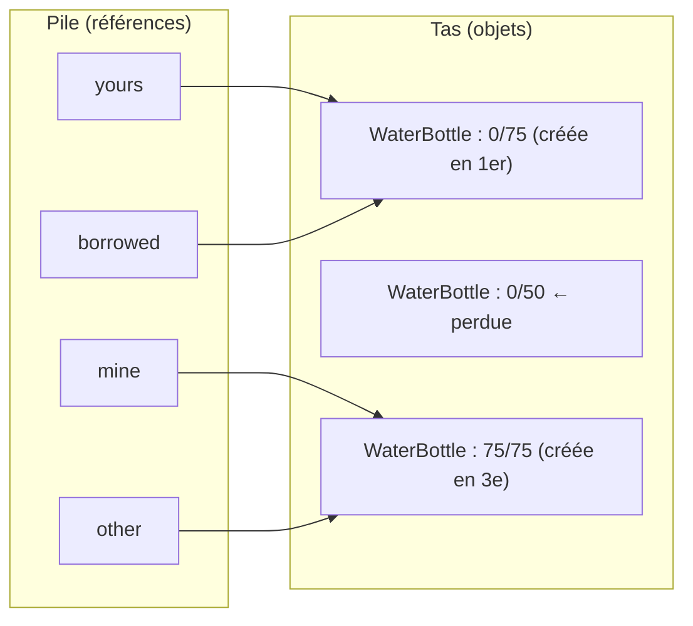
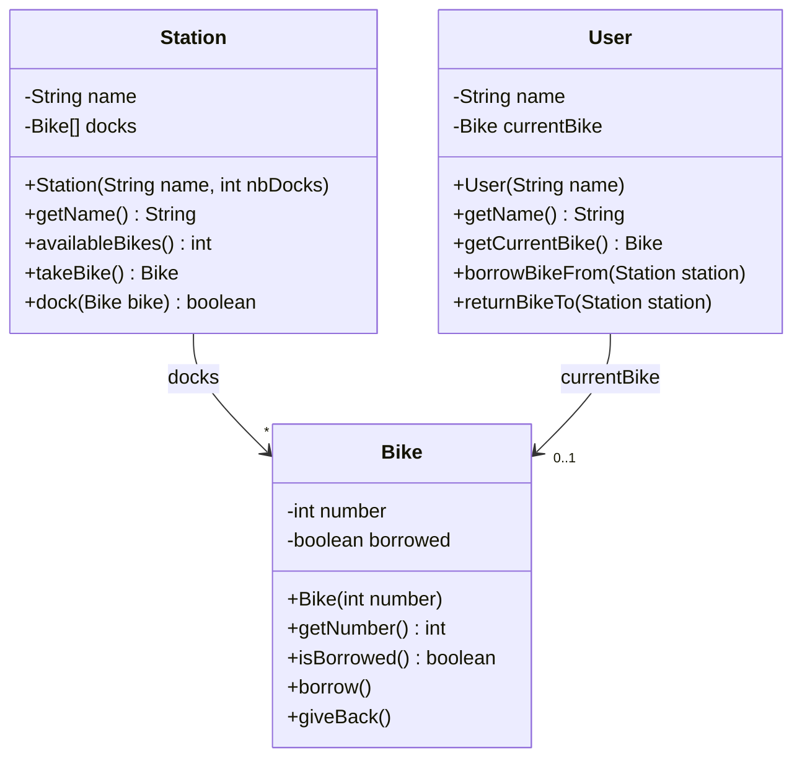
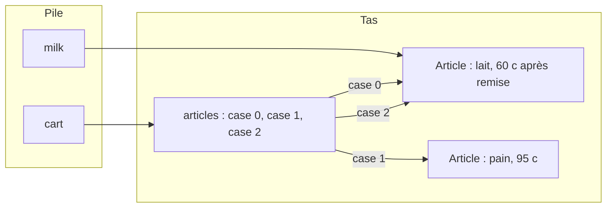

# ✅ 01 — Classes et objets : corrigé

> ⬅️ **Énoncé :** [./enonce.md](./enonce.md) · 🔗 **Cours :** [01 — Classes et objets](../../01-Cours/01-classes-et-objets.md)
> 📌 Tout le code a été **compilé** (Java 21) et **exécuté** : les affichages ci-dessous sont les vrais résultats.

---

## Exercice 1 — La gourde partagée

### Q1 — Affichage

```text
55
bottle 0/50 cL
bottle 0/75 cL
true
false
bottle 75/75 cL | bottle 0/75 cL
```

💡 `borrowed = mine` copie la **référence** : `borrowed.drink(20)` vide **la** gourde d'Inès (75 → 55). Puis `yours = borrowed` : `yours` désigne aussi cette gourde, `drink(100)` la vide (55 < 100 → 0). `other` est un **nouvel** objet : `other == mine` est faux, même s'il a la même capacité.

### Q2 — Objets créés / perdus

**3 objets** (3 `new`). À la fin, la gourde de **50 cL** n'est plus référencée par personne → **perdue** (le garbage collector récupérera sa mémoire).

### Q3 — État final



### Q4 — `null` et variable non initialisée

(a) compile, affiche `avant` puis **plante à l'exécution** :

```text
avant
Exception in thread "main" java.lang.NullPointerException: Cannot invoke "WaterBottle.fill()" because "<local1>" is null
	at NullMain.main(NullMain.java:5)
```

(b) **ne compile pas** :

```text
UninitMain.java:4: error: variable b might not have been initialized
        b.fill();
        ^
```

💡 `null` = « la télécommande ne pilote aucune télé » : on ne peut pas envoyer de message → `NullPointerException`. ⚠️ Nuance : un **attribut** non initialisé vaut `null`, mais une **variable locale** non initialisée est refusée par le compilateur.

---

## Exercice 2 — Le minuteur buggé

### Q1 — Les 3 erreurs de compilation (sortie réelle de `javac`, résumée)

```text
KitchenTimer.java:19: error: incompatible types: int cannot be converted to boolean
KitchenMain.java:3: error: constructor KitchenTimer in class KitchenTimer cannot be applied to given types;
KitchenMain.java:5: error: cannot find symbol
3 errors
```

| Ligne | Erreur | Explication |
|---|---|---|
| `KitchenTimer.java:19` | `return this.seconds = 0;` | `=` est une **affectation** (de type `int`), il faut `==` (comparaison, `boolean`) |
| `KitchenMain.java:3` | `new KitchenTimer("pasta", 9)` | à cause du `void`, `KitchenTimer(...)` est une **méthode** : la classe n'a que le constructeur par défaut, sans paramètre |
| `KitchenMain.java:5` | `t.reset()` | message non défini par la classe `KitchenTimer` |

### Q2 — Les erreurs qui compilent

| Erreur | Conséquence | Correction |
|---|---|---|
| `public void KitchenTimer(...)` | ce n'est **pas** un constructeur | enlever `void` |
| `label = label;` | le paramètre masque l'attribut : `getLabel()` renvoie `null` | `this.label = label;` |
| `this.seconds / 60` | division **entière** : 90 s → `1.0` au lieu de `1.5` | `this.seconds / 60.0` |
| `tick()` sans test | le temps devient négatif (`-10`), `isRinging()` ne sera plus jamais vrai | ne décrémenter que si `seconds > 0` |
| `public int seconds` | casse l'**encapsulation** : n'importe qui peut écrire `t.seconds = -5` | `private` |
| `return label;` | compile, mais le cours impose `this.` | `return this.label;` |

💡 Vérifié en exécutant la version « qui compile » (constructeur réparé seulement) : après 30 `tick()` sur 2 min, on obtient `null 1.0` ; après 100 de plus, `-10 false`.

### Q3 — Classe corrigée

```java
public class KitchenTimer {
    private String label;
    private int seconds;

    /** build a kitchen timer
     * @param label what is being cooked
     * @param minutes initial duration, in minutes
     */
    public KitchenTimer(String label, int minutes) {
        this.label = label;
        this.seconds = minutes * 60;
    }

    /** @return what is being cooked */
    public String getLabel() {
        return this.label;
    }

    /** @return the remaining time in minutes, with decimals (90 s gives 1.5) */
    public double getMinutes() {
        return this.seconds / 60.0;
    }

    /** one second elapses (the remaining time never goes below 0) */
    public void tick() {
        if (this.seconds > 0) {
            this.seconds = this.seconds - 1;
        }
    }

    /** @return true if the remaining time is 0 */
    public boolean isRinging() {
        return this.seconds == 0;
    }

    /** @return a description such as "pasta : 7 min 45 s" */
    public String toString() {
        return this.label + " : " + (this.seconds / 60) + " min " + (this.seconds % 60) + " s";
    }
}
```

💡 Avec la version corrigée, le même scénario affiche `pasta 1.5` puis `pasta : 0 min 0 s true`. Dans `toString`, la division **entière** est voulue : `465 / 60` = 7 min, `465 % 60` = 45 s.

---

## Exercice 3 — Le compte bancaire

### Q1 + Q2 — Classe complète

```java
public class BankAccount {
    private String owner;
    private int balance;   // en euros

    /** build an account with a balance of 0
     * @param owner the owner of the account
     */
    public BankAccount(String owner) {
        this.owner = owner;
        this.balance = 0;
    }

    /** build an account with a given initial balance
     * @param owner the owner of the account
     * @param initialBalance the initial balance
     */
    public BankAccount(String owner, int initialBalance) {
        this.owner = owner;
        this.balance = initialBalance;
    }

    /** @return the owner of this account */
    public String getOwner() {
        return this.owner;
    }

    /** @return the balance of this account */
    public int getBalance() {
        return this.balance;
    }

    /** add money to this account (nothing happens if amount is not positive)
     * @param amount the amount to add
     */
    public void deposit(int amount) {
        if (amount > 0) {
            this.balance = this.balance + amount;
        }
    }

    /** withdraw money if the balance is sufficient
     * @param amount the amount to withdraw
     * @return true if the withdrawal was done, false otherwise
     */
    public boolean withdraw(int amount) {
        if (amount > 0 && amount <= this.balance) {
            this.balance = this.balance - amount;
            return true;
        }
        return false;
    }

    /** transfer money from this account to another one, if possible
     * @param other the account that receives the money
     * @param amount the amount to transfer
     * @return true if the transfer was done, false otherwise
     */
    public boolean transferTo(BankAccount other, int amount) {
        if (this.withdraw(amount)) {
            other.deposit(amount);
            return true;
        }
        return false;
    }

    /** @return a description such as "Alice : 120 €" */
    public String toString() {
        return this.owner + " : " + this.balance + " €";
    }
}
```

💡 `transferTo` ne réécrit pas la règle « solde suffisant » : elle **délègue** à `withdraw` (message envoyé à `this`) puis à `deposit` (message envoyé à `other`). Une règle = un seul endroit dans le code.

### Q3 — Affichage

```text
false
true
Alice : 60 €
Bob : 70 €
20
Bob : 20 €
```

💡 `withdraw(150)` échoue (solde 100). Le virement de 40 réussit : Alice 60, Bob 30 + 40 = 70. `joint` et `bob` désignent **le même** compte : retirer 50 via `joint` laisse 20 « chez Bob ». `deposit(-10)` est ignoré.

### Q4 — Un seul paramètre

Le compte débité est le **receveur** du message (`this`) : `alice.transferTo(bob, 40)` se lit « le compte d'Alice vire 40 € à `bob` ». Mettre deux comptes en paramètres rendrait `this` inutile (même piège que `moreExpensiveThan(Item a, Item b)`).

---

## Exercice 4 — Vélos en libre-service

### Q1 — Analyse

| Noms communs → classes | Verbes → méthodes |
|---|---|
| station → `Station` | savoir combien de vélos sont disponibles → `availableBikes()` ; recevoir / donner un vélo → `dock(Bike)`, `takeBike()` |
| vélo → `Bike` | savoir s'il est emprunté → `isBorrowed()` ; obtenir son numéro → `getNumber()` |
| usager → `User` | emprunter dans une station → `borrowBikeFrom(Station)` ; rendre → `returnBikeTo(Station)` |
| nom, numéro, borne | ce sont des **attributs** (valeurs simples ou tableau), pas des classes |

### Q2 — UML (comportement puis état)



💡 L'état se **déduit** du comportement : pour « un vélo à la fois », l'usager doit mémoriser `currentBike` ; pour « savoir s'il est emprunté », le vélo a un booléen `borrowed`.

### Q3 — Scénario

```java
public class BikeScenario {
    public static void main(String[] args) {
        Station gare = new Station("Gare Lille Flandres", 3);
        Station cite = new Station("Cité scientifique", 2);
        gare.dock(new Bike(1));
        gare.dock(new Bike(2));
        User lea = new User("Léa");
        lea.borrowBikeFrom(gare);
        lea.returnBikeTo(cite);
        System.out.println(gare.getName() + " : " + gare.availableBikes());
        System.out.println(cite.getName() + " : " + cite.availableBikes());
    }
}
```

```text
Gare Lille Flandres : 1
Cité scientifique : 1
```

### Q4 — Les 3 classes et l'affichage

```java
public class Bike {
    private int number;
    private boolean borrowed;

    public Bike(int number) {
        this.number = number;
        this.borrowed = false;
    }

    public int getNumber() {
        return this.number;
    }

    public boolean isBorrowed() {
        return this.borrowed;
    }

    public void borrow() {
        this.borrowed = true;
    }

    public void giveBack() {
        this.borrowed = false;
    }
}
```

```java
public class Station {
    private String name;
    private Bike[] docks;   // docks[i] == null : borne i libre

    public Station(String name, int nbDocks) {
        this.name = name;
        this.docks = new Bike[nbDocks];
    }

    public String getName() {
        return this.name;
    }

    public int availableBikes() {
        int count = 0;
        for (int i = 0; i < this.docks.length; i++) {
            if (this.docks[i] != null) {
                count = count + 1;
            }
        }
        return count;
    }

    /** @return the bike taken from the station, or null if there is none */
    public Bike takeBike() {
        for (int i = 0; i < this.docks.length; i++) {
            if (this.docks[i] != null) {
                Bike bike = this.docks[i];
                this.docks[i] = null;
                return bike;
            }
        }
        return null;
    }

    /** @return true if the bike has been docked, false if the station is full */
    public boolean dock(Bike bike) {
        for (int i = 0; i < this.docks.length; i++) {
            if (this.docks[i] == null) {
                this.docks[i] = bike;
                return true;
            }
        }
        return false;
    }
}
```

```java
public class User {
    private String name;
    private Bike currentBike;   // null si aucun vélo emprunté

    public User(String name) {
        this.name = name;
        this.currentBike = null;
    }

    public String getName() {
        return this.name;
    }

    public Bike getCurrentBike() {
        return this.currentBike;
    }

    /** borrow a bike in the station (only one bike at a time) */
    public void borrowBikeFrom(Station station) {
        if (this.currentBike == null) {
            Bike bike = station.takeBike();
            if (bike != null) {
                bike.borrow();
                this.currentBike = bike;
            }
        }
    }

    /** give back the current bike in the station, if it is not full */
    public void returnBikeTo(Station station) {
        if (this.currentBike != null && station.dock(this.currentBike)) {
            this.currentBike.giveBack();
            this.currentBike = null;
        }
    }
}
```

Affichage du `main` de l'énoncé :

```text
1 1
1 1 true
```

💡 Le 2ᵉ `borrowBikeFrom(gare)` ne fait rien (Léa a déjà le vélo n°1) : il reste 1 vélo à la gare. Tout passe par **envoi de messages** : l'usager ne touche jamais au tableau `docks`, il demande à la station (`takeBike`, `dock`).

---

## Exercice 5 — Le panier de courses

### Q1 + Q2 — `ShoppingCart`

```java
public class ShoppingCart {
    private Article[] articles;
    private int nbArticles;

    /** build an empty cart
     * @param capacity the maximum number of articles in the cart
     */
    public ShoppingCart(int capacity) {
        this.articles = new Article[capacity];
        this.nbArticles = 0;
    }

    /** @return the number of articles in the cart */
    public int getNbArticles() {
        return this.nbArticles;
    }

    /** add an article if the cart is not full
     * @param a the article to add
     * @return true if the article has been added, false if the cart is full
     */
    public boolean add(Article a) {
        if (this.nbArticles == this.articles.length) {
            return false;
        }
        this.articles[this.nbArticles] = a;
        this.nbArticles = this.nbArticles + 1;
        return true;
    }

    /** @return the total price of the cart, in cents */
    public int totalPrice() {
        int total = 0;
        for (int i = 0; i < this.nbArticles; i++) {
            total = total + this.articles[i].getPrice();
        }
        return total;
    }

    /** @return the most expensive article of the cart, or null if the cart is empty */
    public Article mostExpensive() {
        if (this.nbArticles == 0) {
            return null;
        }
        Article best = this.articles[0];
        for (int i = 1; i < this.nbArticles; i++) {
            if (this.articles[i].moreExpensiveThan(best)) {
                best = this.articles[i];
            }
        }
        return best;
    }
}
```

💡 On boucle jusqu'à `nbArticles` (et **pas** `articles.length`) : au-delà, les cases valent `null` → `NullPointerException` sur `getPrice()`.

### Q3 — Affichage

```text
null
false
3 335
215
pain (95 c)
```

### Q4 — Pourquoi le total change



💡 Le panier stocke des **références** : les cases 0 et 2 désignent **le même** objet `milk`. `milk.applyDiscount(50)` le passe de 120 à 60 c, donc le total passe de 120 + 95 + 120 = 335 à 60 + 95 + 60 = 215. Le comté n'a pas été ajouté : le panier était plein (`false`).

---

## Exercice 6 — Les anniversaires

### Q1 — Sans `toString` ni `equals`

```text
Birthday@2a139a55
false
false
```

💡 La 1ʳᵉ ligne dépend de l'exécution (`Birthday@` + un code hexadécimal). Sans `equals` écrite, `b1.equals(b2)` compare les **références**, comme `==` → `false`.

### Q2 + Q3 — Classe complète

```java
public class Birthday {
    private int day;
    private int month;

    public Birthday(int day, int month) {
        this.day = day;
        this.month = month;
    }

    public int getDay() {
        return this.day;
    }

    public int getMonth() {
        return this.month;
    }

    /** @return a description such as "14/7" */
    public String toString() {
        return this.day + "/" + this.month;
    }

    /** two birthdays are equal if they have the same day and the same month
     * @param o the object to compare with this birthday
     * @return true if o is a Birthday with the same day and month
     */
    public boolean equals(Object o) {
        if (!(o instanceof Birthday)) {
            return false;
        }
        Birthday other = (Birthday) o;
        return this.day == other.day && this.month == other.month;
    }
}
```

💡 Le paramètre est de type **`Object`** (signature imposée, comme `Member.equals` au TP3) : on vérifie d'abord que `o` est bien un `Birthday`, puis on le « convertit » pour accéder à ses attributs.

### Q4 — Affichage

```text
14/7
né le 7/14
false
true
true
false
false
true
false
true
```

| Ligne | Pourquoi |
|---|---|
| `14/7`, `né le 7/14` | `println` et la concaténation `+` appellent `toString()` automatiquement |
| `b1 == b2` → `false` | deux `new` = deux objets distincts |
| `b1.equals(b2)` → `true` | même jour, même mois |
| `b1 == b3` → `true` | même référence |
| `b1.equals(b4)` → `false` | 14/7 ≠ 7/14 |
| `b1.equals("14/7")` → `false` | `"14/7"` est un `String`, pas un `Birthday` |
| `b1.toString().equals("14/7")` → `true` | on compare deux `String` |
| `city == typed` → `false` | deux objets `String` différents |
| `city.equals(typed)` → `true` | mêmes caractères : **toujours** comparer des `String` avec `equals` |

---

## Exercice 7 — Le minuteur en ligne de commande

### Q1 — `TimerMain`

```java
public class TimerMain {
    public static void main(String[] args) {
        if (args.length < 2) {
            System.out.println("usage : java TimerMain <label> <minutes>");
        } else {
            String label = args[0];
            int minutes = Integer.parseInt(args[1]);
            KitchenTimer timer = new KitchenTimer(label, minutes);
            System.out.println(timer);
            for (int i = 0; i < 75; i++) {
                timer.tick();
            }
            System.out.println(timer);
            while (!timer.isRinging()) {
                timer.tick();
            }
            System.out.println("DRING ! " + timer.getLabel() + " est prêt");
        }
    }
}
```

### Q2 — Exécutions réelles

```text
$ java TimerMain
usage : java TimerMain <label> <minutes>
$ java TimerMain pasta
usage : java TimerMain <label> <minutes>
$ java TimerMain pasta 9
pasta : 9 min 0 s
pasta : 7 min 45 s
DRING ! pasta est prêt
$ java TimerMain egg 1
egg : 1 min 0 s
egg : 0 min 0 s
DRING ! egg est prêt
$ java TimerMain "soft egg" 3 extra
soft egg : 3 min 0 s
soft egg : 1 min 45 s
DRING ! soft egg est prêt
```

💡 `egg 1` : les 15 derniers `tick()` n'ont aucun effet (jamais sous 0). Avec les guillemets, `"soft egg"` est **un seul** argument ; l'argument en trop (`extra`) est simplement ignoré.

### Q3 — Arguments invalides

```text
$ java TimerMain pasta neuf
Exception in thread "main" java.lang.NumberFormatException: For input string: "neuf"
	at java.base/java.lang.NumberFormatException.forInputString(NumberFormatException.java:67)
	...
	at TimerMain.main(TimerMain.java:7)
```

💡 `Integer.parseInt("neuf")` échoue → le programme s'arrête. Avec `soft egg 3`, `args[1]` vaut `"egg"` : même erreur (`For input string: "egg"`). On apprendra à **capturer** cette exception au [chapitre 04](../../01-Cours/04-exceptions.md).

---

## ⚠️ Erreurs fréquentes

| Erreur | Pourquoi c'est faux | Correction |
|---|---|---|
| Croire que `b = a` crée une copie | seule la **référence** est copiée : un objet, deux noms | `new` pour un 2ᵉ objet |
| `label = label;` dans le constructeur | le paramètre masque l'attribut | `this.label = label;` |
| `public void KitchenTimer(...)` | avec un type de retour, ce n'est plus un constructeur | aucun type de retour |
| `return this.seconds = 0;` | affectation au lieu de comparaison | `==` |
| `this.seconds / 60` pour un `double` | division entière | `/ 60.0` |
| Attributs `public` | casse l'encapsulation | `private` + accesseurs |
| Boucler jusqu'à `articles.length` dans un tableau partiellement rempli | cases `null` → `NullPointerException` | boucler jusqu'à `nbArticles` |
| `transferTo(BankAccount a, BankAccount b, int x)` | oublie que le receveur est `this` | un seul compte en paramètre |
| Comparer deux `String` avec `==` | compare les références | `s1.equals(s2)` |
| `equals(Birthday o)` au lieu de `equals(Object o)` | ce n'est pas la signature attendue (TP3, collections) | paramètre `Object` + `instanceof` |
| Oublier de tester `args.length` | `args[1]` inexistant → plantage | afficher un message d'usage |

---

⬅️ [Retour à l'énoncé](./enonce.md) · 🏠 [Sommaire des exercices](../README.md)
