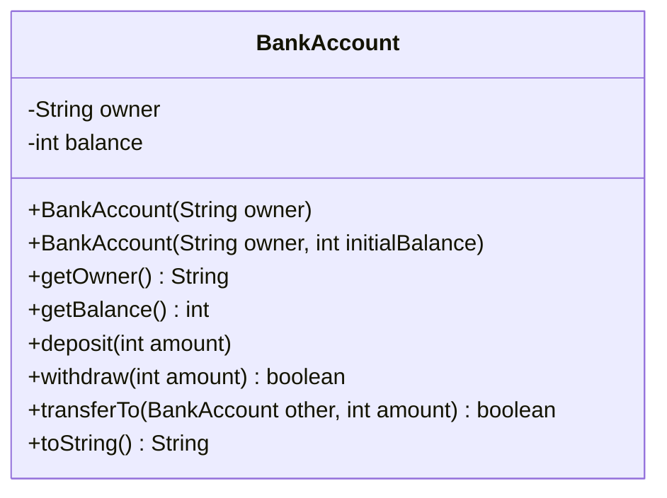
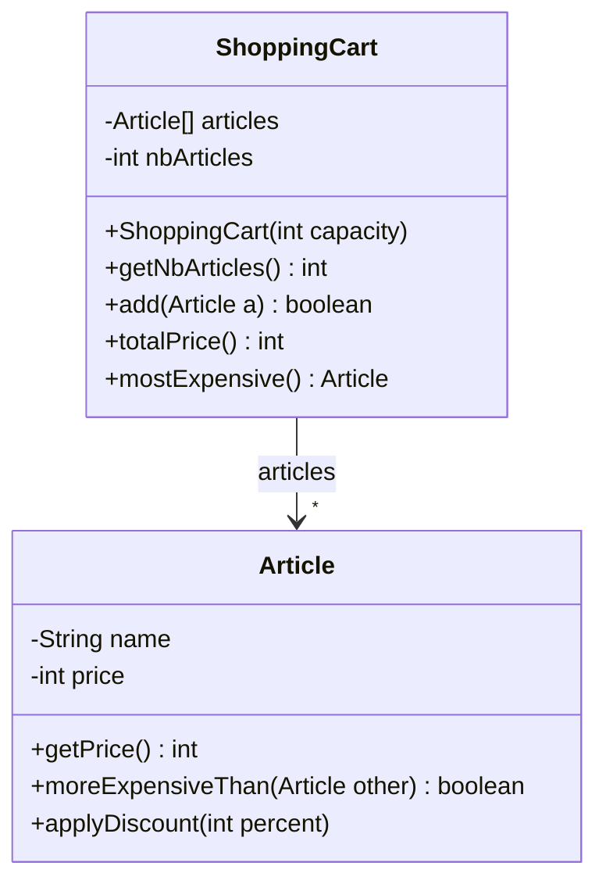
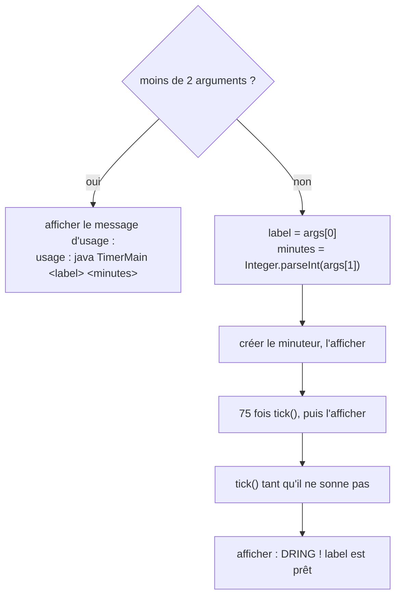

# 🏋️ 01 — Classes et objets : exercices d'entraînement

> ✅ **Corrigé :** [./corrige.md](./corrige.md) — essaie d'abord seul !
> 🔗 **Cours :** [01 — Classes et objets](../../01-Cours/01-classes-et-objets.md)
> 🎯 Références, `new`, `this`, constructeurs, envoi de message, analyse objet, `toString`/`equals`, `main(String[] args)`.

## 🗺️ Les exercices

| n° | Titre | Niveau | Durée | Notions |
|---|---|---|---|---|
| 1 | La gourde partagée | ⭐ | 10 min | références, alias `a = b`, `null`, objets perdus |
| 2 | Le minuteur buggé | ⭐ | 15 min | trouver les erreurs : constructeur, `this`, `private`, division entière |
| 3 | Le compte bancaire | ⭐⭐ | 20 min | écrire une classe complète, 2 constructeurs, envoi de message à `this` |
| 4 | Vélos en libre-service | ⭐⭐ | 25 min | analyse objet : noms → classes, verbes → méthodes, UML |
| 5 | Le panier de courses | ⭐⭐ | 25 min | objets qui collaborent, tableau d'objets, références partagées |
| 6 | Les anniversaires | ⭐⭐ | 15 min | `toString()`, `==` vs `equals`, `equals(Object o)` |
| 7 | Le minuteur en ligne de commande | ⭐⭐⭐ | 20 min | `main(String[] args)`, `Integer.parseInt` |

📌 Conseil : fais chaque « que s'affiche-t-il ? » **sur papier**, puis vérifie en compilant (`javac`, `java`).

---

## Exercice 1 — La gourde partagée ⭐

🌍 **Situation :** Inès remplit sa gourde de 75 cL ; son ami Tom la lui « emprunte » pour boire. Tom n'a pas une **autre** gourde : c'est **la même**. En Java, c'est pareil avec les références.

```java
public class WaterBottle {
    private int capacity;   // en cL
    private int content;    // en cL

    public WaterBottle(int capacity) {
        this.capacity = capacity;
        this.content = 0;
    }

    public void fill() {
        this.content = this.capacity;
    }

    public void drink(int amount) {
        if (amount > this.content) {
            this.content = 0;
        } else {
            this.content = this.content - amount;
        }
    }

    public int getContent() {
        return this.content;
    }

    public String toString() {
        return "bottle " + this.content + "/" + this.capacity + " cL";
    }
}
```

```java
public class BottleMain {
    public static void main(String[] args) {
        WaterBottle mine = new WaterBottle(75);
        WaterBottle yours = new WaterBottle(50);
        mine.fill();
        WaterBottle borrowed = mine;
        borrowed.drink(20);
        System.out.println(mine.getContent());
        System.out.println(yours);
        yours = borrowed;
        yours.drink(100);
        System.out.println(mine);
        System.out.println(borrowed == mine);
        WaterBottle other = new WaterBottle(75);
        System.out.println(other == mine);
        other.fill();
        mine = other;
        System.out.println(mine + " | " + yours);
    }
}
```

- [ ] **Q1.** Que s'affiche-t-il ? (6 lignes)
- [ ] **Q2.** Combien d'objets `WaterBottle` sont créés ? À la fin du `main`, lequel est **perdu** ?
- [ ] **Q3.** Dessine l'état final de la mémoire (pile : `mine`, `yours`, `borrowed`, `other` ; tas : les objets).
- [ ] **Q4.** Que se passe-t-il pour chacun de ces deux morceaux de code (dans un `main`) ?

```java
// (a)
WaterBottle b = null;
System.out.println("avant");
b.fill();
System.out.println("après");
```

```java
// (b)
WaterBottle b;
b.fill();
```

<details><summary>💡 Indice</summary>

- Compte les `new` : **chaque `new` crée un objet**, une affectation `x = y` n'en crée aucun.
- `x = y` copie la **référence** (la « télécommande »), pas l'objet.
- `==` entre deux références : vrai si elles désignent **le même objet**.
- (b) : une variable **locale** non initialisée n'est pas la même chose qu'une variable qui vaut `null`…

</details>

---

## Exercice 2 — Le minuteur buggé ⭐

🌍 **Situation :** un minuteur de cuisine affiche ce qui cuit (« pasta ») et le temps restant. À chaque seconde il décompte ; arrivé à 0, il sonne… et ne descend **jamais** sous 0.

Ce qui est attendu :

| Élément | Comportement attendu |
|---|---|
| `KitchenTimer(String label, int minutes)` | crée un minuteur pour `label`, réglé sur `minutes` minutes |
| `getLabel()` | renvoie ce qui cuit |
| `getMinutes()` | temps restant en minutes **avec décimales** (90 s → `1.5`) |
| `tick()` | une seconde s'écoule (jamais en dessous de 0) |
| `isRinging()` | vrai si le temps restant est 0 |

Le code écrit par un camarade :

```java
public class KitchenTimer {
    public int seconds;
    private String label;

    public void KitchenTimer(String label, int minutes) {
        label = label;
        this.seconds = minutes * 60;
    }

    public double getMinutes() {
        return this.seconds / 60;
    }

    public void tick() {
        this.seconds = this.seconds - 1;
    }

    public boolean isRinging() {
        return this.seconds = 0;
    }

    public String getLabel() {
        return label;
    }
}
```

```java
public class KitchenMain {
    public static void main(String[] args) {
        KitchenTimer t = new KitchenTimer("pasta", 9);
        t.tick();
        t.reset();
    }
}
```

- [ ] **Q1.** `javac KitchenTimer.java KitchenMain.java` affiche **3 erreurs**. Lesquelles (fichier, ligne, raison) ?
- [ ] **Q2.** Trouve les **erreurs qui compilent** mais donnent un résultat faux ou cassent l'encapsulation (il y en a au moins 4).
- [ ] **Q3.** Réécris la classe `KitchenTimer` corrigée, avec en plus une méthode `toString()` qui renvoie par exemple `"pasta : 7 min 45 s"`.

<details><summary>💡 Indice</summary>

- Un constructeur n'a **pas** de type de retour, même pas `void`.
- `=` affecte, `==` compare.
- Que vaut `90 / 60` en Java ? Et `90 / 60.0` ?
- Dans le constructeur, à quoi se réfère `label` tout seul ?
- `%` donne le reste de la division entière : `465 % 60` vaut `45`.

</details>

---

## Exercice 3 — Le compte bancaire ⭐⭐

🌍 **Situation :** une appli bancaire gère des comptes. On peut déposer, retirer (seulement si le solde suffit) et faire un virement vers un autre compte. Montants en **euros entiers**.



| Méthode | Règle |
|---|---|
| `BankAccount(owner)` | solde initial **0** |
| `deposit(amount)` | ajoute `amount` ; **ignoré** si `amount <= 0` |
| `withdraw(amount)` | retire si `0 < amount <= solde` et renvoie `true` ; sinon ne change rien et renvoie `false` |
| `transferTo(other, amount)` | retire de **ce** compte et dépose sur `other`, seulement si le retrait est possible ; renvoie `true` si le virement a eu lieu |
| `toString()` | `"Alice : 120 €"` |

- [ ] **Q1.** Écris la classe `BankAccount` complète (attributs, 2 constructeurs, accesseurs, `deposit`, `withdraw`, `toString`), avec javadoc.
- [ ] **Q2.** Écris `transferTo` en **réutilisant** `withdraw` et `deposit` (envoi de message à `this` et à `other`).
- [ ] **Q3.** Que s'affiche-t-il ?

```java
BankAccount alice = new BankAccount("Alice", 100);
BankAccount bob = new BankAccount("Bob");
bob.deposit(30);
System.out.println(alice.withdraw(150));
System.out.println(alice.transferTo(bob, 40));
System.out.println(alice);
System.out.println(bob);
BankAccount joint = bob;
joint.withdraw(50);
System.out.println(bob.getBalance());
bob.deposit(-10);
System.out.println(joint);
```

- [ ] **Q4.** Pourquoi `transferTo` n'a-t-elle qu'**un seul** paramètre de type `BankAccount`, alors qu'un virement concerne deux comptes ?

<details><summary>💡 Indice</summary>

- `transferTo` : `if (this.withdraw(amount)) { ... }` — le résultat booléen de `withdraw` dit si le retrait a réussi.
- Q4 : pense à `moreExpensiveThan(Item otherItem)` dans le cours.

</details>

---

## Exercice 4 — Vélos en libre-service ⭐⭐

🌍 **Situation :** à Lille, on emprunte un vélo V'Lille dans une station et on le rend dans n'importe quelle station.

> Une **station** a un **nom** et un nombre fixe de **bornes** ; chaque borne accueille au plus un vélo. On veut *savoir combien de vélos sont disponibles* dans une station.
> Un **vélo** a un **numéro** ; on peut *savoir s'il est emprunté*.
> Un **usager** a un nom. Il peut *emprunter un vélo* dans une station et *le rendre* dans une station (éventuellement une autre). Un usager ne peut emprunter qu'**un vélo à la fois**. On ne peut rendre un vélo que s'il reste une borne libre.

- [ ] **Q1.** Fais l'analyse : tableau « noms communs → classes » / « verbes → méthodes ».
- [ ] **Q2.** Propose le diagramme UML des 3 classes : d'abord les **méthodes** (comportement), puis déduis les **attributs** (état).
- [ ] **Q3.** Écris le **scénario** suivant en Java : *deux stations « Gare Lille Flandres » (3 bornes) et « Cité scientifique » (2 bornes) ; on dépose les vélos n°1 et n°2 à la gare ; Léa emprunte un vélo à la gare puis le rend à Cité scientifique ; on affiche le nombre de vélos disponibles dans chaque station.*
- [ ] **Q4.** ⭐⭐⭐ Code les 3 classes. Que s'affiche-t-il pour ce `main` ?

```java
Station gare = new Station("Gare Lille Flandres", 3);
Station cite = new Station("Cité scientifique", 2);
gare.dock(new Bike(1));
gare.dock(new Bike(2));
User lea = new User("Léa");
lea.borrowBikeFrom(gare);
lea.borrowBikeFrom(gare);
System.out.println(gare.availableBikes() + " " + lea.getCurrentBike().getNumber());
lea.returnBikeTo(cite);
System.out.println(gare.availableBikes() + " " + cite.availableBikes() + " " + (lea.getCurrentBike() == null));
```

<details><summary>💡 Indice</summary>

- 3 noms importants → 3 classes : `Station`, `Bike`, `User`.
- Les bornes d'une station : un tableau `Bike[] docks` ; une case à `null` = borne libre.
- « un vélo à la fois » → l'usager mémorise **son** vélo courant (`null` s'il n'en a pas).
- Le 2ᵉ `borrowBikeFrom(gare)` de Léa doit être sans effet.

</details>

---

## Exercice 5 — Le panier de courses ⭐⭐

🌍 **Situation :** au supermarché, le panier ne contient pas des **copies** des produits : il contient **les** produits. Si le prix d'un produit baisse en caisse, le total du panier baisse aussi.

```java
public class Article {
    private String name;
    private int price;   // en centimes

    public Article(String name, int price) {
        this.name = name;
        this.price = price;
    }

    public String getName() {
        return this.name;
    }

    public int getPrice() {
        return this.price;
    }

    /** reduce the price of this article
     * @param percent the discount, between 0 and 100
     */
    public void applyDiscount(int percent) {
        this.price = this.price - this.price * percent / 100;
    }

    public boolean moreExpensiveThan(Article other) {
        return this.price > other.price;
    }

    public String toString() {
        return this.name + " (" + this.price + " c)";
    }
}
```



- [ ] **Q1.** Écris `ShoppingCart` : constructeur (panier vide d'une capacité donnée), `getNbArticles()`, `add(Article a)` (renvoie `false` si le panier est plein), `totalPrice()` (en centimes).
- [ ] **Q2.** Écris `mostExpensive()` : l'article le plus cher, ou `null` si le panier est vide. Utilise le message `moreExpensiveThan`.
- [ ] **Q3.** Que s'affiche-t-il ?

```java
Article milk = new Article("lait", 120);
Article bread = new Article("pain", 95);
Article cheese = new Article("comté", 450);
ShoppingCart cart = new ShoppingCart(3);
System.out.println(cart.mostExpensive());
cart.add(milk);
cart.add(bread);
cart.add(milk);
System.out.println(cart.add(cheese));
System.out.println(cart.getNbArticles() + " " + cart.totalPrice());
milk.applyDiscount(50);
System.out.println(cart.totalPrice());
System.out.println(cart.mostExpensive());
```

- [ ] **Q4.** Explique pourquoi le **deuxième** total est différent du premier alors qu'on n'a pas touché au panier.

<details><summary>💡 Indice</summary>

- `nbArticles` sert à la fois de compteur et d'indice de la **prochaine case libre**.
- Panier plein : `this.nbArticles == this.articles.length`.
- Q3 : le même objet `milk` est ajouté **deux fois** (2 cases, 1 seul objet).
- Pourquoi des prix en centimes (`int`) ? Pour éviter les arrondis des `double` (`0.1 + 0.2` ne vaut pas exactement `0.3`).

</details>

---

## Exercice 6 — Les anniversaires ⭐⭐

🌍 **Situation :** deux cartes d'anniversaire portant « 14/7 » sont **deux cartes différentes**, mais elles indiquent **la même date**. Java fait la même différence : `==` (même objet ?) / `equals` (même valeur ?).

Première version, sans `toString` ni `equals` :

```java
public class Birthday {
    private int day;
    private int month;

    public Birthday(int day, int month) {
        this.day = day;
        this.month = month;
    }
}
```

- [ ] **Q1.** Avec cette version, que s'affiche-t-il ?

```java
Birthday b1 = new Birthday(14, 7);
Birthday b2 = new Birthday(14, 7);
System.out.println(b1);
System.out.println(b1 == b2);
System.out.println(b1.equals(b2));
```

- [ ] **Q2.** Ajoute les accesseurs et `toString()` qui renvoie `"14/7"`.
- [ ] **Q3.** Ajoute `public boolean equals(Object o)` : deux anniversaires sont égaux s'ils ont **même jour et même mois** (même schéma que `Member.equals` du TP3).
- [ ] **Q4.** Avec la version complète, que s'affiche-t-il ?

```java
Birthday b1 = new Birthday(14, 7);
Birthday b2 = new Birthday(14, 7);
Birthday b3 = b1;
Birthday b4 = new Birthday(7, 14);
System.out.println(b1);
System.out.println("né le " + b4);
System.out.println(b1 == b2);
System.out.println(b1.equals(b2));
System.out.println(b1 == b3);
System.out.println(b1.equals(b4));
System.out.println(b1.equals("14/7"));
System.out.println(b1.toString().equals("14/7"));
String city = "Lille";
String typed = new String("Lille");
System.out.println(city == typed);
System.out.println(city.equals(typed));
```

<details><summary>💡 Indice</summary>

- Sans `toString()` écrite, `println` affiche `NomDeLaClasse@` suivi d'un code hexadécimal.
- Sans `equals` écrite, `equals` se comporte comme `==`.
- Schéma de `equals` :

```java
public boolean equals(Object o) {
    if (!(o instanceof Birthday)) {
        return false;
    }
    Birthday other = (Birthday) o;
    return ...;
}
```

</details>

---

## Exercice 7 — Le minuteur en ligne de commande ⭐⭐⭐

🌍 **Situation :** on veut lancer le minuteur depuis le terminal : `java TimerMain pasta 9` règle un minuteur « pasta » sur 9 minutes. On réutilise la classe `KitchenTimer` **corrigée** de l'exercice 2.



- [ ] **Q1.** Écris la classe `TimerMain` (méthode `main` uniquement).
- [ ] **Q2.** Qu'affichent ces commandes ?

```bash
java TimerMain
java TimerMain pasta
java TimerMain pasta 9
java TimerMain egg 1
java TimerMain "soft egg" 3 extra
```

- [ ] **Q3.** Que se passe-t-il avec `java TimerMain pasta neuf` ? Et avec `java TimerMain soft egg 3` ?

<details><summary>💡 Indice</summary>

- `args` est un tableau de `String` : `args.length`, `args[0]`, `args[1]`.
- `Integer.parseInt("9")` vaut l'entier `9`.
- Les guillemets du terminal regroupent plusieurs mots en **un seul** argument.
- `egg 1` : 75 `tick()` pour 60 secondes… relis la règle « jamais sous 0 ».

</details>

---

🏠 [Sommaire des exercices](../README.md)
