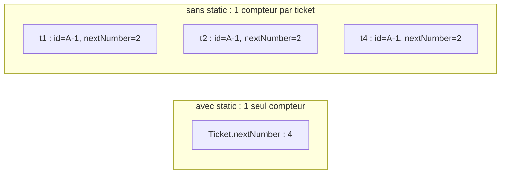
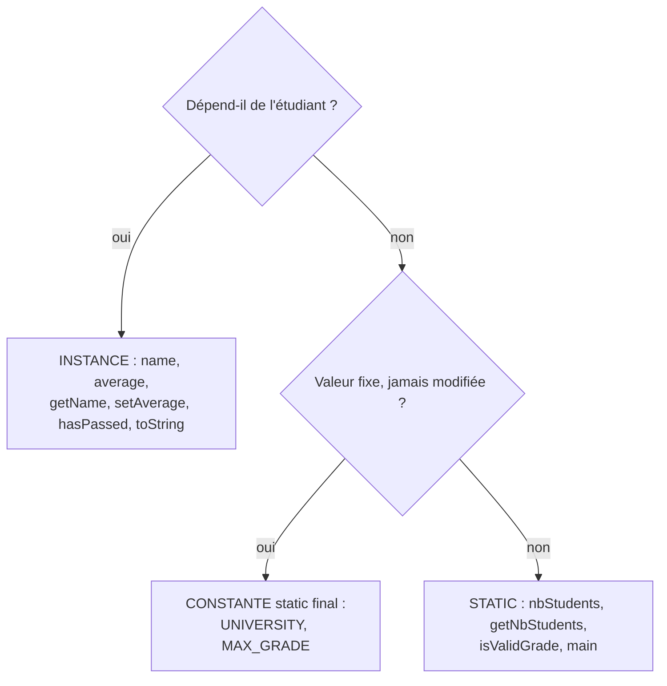

# ✅ 02 — static et enum : corrigé

> ⬅️ **Énoncé :** [./enonce.md](./enonce.md) · 🔗 **Cours :** [02 — static et types énumérés](../../01-Cours/02-static-et-enum.md)
> 📌 Tout le code a été **compilé** (Java 21) et **exécuté** ; les tests du bonus (exercice 8) ont été lancés avec JUnit 5 : **5 tests réussis**.

---

## Exercice 1 — Les tickets de la boulangerie

### Q1 — Classe `Ticket`

```java
public class Ticket {
    private static final String PREFIX = "A-";
    private static int nextNumber = 1;
    private String id;

    /** build a ticket with the next available number */
    public Ticket() {
        this.id = Ticket.PREFIX + Ticket.nextNumber;
        Ticket.nextNumber = Ticket.nextNumber + 1;
    }

    /** @return the id of this ticket, such as "A-3" */
    public String getId() {
        return this.id;
    }

    /** @return the number of tickets created so far */
    public static int getNumberOfTickets() {
        return Ticket.nextNumber - 1;
    }
}
```

💡 Le compteur est **de classe** (`Ticket.nextNumber`), l'identifiant est **d'instance** (`this.id`) : chaque ticket garde **son** numéro, le distributeur avance pour tout le monde.

### Q2 — Affichage

```text
0
A-1 A-2 A-1 A-3
3
```

💡 Avant tout `new`, le compteur existe déjà (créé au chargement de la classe) : `0` ticket. `t3 = t1` copie une référence : `t3.getId()` vaut `A-1`, et `t4` reçoit `A-3`.

### Q3 — Compteur sans `static`

```text
A-1 A-1 A-1
```

💡 Sans `static`, **chaque** ticket a son propre `nextNumber`, initialisé à 1 à sa création : le compteur n'est plus partagé. C'est comme si chaque client avait son propre distributeur de tickets.



---

## Exercice 2 — L'ascenseur

### Q1 + Q2 — Constantes et `maxLoad` statique

```java
public class Elevator {
    public static final int MAX_PERSONS = 8;
    public static final int AVERAGE_WEIGHT = 75;   // en kg
    private int nbPersons;

    public Elevator() {
        this.nbPersons = 0;
    }

    public int getNbPersons() {
        return this.nbPersons;
    }

    /** @return true if newPersons more persons can enter */
    public boolean canEnter(int newPersons) {
        return this.nbPersons + newPersons <= Elevator.MAX_PERSONS;
    }

    /** newPersons enter the elevator, if there is enough room */
    public void enter(int newPersons) {
        if (this.canEnter(newPersons)) {
            this.nbPersons = this.nbPersons + newPersons;
        }
    }

    /** @return the maximum load of any elevator, in kg */
    public static int maxLoad() {
        return Elevator.MAX_PERSONS * Elevator.AVERAGE_WEIGHT;
    }
}
```

💡 `maxLoad()` n'utilise **aucun** attribut d'instance : son résultat est le même pour tous les ascenseurs → méthode `static`, appelée par `Elevator.maxLoad()`. `canEnter` utilise `this.nbPersons` → reste d'instance.

### Q3 — Tableau

| Déclaration | Exemplaire(s) | Modifiable ? | Convention OK ? |
|---|---|---|---|
| `public static final int MAX_PERSONS = 8;` | 1 pour la classe | non | ✅ constante |
| `private static int nbElevators = 0;` | 1 pour la classe | oui | ✅ (pas une constante → camelCase) |
| `private final String brand;` | 1 par instance | non (fixé dans le constructeur) | ✅ |
| `public static int maxPersons = 8;` | 1 pour la classe | **oui** ⚠️ n'importe qui peut écrire `Elevator.maxPersons = 50` | ❌ ce n'est pas une constante : ajouter `final` et écrire `MAX_PERSONS` |
| `public static final int averageWeight = 75;` | 1 pour la classe | non | ❌ une constante s'écrit `AVERAGE_WEIGHT` |

### Q4 — Affichage et affectation d'une constante

```text
5 true
8 600
```

💡 `enter(4)` est refusé (5 + 4 = 9 > 8), il reste 5 personnes, et 5 + 3 = 8 ≤ 8 → `true`. Avec `Elevator.MAX_PERSONS = 10;`, **ça ne compile pas** :

```text
ElevatorMain.java:3: error: cannot assign a value to static final variable MAX_PERSONS
        Elevator.MAX_PERSONS = 10;
                ^
```

---

## Exercice 3 — Conversions de cuisine

### Q1 — Classe utilitaire

```java
public class KitchenConversions {
    public static final int CUP_IN_ML = 250;

    /** @param cups a volume in cups
     * @return the same volume in milliliters
     */
    public static double cupsToMilliliters(double cups) {
        return cups * KitchenConversions.CUP_IN_ML;
    }

    /** @param fahrenheit a temperature in °F
     * @return the same temperature in °C
     */
    public static double fahrenheitToCelsius(double fahrenheit) {
        return (fahrenheit - 32) * 5 / 9;
    }

    /** @param a an integer
     * @param b another integer
     * @return the greatest of a and b
     */
    public static int max(int a, int b) {
        if (a > b) {
            return a;
        }
        return b;
    }
}
```

### Q2 — Affichage

```text
375.0
100.0
176.66666666666666
17
```

💡 `(fahrenheit - 32)` est un `double`, donc `* 5 / 9` reste en `double` (pas de division entière). Dernière ligne : `7 + 10` = `17` (addition de deux `int`, pas de concaténation).

### Q3 — Les 3 erreurs

```text
KitchenConversions.java:5: error: non-static variable this cannot be referenced from a static context
        this.lastResult = cups * 250;
        ^
KitchenConversions.java:6: error: non-static variable this cannot be referenced from a static context
        return this.lastResult;
               ^
RecipeMain.java:7: error: non-static method doubleQuantity(double) cannot be referenced from a static context
        System.out.println(doubleQuantity(150));
                           ^
3 errors
```

Corrections :

```java
public class RecipeMain {
    public static double doubleQuantity(double q) {
        return 2 * q;
    }

    public static void main(String[] args) {
        System.out.println(RecipeMain.doubleQuantity(150));
        System.out.println(KitchenConversions.cupsToMilliliters(2));
    }
}
```

```text
300.0
500.0
```

💡 Une méthode `static` n'a **pas de receveur** : ni `this`, ni attribut d'instance. Ici `lastResult` ne sert à rien, on le supprime (cf. `KitchenConversions` de la Q1). `doubleQuantity` ne dépend que de son paramètre → `static`.

### Q4 — Objet « jetable »

`new KitchenConversions()` crée un objet **sans état utile**, seulement pour envoyer un message : c'est exactement le cas `new Trigonometry().sin(60)` du cours. Une méthode `static` s'appelle **sans instance** : `KitchenConversions.cupsToMilliliters(2)`.

---

## Exercice 4 — Les tailles de vêtements

### Q1 — Affichage

```text
M
2
5
4
S
true
XS S M L XL 
```

💡 Afficher une valeur d'`enum` affiche son **nom**. `ordinal()` commence à 0 : `M` est la 3ᵉ → `2`. `valueOf("M")` renvoie **le** même objet que `Size.M` → `==` vaut `true`.

### Q2 + Q3 — Méthodes ajoutées

```java
public enum Size {
    XS, S, M, L, XL;

    /** @param other another size
     * @return true if this size is bigger than other
     */
    public boolean isBiggerThan(Size other) {
        return this.ordinal() > other.ordinal();
    }

    /** @return the next bigger size, or XL if this size is already XL */
    public Size bigger() {
        Size[] all = Size.values();
        if (this.ordinal() == all.length - 1) {
            return this;
        }
        return all[this.ordinal() + 1];
    }
}
```

### Q4 — Résultats

```text
true false
M XL
Exception in thread "main" java.lang.IllegalArgumentException: No enum constant Size.xl
```

et `new Size()` ne compile pas :

```text
NewSize.java:3: error: enum classes may not be instantiated
        Size s = new Size();
                 ^
```

💡 `valueOf` exige le nom **exact** (majuscules comprises). Le constructeur d'un `enum` est **privé** : les 5 tailles sont les **seules** instances possibles.

---

## Exercice 5 — Le feu tricolore

### Q1 à Q4 — `enum` enrichi

```java
public enum TrafficLight {
    GREEN(30), ORANGE(3), RED(25);

    private final int duration;   // en secondes

    private TrafficLight(int duration) {
        this.duration = duration;
    }

    /** @return how long this light stays on, in seconds */
    public int getDuration() {
        return this.duration;
    }

    /** @return the light that comes after this one (RED is followed by GREEN) */
    public TrafficLight next() {
        TrafficLight[] all = TrafficLight.values();
        return all[(this.ordinal() + 1) % all.length];
    }

    /** @return true if cars can pass */
    public boolean canPass() {
        return this == TrafficLight.GREEN;
    }

    /** @return the duration of a whole cycle, in seconds */
    public static int cycleDuration() {
        int total = 0;
        for (TrafficLight light : TrafficLight.values()) {
            total = total + light.getDuration();
        }
        return total;
    }
}
```

💡 `next()` dépend de **la** couleur receveuse → méthode d'instance. `cycleDuration()` concerne **toutes** les couleurs → `static`. Le `% all.length` fait « boucler » : `(2 + 1) % 3 = 0` → `GREEN`. ⚠️ L'**ordre de déclaration** compte : c'est lui qui fixe `ordinal()`.

### Q5 — Affichage

```text
ORANGE 3 s, passer : false
RED 25 s, passer : false
GREEN 30 s, passer : true
ORANGE 3 s, passer : false
58
true
```

---

## Exercice 6 — Pièces et billets en euros

### Q1 à Q4

```java
public enum Euro {
    CENT_1(1), CENT_2(2), CENT_5(5), CENT_10(10), CENT_20(20), CENT_50(50),
    EURO_1(100), EURO_2(200), NOTE_5(500), NOTE_10(1000), NOTE_20(2000), NOTE_50(5000);

    private static final int SMALLEST_NOTE = 500;
    private final int cents;

    private Euro(int cents) {
        this.cents = cents;
    }

    /** @return the value of this coin or banknote, in cents */
    public int getCents() {
        return this.cents;
    }

    /** @return true if this is a banknote, false if it is a coin */
    public boolean isBanknote() {
        return this.cents >= Euro.SMALLEST_NOTE;
    }

    /** @param wallet some coins and banknotes
     * @return the total value of the wallet, in cents
     */
    public static int total(Euro[] wallet) {
        int sum = 0;
        for (Euro money : wallet) {
            sum = sum + money.getCents();
        }
        return sum;
    }

    /** @return the number of different coins (not banknotes) */
    public static int numberOfCoinTypes() {
        int count = 0;
        for (Euro money : Euro.values()) {
            if (!money.isBanknote()) {
                count = count + 1;
            }
        }
        return count;
    }
}
```

💡 `SMALLEST_NOTE` est déclarée **après** les valeurs (la liste des constantes vient toujours en premier). Elle est privée : c'est un détail interne, seul `isBanknote()` est utile de l'extérieur.

### Q5 — Affichage

```text
8 500
false true
1305
8
NOTE_50
```

💡 `NOTE_5` est la 9ᵉ valeur → `ordinal()` = 8. Total : 1000 + 200 + 50 + 50 + 5 = 1305 centimes (13,05 €). 8 sortes de pièces (de 1 centime à 2 €).

---

## Exercice 7 — Static ou pas ?

### Q1 — Tableau de décision



| Élément | Réponse | Justification |
|---|---|---|
| `UNIVERSITY` | constante `public static final String` | même valeur pour tous, figée |
| `MAX_GRADE` | constante `public static final int` | idem |
| `nbStudents` | `private static int` | partagé, modifié à chaque `new` |
| `name`, `average` | attributs d'instance `private` | propres à chaque étudiant |
| `getName()`, `setAverage(...)`, `hasPassed()`, `toString()` | méthodes d'instance | utilisent `this.name` / `this.average` |
| `isValidGrade(double grade)` | `static` | ne dépend que du paramètre (« fonction » utilitaire) |
| `getNbStudents()` | `static` | lit un attribut de classe, utilisable sans étudiant |
| `main(String[] args)` | `static` | appelée par la JVM avant tout objet |

### Q2 — Classe `Student`

```java
public class Student {
    public static final String UNIVERSITY = "Université de Lille";
    public static final int MAX_GRADE = 20;
    private static int nbStudents = 0;

    private String name;
    private double average;

    public Student(String name) {
        this.name = name;
        this.average = 0;
        Student.nbStudents = Student.nbStudents + 1;
    }

    public String getName() {
        return this.name;
    }

    public void setAverage(double average) {
        if (Student.isValidGrade(average)) {
            this.average = average;
        }
    }

    public boolean hasPassed() {
        return this.average >= 10;
    }

    public static boolean isValidGrade(double grade) {
        return grade >= 0 && grade <= Student.MAX_GRADE;
    }

    public static int getNbStudents() {
        return Student.nbStudents;
    }

    public String toString() {
        return this.name + " (" + Student.UNIVERSITY + ") : " + this.average;
    }

    public static void main(String[] args) {
        Student alice = new Student("Alice");
        Student bob = new Student("Bob");
        alice.setAverage(14.5);
        bob.setAverage(25);
        System.out.println(alice + " / " + bob);
        System.out.println(alice.hasPassed() + " " + Student.isValidGrade(-1) + " " + Student.getNbStudents());
    }
}
```

```text
Alice (Université de Lille) : 14.5 / Bob (Université de Lille) : 0.0
true false 2
```

💡 25 n'est pas une note valide : la moyenne de Bob reste à `0.0`. Une méthode d'instance **peut** utiliser un membre `static` (`Student.isValidGrade`) ; l'inverse est impossible sans objet.

### Q3 — Les 2 erreurs

```text
Student.java:15: error: non-static variable this cannot be referenced from a static context
        return this.name + " parmi " + Student.nbStudents;
               ^
Student.java:20: error: non-static method getName() cannot be referenced from a static context
        System.out.println(Student.getName());
                                  ^
2 errors
```

💡 `describe()` utilise le nom d'**un** étudiant → elle ne doit **pas** être `static`. `getName()` est une méthode d'instance : on l'envoie à **un objet**, `alice.getName()`, pas à la classe.

---

## Exercice 8 — La mention au bac

### Q1 à Q3 — `Honours`

```java
public enum Honours {
    NONE("sans mention"), FAIRLY_GOOD("assez bien"), GOOD("bien"), VERY_GOOD("très bien");

    private static final double FAIRLY_GOOD_THRESHOLD = 12;
    private static final double GOOD_THRESHOLD = 14;
    private static final double VERY_GOOD_THRESHOLD = 16;

    private final String label;

    private Honours(String label) {
        this.label = label;
    }

    /** @return the French label of this honours, such as "assez bien" */
    public String getLabel() {
        return this.label;
    }

    /** @param average an average grade, between 0 and 20
     * @return the highest honours obtained with this average
     */
    public static Honours fromAverage(double average) {
        if (average >= Honours.VERY_GOOD_THRESHOLD) {
            return Honours.VERY_GOOD;
        } else if (average >= Honours.GOOD_THRESHOLD) {
            return Honours.GOOD;
        } else if (average >= Honours.FAIRLY_GOOD_THRESHOLD) {
            return Honours.FAIRLY_GOOD;
        }
        return Honours.NONE;
    }
}
```

💡 `fromAverage` est `static` : on n'a **pas encore** de mention quand on l'appelle, on part d'un nombre pour **obtenir** une valeur de l'`enum` (comme `fromPoints` au TP3, ou `valueOf`). On teste du seuil le plus haut au plus bas.

### Q4 — `HonoursMain`

```java
public class HonoursMain {
    public static void main(String[] args) {
        if (args.length == 0) {
            System.out.println("usage : java HonoursMain <moyenne> ...");
        }
        for (int i = 0; i < args.length; i++) {
            double average = Double.parseDouble(args[i]);
            Honours h = Honours.fromAverage(average);
            System.out.println(average + " -> " + h.getLabel() + " (" + h + ")");
        }
    }
}
```

### Q5 — Exécution

```text
$ java HonoursMain
usage : java HonoursMain <moyenne> ...
$ java HonoursMain 11.99 12 13.5 14 15.99 16 20
11.99 -> sans mention (NONE)
12.0 -> assez bien (FAIRLY_GOOD)
13.5 -> assez bien (FAIRLY_GOOD)
14.0 -> bien (GOOD)
15.99 -> bien (GOOD)
16.0 -> très bien (VERY_GOOD)
20.0 -> très bien (VERY_GOOD)
```

💡 `"12"` devient le `double` `12.0` : c'est pour ça que l'affichage montre `12.0`.

### Q6 — Bonus : tests aux limites (5 tests réussis)

```java
import org.junit.jupiter.api.Test;
import static org.junit.jupiter.api.Assertions.*;

public class HonoursTest {

    @Test
    public void noHonoursBelow12() {
        assertSame(Honours.NONE, Honours.fromAverage(8));
        assertSame(Honours.NONE, Honours.fromAverage(11.99));
    }

    @Test
    public void fairlyGoodFrom12ToBelow14() {
        assertSame(Honours.FAIRLY_GOOD, Honours.fromAverage(12));
        assertSame(Honours.FAIRLY_GOOD, Honours.fromAverage(13.99));
    }

    @Test
    public void goodFrom14ToBelow16() {
        assertSame(Honours.GOOD, Honours.fromAverage(14));
        assertSame(Honours.GOOD, Honours.fromAverage(15.99));
    }

    @Test
    public void veryGoodFrom16() {
        assertSame(Honours.VERY_GOOD, Honours.fromAverage(16));
        assertSame(Honours.VERY_GOOD, Honours.fromAverage(20));
    }

    @Test
    public void labels() {
        assertEquals("assez bien", Honours.FAIRLY_GOOD.getLabel());
        assertEquals("très bien", Honours.VERY_GOOD.getLabel());
    }
}
```

💡 `assertSame` convient parfaitement aux `enum` : chaque valeur est un objet **unique**.

---

## ⚠️ Erreurs fréquentes

| Erreur | Pourquoi c'est faux | Correction |
|---|---|---|
| Compteur d'instances sans `static` | chaque objet a son propre compteur → tous les tickets ont le n°1 | `private static int nextNumber` |
| `this.nextNumber` pour un attribut de classe | laisse croire qu'il appartient à l'objet | `Ticket.nextNumber` |
| `public static int maxPersons = 8;` comme « constante » | sans `final`, n'importe qui peut la modifier | `public static final int MAX_PERSONS = 8;` |
| `this` dans une méthode `static` | pas de receveur → erreur de compilation | retirer `this` ou retirer `static` |
| Appeler une méthode d'instance depuis `main` sans objet | `main` est `static` | créer un objet, ou rendre la méthode `static` |
| `new KitchenConversions().max(3, 7)` | objet « jetable » inutile | `KitchenConversions.max(3, 7)` |
| Croire que `ordinal()` commence à 1 | il commence à **0** | `Size.XS.ordinal() == 0` |
| `Size.valueOf("xl")` | le nom doit être **exact** → `IllegalArgumentException` | `Size.valueOf("XL")` |
| `new TrafficLight(30)` | constructeur d'`enum` privé | utiliser `TrafficLight.GREEN` |
| Oublier le `;` après la liste des valeurs d'un `enum` enrichi | erreur de compilation | `GREEN(30), ORANGE(3), RED(25);` |
| `next()` sans `% values().length` | `ArrayIndexOutOfBoundsException` après la dernière valeur | `(ordinal() + 1) % values().length` |
| `fromAverage` en testant d'abord le seuil le plus bas | `15` donnerait « assez bien » | tester du plus haut au plus bas |

---

⬅️ [Retour à l'énoncé](./enonce.md) · 🏠 [Sommaire des exercices](../README.md)
