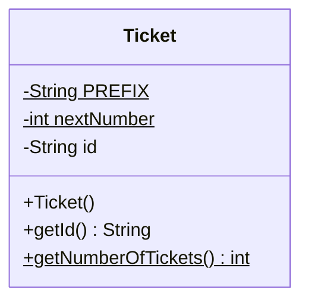
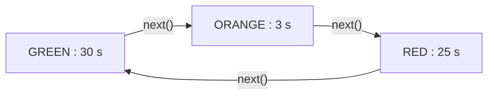
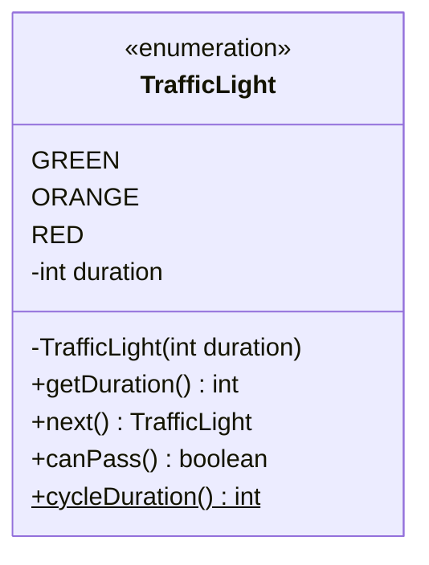
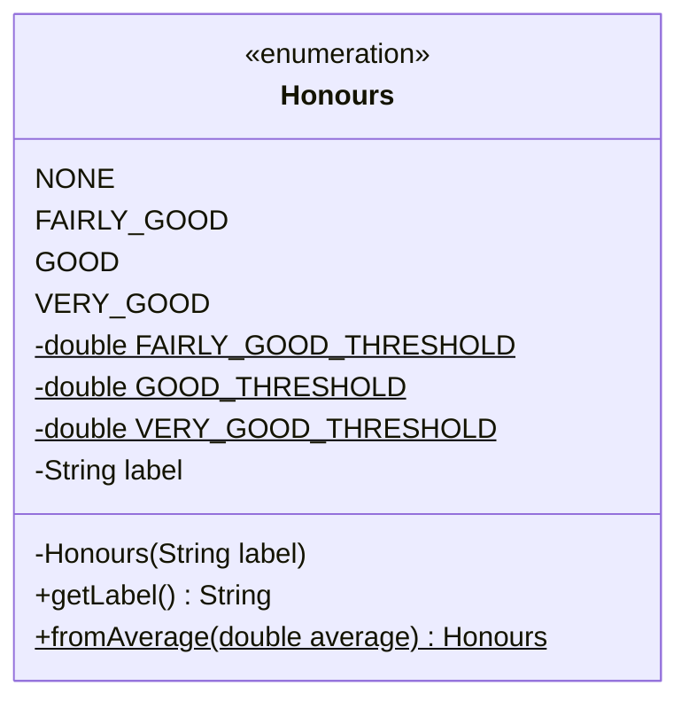

# 🏋️ 02 — static et enum : exercices d'entraînement

> ✅ **Corrigé :** [./corrige.md](./corrige.md) — essaie d'abord seul !
> 🔗 **Cours :** [02 — static et types énumérés](../../01-Cours/02-static-et-enum.md)
> 🎯 Attributs et méthodes de classe, constantes `static final`, `enum` simple et enrichi, `values()` / `valueOf()` / `ordinal()`, méthode `static fromXxx` comme au TP3.

## 🗺️ Les exercices

| n° | Titre | Niveau | Durée | Notions |
|---|---|---|---|---|
| 1 | Les tickets de la boulangerie | ⭐ | 15 min | compteur d'instances `private static`, constante |
| 2 | L'ascenseur | ⭐ | 10 min | constantes `static final`, conventions de nommage |
| 3 | Conversions de cuisine | ⭐⭐ | 15 min | méthodes utilitaires `static`, pas de `this` |
| 4 | Les tailles de vêtements | ⭐ | 15 min | `enum` simple, `values()`, `valueOf()`, `ordinal()`, `name()` |
| 5 | Le feu tricolore | ⭐⭐ | 20 min | `enum` enrichi (attribut, constructeur privé), `next()` |
| 6 | Pièces et billets en euros | ⭐⭐ | 20 min | `enum` enrichi, constante privée, méthodes `static` |
| 7 | Static ou pas ? | ⭐⭐ | 15 min | tableau de décision instance / classe / constante |
| 8 | La mention au bac | ⭐⭐⭐ | 30 min | `static fromXxx` comme au TP3, `main` + `args`, (bonus) tests |

📌 Dans les diagrammes UML, `$` à la fin d'un membre = membre `static` (souligné sur papier).

---

## Exercice 1 — Les tickets de la boulangerie ⭐

🌍 **Situation :** à la boulangerie, chaque client prend un ticket numéroté `A-1`, `A-2`, `A-3`… Le distributeur est **unique** : le numéro suivant est **partagé** par tous les tickets, il n'appartient à aucun ticket en particulier.



- [ ] **Q1.** Écris la classe `Ticket` : constante `PREFIX = "A-"`, compteur `nextNumber` qui commence à 1, constructeur qui donne au ticket le prochain numéro, `getId()`, et la méthode **de classe** `getNumberOfTickets()` (nombre de tickets créés).
- [ ] **Q2.** Que s'affiche-t-il ?

```java
System.out.println(Ticket.getNumberOfTickets());
Ticket t1 = new Ticket();
Ticket t2 = new Ticket();
Ticket t3 = t1;
Ticket t4 = new Ticket();
System.out.println(t1.getId() + " " + t2.getId() + " " + t3.getId() + " " + t4.getId());
System.out.println(Ticket.getNumberOfTickets());
```

- [ ] **Q3.** Un camarade a oublié `static` sur le compteur :

```java
    private int nextNumber = 1;

    public Ticket() {
        this.id = Ticket.PREFIX + this.nextNumber;
        this.nextNumber = this.nextNumber + 1;
    }
```

Qu'affichent alors `t1.getId()`, `t2.getId()` et `t4.getId()` ? Pourquoi ?

<details><summary>💡 Indice</summary>

- Revois l'exemple `Order` du cours : `Order.ORDER_ID_PREFIX + Order.counter++`.
- `getNumberOfTickets()` peut se déduire de `nextNumber` : pas besoin d'un 2ᵉ compteur.
- Q2 : `t3 = t1` ne crée **pas** de ticket.

</details>

---

## Exercice 2 — L'ascenseur ⭐

🌍 **Situation :** dans l'ascenseur, la plaque indique « 8 personnes – 600 kg ». Ces valeurs sont les mêmes pour tous les ascenseurs du modèle et ne changent jamais : ce sont des **constantes**.

```java
public class Elevator {
    private int nbPersons;

    public Elevator() {
        this.nbPersons = 0;
    }

    public int getNbPersons() {
        return this.nbPersons;
    }

    public boolean canEnter(int newPersons) {
        return this.nbPersons + newPersons <= 8;
    }

    public void enter(int newPersons) {
        if (this.canEnter(newPersons)) {
            this.nbPersons = this.nbPersons + newPersons;
        }
    }

    public int maxLoad() {
        return 8 * 75;
    }
}
```

- [ ] **Q1.** Remplace les nombres « magiques » `8` et `75` (poids moyen d'une personne, en kg) par des constantes **publiques** bien nommées.
- [ ] **Q2.** `maxLoad()` dépend-elle de l'état d'un ascenseur ? Que faut-il en conclure ? Réécris-la.
- [ ] **Q3.** Pour chaque déclaration, indique : un exemplaire **par instance** ou **pour la classe** ? modifiable ? convention de nommage respectée ?

| Déclaration | Exemplaire(s) | Modifiable ? | Convention OK ? |
|---|---|---|---|
| `public static final int MAX_PERSONS = 8;` | | | |
| `private static int nbElevators = 0;` | | | |
| `private final String brand;` | | | |
| `public static int maxPersons = 8;` | | | |
| `public static final int averageWeight = 75;` | | | |

- [ ] **Q4.** Que s'affiche-t-il ? Et que se passe-t-il si on ajoute `Elevator.MAX_PERSONS = 10;` dans un `main` ?

```java
Elevator e = new Elevator();
e.enter(5);
e.enter(4);
System.out.println(e.getNbPersons() + " " + e.canEnter(3));
System.out.println(Elevator.MAX_PERSONS + " " + Elevator.maxLoad());
```

<details><summary>💡 Indice</summary>

- Constante = `static final`, en `MAJUSCULES_AVEC_UNDERSCORE`.
- Une méthode dont le résultat ne dépend **que** de constantes ou de paramètres peut être `static`.
- `final` sans `static` : une valeur **par objet**, fixée à la construction.

</details>

---

## Exercice 3 — Conversions de cuisine ⭐⭐

🌍 **Situation :** une recette américaine demande « 1.5 cups » de lait et un four à « 350 °F ». Pour convertir, pas besoin d'un « objet convertisseur » : une calculatrice suffit. C'est le rôle des méthodes **utilitaires** `static`, comme `Math.sqrt`.

- [ ] **Q1.** Écris la classe `KitchenConversions` avec :
  - une constante `CUP_IN_ML` qui vaut `250` ;
  - `cupsToMilliliters(double cups)` ;
  - `fahrenheitToCelsius(double fahrenheit)` : `(f - 32) × 5 / 9` ;
  - `max(int a, int b)` : le plus grand des deux.
- [ ] **Q2.** Que s'affiche-t-il ?

```java
System.out.println(KitchenConversions.cupsToMilliliters(1.5));
System.out.println(KitchenConversions.fahrenheitToCelsius(212));
System.out.println(KitchenConversions.fahrenheitToCelsius(350));
System.out.println(KitchenConversions.max(3, 7) + Math.max(10, 2));
```

- [ ] **Q3.** Trouve les **3 erreurs de compilation** dans ces deux fichiers :

```java
public class KitchenConversions {
    private double lastResult;

    public static double cupsToMilliliters(double cups) {
        this.lastResult = cups * 250;
        return this.lastResult;
    }
}
```

```java
public class RecipeMain {
    public double doubleQuantity(double q) {
        return 2 * q;
    }

    public static void main(String[] args) {
        System.out.println(doubleQuantity(150));
    }
}
```

- [ ] **Q4.** `new KitchenConversions().cupsToMilliliters(2)` compile. Pourquoi est-ce quand même une mauvaise idée ?

<details><summary>💡 Indice</summary>

- Dans une méthode `static`, **il n'y a pas de receveur** : `this` n'existe pas.
- `main` est `static` : depuis `main`, on ne peut pas envoyer un message « sans objet » à une méthode d'instance.
- Q2 : attention, la dernière ligne additionne deux `int`.

</details>

---

## Exercice 4 — Les tailles de vêtements ⭐

🌍 **Situation :** sur l'étiquette d'un tee-shirt, la taille est XS, S, M, L ou XL — et **rien d'autre**. Un ensemble fini de valeurs connues à l'avance : c'est un type énuméré.

```java
public enum Size {
    XS, S, M, L, XL;
}
```

- [ ] **Q1.** Que s'affiche-t-il ?

```java
Size s = Size.M;
System.out.println(s);
System.out.println(s.ordinal());
System.out.println(Size.values().length);
System.out.println(Size.valueOf("XL").ordinal());
System.out.println(Size.values()[1].name());
System.out.println(s == Size.valueOf("M"));
for (Size t : Size.values()) {
    System.out.print(t + " ");
}
```

- [ ] **Q2.** Ajoute la méthode `boolean isBiggerThan(Size other)`.
- [ ] **Q3.** Ajoute la méthode `Size bigger()` : la taille juste au-dessus ; `XL` reste `XL` (pas de retour à `XS` !).
- [ ] **Q4.** Que donnent `Size.L.isBiggerThan(Size.M)`, `Size.M.isBiggerThan(Size.M)`, `Size.S.bigger()`, `Size.XL.bigger()` ? Et que se passe-t-il avec `Size.valueOf("xl")` puis avec `new Size()` ?

<details><summary>💡 Indice</summary>

- `ordinal()` commence à **0**.
- Afficher une valeur d'`enum` affiche son nom.
- Dernière valeur : `ordinal() == Size.values().length - 1`.

</details>

---

## Exercice 5 — Le feu tricolore ⭐⭐

🌍 **Situation :** un feu passe du vert à l'orange, puis au rouge, puis de nouveau au vert, sans fin. Chaque couleur dure un temps fixé : vert 30 s, orange 3 s, rouge 25 s.





- [ ] **Q1.** Écris l'`enum` `TrafficLight` avec l'attribut `duration` (en secondes), son constructeur et `getDuration()`.
- [ ] **Q2.** Écris `next()` : la couleur suivante (après `RED` vient `GREEN`).
- [ ] **Q3.** Écris `canPass()` : vrai seulement pour le vert.
- [ ] **Q4.** Écris la méthode **de classe** `cycleDuration()` : durée totale d'un cycle complet.
- [ ] **Q5.** Que s'affiche-t-il ?

```java
TrafficLight light = TrafficLight.ORANGE;
for (int i = 0; i < 4; i++) {
    System.out.println(light + " " + light.getDuration() + " s, passer : " + light.canPass());
    light = light.next();
}
System.out.println(TrafficLight.cycleDuration());
System.out.println(TrafficLight.RED.next() == TrafficLight.GREEN);
```

<details><summary>💡 Indice</summary>

- Formule du cours : `E.values()[(e.ordinal() + 1) % E.values().length]`.
- La liste des constantes vient **en premier** et se termine par `;`.
- `canPass()` : on peut comparer des valeurs d'`enum` avec `==`.

</details>

---

## Exercice 6 — Pièces et billets en euros ⭐⭐

🌍 **Situation :** dans un porte-monnaie, il n'existe que 12 sortes de pièces et billets en euros (jusqu'à 50 €). Chacune a une **valeur**. Pour éviter les arrondis, on compte en **centimes**.

| Constante | `CENT_1` | `CENT_2` | `CENT_5` | `CENT_10` | `CENT_20` | `CENT_50` | `EURO_1` | `EURO_2` | `NOTE_5` | `NOTE_10` | `NOTE_20` | `NOTE_50` |
|---|---|---|---|---|---|---|---|---|---|---|---|---|
| Valeur (centimes) | 1 | 2 | 5 | 10 | 20 | 50 | 100 | 200 | 500 | 1000 | 2000 | 5000 |

- [ ] **Q1.** Écris l'`enum` `Euro` avec l'attribut `cents`, son constructeur et `getCents()`.
- [ ] **Q2.** Écris `isBanknote()` : un billet vaut au moins 500 centimes. Utilise une constante **privée** `SMALLEST_NOTE`.
- [ ] **Q3.** Écris la méthode de classe `int total(Euro[] wallet)` : valeur totale d'un porte-monnaie.
- [ ] **Q4.** Écris la méthode de classe `int numberOfCoinTypes()` : combien de sortes de **pièces** existent (en parcourant `values()`).
- [ ] **Q5.** Que s'affiche-t-il ?

```java
System.out.println(Euro.NOTE_5.ordinal() + " " + Euro.NOTE_5.getCents());
System.out.println(Euro.EURO_2.isBanknote() + " " + Euro.valueOf("NOTE_10").isBanknote());
Euro[] wallet = { Euro.NOTE_10, Euro.EURO_2, Euro.CENT_50, Euro.CENT_50, Euro.CENT_5 };
System.out.println(Euro.total(wallet));
System.out.println(Euro.numberOfCoinTypes());
System.out.println(Euro.values()[Euro.values().length - 1]);
```

<details><summary>💡 Indice</summary>

- Même schéma que l'`enum` `Day` du cours (`monday(true)` …) ou `Coin` de l'auto-évaluation.
- `total` et `numberOfCoinTypes` ne concernent pas **une** pièce en particulier → `static`.
- Parcours : `for (Euro money : wallet) { ... }`.

</details>

---

## Exercice 7 — Static ou pas ? ⭐⭐

🌍 **Situation :** à l'université, le nom de l'établissement est le même pour tous les étudiants ; la moyenne, elle, est propre à chacun. Il faut décider, pour chaque élément, s'il appartient **à un étudiant** ou **à la classe `Student`**.

- [ ] **Q1.** Remplis le tableau : **instance**, **classe (`static`)** ou **constante (`static final`)** ?

| Élément | Description | Ta réponse |
|---|---|---|
| `UNIVERSITY` | `"Université de Lille"`, identique pour tous, ne change jamais | |
| `MAX_GRADE` | note maximale : 20 | |
| `nbStudents` | nombre d'étudiants créés depuis le lancement | |
| `name` | nom de l'étudiant | |
| `average` | moyenne de l'étudiant | |
| `getName()` | renvoie le nom | |
| `setAverage(double average)` | modifie la moyenne (si la note est valide) | |
| `hasPassed()` | vrai si la moyenne est ≥ 10 | |
| `isValidGrade(double grade)` | vrai si `0 ≤ grade ≤ 20` | |
| `getNbStudents()` | renvoie le nombre d'étudiants créés | |
| `toString()` | `"Alice (Université de Lille) : 14.5"` | |
| `main(String[] args)` | point d'entrée du programme | |

- [ ] **Q2.** Écris la classe `Student` complète (dont un `main` qui crée Alice et Bob, donne 14.5 à Alice et 25 à Bob, puis affiche les deux étudiants, `alice.hasPassed()`, `Student.isValidGrade(-1)` et `Student.getNbStudents()`).
- [ ] **Q3.** Trouve les **2 erreurs de compilation** :

```java
public class Student {
    private static int nbStudents = 0;
    private String name;

    public Student(String name) {
        this.name = name;
        Student.nbStudents = Student.nbStudents + 1;
    }

    public String getName() {
        return this.name;
    }

    public static String describe() {
        return this.name + " parmi " + Student.nbStudents;
    }

    public static void main(String[] args) {
        Student alice = new Student("Alice");
        System.out.println(Student.getName());
    }
}
```

<details><summary>💡 Indice</summary>

Pose-toi la question : « la réponse **change-t-elle d'un étudiant à l'autre** ? ».
- Oui → attribut / méthode **d'instance**.
- Non, et la valeur ne change jamais → **constante**.
- Non, et c'est partagé (compteur) ou ça ne dépend que des paramètres → **`static`**.

</details>

---

## Exercice 8 — La mention au bac ⭐⭐⭐

🌍 **Situation :** au bac, la mention dépend de la moyenne : moins de 12 → sans mention ; à partir de 12 → assez bien ; à partir de 14 → bien ; à partir de 16 → très bien. C'est exactement le schéma de `PremiumLevel.fromPoints` du [TP3](../../03-TP/TP3-member/ENONCE.md).



| Valeur | `label` | Moyenne |
|---|---|---|
| `NONE` | `"sans mention"` | < 12 |
| `FAIRLY_GOOD` | `"assez bien"` | [12, 14[ |
| `GOOD` | `"bien"` | [14, 16[ |
| `VERY_GOOD` | `"très bien"` | ≥ 16 |

- [ ] **Q1.** Écris l'`enum` `Honours` : les 4 valeurs avec leur `label`, le constructeur, `getLabel()`.
- [ ] **Q2.** Ajoute 3 constantes **privées** pour les seuils (12, 14, 16).
- [ ] **Q3.** Écris `public static Honours fromAverage(double average)` : la **plus haute** mention obtenue.
- [ ] **Q4.** Écris `HonoursMain` : sans argument → message d'usage ; sinon, pour **chaque** argument (une moyenne), afficher la moyenne, le libellé et le nom de la constante.
- [ ] **Q5.** Qu'affiche `java HonoursMain 11.99 12 13.5 14 15.99 16 20` ?
- [ ] **Q6.** *(bonus, après le [chapitre 03](../../01-Cours/03-tests.md))* Écris les méthodes de test de `fromAverage` en visant les **valeurs limites**.

<details><summary>💡 Indice</summary>

- Tester les seuils **du plus haut au plus bas** : le premier `if` vrai donne la plus haute mention.
- `Double.parseDouble("13.5")` vaut `13.5` (comme `Integer.parseInt` pour les entiers).
- Les constantes `static` d'un `enum` se déclarent **après** la liste des valeurs.
- Valeurs limites : juste en dessous et pile sur chaque seuil (11.99 / 12, 13.99 / 14…).

</details>

---

🏠 [Sommaire des exercices](../README.md)
