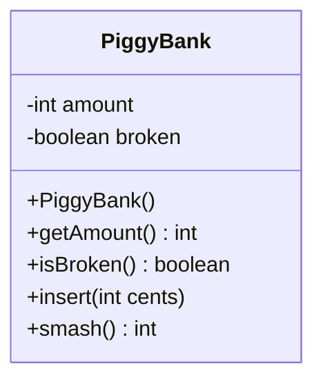
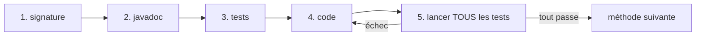
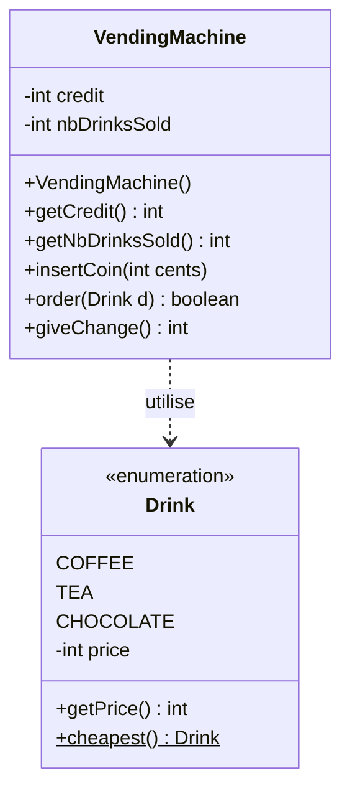

# 🏋️ 03 — Tests unitaires : exercices d'entraînement

> ✅ **Corrigé :** [./corrige.md](./corrige.md) — essaie d'abord seul !
> 🔗 **Cours :** [03 — Tests unitaires (JUnit)](../../01-Cours/03-tests.md)
> 🎯 Choisir la bonne assertion, lire un rapport d'échec, écrire des tests (cas normal **et** cas limites), appliquer la démarche « signature → javadoc → tests → code → tests ».

## 🗺️ Les exercices

| n° | Titre | Niveau | Durée | Notions |
|---|---|---|---|---|
| 1 | La consigne à bagages | ⭐ | 15 min | choisir l'assertion : `assertEquals`, `assertTrue`, `assertFalse`, `assertSame`, `assertNull`… |
| 2 | Le podomètre qui se trompe | ⭐ | 15 min | lire une trace d'échec JUnit, bug dans le code ou dans le test ? |
| 3 | La batterie du téléphone | ⭐⭐ | 25 min | écrire les tests d'une classe donnée : cas normaux et limites |
| 4 | Le parking qui déborde | ⭐⭐ | 20 min | trouver le cas non testé, test qui révèle le bug, non-régression |
| 5 | La tirelire | ⭐⭐ | 25 min | démarche du cours : tests **avant** le code |
| 6 | Le distributeur de boissons (style DS) | ⭐⭐⭐ | 40 min | `enum` + javadoc + méthodes de test + code |

📌 Rappel des commandes (dossiers `src/`, `classes/`, `test/`, jar renommé `junit-console.jar`) :

```bash
javac -d classes src/*.java
javac -classpath junit-console.jar:classes test/*.java
java -jar junit-console.jar -classpath test:classes -scan-classpath
```

📌 Toutes les classes de test commencent par :

```java
import org.junit.jupiter.api.Test;
import static org.junit.jupiter.api.Assertions.*;
```

---

## Exercice 1 — La consigne à bagages ⭐

🌍 **Situation :** à la gare, on dépose son sac dans un casier numéroté. Un casier contient **au plus un** sac ; on ne peut pas en ajouter un 2ᵉ. Quand on reprend son sac, on veut récupérer **le sien**, pas « un sac qui lui ressemble ».

```java
public class Bag {
    private String owner;

    public Bag(String owner) {
        this.owner = owner;
    }

    public String getOwner() {
        return this.owner;
    }
}
```

```java
public class Locker {
    private int number;
    private Bag bag;   // null si le casier est libre

    /** build an empty locker
     * @param number the number of this locker
     */
    public Locker(int number) {
        this.number = number;
        this.bag = null;
    }

    /** @return the number of this locker */
    public int getNumber() {
        return this.number;
    }

    /** @return true if there is no bag in this locker */
    public boolean isFree() {
        return this.bag == null;
    }

    /** @return the bag in this locker, or null if it is free */
    public Bag getBag() {
        return this.bag;
    }

    /** put a bag in this locker, only if it is free
     * @param b the bag to put
     */
    public void put(Bag b) {
        if (this.isFree()) {
            this.bag = b;
        }
    }

    /** take the bag out of this locker, which becomes free
     * @return the bag that was in the locker (null if it was free)
     */
    public Bag takeBag() {
        Bag b = this.bag;
        this.bag = null;
        return b;
    }
}
```

- [ ] **Q1.** Pour chaque vérification, écris **l'assertion** la plus adaptée (avec `Locker locker = new Locker(12);`, `Bag b = new Bag("Léa");`, `Bag b2 = new Bag("Tom");`).

| n° | Vérification | Assertion |
|---|---|---|
| a | le casier a bien le numéro 12 | |
| b | un casier neuf est libre | |
| c | un casier neuf ne contient aucun sac | |
| d | après `put(b)`, le casier n'est plus libre | |
| e | après `put(b)`, le sac du casier est **b lui-même** | |
| f | le propriétaire du sac rangé est `"Léa"` | |
| g | après `put(b)` puis `put(b2)`, le sac rangé n'est **pas** `b2` | |
| h | `takeBag()` renvoie `b` | |

- [ ] **Q2.** Écris la classe `LockerTest` avec 4 méthodes de test : casier neuf ; dépôt dans un casier libre ; dépôt refusé dans un casier occupé ; retrait du sac. Respecte la structure **situation initiale / précondition → appel → postconditions**.
- [ ] **Q3.** Pour la vérification (e), pourquoi `assertEquals("Léa", locker.getBag().getOwner())` **ne suffit pas** ?

<details><summary>💡 Indice</summary>

- `assertSame` : **même objet** ; `assertEquals` : **même valeur**.
- La valeur **attendue** se met en **premier**.
- `assertNull(ref)` est plus lisible que `assertTrue(ref == null)`.

</details>

---

## Exercice 2 — Le podomètre qui se trompe ⭐

🌍 **Situation :** une appli de podomètre compte les pas et convertit en kilomètres (un pas = 70 cm). L'objectif « 10 000 pas » doit être validé dès qu'on **atteint** 10 000 pas. Un développeur a écrit la classe **et** ses tests… et JUnit n'est pas content.

```java
public class StepCounter {
    public static final int STEP_LENGTH_CM = 70;
    private int steps;

    /** build a step counter with 0 steps */
    public StepCounter() {
        this.steps = 0;
    }

    /** @return the number of steps walked */
    public int getSteps() {
        return this.steps;
    }

    /** add steps to the counter; a negative number of steps is ignored
     * @param nbSteps the number of steps walked
     */
    public void walk(int nbSteps) {
        if (nbSteps > 0) {
            this.steps = this.steps + nbSteps;
        }
    }

    /** @return the distance walked, in kilometers (5000 steps give 3.5 km) */
    public double getKilometers() {
        return this.steps * StepCounter.STEP_LENGTH_CM / 100000;
    }

    /** @param goal a number of steps
     * @return true if at least goal steps have been walked
     */
    public boolean goalReached(int goal) {
        return this.steps > goal;
    }
}
```

```java
import org.junit.jupiter.api.Test;
import static org.junit.jupiter.api.Assertions.*;

public class StepCounterTest {

    @Test
    public void newCounterHasZeroSteps() {
        StepCounter c = new StepCounter();
        assertEquals(0, c.getSteps());
    }

    @Test
    public void walkAddsSteps() {
        StepCounter c = new StepCounter();
        c.walk(300);
        c.walk(200);
        assertEquals(500, c.getSteps());
    }

    @Test
    public void negativeStepsAreIgnored() {
        StepCounter c = new StepCounter();
        c.walk(100);
        c.walk(-30);
        assertEquals(70, c.getSteps());          // ligne 25
    }

    @Test
    public void kilometersAfter5000Steps() {
        StepCounter c = new StepCounter();
        c.walk(5000);
        assertEquals(3.5, c.getKilometers());    // ligne 32
    }

    @Test
    public void goalReachedWhenExactlyTheGoal() {
        StepCounter c = new StepCounter();
        c.walk(10000);
        assertTrue(c.goalReached(10000));        // ligne 39
    }
}
```

Le rapport de JUnit (extrait réel) :

```text
╷
├─ JUnit Jupiter ✔
│  └─ StepCounterTest ✔
│     ├─ goalReachedWhenExactlyTheGoal() ✘ expected: <true> but was: <false>
│     ├─ newCounterHasZeroSteps() ✔
│     ├─ kilometersAfter5000Steps() ✘ expected: <3.5> but was: <3.0>
│     ├─ walkAddsSteps() ✔
│     └─ negativeStepsAreIgnored() ✘ expected: <70> but was: <100>
(...)
Failures (3):
  JUnit Jupiter:StepCounterTest:goalReachedWhenExactlyTheGoal()
    => org.opentest4j.AssertionFailedError: expected: <true> but was: <false>
       (...)
       StepCounterTest.goalReachedWhenExactlyTheGoal(StepCounterTest.java:39)
       (...)
  JUnit Jupiter:StepCounterTest:kilometersAfter5000Steps()
    => org.opentest4j.AssertionFailedError: expected: <3.5> but was: <3.0>
       (...)
       StepCounterTest.kilometersAfter5000Steps(StepCounterTest.java:32)
       (...)
  JUnit Jupiter:StepCounterTest:negativeStepsAreIgnored()
    => org.opentest4j.AssertionFailedError: expected: <70> but was: <100>
       (...)
       StepCounterTest.negativeStepsAreIgnored(StepCounterTest.java:25)
       (...)
[         5 tests found           ]
[         2 tests successful      ]
[         3 tests failed          ]
```

- [ ] **Q1.** Combien de tests ont été exécutés ? Réussis ? En échec ?
- [ ] **Q2.** Pour chaque échec, donne : le test, la valeur **attendue**, la valeur **obtenue**, la ligne.
- [ ] **Q3.** Pour chaque échec, l'erreur est-elle dans le **code** ou dans le **test** ? Justifie avec la **javadoc**.
- [ ] **Q4.** Corrige ce qui doit l'être. Combien de tests réussissent ensuite ?

<details><summary>💡 Indice</summary>

- `expected` = 1er argument de `assertEquals`, `but was` = ce que le code a renvoyé.
- Que vaut `350000 / 100000` en Java ? Et `350000 / 100000.0` ?
- « **au moins** goal pas » : `>` ou `>=` ?
- Un test qui contredit la javadoc est un test **faux**.

</details>

---

## Exercice 3 — La batterie du téléphone ⭐⭐

🌍 **Situation :** la batterie d'un téléphone est entre 0 % et 100 %. On la recharge (jamais au-delà de 100 %) et on l'utilise (jamais en dessous de 0 %). Sous 20 %, le téléphone affiche « batterie faible ».

```java
public class PhoneBattery {
    public static final int MAX_LEVEL = 100;
    public static final int LOW_LEVEL = 20;
    private int level;   // en %

    /** build a battery with a given level
     * @param level the initial level, assumed between 0 and 100
     */
    public PhoneBattery(int level) {
        this.level = level;
    }

    /** @return the level of this battery, in % */
    public int getLevel() {
        return this.level;
    }

    /** charge the battery; the level never goes above 100
     * @param amount the percentage to add (assumed positive)
     */
    public void charge(int amount) {
        this.level = this.level + amount;
        if (this.level > PhoneBattery.MAX_LEVEL) {
            this.level = PhoneBattery.MAX_LEVEL;
        }
    }

    /** use the battery; the level never goes below 0
     * @param amount the percentage to remove (assumed positive)
     */
    public void use(int amount) {
        this.level = this.level - amount;
        if (this.level < 0) {
            this.level = 0;
        }
    }

    /** @return true if the level is 0 */
    public boolean isEmpty() {
        return this.level == 0;
    }

    /** @return true if the level is strictly below 20 */
    public boolean isLow() {
        return this.level < PhoneBattery.LOW_LEVEL;
    }
}
```

- [ ] **Q1.** Complète le tableau des cas à tester (au moins un cas **normal** et un cas **limite** par méthode).

| Méthode | Cas normal | Cas limite(s) |
|---|---|---|
| constructeur + `getLevel()` | | — |
| `charge` | | |
| `use` | | |
| `isEmpty` | | |
| `isLow` | | |

- [ ] **Q2.** Écris la classe `PhoneBatteryTest` (au moins 8 méthodes de test, une par cas, aux noms explicites).
- [ ] **Q3.** Un camarade écrit `this.level <= PhoneBattery.LOW_LEVEL` dans `isLow()`. Lequel de tes tests échoue ? Et s'il oublie le `if` de `charge` ?

<details><summary>💡 Indice</summary>

- Limite = valeur **pile** sur la frontière, et juste à côté : 20 et 19 pour `isLow`, 100 pour `charge`, 0 pour `use`.
- `charge` de 70 à 100 (pile la limite) et de 90 + 50 (dépassement) sont **deux** cas différents.
- Un nom de test est une phrase : `batteryIsNotLowAtExactly20`.

</details>

---

## Exercice 4 — Le parking qui déborde ⭐⭐

🌍 **Situation :** la barrière d'un parking compte les voitures. Le gardien se plaint : « hier, **3** voitures sont entrées dans le parking de **2** places, et ce matin le panneau affichait **-1** voiture ! ». Pourtant, tous les tests passent…

```java
public class ParkingLot {
    private int capacity;
    private int nbCars;

    /** build an empty parking lot
     * @param capacity the number of places
     */
    public ParkingLot(int capacity) {
        this.capacity = capacity;
        this.nbCars = 0;
    }

    /** @return the number of cars in the parking lot */
    public int getNbCars() {
        return this.nbCars;
    }

    /** @return true if all the places are taken */
    public boolean isFull() {
        return this.nbCars > this.capacity;
    }

    /** a car enters, only if the parking lot is not full
     * @return true if the car could enter, false otherwise
     */
    public boolean enter() {
        if (!this.isFull()) {
            this.nbCars = this.nbCars + 1;
            return true;
        }
        return false;
    }

    /** a car leaves the parking lot (nothing happens if it is empty) */
    public void leave() {
        this.nbCars = this.nbCars - 1;
    }
}
```

```java
import org.junit.jupiter.api.Test;
import static org.junit.jupiter.api.Assertions.*;

public class ParkingLotTest {

    @Test
    public void newParkingLotIsEmpty() {
        ParkingLot p = new ParkingLot(3);
        assertEquals(0, p.getNbCars());
        assertFalse(p.isFull());
    }

    @Test
    public void carCanEnterEmptyParkingLot() {
        ParkingLot p = new ParkingLot(3);
        assertTrue(p.enter());
        assertEquals(1, p.getNbCars());
    }

    @Test
    public void carLeavingDecreasesNbCars() {
        ParkingLot p = new ParkingLot(3);
        p.enter();
        p.enter();
        p.leave();
        assertEquals(1, p.getNbCars());
    }
}
```

- [ ] **Q1.** Quels comportements de la javadoc ne sont **jamais** testés ?
- [ ] **Q2.** Écris **3** nouvelles méthodes de test qui auraient détecté les problèmes du gardien. Qu'affiche JUnit pour chacune, avec le code actuel ?
- [ ] **Q3.** Corrige `ParkingLot`.
- [ ] **Q4.** Pourquoi faut-il relancer **les 6** tests (et pas seulement les 3 nouveaux) après la correction ?

<details><summary>💡 Indice</summary>

- Les 3 tests existants ne remplissent **jamais** le parking et ne font **jamais** sortir de voiture d'un parking vide.
- Un parking de capacité 2 avec 2 voitures : `isFull()` doit valoir `true`.
- Un bon test de bug **échoue** avec le code bugué et **réussit** avec le code corrigé.

</details>

---

## Exercice 5 — La tirelire ⭐⭐

🌍 **Situation :** on glisse des pièces dans une tirelire ; pour récupérer l'argent, on la casse. Une tirelire cassée ne peut plus recevoir d'argent.

> **Cahier des charges** — Une tirelire est créée vide et intacte. On peut y insérer une somme en centimes (une somme nulle ou négative est ignorée). On peut la casser : on récupère alors tout son contenu, et elle est vide. Casser une tirelire déjà cassée ne rapporte rien. On ne peut plus rien insérer dans une tirelire cassée.



On applique la **démarche du cours**, méthode par méthode :



- [ ] **Q1.** Écris la **javadoc** de `insert` et de `smash`.
- [ ] **Q2.** Relève dans le cahier des charges chaque comportement attendu, et associe-lui un **nom de test**.
- [ ] **Q3.** Écris la classe `PiggyBankTest` (avant le code !).
- [ ] **Q4.** Écris la classe `PiggyBank`.
- [ ] **Q5.** Donne les commandes pour compiler et lancer les tests, et la fin du rapport attendu.

<details><summary>💡 Indice</summary>

- 6 phrases du cahier des charges → environ 6 tests.
- `smash()` : mémoriser le contenu **avant** de le remettre à 0.
- Pense aux **préconditions** : avant de tester « on ne peut plus insérer », vérifie que la tirelire est bien cassée.

</details>

---

## Exercice 6 — Le distributeur de boissons (style DS) ⭐⭐⭐

> ⏱️ 40 min · Consignes comme au DS : javadoc et tests **seulement s'ils sont demandés** ; pour les tests, seulement le code des **méthodes de test**.

🌍 **Situation :** un distributeur de la fac vend du café (50 c), du thé (40 c) et du chocolat (60 c). On insère des pièces, ce qui augmente le **crédit** ; une boisson est servie si le crédit suffit ; on peut récupérer la monnaie.



### `Drink`

- [ ] **Q1** *(5 min)*. Fichier `Drink.java` complet : les 3 boissons et leur prix en centimes, constructeur, `getPrice()`.
- [ ] **Q2** *(5 min)*. Méthode **statique** `cheapest()` : la boisson la moins chère (parcours de `values()`).

### `VendingMachine`

Règles :
- à la création : crédit 0, aucune boisson vendue ;
- `insertCoin(cents)` : augmente le crédit (ignoré si `cents <= 0`) ;
- `order(d)` : si le crédit est **suffisant**, le prix est retiré du crédit, le nombre de boissons vendues augmente de 1, et la méthode renvoie `true` ; sinon **rien ne change** et elle renvoie `false` ;
- `giveChange()` : renvoie tout le crédit restant, qui repasse à 0.

- [ ] **Q3** *(6 min)*. En-tête, attributs, constructeur, `getCredit()`, `getNbDrinksSold()`, `insertCoin`.
- [ ] **Q4.1** *(4 min)*. **Javadoc** de `order`.
- [ ] **Q4.2** *(12 min)*. **Méthodes de test** de `order` : fais d'abord la liste des cas (dont les cas limites), puis écris les tests.
- [ ] **Q4.3** *(4 min)*. Code de `order`.
- [ ] **Q5** *(4 min)*. Méthodes de test **et** code de `giveChange()`.

<details><summary>💡 Indice</summary>

- Cas de `order` : crédit largement suffisant / **pile** le prix / insuffisant / nul / plusieurs commandes à la suite.
- « rien ne change » se **teste** : crédit **et** nombre de boissons vendues inchangés.
- `cheapest()` se teste avec `assertSame` (valeur d'`enum` unique).

</details>

---

🏠 [Sommaire des exercices](../README.md)
